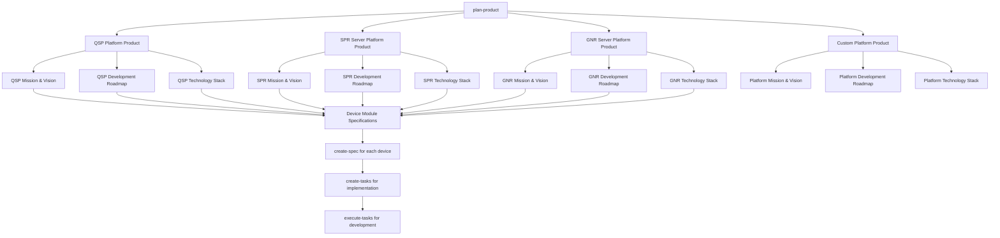
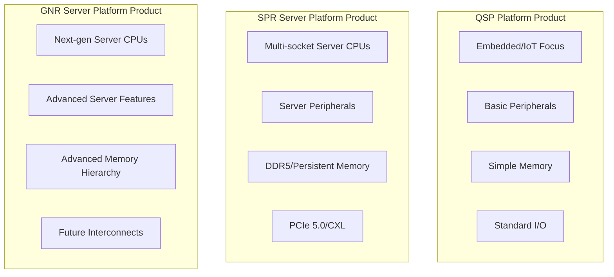
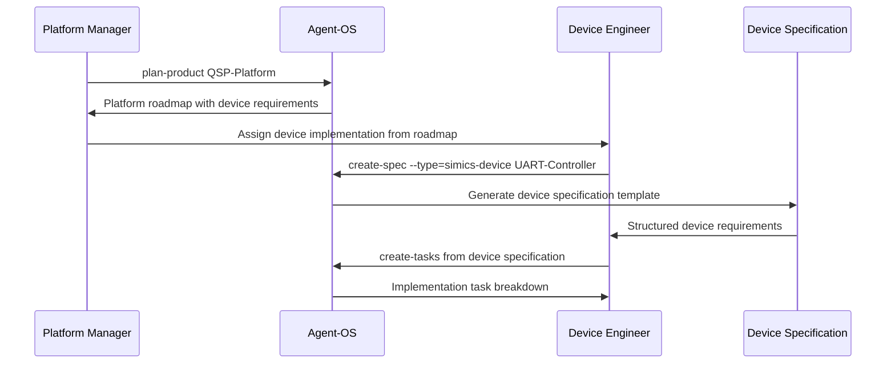
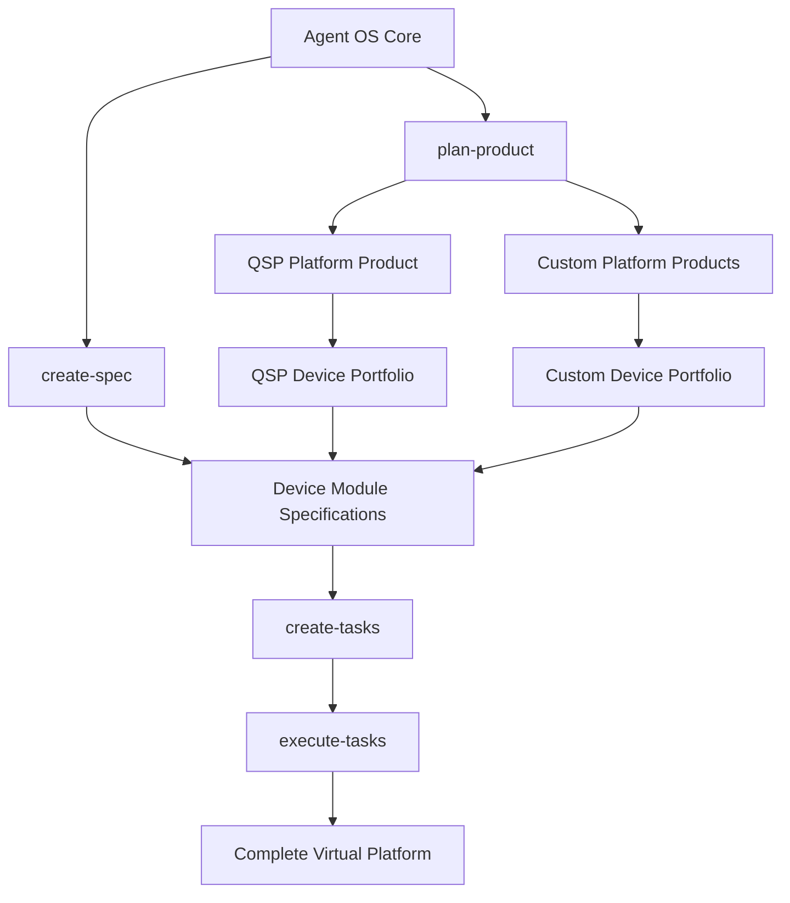
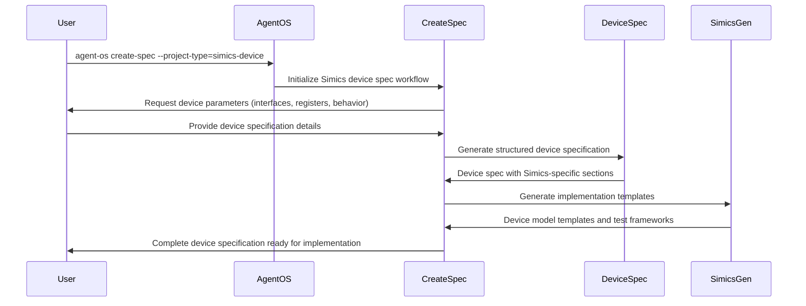
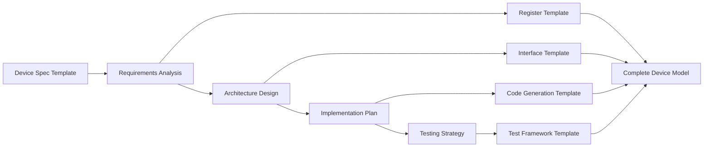
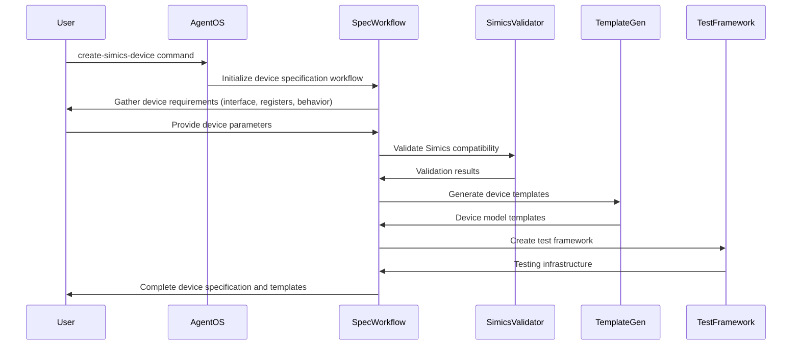

# Simics Integration Design

## Overview

This design document outlines the integration of Simics model development capabilities into agent-os, treating Simics as a platform and individual device modules as specifications. The integration leverages agent-os's existing workflow architecture to provide structured development processes for virtual platform creation, device modeling, and system simulation within the Simics ecosystem.

The Simics integration introduces specialized project types, commands, and instruction workflows that align with agent-os's established patterns while addressing the unique requirements of hardware modeling and simulation platform development. Each device module becomes a structured specification that follows agent-os's create-spec workflow, ensuring consistent documentation, implementation guidance, and testing requirements.

## Platform as Product Model

### Simics Platform Product Strategy

The Simics integration treats established platforms like QSP (Quick Start Platform) as products within agent-os, leveraging the plan-product workflow to establish comprehensive product documentation, roadmaps, and development strategies. This approach transforms platform development from ad-hoc activities into structured product management processes.



### Product Lifecycle Integration

Simics platforms follow agent-os's complete product lifecycle, from initial planning through feature development and maintenance:

| Workflow Stage | Simics Platform Application | Output Artifacts |
|----------------|----------------------------|------------------|
| plan-product | Define platform vision, target systems, device portfolio | Platform mission, roadmap, technical architecture |
| analyze-product | Assess existing platform state, device compatibility | Platform analysis, migration strategy |
| create-spec | Specify individual device modules and platform features | Device specifications, integration requirements |
| create-tasks | Break down device implementation and platform assembly | Implementation task lists, development milestones |
| execute-tasks | Implement device models and platform configurations | Working device models, integrated platforms |
| post-execution-tasks | Validate platform functionality, generate documentation | Test reports, platform documentation |

## Platform Product Planning

### QSP Platform Product Definition

Using the plan-product workflow, QSP (Quick Start Platform) is defined as a comprehensive product with clear mission, technical specifications, and development roadmap:

**Product Mission:**
"Provide a standardized, extensible virtual platform that enables rapid prototyping and validation of embedded systems, supporting common device interfaces and industry-standard configurations for accelerated development cycles."

**Product Vision:**
"Establish QSP as the reference platform for Simics-based development, offering comprehensive device coverage, robust testing capabilities, and seamless integration with development toolchains."

### SPR Server Platform Product Definition

SPR (Sapphire Rapids) server platform represents a high-performance server product targeting data center and enterprise computing scenarios:

**Product Mission:**
"Deliver a comprehensive virtual server platform based on Sapphire Rapids architecture, enabling validation and development of server workloads, system software, and hardware configurations in enterprise computing environments."

**Product Vision:**
"Establish SPR platform as the premier server simulation environment for enterprise software development, system validation, and performance analysis across diverse server computing scenarios."

**Server-Specific Characteristics:**
- Multi-socket CPU configurations with NUMA topology
- Advanced memory hierarchies including DDR5 and persistent memory
- High-speed I/O subsystems (PCIe 5.0, CXL)
- Server-class networking and storage interfaces
- Enterprise security features and manageability

### GNR Server Platform Product Definition

GNR (Granite Rapids) server platform represents next-generation server computing with advanced architectural features:

**Product Mission:**
"Provide cutting-edge virtual server platform based on Granite Rapids architecture, supporting next-generation server technologies and enabling early development of future enterprise computing solutions."

**Product Vision:**
"Position GNR platform as the leading-edge server simulation environment for next-generation software development, architectural exploration, and performance optimization in future server computing."

**Advanced Server Features:**
- Next-generation CPU microarchitecture simulation
- Enhanced memory subsystem with advanced caching
- Emerging interconnect technologies and protocols
- Advanced security and virtualization features
- AI/ML acceleration and specialized compute units

**Comparative Platform Architecture:**


### Platform Product Roadmap

The plan-product workflow generates structured roadmaps for each platform product, tailored to their specific focus areas and target use cases:

#### QSP Platform Roadmap
**Phase 1: Foundation (Months 1-3)**
- Core processor and memory subsystem implementation
- Basic I/O interface support (UART, GPIO)
- Platform configuration framework
- Initial testing and validation infrastructure

**Phase 2: Enhancement (Months 4-6)**
- Advanced peripheral support (SPI, I2C, USB)
- Network interface implementation
- Performance optimization and accuracy improvements
- Comprehensive test suite development

**Phase 3: Extension (Months 7-9)**
- Custom device integration framework
- Plugin architecture for third-party extensions
- Advanced debugging and analysis tools
- Documentation and tutorial development

**Phase 4: Optimization (Months 10-12)**
- Performance profiling and optimization
- Scalability improvements for complex systems
- Integration with external tools and frameworks
- Community support and maintenance processes

#### SPR Server Platform Roadmap
**Phase 1: Server Foundation (Months 1-4)**
- Multi-socket CPU topology implementation
- NUMA memory architecture modeling
- Basic server I/O subsystem (PCIe, SATA)
- Server management interface (BMC, IPMI)

**Phase 2: Advanced Features (Months 5-8)**
- DDR5 memory controller implementation
- PCIe 5.0 and CXL interface support
- Advanced interrupt handling (x2APIC, MSI-X)
- Server networking (10GbE, InfiniBand)

**Phase 3: Enterprise Integration (Months 9-12)**
- Virtualization support (VT-x, VT-d)
- Security features (TXT, SGX)
- Storage subsystem (NVMe, persistent memory)
- Performance monitoring and telemetry

**Phase 4: Validation & Optimization (Months 13-16)**
- Comprehensive server workload validation
- Performance benchmarking and optimization
- Enterprise software compatibility testing
- Production deployment preparation

#### GNR Server Platform Roadmap
**Phase 1: Next-Gen Architecture (Months 1-6)**
- Advanced CPU microarchitecture modeling
- Next-generation memory hierarchy implementation
- Emerging interconnect protocol support
- AI/ML acceleration unit integration

**Phase 2: Advanced Capabilities (Months 7-12)**
- Enhanced security and isolation features
- Advanced virtualization capabilities
- Specialized compute unit integration
- Future storage technology support

**Phase 3: Ecosystem Integration (Months 13-18)**
- Next-generation software stack compatibility
- Advanced toolchain integration
- Performance analysis and optimization tools
- Future technology validation framework

**Phase 4: Production Readiness (Months 19-24)**
- Comprehensive validation across use cases
- Performance and accuracy optimization
- Enterprise deployment preparation
- Long-term maintenance and support framework

### Custom Platform Product Planning

For custom platforms beyond QSP, SPR, and GNR, the plan-product workflow provides a comprehensive template for establishing new platform products:

**Platform Product Template:**
```yaml
platform_product:
  name: "Platform Name (QSP/SPR/GNR/Custom)"
  category: "embedded|server|specialized"
  mission: "Define the platform's core purpose and value proposition"
  vision: "Long-term goals and impact objectives"
  target_systems:
    - "Target system type 1"
    - "Target system type 2"
  architecture_class:
    qsp:
      focus: "Embedded/IoT development"
      complexity: "Low to Medium"
      target_users: "Embedded developers, IoT engineers"
    spr:
      focus: "Server/Data center validation"
      complexity: "High"
      target_users: "System architects, server developers"
    gnr:
      focus: "Next-generation server research"
      complexity: "Very High"
      target_users: "Architecture researchers, advanced developers"
  device_portfolio:
    core_devices:
      - "Essential device 1"
      - "Essential device 2"
    optional_devices:
      - "Optional device 1"
      - "Optional device 2"
  technical_stack:
    simics_version: "6.0+"
    modeling_accuracy: "functional|cycle-accurate|instruction-accurate"
    performance_targets:
      simulation_speed: "Platform-specific targets"
      memory_footprint: "Platform-specific limits"
  development_phases:
    - phase: "Foundation"
      duration: "Platform-specific duration"
      deliverables: ["Core devices", "Basic platform"]
    - phase: "Enhancement"
      duration: "Platform-specific duration"
      deliverables: ["Advanced features", "Testing framework"]
```

**Platform Comparison Matrix:**

| Aspect | QSP Platform | SPR Server Platform | GNR Server Platform |
|--------|--------------|-------------------|-------------------|
| **Primary Focus** | Embedded/IoT development | Current server validation | Next-gen server research |
| **Complexity Level** | Low-Medium | High | Very High |
| **CPU Architecture** | ARM/x86 embedded | Multi-socket Xeon | Advanced server CPU |
| **Memory Subsystem** | Basic DDR | DDR5/Persistent memory | Advanced memory hierarchy |
| **I/O Capabilities** | Standard peripherals | PCIe 5.0/CXL | Future interconnects |
| **Target Users** | Embedded developers | Server architects | Research teams |
| **Development Timeline** | 12 months | 16 months | 24 months |
| **Validation Scope** | Device functionality | Server workloads | Architecture exploration |
| **Performance Requirements** | Functional accuracy | High-performance simulation | Research-grade accuracy |

## Device Modules as Product Specifications

### From Platform Product to Device Specifications

Once a platform is defined as a product through plan-product, individual device modules are created as specifications using the create-spec workflow. This establishes a clear hierarchy from platform-level planning to device-level implementation:



### Specification-Driven Device Development

Each device module specification generated from platform product requirements includes:

**Device Specification Structure:**
- **Product Context**: Reference to parent platform product and integration requirements
- **Functional Requirements**: Device behavior, interface specifications, performance targets
- **Implementation Guidelines**: Simics API usage, coding standards, testing requirements
- **Integration Specifications**: Platform integration points, dependencies, configuration options
- **Validation Criteria**: Testing scenarios, acceptance criteria, performance benchmarks

**Example Device Specification Workflow:**
1. **Platform Product Definition**: QSP/SPR/GNR platform identifies need for specific device (e.g., UART controller for QSP, PCIe controller for SPR, AI accelerator for GNR)
2. **Specification Creation**: `create-spec --type=simics-device --platform=<QSP|SPR|GNR> <Device-Name>`
3. **Requirements Gathering**: Platform-specific interface specifications, register definitions, behavioral requirements
4. **Implementation Planning**: `create-tasks` breaks down specification into implementable tasks aligned with platform roadmap
5. **Development Execution**: `execute-tasks` implements device model according to specification and platform requirements
6. **Platform Integration**: Device integrated into target platform configuration (QSP/SPR/GNR)

**Platform-Specific Device Examples:**

| Platform | Device Examples | Complexity | Integration Requirements |
|----------|----------------|------------|-------------------------|
| **QSP** | UART, GPIO, SPI, I2C, Timer | Low-Medium | Standard peripheral bus integration |
| **SPR** | PCIe Controller, DDR5 Controller, CXL Interface, NUMA Node | High | Server topology integration, multi-socket coordination |
| **GNR** | AI Accelerator, Advanced Memory Controller, Future Interconnect | Very High | Next-gen architecture integration, research-level accuracy |


## Architecture

### Platform Integration Model

The Simics integration extends agent-os's platform architecture by introducing a two-tier approach: treating major Simics platforms (like QSP) as products using the plan-product workflow, and individual device modules as specifications using the create-spec workflow. This hierarchical structure aligns with agent-os's established patterns while addressing the unique requirements of virtual platform development.



### Component Architecture

The Simics integration introduces several specialized components that work within agent-os's existing framework:

| Component | Purpose | Implementation Approach |
|-----------|---------|------------------------|
| Simics Project Types | Domain-specific project configurations for different Simics development scenarios | New entries in config.yml defining custom instruction and standards paths |
| Device Module Specifications | Structured specifications for individual device models treated as agent-os specs | Enhanced create-spec workflow with Simics-specific templates |
| Simics Commands | High-level workflow entry points for Simics operations | Command files in commands/ directory following agent-os patterns |
| Simics Instructions | Detailed workflow implementations for device and platform development | Instruction files in instructions/core/ with Simics-specific processes |
| Model Templates | Reusable device and platform configuration templates | Template files in standards/ directory for consistent implementations |
| Simulation Subagents | Specialized task automation for Simics operations | Subagent definitions for code generation, testing, and validation |

### Device Module as Specification Model

Each Simics device module is treated as a specification within agent-os, following the established create-spec workflow pattern enhanced with Simics-specific requirements. This approach ensures structured documentation, implementation guidance, and testing requirements for device models.



## Technology Stack & Dependencies

### Core Simics Components

| Component | Version | Purpose |
|-----------|---------|----------|
| Simics Base | 6.x+ | Core simulation platform and APIs |
| Device Modeling Framework | Latest | Device model development toolkit |
| Simics Scripting API | Python 3.x | Automation and configuration scripting |
| Virtual Platform Tools | Latest | Platform assembly and configuration |

### Agent-OS Integration Points

| Integration Area | Implementation | Dependency |
|------------------|----------------|-------------|
| Project Types | config.yml extensions | Agent-OS core configuration system |
| Workflow Instructions | Simics-specific instruction files | Agent-OS instruction processing engine |
| Command Interface | Simics command definitions | Agent-OS CLI framework |
| Template System | Device and platform templates | Agent-OS standards and template system |

## Simics Project Types

### Project Type Definitions

The Simics integration introduces three primary project types that extend agent-os's existing project type system:

#### simics-device Project Type
Focused on individual device model development with emphasis on register modeling, interface implementation, and behavioral simulation.

**Configuration Structure:**
```yaml
project_types:
  simics-device:
    instructions: ~/.agent-os/simics/device-instructions
    standards: ~/.agent-os/simics/device-standards
    templates:
      - device-model-template
      - register-interface-template
      - test-framework-template
```

**Specialized Workflows:**
- Device specification creation with hardware interface definitions
- Register bank modeling and memory mapping
- Behavioral implementation with event-driven simulation
- Integration testing with virtual platforms

#### simics-platform Project Type
Designed for virtual platform assembly, system-level configuration, and multi-device integration scenarios.

**Configuration Structure:**
```yaml
project_types:
  simics-platform:
    instructions: ~/.agent-os/simics/platform-instructions
    standards: ~/.agent-os/simics/platform-standards
    templates:
      - platform-assembly-template
      - system-configuration-template
      - integration-test-template
```

**Specialized Workflows:**
- Platform architecture specification
- Device integration and interconnect modeling
- System-level configuration management
- Platform validation and testing

#### simics-simulation Project Type
Optimized for simulation environment setup, test scenario development, and automated testing frameworks.

**Configuration Structure:**
```yaml
project_types:
  simics-simulation:
    instructions: ~/.agent-os/simics/simulation-instructions
    standards: ~/.agent-os/simics/simulation-standards
    templates:
      - simulation-setup-template
      - test-scenario-template
      - automation-framework-template
```

**Specialized Workflows:**
- Simulation environment configuration
- Test scenario specification and implementation
- Automated testing pipeline setup
- Performance analysis and reporting

### Simics Commands Reference

#### Platform Product Commands

##### plan-simics-platform
**Purpose:** Initialize a new Simics platform as a product with comprehensive planning and roadmap development

**Usage Pattern:**
```
agent-os plan-product --project-type=simics-platform --platform-name=<name>
```

**Workflow Integration:**
- Triggers plan-product workflow with Simics platform template
- Generates platform mission, vision, and technical architecture
- Creates development roadmap with device implementation phases
- Establishes platform-level requirements and constraints

**Platform Product Outputs:**
- Platform mission and vision statements
- Technical architecture and device portfolio definition
- Development roadmap with milestone planning
- Resource requirements and team structure
- Integration testing and validation strategy

##### analyze-simics-platform
**Purpose:** Analyze existing Simics platform for agent-os integration and improvement opportunities

**Usage Pattern:**
```
agent-os analyze-product --project-type=simics-platform --platform-path=<path>
```

**Workflow Integration:**
- Analyzes existing platform configuration and device models
- Identifies improvement opportunities and standardization needs
- Generates migration strategy for agent-os integration
- Creates compatibility assessment and risk analysis

#### Device Specification Commands

#### create-simics-device
**Purpose:** Create a new Simics device model specification derived from platform product requirements

**Usage Pattern:**
```
agent-os create-spec --project-type=simics-device --device-name=<name> --platform=<platform-product>
```

**Workflow Integration:**
- References parent platform product for context and requirements
- Triggers create-spec workflow with Simics device template
- Generates device specification with hardware interface definitions
- Creates implementation templates aligned with platform architecture
- Sets up testing framework integrated with platform validation

**Parameters:**
| Parameter | Type | Description | Required |
|-----------|------|-------------|----------|
| device-name | String | Unique identifier for the device model | Yes |
| platform | String | Parent platform product name | Yes |
| interface-type | Enum | Primary interface (PCI, AHB, APB, Custom) | Yes |
| register-width | Integer | Default register width (8, 16, 32, 64 bits) | Yes |
| memory-mapped | Boolean | Whether device uses memory-mapped registers | No |
| interrupt-capable | Boolean | Whether device can generate interrupts | No |

#### model-device-interface
**Purpose:** Define and implement device interfaces and register banks within platform context

**Usage Pattern:**
```
agent-os create-tasks --spec=<device-spec> --focus=interface-modeling
```

**Workflow Integration:**
- Extends existing device specification with detailed interface definitions
- Generates register access methods and memory mapping aligned with platform
- Creates interface documentation and platform-integrated validation tests
- Updates device model implementation templates with platform compatibility

### Platform Assembly Commands

#### assemble-platform
**Purpose:** Assemble device specifications into complete platform implementation based on product roadmap

**Usage Pattern:**
```
agent-os execute-tasks --product=<platform-product> --phase=<development-phase>
```

**Workflow Integration:**
- Coordinates multiple device specifications according to platform product plan
- Implements platform configuration and device integration
- Generates platform assembly scripts and configuration files
- Creates integrated testing framework covering full platform functionality

#### validate-platform
**Purpose:** Execute comprehensive platform validation against product requirements

**Usage Pattern:**
```
agent-os post-execution-tasks --product=<platform-product> --validation-level=<level>
```

**Workflow Integration:**
- Validates completed platform against original product specifications
- Executes comprehensive testing scenarios defined in platform product
- Generates validation reports and compliance documentation
- Updates platform product documentation with actual implementation details

## Device Specification Framework

### Specification Structure

Device modules as specifications follow a structured format that extends agent-os's standard specification template with Simics-specific sections:

#### Core Specification Sections

| Section | Purpose | Simics Extensions |
|---------|---------|------------------|
| Overview | Device purpose and functionality | Hardware abstraction level, simulation accuracy |
| Architecture | System integration and interfaces | Register banks, memory mapping, interrupt handling |
| Implementation Details | Technical specifications | Simics API usage, event handling, state management |
| Testing Strategy | Validation and verification approach | Virtual platform integration, regression testing |

#### Simics-Specific Specification Elements

**Hardware Interface Definition:**
- Physical interface specifications (PCI, AHB, APB, custom)
- Memory mapping requirements and address space allocation
- Interrupt generation and handling capabilities
- Clock domain and timing requirements

**Register Bank Modeling:**
- Register layout and bit field definitions
- Access permissions and side effects
- Reset values and initialization sequences
- Register interdependencies and constraints

**Behavioral Implementation:**
- Functional behavior specification
- State machine definitions and transitions
- Event handling and callback mechanisms
- Performance characteristics and timing accuracy

**Integration Requirements:**
- Platform integration constraints
- Device dependencies and prerequisites
- Configuration parameters and options
- Debugging and diagnostic capabilities

### Template-Driven Development

The device specification framework utilizes template-driven development to ensure consistency and completeness across device models:



## Workflow Implementation

### Device Creation Workflow

The device creation workflow extends agent-os's create-spec process with Simics-specific steps and validations:



### Platform Assembly Workflow

The platform assembly workflow coordinates multiple device specifications into cohesive virtual platforms:

**Workflow Stages:**
1. **Platform Requirements Analysis** - Define system architecture and device requirements
2. **Device Integration Planning** - Specify device interconnections and dependencies
3. **Configuration Generation** - Create platform configuration scripts and parameters
4. **Integration Testing Setup** - Establish testing framework for platform validation
5. **Documentation Generation** - Produce comprehensive platform documentation

**Integration Points:**
- Device specification validation and compatibility checking
- Address space allocation and memory mapping coordination
- Interrupt routing and priority management
- Clock domain synchronization and timing analysis

### Testing and Validation Workflow

The testing workflow ensures device models and platforms meet functional and performance requirements:

**Testing Categories:**
- **Unit Testing** - Individual device model validation
- **Integration Testing** - Device interaction and platform-level testing
- **Regression Testing** - Automated testing for continuous validation
- **Performance Testing** - Simulation speed and accuracy measurement

**Validation Framework:**
- Automated test generation from device specifications
- Virtual platform test environment setup
- Continuous integration with agent-os testing infrastructure
- Performance benchmarking and analysis reporting

## Configuration Management

### Simics Project Configuration

The Simics integration extends agent-os's configuration system to support Simics-specific settings and project types:

**Configuration Structure:**
```yaml
# Enhanced config.yml for Simics integration
project_types:
  default:
    instructions: ~/.agent-os/instructions
    standards: ~/.agent-os/standards
  
  simics-device:
    instructions: ~/.agent-os/simics/device-instructions
    standards: ~/.agent-os/simics/device-standards
  
  simics-platform:
    instructions: ~/.agent-os/simics/platform-instructions
    standards: ~/.agent-os/simics/platform-standards
  
  simics-simulation:
    instructions: ~/.agent-os/simics/simulation-instructions
    standards: ~/.agent-os/simics/simulation-standards

default_project_type: default

simics:
  version: "6.0+"
  api_version: "latest"
  default_accuracy: "functional"
  enable_debugging: true
  performance_monitoring: true
```

### Standards and Best Practices

The Simics integration includes specialized standards that extend agent-os's existing best practices:

**Device Development Standards:**
- Consistent register naming conventions and bit field definitions
- Standardized interface implementation patterns
- Event handling and state management guidelines
- Performance optimization and simulation efficiency practices

**Platform Development Standards:**
- System architecture documentation requirements
- Device integration and interconnect specifications
- Configuration management and version control practices
- Testing and validation methodology standards

**Code Quality Standards:**
- Simics API usage patterns and best practices
- Error handling and debugging capabilities
- Documentation and inline commenting requirements
- Performance profiling and optimization guidelines