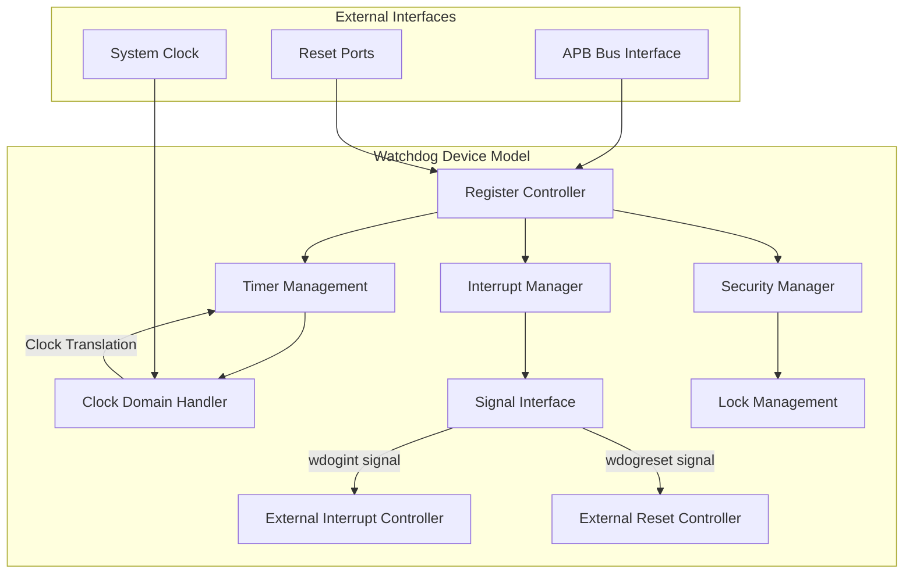
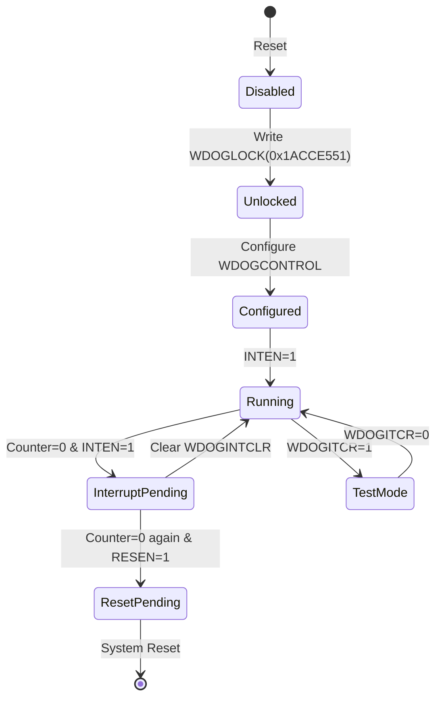
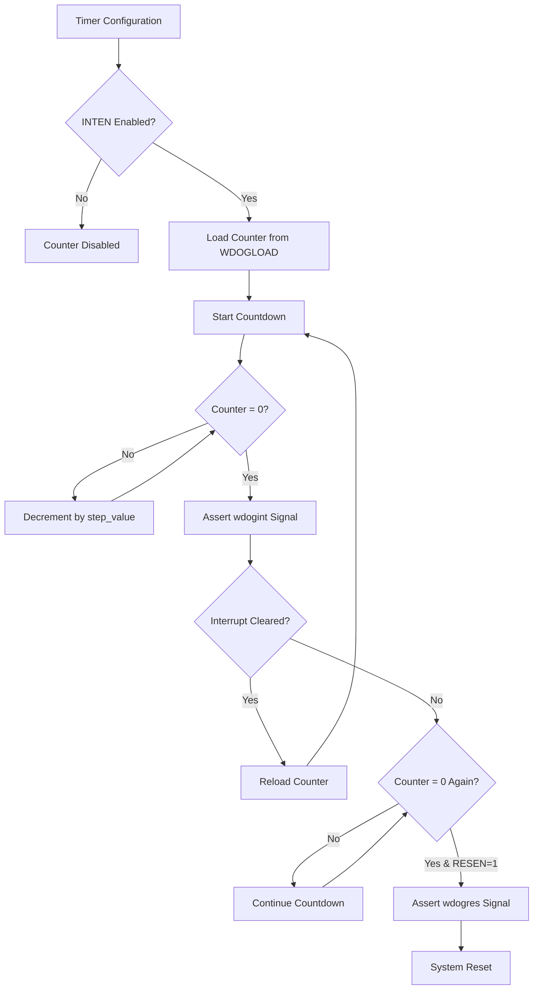

# Simics Watchdog Device Model Design

## Overview

This design document defines the strategic architecture for implementing a Simics watchdog device model (WDT) using DML 1.4, based on the CPU v3 project MSCP watchdog module specification. The model provides a configurable 32-bit down-counter with interrupt and reset capabilities, designed for system monitoring and failsafe operations in virtual platforms.

### Device Classification
- **Device Name**: Watchdog Timer (WDT)
- **Device Type**: System Timer/Watchdog
- **Platform**: Multi-platform (QSP/SPR/GNR/Custom)  
- **Interface**: APB (Advanced Peripheral Bus)
- **Register Width**: 32 bits
- **Memory Mapped**: Yes
- **Interrupt Capable**: Yes

### Core Value Proposition
The watchdog device model serves as a critical system safety component that monitors system health by providing configurable timeout detection with progressive escalation from interrupt notification to system reset. This ensures system reliability in embedded and server virtual platforms.

## Technology Stack & Dependencies

### Simics Framework Integration
- **DML Version**: 1.4 (Device Modeling Language)
- **Simics API**: Device modeling interfaces for register banks, interrupts, and clock domains
- **Signal Framework**: Simics signal interface for interrupt and reset connections
- **Checkpointing**: State persistence for simulation save/restore operations

### Clock Domain Architecture
- **System Clock Domain**: Primary system frequency (`sys_mhz` attribute)
- **Watchdog Clock Domain**: Independent watchdog timer frequency
- **Clock Translation**: Automatic conversion between system cycles and watchdog cycles

## Architecture

### Component Architecture

The watchdog device model consists of four primary architectural components working in coordination:

### Register Bank Architecture

The device implements a comprehensive register bank organized into functional groups:

| Address Range | Register Group | Purpose |
|---------------|----------------|---------|
| 0x000-0x014 | Core Registers | Timer control and status |
| 0xC00 | Security Register | Write access protection |
| 0xF00-0xF04 | Test Registers | Integration testing |
| 0xFD0-0xFEC | Peripheral ID | Device identification |
| 0xFF0-0xFFC | PrimeCell ID | Component identification |

### State Management Architecture

The device maintains state through a hierarchical state machine:

## Data Models & Register Specifications

### Core Timer Registers

#### WDOGLOAD Register (0x000)
| Field | Bits | Type | Reset | Description |
|-------|------|------|-------|-------------|
| wdog_load | 31:0 | R/W | 0xFFFFFFFF | Timer reload value in watchdog cycles |

#### WDOGVALUE Register (0x004)  
| Field | Bits | Type | Reset | Description |
|-------|------|------|-------|-------------|
| count_read | 31:0 | RO | 0xFFFFFFFF | Current counter value (read-only) |

#### WDOGCONTROL Register (0x008)
| Field | Bits | Type | Reset | Description |
|-------|------|------|-------|-------------|
| Reserved | 31:5 | - | - | Reserved bits |
| step_value | 4:2 | R/W | 3'b000 | Clock division configuration |
| RESEN | 1 | R/W | 1'b0 | Reset enable on second timeout |
| INTEN | 0 | R/W | 1'b0 | Interrupt enable and counter start |

### Status and Control Registers

#### WDOGINTCLR Register (0x00C)
| Field | Bits | Type | Reset | Description |
|-------|------|------|-------|-------------|
| intclr | 31:0 | WO | 0x00 | Write any value to clear interrupt and reload counter |

#### WDOGRIS Register (0x010)
| Field | Bits | Type | Reset | Description |
|-------|------|------|-------|-------------|
| Reserved | 31:1 | - | - | Reserved |
| raw_interrupt | 0 | RO | 1'b0 | Raw interrupt status before masking |

#### WDOGMIS Register (0x014)
| Field | Bits | Type | Reset | Description |
|-------|------|------|-------|-------------|
| Reserved | 31:1 | - | - | Reserved |
| masked_interrupt | 0 | RO | 1'b0 | Masked interrupt status (WDOGRIS & INTEN) |

### Security and Test Registers

#### WDOGLOCK Register (0xC00)
| Field | Bits | Type | Reset | Description |
|-------|------|------|-------|-------------|
| wdog_lock | 31:0 | R/W | 0x00000000 | Write 0x1ACCE551 to unlock, others to lock |

#### WDOGITCR Register (0xF00)
| Field | Bits | Type | Reset | Description |
|-------|------|------|-------|-------------|
| Reserved | 31:1 | - | - | Reserved |
| test_enable | 0 | R/W | 1'b0 | Integration test mode enable |

#### WDOGITOP Register (0xF04)
| Field | Bits | Type | Reset | Description |
|-------|------|------|-------|-------------|
| Reserved | 31:2 | - | - | Reserved |
| test_wdogint | 1 | WO | 1'b0 | Direct interrupt control in test mode |
| test_wdogres | 0 | WO | 1'b0 | Direct reset control in test mode |

## Business Logic Layer

### Timer Management Logic

The core timer functionality implements a sophisticated countdown mechanism with clock domain translation:

#### Clock Frequency Translation
The device supports different operating frequencies through the `step_value` configuration:

| step_value | Division Factor | Target Frequency |
|------------|----------------|------------------|
| 3'b000 | 1 | 1 GHz |
| 3'b001 | 2 | 500 MHz |
| 3'b010 | 4 | 250 MHz |
| 3'b011 | 8 | 125 MHz |
| 3'b100 | 16 | 62.5 MHz |

#### Counter Operation Flow

### Interrupt Management Logic

The interrupt system provides two-level interrupt handling with raw and masked interrupt status:

#### Interrupt Generation Strategy
- **Level 1**: Raw interrupt generation when counter reaches zero
- **Level 2**: Masked interrupt output based on INTEN configuration
- **Persistence**: Interrupt remains active until explicitly cleared
- **Escalation**: Second timeout triggers reset if RESEN enabled

### Security Management Logic

The lock mechanism protects critical registers from unauthorized modification:

#### Lock State Management
- **Unlocked State**: Write access enabled to all registers
- **Locked State**: Write access disabled except to WDOGLOCK
- **Unlock Sequence**: Write exact value 0x1ACCE551 to WDOGLOCK
- **Lock Sequence**: Write any other value to WDOGLOCK

## Signal Interface Architecture

### External Signal Connections

The device exposes standardized signal interfaces for system integration:

#### Interrupt Signal Interface
- **Signal Name**: `wdogint`
- **Interface Type**: `signal`
- **Direction**: Output
- **Behavior**: Level-triggered, active high
- **Connection**: External interrupt controller

#### Reset Signal Interface  
- **Signal Name**: `wdogintr_ws1_out`
- **Interface Type**: `signal`
- **Direction**: Output
- **Behavior**: Level-triggered, active high
- **Connection**: External reset controller

### Reset Port Architecture

The device implements multiple reset domains for different operational contexts:

| Port Name | Reset Type | Domain | Purpose |
|-----------|------------|--------|---------|
| WRESET | Warm Reset | Watchdog Domain | Watchdog-specific reset |
| PRESET | APB Reset | Bus Domain | APB bus interface reset |
| WDOGRESET | Module Reset | Device Domain | Complete device reset |

## Testing Strategy

### Unit Testing Framework

The testing strategy encompasses comprehensive validation of device functionality:

#### Register Access Validation
- **Read/Write Verification**: All register access patterns
- **Reset Value Validation**: Proper initialization values
- **Access Permission Testing**: Read-only and write-only restrictions
- **Reserved Bit Handling**: Proper treatment of undefined bits

#### Timer Functionality Testing
- **Counter Operation**: Proper countdown behavior
- **Clock Translation**: Accurate frequency conversion
- **Reload Mechanism**: Correct counter restoration
- **Timeout Detection**: Precise zero-value detection

#### Interrupt System Testing
- **Interrupt Generation**: Proper signal assertion
- **Interrupt Clearing**: Correct signal deassertion  
- **Masked vs Raw Status**: Proper status differentiation
- **Reset Escalation**: Second timeout reset behavior

#### Security Mechanism Testing
- **Lock Protection**: Register write protection
- **Unlock Sequence**: Proper unlock mechanism
- **Lock State Persistence**: State maintenance across operations

#### Integration Testing
- **Signal Interface Testing**: External connection validation
- **Reset Port Testing**: Multi-domain reset behavior
- **Clock Domain Testing**: Cross-domain timing validation
- **System Integration**: Platform-level interaction testing

### Test Implementation Strategy

The unit test framework leverages the existing test infrastructure at `test/unit-tests/watchdog/s-reset.py`, providing:

- **Automated Test Execution**: Scripted test case execution
- **Regression Testing**: Continuous validation during development
- **Coverage Analysis**: Comprehensive functionality coverage
- **Performance Validation**: Timing accuracy verification

## Configuration Parameters

### Device Attributes

The device exposes configurable attributes for platform integration:

| Attribute | Type | Default | Description |
|-----------|------|---------|-------------|
| sys_mhz | integer | 1000 | System frequency in MHz for clock translation |
| base_address | uint64 | 0x0 | Device base address in memory map |
| debug_enabled | boolean | false | Enable debug output and logging |

### Platform Integration Parameters

- **Memory Mapping**: Flexible base address configuration
- **Interrupt Routing**: Configurable interrupt target selection
- **Clock Domains**: Independent timer and system clock configuration
- **Reset Integration**: Multiple reset source handling

The design provides a robust, secure, and flexible watchdog device model that maintains compatibility with existing Simics infrastructure while delivering the comprehensive functionality required by the original specification.