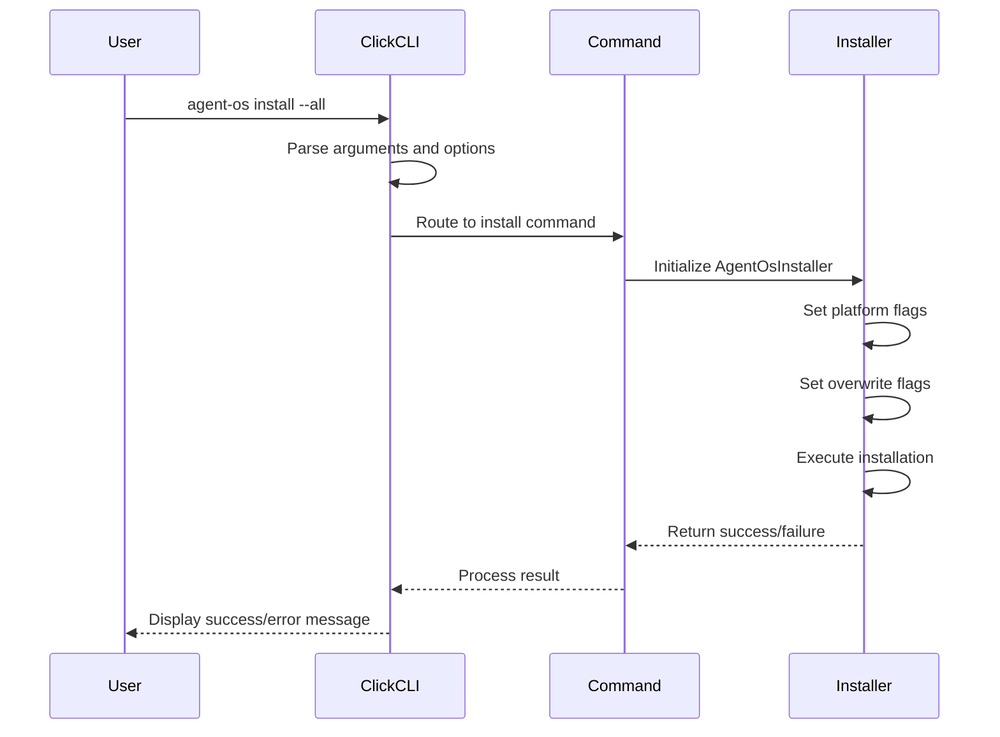

<docs>
# API Reference

<cite>
**Referenced Files in This Document**   
- [cli.py](file://src/cli.py)
- [installer.py](file://src/installer.py)
- [config.yml](file://config.yml)
- [pyproject.toml](file://pyproject.toml)
- [CHANGELOG.md](file://CHANGELOG.md)
- [SIMICS_INTEGRATION.md](file://SIMICS_INTEGRATION.md)
- [commands/analyze-simics-platform.md](file://commands/analyze-simics-platform.md)
- [simics/INTEGRATION_STATUS.md](file://simics/INTEGRATION_STATUS.md)
- [tests/test_simics_integration.py](file://tests/test_simics_integration.py)
</cite>

## Update Summary
**Changes Made**   
- Added comprehensive documentation for Simics integration commands and workflows
- Updated CLI Commands section with new Simics-related commands
- Enhanced Configuration Interface section with Simics-specific options
- Added new section for Simics Project Types and their usage
- Updated Versioning and Compatibility with Simics integration details
- Added protocol examples for Simics workflows

## Table of Contents
1. [Introduction](#introduction)
2. [CLI Commands](#cli-commands)
3. [Configuration Interface](#configuration-interface)
4. [Click Framework Implementation](#click-framework-implementation)
5. [Protocol-Specific Examples](#protocol-specific-examples)
6. [Error Handling and Exit Codes](#error-handling-and-exit-codes)
7. [Security Considerations](#security-considerations)
8. [CI/CD Integration Guidelines](#cicd-integration-guidelines)
9. [Versioning and Compatibility](#versioning-and-compatibility)
10. [Rate Limiting for Automated Usage](#rate-limiting-for-automated-usage)

## Introduction
Agent OS provides a comprehensive command-line interface for managing AI-assisted development workflows across multiple platforms including Claude Code, Cursor, GitHub Copilot, Qwen Code, and now Simics for virtual platform development. This API reference documents the public CLI commands, configuration interface, and integration patterns for automating Agent OS operations in development environments.

**Section sources**
- [cli.py](file://src/cli.py#L1-L187)
- [SIMICS_INTEGRATION.md](file://SIMICS_INTEGRATION.md#L1-L146)

## CLI Commands
Agent OS exposes three primary CLI commands for installation, information retrieval, and status checking. These commands are implemented using the Click framework and provide robust functionality for managing Agent OS installations. Additionally, new commands have been added to support Simics platform development.

### install Command
The `install` command deploys Agent OS in a project directory with configurable platform support.

**Invocation Syntax**
```
agent-os install [OPTIONS] [PROJECT_DIR]
```

**Parameters**
- `project_dir`: Target project directory (default: current directory)

**Options**
- `--claude-code`: Enable Claude Code support
- `--cursor`: Enable Cursor support
- `--github-copilot`: Enable GitHub Copilot support
- `--qwen-code`: Enable Qwen Code support
- `--adk`: Enable ADK (Agent Development Kit) support
- `--all`: Enable all platforms including ADK
- `--overwrite-instructions`: Overwrite existing instruction files
- `--overwrite-standards`: Overwrite existing standards files
- `--overwrite-config`: Overwrite existing config files

**Return Values**
- Exit code 0: Successful installation
- Exit code 1: Installation failure or error

**Usage Examples**
```bash
# Install with all platforms in current directory
agent-os install --all

# Install specific platforms in a project
agent-os install /path/to/project --claude-code --cursor

# Install with overwrite flags
agent-os install --adk --overwrite-instructions --overwrite-standards
```

**Section sources**
- [cli.py](file://src/cli.py#L45-L140)
- [installer.py](file://src/installer.py#L63-L151)

### info Command
The `info` command displays Agent OS information and available platforms.

**Invocation Syntax**
```
agent-os info
```

**Functionality**
- Shows Agent OS version and information
- Lists all available platforms with descriptions
- Displays directory structures for each platform
- Provides usage examples for installation

**Return Values**
- Exit code 0: Successful execution
- Exit code 1: Unexpected error

**Usage Examples**
```bash
# Display Agent OS information
agent-os info
```

**Section sources**
- [cli.py](file://src/cli.py#L142-L168)

### status Command
The `status` command checks Agent OS installation status in a project directory.

**Invocation Syntax**
```
agent-os status PROJECT_DIR
```

**Parameters**
- `project_dir`: Project directory to check (must exist)

**Functionality**
- Checks for platform-specific directories
- Reports installation status for each platform
- Displays paths for all platform directories

**Return Values**
- Exit code 0: Successful execution
- Exit code 1: Directory does not exist or unexpected error

**Usage Examples**
```bash
# Check status in current project
agent-os status .

# Check status in specific project
agent-os status /path/to/project
```

**Section sources**
- [cli.py](file://src/cli.py#L170-L187)

### Simics-Specific Commands
The Simics integration introduces several new commands for virtual platform development, device modeling, and simulation.

#### plan-simics-platform Command
Creates a comprehensive plan for a Simics virtual platform product.

**Invocation Syntax**
```
agent-os plan-simics-platform [OPTIONS]
```

**Options**
- `--platform-name`: Name of the platform (qsp, spr, gnr, or custom)
- `--mission`: Platform mission statement
- `--roadmap`: Development roadmap
- `--device-portfolio`: List of devices to include

**Functionality**
- Creates platform product directory structure
- Generates mission, roadmap, and technical specifications
- Establishes device portfolio for the platform
- Sets up configuration for platform development

**Usage Examples**
```bash
# Plan QSP platform
agent-os plan-simics-platform --platform-name=qsp --mission="Embedded IoT development platform"

# Plan custom server platform
agent-os plan-simics-platform --platform-name=custom-server --device-portfolio="PCIe,DDR5,CXL"
```

**Section sources**
- [SIMICS_INTEGRATION.md](file://SIMICS_INTEGRATION.md#L1-L146)
- [commands/plan-simics-platform.md](file://commands/plan-simics-platform.md)

#### create-simics-device Command
Creates a specification for a Simics device model.

**Invocation Syntax**
```
agent-os create-simics-device [OPTIONS]
```

**Options**
- `--platform`: Target platform (qsp, spr, gnr)
- `--device-name`: Name of the device to create
- `--complexity`: Device complexity level
- `--interface-spec`: Interface specification details

**Functionality**
- Creates device specification with register modeling
- Generates implementation and testing sub-specifications
- Sets up behavioral simulation requirements
- Integrates with platform device portfolio

**Usage Examples**
```bash
# Create UART controller for QSP platform
agent-os create-simics-device --platform=qsp --device-name=uart-controller

# Create PCIe controller for SPR platform
agent-os create-simics-device --platform=spr --device-name=pcie-controller --complexity=high
```

**Section sources**
- [SIMICS_INTEGRATION.md](file://SIMICS_INTEGRATION.md#L1-L146)
- [commands/create-simics-device.md](file://commands/create-simics-device.md)

#### analyze-simics-platform Command
Analyzes existing Simics platforms for integration and improvement opportunities.

**Invocation Syntax**
```
agent-os analyze-simics-platform [OPTIONS]
```

**Options**
- `--platform`: Platform to analyze
- `--assessment-type`: Type of assessment (integration, performance, compatibility)
- `--output-format`: Output format for analysis results

**Functionality**
- Evaluates platform architecture and components
- Identifies integration opportunities with agent-os
- Assesses performance characteristics and bottlenecks
- Recommends improvements and optimizations

**Usage Examples**
```bash
# Analyze QSP platform for integration
agent-os analyze-simics-platform --platform=qsp --assessment-type=integration

# Analyze SPR platform for performance
agent-os analyze-simics-platform --platform=spr --assessment-type=performance
```

**Section sources**
- [commands/analyze-simics-platform.md](file://commands/analyze-simics-platform.md)
- [SIMICS_INTEGRATION.md](file://SIMICS_INTEGRATION.md#L1-L146)

#### assemble-platform Command
Integrates devices into a complete virtual platform.

**Invocation Syntax**
```
agent-os assemble-platform [OPTIONS]
```

**Options**
- `--product`: Target platform product
- `--phase`: Assembly phase (foundation, integration, validation)
- `--devices`: Specific devices to include

**Functionality**
- Integrates device models into platform topology
- Configures system-level parameters and connections
- Resolves device compatibility issues
- Prepares platform for validation

**Usage Examples**
```bash
# Assemble foundation phase of QSP platform
agent-os assemble-platform --product=qsp --phase=foundation

# Assemble complete platform with specific devices
agent-os assemble-platform --product=qsp --devices="uart,gpio,timer"
```

**Section sources**
- [commands/assemble-platform.md](file://commands/assemble-platform.md)
- [SIMICS_INTEGRATION.md](file://SIMICS_INTEGRATION.md#L1-L146)

#### validate-platform Command
Executes comprehensive validation of a virtual platform.

**Invocation Syntax**
```
agent-os validate-platform [OPTIONS]
```

**Options**
- `--product`: Platform product to validate
- `--validation-type`: Type of validation (functional, performance, stress)
- `--test-suite`: Specific test suite to run

**Functionality**
- Runs functional verification tests
- Performs performance benchmarking
- Executes stress and corner case testing
- Generates validation reports

**Usage Examples**
```bash
# Validate QSP platform functionality
agent-os validate-platform --product=qsp --validation-type=functional

# Run performance validation on SPR platform
agent-os validate-platform --product=spr --validation-type=performance
```

**Section sources**
- [commands/validate-platform.md](file://commands/validate-platform.md)
- [SIMICS_INTEGRATION.md](file://SIMICS_INTEGRATION.md#L1-L146)

#### model-device-interface Command
Creates detailed interface models for Simics devices.

**Invocation Syntax**
```
agent-os model-device-interface [OPTIONS]
```

**Options**
- `--spec`: Device specification to model
- `--interface-type`: Type of interface (register, memory, interrupt)
- `--timing-accuracy`: Timing accuracy level

**Functionality**
- Models register interfaces with bitfield definitions
- Specifies memory-mapped I/O regions
- Defines interrupt and DMA channels
- Documents timing and synchronization requirements

**Usage Examples**
```bash
# Model interface for UART controller
agent-os model-device-interface --spec=uart-controller --interface-type=register

# Model memory interface for PCIe controller
agent-os model-device-interface --spec=pcie-controller --interface-type=memory
```

**Section sources**
- [commands/model-device-interface.md](file://commands/model-device-interface.md)
- [SIMICS_INTEGRATION.md](file://SIMICS_INTEGRATION.md#L1-L146)

## Configuration Interface
The configuration interface is exposed through the `config.yml` file, which controls Agent OS behavior and platform settings. The Simics integration extends this configuration with specialized options.

### Configuration Options
The following options are available in the configuration file:

**agent_os_version**
- **Type**: String
- **Default**: "1.4.1"
- **Effect**: Tracks the installed version of Agent OS

**agents**
- **Type**: Nested mapping
- **Default**: All platforms disabled
- **Sub-options**:
  - `claude_code.enabled`: Boolean, default false
  - `cursor.enabled`: Boolean, default false
  - `github_copilot.enabled`: Boolean, default false
  - `qwen_code.enabled`: Boolean, default false
- **Effect**: Controls which AI coding platforms are enabled

**project_types**
- **Type**: Nested mapping
- **Default**: Single "default" type
- **Structure**:
  - `instructions`: Path to instruction files
  - `standards`: Path to standards files
- **Effect**: Defines different project configurations for various project types

**default_project_type**
- **Type**: String
- **Default**: "default"
- **Effect**: Specifies the default project type for new installations

### Simics Configuration Options
The Simics integration adds specialized configuration options:

**simics.version**
- **Type**: String
- **Default**: "6.0+"
- **Effect**: Specifies the minimum Simics version required

**simics.api_version**
- **Type**: String
- **Default**: "latest"
- **Effect**: Specifies the Simics API version to use

**simics.default_accuracy**
- **Type**: String
- **Default**: "functional"
- **Effect**: Sets the default simulation accuracy level

**simics.enable_debugging**
- **Type**: Boolean
- **Default**: true
- **Effect**: Enables debugging capabilities in Simics environment

**simics.performance_monitoring**
- **Type**: Boolean
- **Default**: true
- **Effect**: Enables performance monitoring and profiling

### Configuration File Structure
```yaml
# Agent OS Configuration
agent_os_version: 1.4.1

agents:
  claude_code:
    enabled: false
  cursor:
    enabled: false
  github_copilot:
    enabled: false
  qwen_code:
    enabled: false

project_types:
  default:
    instructions: ~/.agent-os/instructions
    standards: ~/.agent-os/standards
  simics-device:
    instructions: ~/.agent-os/simics/device-instructions  
    standards: ~/.agent-os/simics/device-standards
  simics-platform:
    instructions: ~/.agent-os/simics/platform-instructions
    standards: ~/.agent-os/simics/platform-standards
  simics-simulation:
    instructions: ~/.agent-os/simics/simulation-instructions
    standards: ~/.agent-os/simics/simulation-standards

default_project_type: default

# Simics-specific configuration
simics:
  version: "6.0+"
  api_version: "latest"
  default_accuracy: "functional"
  enable_debugging: true
  performance_monitoring: true
```

**Section sources**
- [config.yml](file://config.yml#L1-L32)
- [SIMICS_INTEGRATION.md](file://SIMICS_INTEGRATION.md#L1-L146)

## Click Framework Implementation
The Click framework in `src/cli.py` implements command routing and argument parsing for the Agent OS CLI.

### Command Routing
Click decorators define the command structure:
- `@click.group()` creates the main CLI group
- `@cli.command()` decorates individual commands
- `@click.argument()` defines positional arguments
- `@click.option()` defines optional flags

### Argument Parsing
The implementation uses Click's type system and validation:
- `click.Path()` for file/directory path handling
- `is_flag=True` for boolean options
- `type=click.Path(exists=True, file_okay=False, dir_okay=True)` for validated directory arguments
- Default values and help text for all options

### Error Handling
The framework integrates with Python's exception handling:
- Try-except blocks wrap command execution
- Specific exception handling for keyboard interrupts
- Generic exception handling with error reporting
- System exit codes for different error conditions



**Diagram sources**
- [cli.py](file://src/cli.py#L1-L187)
- [installer.py](file://src/installer.py#L1-L155)

**Section sources**
- [cli.py](file://src/cli.py#L1-L187)

## Protocol-Specific Examples
The following examples demonstrate programmatic interaction with Agent OS through shell scripts, including Simics-specific workflows.

### Automated Installation Script
```bash
#!/bin/bash
# Automated Agent OS installation script

PROJECT_DIR="./my-project"
PLATFORMS="--claude-code --cursor --github-copilot"

echo "Creating project directory..."
mkdir -p "$PROJECT_DIR"
cd "$PROJECT_DIR"

echo "Installing Agent OS..."
agent-os install "$PROJECT_DIR" $PLATFORMS --overwrite-instructions --overwrite-standards

if [ $? -eq 0 ]; then
    echo "Agent OS installed successfully!"
    agent-os status "$PROJECT_DIR"
else
    echo "Agent OS installation failed!"
    exit 1
fi
```

### Simics Platform Workflow Script
```bash
#!/bin/bash
# Complete Simics platform development workflow

PLATFORM_NAME="qsp-iot"
DEVICE_NAME="uart-controller"

echo "Planning Simics platform..."
agent-os plan-simics-platform --platform-name=$PLATFORM_NAME --mission="IoT development platform"

echo "Creating device specification..."
agent-os create-simics-device --platform=qsp --device-name=$DEVICE_NAME

echo "Modeling device interface..."
agent-os model-device-interface --spec=$DEVICE_NAME --interface-type=register

echo "Creating implementation tasks..."
agent-os create-tasks --spec=$DEVICE_NAME

echo "Executing device implementation..."
agent-os execute-tasks --spec=$DEVICE_NAME

echo "Assembling platform foundation..."
agent-os assemble-platform --product=$PLATFORM_NAME --phase=foundation

echo "Validating platform functionality..."
agent-os validate-platform --product=$PLATFORM_NAME --validation-type=functional
```

### Batch Project Setup with Simics
```bash
#!/bin/bash
# Setup multiple Simics projects

PROJECTS=("simics-device-project" "simics-platform-project" "simics-simulation-project")
BASE_OPTIONS="--all --overwrite-instructions"

for project in "${PROJECTS[@]}"; do
    echo "Setting up $project..."
    mkdir -p "$project"
    cd "$project"
    
    # Install base Agent OS
    agent-os install . $BASE_OPTIONS
    
    # Configure for Simics development
    if [[ "$project" == *"device"* ]]; then
        echo "Configuring for Simics device development"
        # Add device-specific setup
    elif [[ "$project" == *"platform"* ]]; then
        echo "Configuring for Simics platform development"
        # Add platform-specific setup
    fi
    
    if [ $? -eq 0 ]; then
        echo "✓ $project setup complete"
    else
        echo "✗ $project setup failed"
    fi
    
    cd ..
done
```

### Simics Integration Status Check
```bash
#!/bin/bash
# Verify Simics integration status

check_simics_integration() {
    local root_dir=$1
    echo "=== Simics Integration Status ==="
    
    # Check Simics directory structure
    if [ -d "$root_dir/simics" ]; then
        echo "✓ Simics directory found"
        
        # Check required subdirectories
        local required_dirs=("device-instructions" "platform-instructions" "simulation-instructions" "device-standards" "platform-standards" "simulation-standards")
        for dir in "${required_dirs[@]}"; do
            if [ -d "$root_dir/simics/$dir" ]; then
                echo "✓ $dir directory found"
            else
                echo "✗ $dir directory missing"
            fi
        done
    else
        echo "✗ Simics directory not found"
        return 1
    fi
    
    # Check Simics commands
    local simics_commands=("plan-simics-platform.md" "create-simics-device.md" "analyze-simics-platform.md" "assemble-platform.md" "validate-platform.md" "model-device-interface.md")
    local commands_dir="$root_dir/commands"
    
    for cmd in "${simics_commands[@]}"; do
        if [ -f "$commands_dir/$cmd" ]; then
            echo "✓ $cmd found"
        else
            echo "✗ $cmd missing"
        fi
    done
}

# Check current directory
check_simics_integration "."
```

**Section sources**
- [cli.py](file://src/cli.py#L45-L187)
- [SIMICS_INTEGRATION.md](file://SIMICS_INTEGRATION.md#L1-L146)
- [simics/INTEGRATION_STATUS.md](file://simics/INTEGRATION_STATUS.md#L1-L136)

## Error Handling and Exit Codes
Agent OS implements comprehensive error handling with standardized exit codes.

### Exit Codes
- **0**: Success - Command completed successfully
- **1**: Failure - Command failed due to error or exception
- **2**: Usage Error - Invalid command usage or arguments

### Error Handling Strategies
The system employs multiple error handling mechanisms:

**CLI-Level Error Handling**
- Try-except blocks in the main function
- Keyboard interrupt handling (Ctrl+C)
- Generic exception catching with error reporting
- System exit calls with appropriate codes

**Installation Error Handling**
- Try-except around installation process
- Detailed error messages for installation failures
- Graceful degradation when source files are missing
- Warning messages for non-critical issues

**Input Validation**
- Click framework validates argument types
- Path existence checks for status command
- Flag validation for platform selection
- Default values for optional parameters

### Error Recovery
The system follows these recovery patterns:
- Atomic operations where possible
- Clear error messages with context
- Partial success reporting when applicable
- Recommendations for resolving common issues

**Section sources**
- [cli.py](file://src/cli.py#L1-L187)
- [installer.py](file://src/installer.py#L1-L155)

## Security Considerations
When handling configuration files with sensitive data, consider the following security practices.

### Configuration File Security
- Store `config.yml` in secure locations
- Use file permissions to restrict access (600)
- Avoid committing sensitive configuration to version control
- Use environment variables for highly sensitive data

### Sensitive Data Handling
- The current configuration does not store credentials
- Platform-specific configurations may contain sensitive data
- Use encrypted storage for API keys or authentication tokens
- Implement secure credential management practices

### Best Practices
- Regularly audit configuration files for sensitive information
- Use configuration management tools for enterprise deployments
- Implement backup and recovery procedures for configuration
- Monitor configuration changes in production environments

**Section sources**
- [config.yml](file://config.yml#L1-L32)

## CI/CD Integration Guidelines
The following guidelines help integrate Agent OS into CI/CD pipelines.

### Pipeline Integration
**GitHub Actions Example**
```yaml
name: Setup Agent OS
on: [push]
jobs:
  setup:
    runs-on: ubuntu-latest
    steps:
    - uses: actions/checkout@v3
    
    - name: Install Agent OS
      run: |
        pip install agent-os
        agent-os install . --all --overwrite-instructions
        
    - name: Verify Installation
      run: agent-os status .
```

**GitLab CI Example**
```yaml
stages:
  - setup

agent-os-setup:
  stage: setup
  image: python:3.9
  before_script:
    - pip install agent-os
  script:
    - agent-os install . --all --overwrite-standards
    - agent-os status .
```

### Simics Workflow in CI/CD
```yaml
name: Simics Platform Development
on: [push]
jobs:
  simics-dev:
    runs-on: ubuntu-latest
    steps:
    - uses: actions/checkout@v3
    
    - name: Install Agent OS
      run: |
        pip install agent-os
        
    - name: Plan Simics Platform
      run: |
        agent-os plan-simics-platform --platform-name=qsp --mission="IoT development"
        
    - name: Create Device Specification
      run: |
        agent-os create-simics-device --platform=qsp --device-name=uart-controller
        
    - name: Assemble Platform
      run: |
        agent-os assemble-platform --product=qsp --phase=foundation
        
    - name: Validate Platform
      run: |
        agent-os validate-platform --product=qsp --validation-type=functional
```

### Implementation Best Practices
- Install Agent OS early in the pipeline
- Use consistent platform flags across environments
- Cache Agent OS installation when possible
- Validate installation status before proceeding
- Handle installation failures gracefully

### Automation Considerations
- Use non-interactive mode for automated environments
- Capture and log installation output
- Implement retry logic for transient failures
- Monitor installation performance
- Test configuration changes in staging first

**Section sources**
- [cli.py](file://src/cli.py#L1-L187)
- [SIMICS_INTEGRATION.md](file://SIMICS_INTEGRATION.md#L1-L146)

## Versioning and Compatibility
Versioning information and backward compatibility notes are provided below.

### Version Information
From `pyproject.toml`:
- **Current Version**: 1.0.0
- **Python Requirements**: >=3.8
- **Dependencies**:
  - requests>=2.25.0
  - pyyaml>=5.4.0
  - click>=8.0.0
  - rich>=10.0.0

### Backward Compatibility Notes
Based on `CHANGELOG.md`:

**Version 1.5.0 (2025-09-10)**
- Added GitHub Copilot and Qwen Code platform support
- Enhanced base installation to support all four platforms
- Added `--all` flag for installing all platform support
- **Added Simics integration** with specialized commands for virtual platform development
- **Introduced new project types**: simics-device, simics-platform, simics-simulation
- **Added Simics-specific configuration options** in config.yml
- **Integrated Simics workflows** with existing agent-os CLI and workflow engine

**Version 1.4.2 (2025-