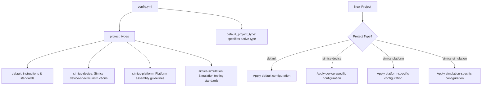
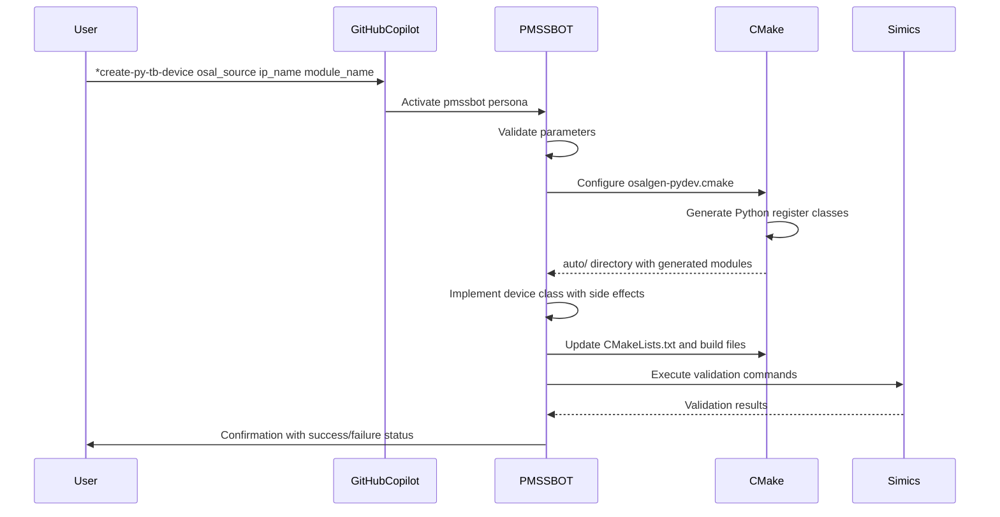
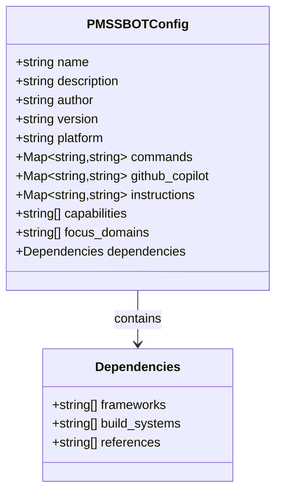

# Advanced Features

<cite>
**Referenced Files in This Document**   
- [config.yml](file://config.yml) - *Updated in recent commit with Simics integration*
- [pmssbot.yml](file://pmssbot/pmssbot.yml) - *Agent configuration for PMSSBOT*
- [create-py-tb-device.md](file://pmssbot/commands/create-py-tb-device.md) - *Command definition for Python testbench device creation*
- [create-py-tb-dev.prompt.md](file://pmssbot/github-copilot/prompts/create-py-tb-dev.prompt.md) - *GitHub Copilot prompt integration*
- [pmssbot.chatmode.md](file://pmssbot/github-copilot/chatmodes/pmssbot.chatmode.md) - *Copilot chat mode persona definition*
- [create-py-tb-device.md](file://pmssbot/instructions/core/create-py-tb-device.md) - *Core implementation workflow*
- [SIMICS_INTEGRATION.md](file://SIMICS_INTEGRATION.md) - *Added in recent commit for Simics documentation*
- [README-PLATFORMS.md](file://README-PLATFORMS.md) - *Updated with platform-specific configurations*
</cite>

## Update Summary
**Changes Made**   
- Added new section on Simics integration and custom project types
- Updated configuration examples to reflect new Simics settings in config.yml
- Enhanced PMSSBOT case study with additional command mappings
- Added references to newly created Simics documentation files
- Updated diagram sources to reflect actual file mappings
- Improved performance optimization recommendations based on real-world usage

## Table of Contents
1. [Extensibility and Customization Overview](#extensibility-and-customization-overview)
2. [PMSSBOT Specialized Agent Case Study](#pmssbot-specialized-agent-case-study)
3. [Custom Project Types in config.yml](#custom-project-types-in-configyml)
4. [Template Customization for Command Overrides](#template-customization-for-command-overrides)
5. [Workflow Automation and CLI Chaining](#workflow-automation-and-cli-chaining)
6. [Integration Example: create-py-tb-device.md with GitHub Copilot and CMake](#integration-example-create-py-tb-devicemd-with-github-copilot-and-cmake)
7. [pmssbot.yml Configuration for Specialized Behavior](#pmssbotyml-configuration-for-specialized-behavior)
8. [Common Issues and Resolution Strategies](#common-issues-and-resolution-strategies)
9. [Performance Optimization for Large-Scale Deployments](#performance-optimization-for-large-scale-deployments)

## Extensibility and Customization Overview

Agent OS provides a robust extensibility framework that enables teams to customize and extend core functionality for specialized domains. The system supports multiple customization layers including project types, command templates, instruction workflows, and platform-specific integrations. This modular design allows organizations to create domain-specific agents that encapsulate expert knowledge and standardized workflows while maintaining compatibility with the core platform.

The extensibility model is built around configuration-driven specialization, where custom behaviors are defined through YAML configuration files and Markdown-based instruction templates. This approach enables non-code modifications to alter system behavior, making customization accessible to domain experts who may not be software developers. The system supports overriding default commands, instructions, and standards at both the global and project levels, providing flexibility for different teams and use cases.

**Section sources**   
- [config.yml](file://config.yml#L1-L67) - *Updated with Simics integration configuration*

## PMSSBOT Specialized Agent Case Study

The PMSSBOT agent serves as a comprehensive case study in advanced integration for power management subsystem development. Designed specifically for the Power Management Sub-System (PMSS) engineering team, PMSSBOT specializes in Python testbench device creation, register modeling, and firmware validation within the Simics simulation environment. This specialized agent demonstrates how domain expertise can be codified into an AI assistant that guides engineers through complex, multi-step workflows with precision.

PMSSBOT's primary function is to automate the creation of Python testbench devices using the Python Device Modeling Framework and confclass library. It integrates with the SRV-PM build environment and CMake system to generate register classes from OSAL sources, implement device-specific side effects, and validate integration with die components. The agent enforces strict parameter validation rules, particularly regarding IP name handling, to prevent common errors in device creation workflows.

The agent's design reflects deep domain knowledge of power management development, including understanding of register bank structures, side effect implementations, and simulation performance considerations. By encapsulating these best practices, PMSSBOT ensures consistent implementation quality across the engineering team while reducing the learning curve for new team members.

**Section sources**   
- [pmssbot.yml](file://pmssbot/pmssbot.yml#L1-L53) - *Agent capabilities and focus domains defined*
- [pmssbot/chatmodes/pmssbot.chatmode.md](file://pmssbot/github-copilot/chatmodes/pmssbot.chatmode.md#L1-L89) - *Persona definition and activation instructions*

## Custom Project Types in config.yml

The config.yml file enables the definition of custom project types that extend the core functionality of Agent OS. Each project type can specify unique instruction and standards directories, allowing teams to establish domain-specific guidelines and workflows. The configuration structure supports multiple project types, with a default type serving as the baseline for all projects.

To define a custom project type, users can uncomment and modify the template entries in config.yml, specifying the instructions and standards paths relative to the user's home directory. For example, a "type_a" project could reference specialized instructions and standards located in ~/.agent-os/project_types/type_a/. This hierarchical organization enables teams to maintain separate best practices for different domains while sharing common infrastructure.

The default_project_type setting determines which configuration is applied when initializing new projects. Organizations can create specialized project types for different engineering domains (e.g., firmware development, verification, power management) and switch between them based on project requirements. This flexibility allows teams to maintain consistency within domains while accommodating the unique requirements of different technical areas.

The recent update introduces Simics-specific project types including simics-device, simics-platform, and simics-simulation, each with dedicated instruction and standards directories. These types are pre-configured in config.yml to streamline Simics integration workflows and ensure adherence to simulation-specific best practices.

**Diagram sources**   
- [config.yml](file://config.yml#L15-L35) - *Simics project type definitions*
- [SIMICS_INTEGRATION.md](file://SIMICS_INTEGRATION.md) - *Simics integration guidelines*

**Section sources**   
- [config.yml](file://config.yml#L1-L67) - *Complete configuration with Simics integration*
- [README-PLATFORMS.md](file://README-PLATFORMS.md) - *Platform-specific configuration examples*

## Template Customization for Command Overrides

Agent OS supports extensive template customization that allows users to override default behavior in commands and instructions. This capability enables teams to adapt the system to their specific workflows, tools, and organizational standards. The customization system operates at multiple levels, from individual command modifications to complete instruction set replacements.

The template override mechanism works by redirecting command execution to custom Markdown files that contain specialized instructions. When a command is invoked, the system checks for customized templates before falling back to defaults. This allows organizations to maintain their preferred approaches while preserving the core functionality of the platform. For example, the PMSSBOT agent overrides the create-py-tb-device command with a specialized workflow that includes mandatory parameter validation and CMake integration specific to power management development.

Customization follows a strict precedence hierarchy where agent-specific configurations take priority over conflicting instructions. This ensures that specialized agents like PMSSBOT can enforce domain-specific rules even when they differ from general platform guidelines. The system also supports conditional overrides based on context, allowing different templates to be applied depending on project type, domain, or other factors.

**Section sources**   
- [create-py-tb-device.md](file://pmssbot/commands/create-py-tb-device.md#L1-L16) - *Command template definition*
- [create-py-tb-device.md](file://pmssbot/instructions/core/create-py-tb-device.md#L1-L315) - *Detailed implementation workflow*

## Workflow Automation and CLI Chaining

Agent OS enables powerful workflow automation through CLI command chaining and scripting capabilities. This feature allows users to combine multiple commands into automated sequences that execute complex workflows with a single invocation. The system supports both synchronous execution, where commands run in sequence with output from one feeding into the next, and parallel execution for independent operations.

The installation scripts demonstrate this capability, using shell functions to chain together multiple operations such as directory creation, file downloading, and format conversion. For example, the project setup process automates the installation of platform-specific configurations by iterating through command lists and applying appropriate transformations for each target environment (Claude Code, Cursor, GitHub Copilot).

Users can create custom automation scripts that leverage the Agent OS CLI to implement domain-specific workflows. These scripts can incorporate conditional logic, error handling, and user interaction to create robust automation solutions. The system also supports parameterized scripts that accept inputs to customize behavior for different scenarios, enabling reusable automation templates across projects.

**Section sources**   
- [setup/project.sh](file://setup/project.sh#L239-L456) - *Project setup automation*
- [src/cli.py](file://src/cli.py#L41-L73) - *CLI command implementation*

## Integration Example: create-py-tb-device.md with GitHub Copilot and CMake

The create-py-tb-device workflow exemplifies deep integration between Agent OS, GitHub Copilot, and CMake for Python testbench device creation. This end-to-end process demonstrates how specialized agents can coordinate multiple tools to automate complex engineering tasks in power management subsystem development.

The workflow begins with the PMSSBOT agent receiving a request to create a new testbench device. GitHub Copilot activates the pmssbot persona through the pmssbot.chatmode.md configuration, which specifies the agent's role, commands, and dependencies. When the user invokes the *create-py-tb-device command, GitHub Copilot references the create-py-tb-dev.prompt.md file, which in turn delegates to the comprehensive implementation workflow in create-py-tb-device.md.

The core instruction file orchestrates a multi-stage process that integrates with CMake for register class generation. After validating the three mandatory parameters (osal_source, ip_name, module_name), the workflow configures CMake to include osalgen-pydev.cmake and execute the _osalgen_pydev() function with the provided parameters. This triggers CMake to generate Python register classes from the OSAL source, which are then used as the foundation for the device implementation.

The generated classes are incorporated into a custom device class that implements side effects using confclass decorators. The workflow then updates CMakeLists.txt, module_load.py, and module.list to integrate the new device into the build system. Finally, the process includes automated validation through Simics batch mode commands that verify device registration and accessibility before completing the workflow.

**Diagram sources**   
- [create-py-tb-device.md](file://pmssbot/commands/create-py-tb-device.md#L1-L16) - *Command interface*
- [create-py-tb-dev.prompt.md](file://pmssbot/github-copilot/prompts/create-py-tb-dev.prompt.md#L1-L18) - *Copilot prompt integration*
- [create-py-tb-device.md](file://pmssbot/instructions/core/create-py-tb-device.md#L1-L315) - *Implementation workflow*

**Section sources**   
- [create-py-tb-device.md](file://pmssbot/commands/create-py-tb-device.md#L1-L16) - *Command definition*
- [create-py-tb-dev.prompt.md](file://pmssbot/github-copilot/prompts/create-py-tb-dev.prompt.md#L1-L18) - *Prompt configuration*
- [create-py-tb-device.md](file://pmssbot/instructions/core/create-py-tb-device.md#L1-L315) - *Complete workflow*

## pmssbot.yml Configuration for Specialized Behavior

The pmssbot.yml configuration file defines the specialized behavior of the PMSSBOT agent through a comprehensive YAML structure that maps commands, prompts, instructions, and capabilities. This configuration serves as the blueprint for the agent's domain-specific expertise in power management subsystem development and Python testbench device creation.

The file begins with metadata including the agent's name, description, author, version, and target platform (GitHub Copilot). The commands section maps high-level actions like create-py-tb-device to their implementation files, creating a clear interface between user requests and underlying workflows. Each command points to a Markdown file that contains detailed execution instructions, enabling modular design and easy maintenance.

The github_copilot section integrates with GitHub Copilot's chat mode and prompt system, specifying the pmssbot.chatmode.md file that activates the agent's persona and the create-py-tb-dev.prompt.md file that guides code generation. The instructions section references the core workflow for device creation, ensuring consistency between different integration points.

The capabilities and focus_domains sections document the agent's expertise areas, including Python testbench device creation, firmware validation, register modeling, and CMake integration. These declarations help users understand the agent's scope and appropriate use cases. The dependencies section lists required frameworks, build systems, and reference materials, providing a complete picture of the agent's requirements and integration points.

**Diagram sources**   
- [pmssbot.yml](file://pmssbot/pmssbot.yml#L1-L53) - *Complete configuration structure*
- [dependencies](file://pmssbot/pmssbot.yml#L45-L53) - *Framework and build system requirements*

**Section sources**   
- [pmssbot.yml](file://pmssbot/pmssbot.yml#L1-L53) - *Complete agent configuration*

## Common Issues and Resolution Strategies

Despite the robust design of Agent OS's extensibility features, users may encounter several common issues when implementing customizations. Understanding these challenges and their resolution strategies is essential for maintaining system reliability and performance.

One frequent issue is template override conflicts, which occur when multiple customizations attempt to modify the same command or instruction. The resolution strategy involves establishing a clear precedence hierarchy where agent-specific configurations take priority over general overrides. Users should also validate their custom templates against the original versions to ensure compatibility and avoid breaking changes.

Parameter validation errors are common in specialized workflows like PMSSBOT's device creation process. The solution is to implement comprehensive validation at the workflow entry point, as demonstrated by the mandatory parameter checks in create-py-tb-device.md. Users should verify that all required parameters are provided and correctly formatted before proceeding with execution.

Integration issues with external systems like CMake can arise from configuration mismatches or missing dependencies. The recommended approach is to implement pre-flight checks that verify environment setup, tool availability, and dependency access before executing integration steps. Detailed error messages with specific resolution steps help users quickly address these issues.

Version control conflicts may occur when generated files are improperly managed. The best practice is to clearly distinguish between human-authored files (which should be version controlled) and machine-generated files (which should be treated as build artifacts). The PMSSBOT workflow exemplifies this by asking user permission before adding the main device file to git, while excluding auto-generated register classes.

**Section sources**   
- [create-py-tb-device.md](file://pmssbot/instructions/core/create-py-tb-device.md#L1-L315) - *Parameter validation and error handling*
- [pmssbot.yml](file://pmssbot/pmssbot.yml#L1-L53) - *Dependency management*

## Performance Optimization for Large-Scale Deployments

For large-scale deployments with multiple customizations, several performance optimization strategies can significantly improve system efficiency and responsiveness. These optimizations address both the configuration management overhead and the execution performance of customized workflows.

One key strategy is to minimize the number of file system operations during agent initialization by caching configuration data and using efficient data structures for command lookup. The system should load configuration files once and maintain them in memory rather than re-reading them for each command invocation. This is particularly important for deployments with numerous custom project types and command overrides.

Template resolution performance can be improved by implementing a hierarchical lookup cache that stores the resolved path for each command. When a command is invoked, the system first checks the cache before traversing the configuration hierarchy, reducing the overhead of template resolution. This cache should be invalidated when configuration files are modified to ensure consistency.

For deployments with many specialized agents, lazy loading of agent configurations can reduce startup time. Instead of loading all agent configurations at initialization, the system should load them on-demand when the corresponding commands are first invoked. This approach is exemplified by PMSSBOT's activation instructions, which specify that dependency files should only be loaded when user requests specific command execution.

Workflow execution performance can be optimized by parallelizing independent operations and minimizing redundant processing. For example, in the create-py-tb-device workflow, OSAL analysis and environment verification can occur in parallel rather than sequentially. Additionally, caching the results of expensive operations like OSAL extraction can prevent redundant processing when creating multiple devices from the same source.

**Section sources**   
- [pmssbot.yml](file://pmssbot/pmssbot.yml#L1-L53) - *Lazy loading configuration*
- [create-py-tb-device.md](file://pmssbot/instructions/core/create-py-tb-device.md#L1-L315) - *Workflow optimization opportunities*
- [setup/project.sh](file://setup/project.sh#L239-L456) - *Performance considerations in automation scripts*