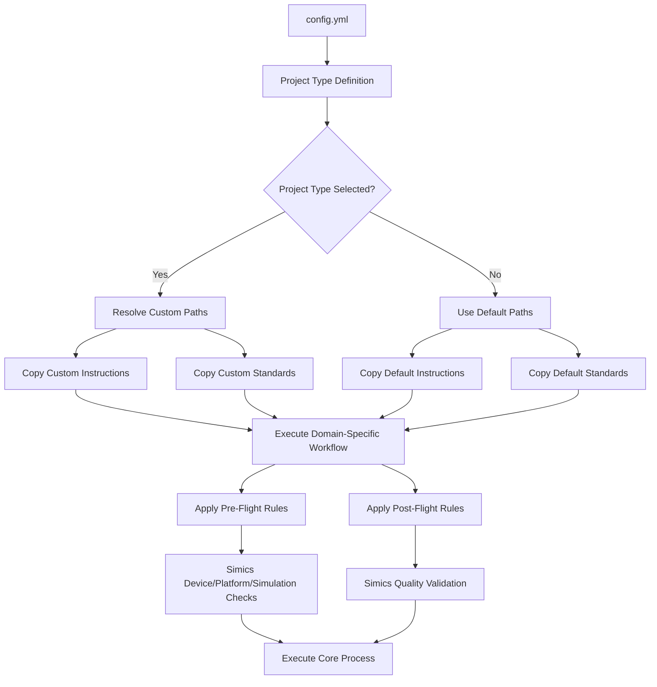
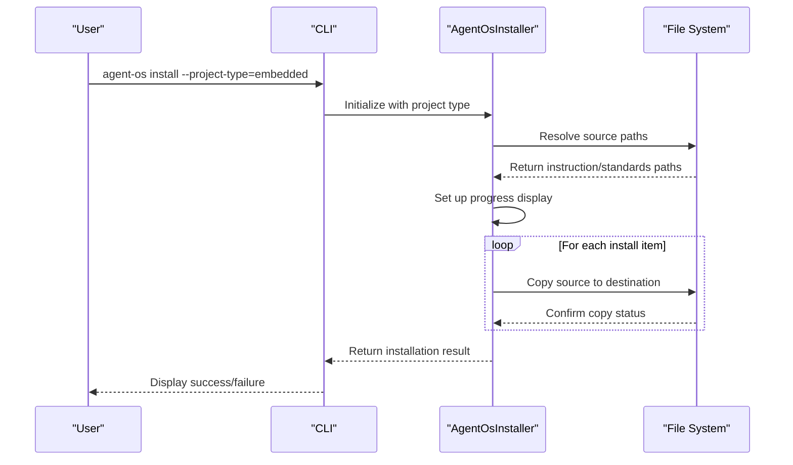
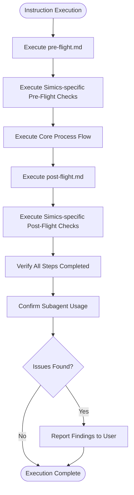
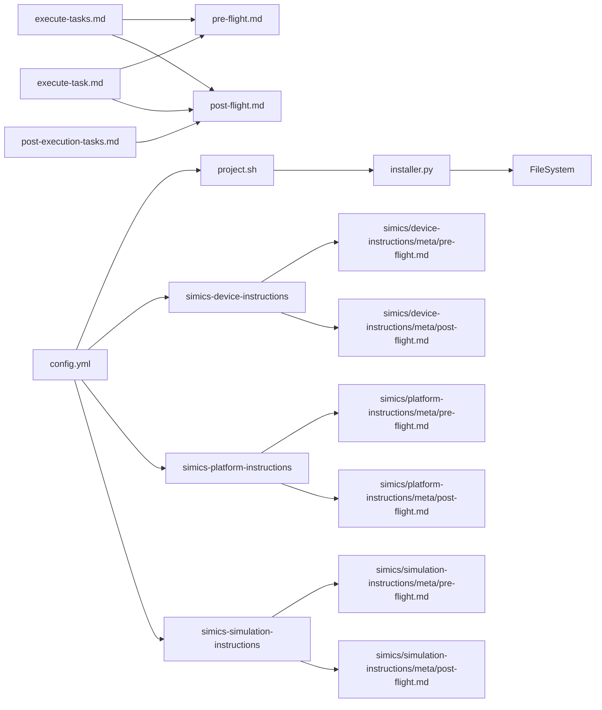

# Custom Project Types

<cite>
**Referenced Files in This Document**   
- [config.yml](file://config.yml) - *Updated with Simics project types in commit 7c66d17*
- [installer.py](file://src/installer.py)
- [pre-flight.md](file://instructions/meta/pre-flight.md)
- [post-flight.md](file://instructions/meta/post-flight.md)
- [execute-tasks.md](file://instructions/core/execute-tasks.md)
- [execute-task.md](file://instructions/core/execute-task.md)
- [post-execution-tasks.md](file://instructions/core/post-execution-tasks.md)
- [project.sh](file://setup/project.sh)
- [CHANGELOG.md](file://CHANGELOG.md)
- [SIMICS_INTEGRATION.md](file://SIMICS_INTEGRATION.md) - *Added in commit 7c66d17*
- [simics/device-instructions/meta/pre-flight.md](file://simics/device-instructions/meta/pre-flight.md) - *Added in commit 7c66d17*
- [simics/device-instructions/meta/post-flight.md](file://simics/device-instructions/meta/post-flight.md) - *Added in commit 7c66d17*
- [simics/platform-instructions/meta/pre-flight.md](file://simics/platform-instructions/meta/pre-flight.md) - *Added in commit 7c66d17*
- [simics/platform-instructions/meta/post-flight.md](file://simics/platform-instructions/meta/post-flight.md) - *Added in commit 7c66d17*
- [simics/simulation-instructions/meta/pre-flight.md](file://simics/simulation-instructions/meta/pre-flight.md) - *Added in commit 7c66d17*
- [simics/simulation-instructions/meta/post-flight.md](file://simics/simulation-instructions/meta/post-flight.md) - *Added in commit 7c66d17*
</cite>

## Update Summary
**Changes Made**   
- Added comprehensive documentation for Simics integration project types
- Updated project type configuration structure with new Simics-specific types
- Enhanced meta-instruction analysis with domain-specific pre-flight and post-flight checks
- Added new architecture diagram reflecting Simics integration
- Updated dependency analysis to include Simics-specific components
- Expanded troubleshooting guidance for Simics project types

## Table of Contents
1. [Introduction](#introduction)
2. [Project Type Configuration Structure](#project-type-configuration-structure)
3. [Core Components](#core-components)
4. [Architecture Overview](#architecture-overview)
5. [Detailed Component Analysis](#detailed-component-analysis)
6. [Dependency Analysis](#dependency-analysis)
7. [Performance Considerations](#performance-considerations)
8. [Troubleshooting Guide](#troubleshooting-guide)
9. [Conclusion](#conclusion)

## Introduction
Custom project types in Agent OS provide a powerful extensibility mechanism that enables developers to define domain-specific workflows for different project categories such as embedded systems, web applications, or machine learning projects. By configuring project types in the `config.yml` file, teams can customize instruction sets, coding standards, and execution behaviors tailored to specific technical domains. This documentation details how the system reads and applies these configurations through the installer module, how pre-flight and post-flight meta-instructions control workflow execution, and how custom project types influence core commands like `agent-os install`. The implementation supports flexible path definitions using tilde expansion and provides fallback mechanisms when custom configurations are unavailable. With the recent addition of Simics integration, three new specialized project types have been introduced: `simics-device`, `simics-platform`, and `simics-simulation`, each designed for specific aspects of virtual platform development.

## Project Type Configuration Structure

The project type system is defined in the `config.yml` configuration file, where each project type specifies custom instruction and standards directories. The default project type points to the core Agent OS directories, while additional types can be defined with custom paths. Project types are referenced during installation via the `--project-type` flag or set as default through the `default_project_type` field. The configuration supports tilde (`~`) expansion for home directory references and allows project-specific instruction sets to override the default behavior. When a project type is specified, the installer and setup scripts resolve the appropriate source paths for instructions and standards based on the configuration. The recent update introduces three Simics-specific project types that provide specialized workflows for device modeling, platform assembly, and simulation testing.

**Section sources**
- [config.yml](file://config.yml#L19-L31)
- [project.sh](file://setup/project.sh#L182-L208)
- [SIMICS_INTEGRATION.md](file://SIMICS_INTEGRATION.md#L54-L70) - *Added in commit 7c66d17*

## Core Components

The custom project type functionality relies on several core components working in concert. The `AgentOsInstaller` class in `installer.py` manages the installation process, copying files from source to target directories based on project type configuration. The `project.sh` script handles shell-based installation logic, including project type resolution and path determination. Meta-instructions in the `instructions/meta/` directory define pre-flight and post-flight behaviors that are consistently applied across all project types. The system integrates with core execution workflows through instruction files like `execute-tasks.md` and `execute-task.md`, which reference the meta-instructions via the `@` path syntax. The configuration system allows for both explicit project type selection during installation and default type assignment through the configuration file. For Simics integration, specialized meta-instructions have been added in the `simics/device-instructions/meta/`, `simics/platform-instructions/meta/`, and `simics/simulation-instructions/meta/` directories to handle domain-specific setup and validation requirements.

**Section sources**
- [installer.py](file://src/installer.py#L25-L151)
- [project.sh](file://setup/project.sh#L148-L186)
- [execute-tasks.md](file://instructions/core/execute-tasks.md#L0-L47)
- [execute-task.md](file://instructions/core/execute-task.md#L0-L46)
- [simics/device-instructions/meta/pre-flight.md](file://simics/device-instructions/meta/pre-flight.md#L0-L18) - *Added in commit 7c66d17*
- [simics/device-instructions/meta/post-flight.md](file://simics/device-instructions/meta/post-flight.md#L0-L18) - *Added in commit 7c66d17*

## Architecture Overview

The custom project type architecture follows a configuration-driven installation pattern where the `config.yml` file serves as the central definition point for all available project types. During installation, the system resolves the appropriate project type based on command-line arguments or default configuration, then determines the source paths for instructions and standards. The installer module copies these resources to the target project directory, enabling domain-specific workflows. The architecture maintains separation between core functionality and project-specific customizations, allowing teams to maintain multiple project type configurations without modifying the base Agent OS installation. Meta-instructions provide consistent pre and post execution behaviors across all project types, ensuring standardized workflow execution regardless of the specific domain configuration. The recent Simics integration extends this architecture with three specialized project types that follow the same pattern but with domain-specific instructions and standards.

**Diagram sources**
- [config.yml](file://config.yml#L19-L31)
- [installer.py](file://src/installer.py#L112-L142)
- [project.sh](file://setup/project.sh#L182-L208)
- [simics/device-instructions/meta/pre-flight.md](file://simics/device-instructions/meta/pre-flight.md#L0-L18) - *Added in commit 7c66d17*
- [simics/device-instructions/meta/post-flight.md](file://simics/device-instructions/meta/post-flight.md#L0-L18) - *Added in commit 7c66d17*

## Detailed Component Analysis

### Project Type Configuration Analysis
The project type configuration in `config.yml` defines a mapping between project type names and their associated instruction and standards directories. Each project type entry contains two key fields: `instructions` and `standards`, which specify the file system paths to the respective resources. The default project type uses the core Agent OS directories, while additional types can be uncommented and customized as needed. The configuration supports tilde expansion, allowing paths to reference user home directories. This structure enables teams to maintain multiple project type configurations in separate directories, facilitating domain-specific customization without modifying the base installation. The recent update adds three Simics-specific project types: `simics-device` for individual device model development, `simics-platform` for virtual platform assembly, and `simics-simulation` for simulation environment setup and automated testing.

**Section sources**
- [config.yml](file://config.yml#L19-L31)
- [SIMICS_INTEGRATION.md](file://SIMICS_INTEGRATION.md#L54-L70) - *Added in commit 7c66d17*

### Installer Module Analysis
The `AgentOsInstaller` class in `installer.py` implements the core installation logic that respects project type configurations. While the installer itself doesn't directly parse project types, it provides the mechanism for copying instruction and standards directories from source to target locations. The installation process is controlled by platform flags that determine which components to install, and the source paths for these components are determined by external scripts like `project.sh` based on the selected project type. The installer uses recursive directory copying with overwrite protection, ensuring that project-specific configurations are properly deployed while preserving existing project files when configured to do so.

**Diagram sources**
- [installer.py](file://src/installer.py#L63-L151)
- [cli.py](file://src/cli.py#L41-L73)

### Meta-Instruction System Analysis
The meta-instruction system provides consistent pre-flight and post-flight behaviors across all project types through dedicated instruction files. The `pre-flight.md` file defines rules that must be followed before executing any task, including subagent delegation requirements and sequential processing of XML blocks. The `post-flight.md` file establishes verification procedures that ensure all steps were executed correctly and that subagents were properly utilized. These meta-instructions are referenced in core workflow files using the `@` syntax, creating a consistent execution framework that applies regardless of the specific project type. For Simics integration, specialized meta-instructions have been added that include domain-specific validation steps. The `simics-device` pre-flight checks verify Simics installation and device development environment setup, while the post-flight checks validate device specification completeness and testing framework establishment. Similarly, `simics-platform` and `simics-simulation` have their own specialized pre-flight and post-flight checks tailored to platform assembly and simulation testing requirements.

**Diagram sources**
- [pre-flight.md](file://instructions/meta/pre-flight.md#L0-L19)
- [post-flight.md](file://instructions/meta/post-flight.md#L0-L17)
- [execute-tasks.md](file://instructions/core/execute-tasks.md#L182-L187)
- [simics/device-instructions/meta/pre-flight.md](file://simics/device-instructions/meta/pre-flight.md#L0-L18) - *Added in commit 7c66d17*
- [simics/device-instructions/meta/post-flight.md](file://simics/device-instructions/meta/post-flight.md#L0-L18) - *Added in commit 7c66d17*

## Dependency Analysis

The custom project type system has a well-defined dependency structure that separates configuration from implementation. The primary dependencies flow from the configuration file to the installation scripts, which then determine the resources copied by the installer module. The `project.sh` script depends on the `config.yml` file to resolve project type paths, while the `installer.py` module depends on the resolved paths to perform file operations. The core instruction files depend on the meta-instructions for consistent execution behavior, creating a hierarchical dependency structure. The system is designed to fail gracefully when custom project type paths are unavailable, falling back to default configurations to ensure installation can proceed even with configuration errors. The Simics integration introduces additional dependencies, with the `simics-device`, `simics-platform`, and `simics-simulation` project types depending on their respective instruction and standards directories. These specialized project types also depend on the Simics-specific meta-instructions for domain-specific validation and quality assurance.

**Diagram sources**
- [config.yml](file://config.yml#L19-L31)
- [project.sh](file://setup/project.sh#L182-L208)
- [installer.py](file://src/installer.py#L112-L142)
- [execute-tasks.md](file://instructions/core/execute-tasks.md#L182-L187)
- [simics/device-instructions/meta/pre-flight.md](file://simics/device-instructions/meta/pre-flight.md#L0-L18) - *Added in commit 7c66d17*
- [simics/device-instructions/meta/post-flight.md](file://simics/device-instructions/meta/post-flight.md#L0-L18) - *Added in commit 7c66d17*

## Performance Considerations

When managing multiple project types at scale, several performance considerations emerge. The file copying operations during installation represent the primary performance bottleneck, particularly when dealing with large instruction and standards directories. The current implementation processes installation items sequentially, which could be optimized through parallel file operations. Path resolution for project types involves multiple file system checks and text processing operations, which can add overhead when working with numerous project types. In team environments, organizing configuration files effectively becomes critical—centralized management of project type definitions can reduce duplication and improve consistency, while distributed configurations offer greater flexibility at the cost of increased maintenance overhead. The system's fallback mechanism to default configurations ensures reliability but may mask configuration issues in large-scale deployments. With the addition of Simics project types, the performance impact of managing multiple specialized project types should be considered, particularly when teams are working on complex platform products that require coordination between device, platform, and simulation projects.

## Troubleshooting Guide

Common issues with custom project types typically involve configuration syntax errors and path resolution problems. Syntax errors in `config.yml` can prevent project type definitions from being parsed correctly—ensure proper indentation and YAML formatting, particularly when defining custom project types. Path resolution issues often occur when using tilde (`~`) in paths; verify that the paths expand correctly to absolute locations and that the referenced directories exist. Inheritance conflicts may arise when multiple project types define overlapping instruction sets; the system does not support inheritance between project types, so each type must be fully self-contained. If a custom project type fails to load, check that the `PROJECT_TYPE` environment variable or command-line argument matches exactly with the configuration, as the matching is case-sensitive. When troubleshooting Simics project types, additional considerations apply: verify that the Simics-specific meta-instructions are properly configured in their respective directories, ensure that the Simics environment variables are set correctly, and confirm that the platform product documentation is accessible. Check that the `default_project_type` in `config.yml` is correctly set and that the referenced directories contain the expected instruction and standards files.

**Section sources**
- [config.yml](file://config.yml#L19-L31)
- [project.sh](file://setup/project.sh#L182-L208)
- [CHANGELOG.md](file://CHANGELOG.md#L111-L125)
- [SIMICS_INTEGRATION.md](file://SIMICS_INTEGRATION.md#L54-L70) - *Added in commit 7c66d17*

## Conclusion

Custom project types in Agent OS provide a flexible framework for tailoring development workflows to specific domains through configuration-driven customization. By defining project types in `config.yml`, teams can create specialized environments for different technical domains while maintaining consistency through shared meta-instructions. The system integrates seamlessly with the core installation process, allowing domain-specific instructions and standards to be deployed alongside the base Agent OS functionality. The architecture supports both explicit project type selection and default type assignment, providing flexibility for individual developers and teams alike. With the recent addition of Simics integration, three specialized project types have been introduced—`simics-device`, `simics-platform`, and `simics-simulation`—each with domain-specific meta-instructions for pre-flight and post-flight validation. With proper organization and attention to configuration details, custom project types enable efficient workflow customization at scale, making Agent OS adaptable to a wide range of development scenarios.