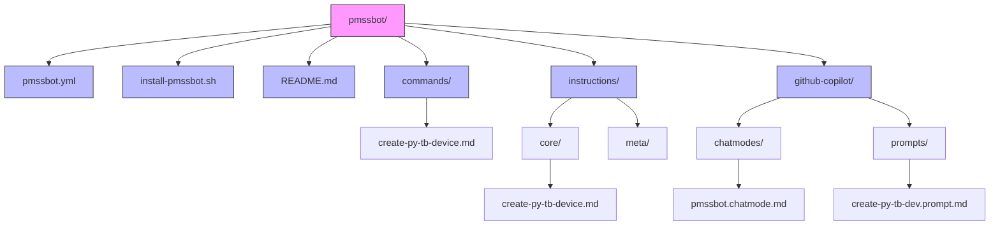
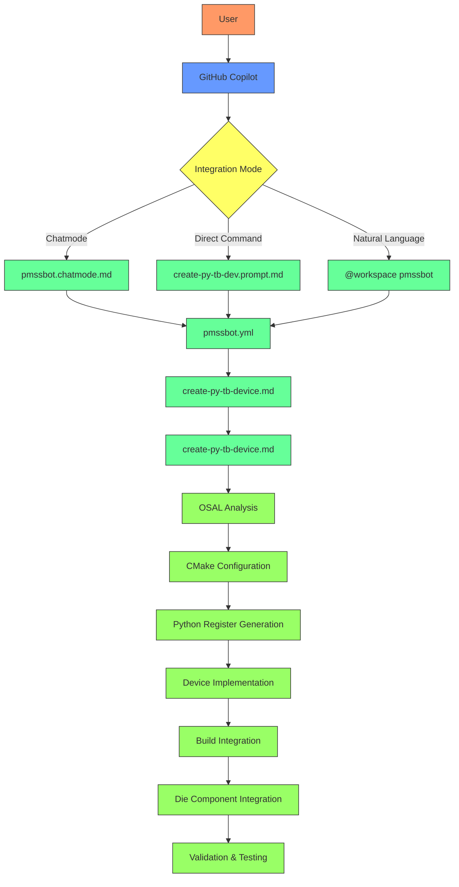
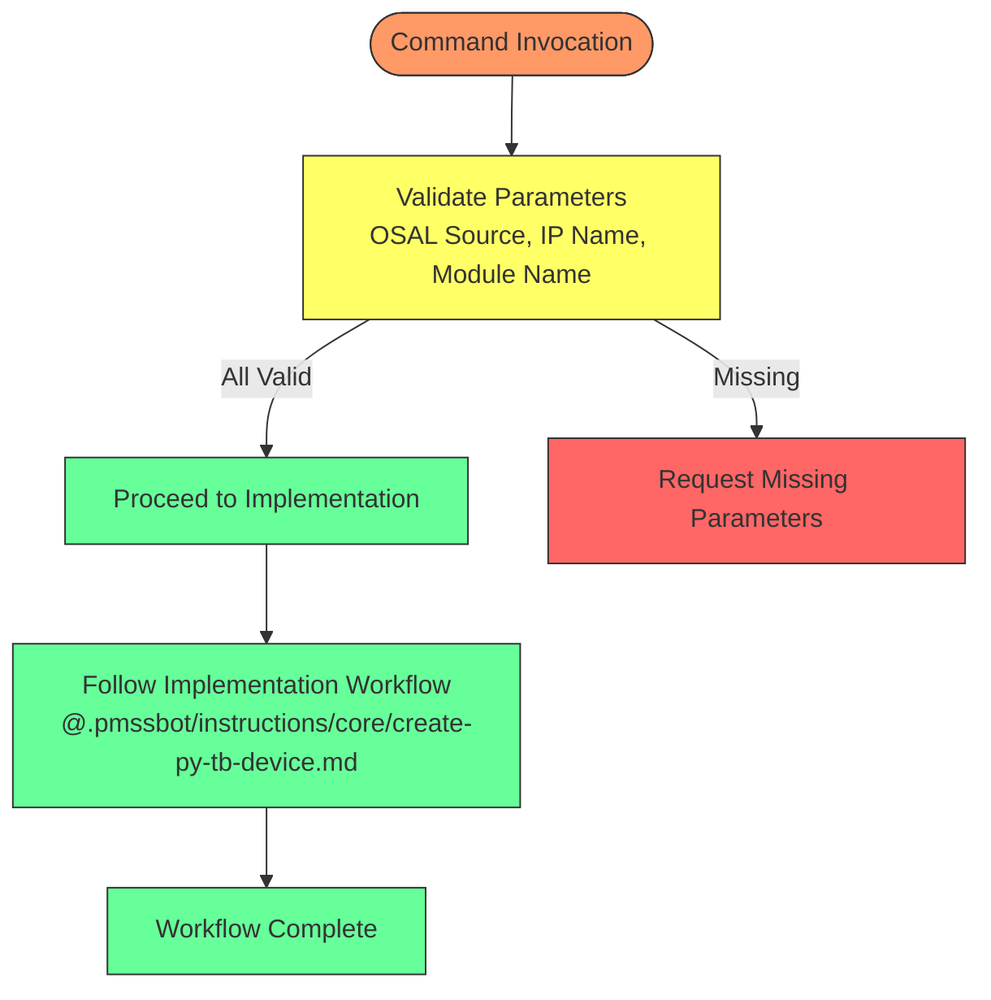
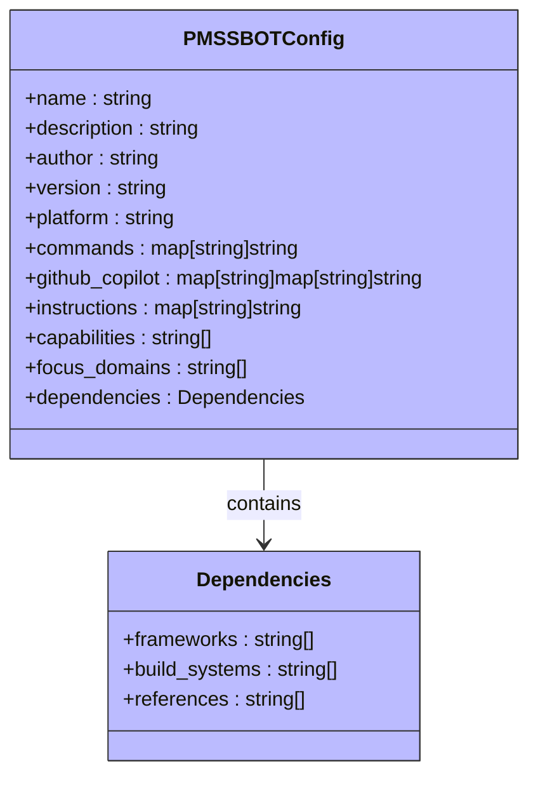
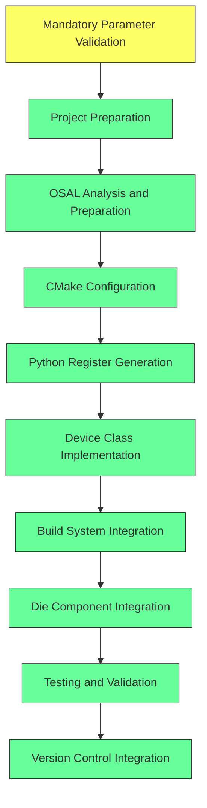
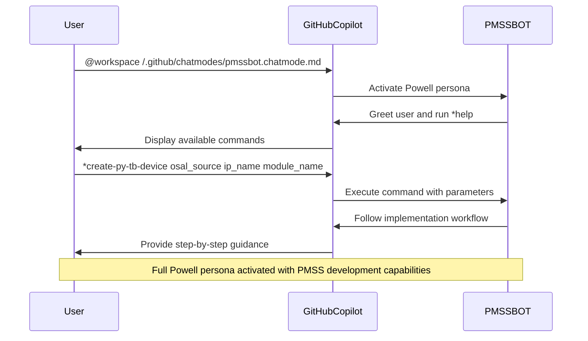
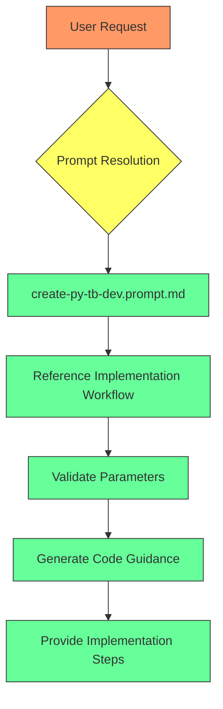
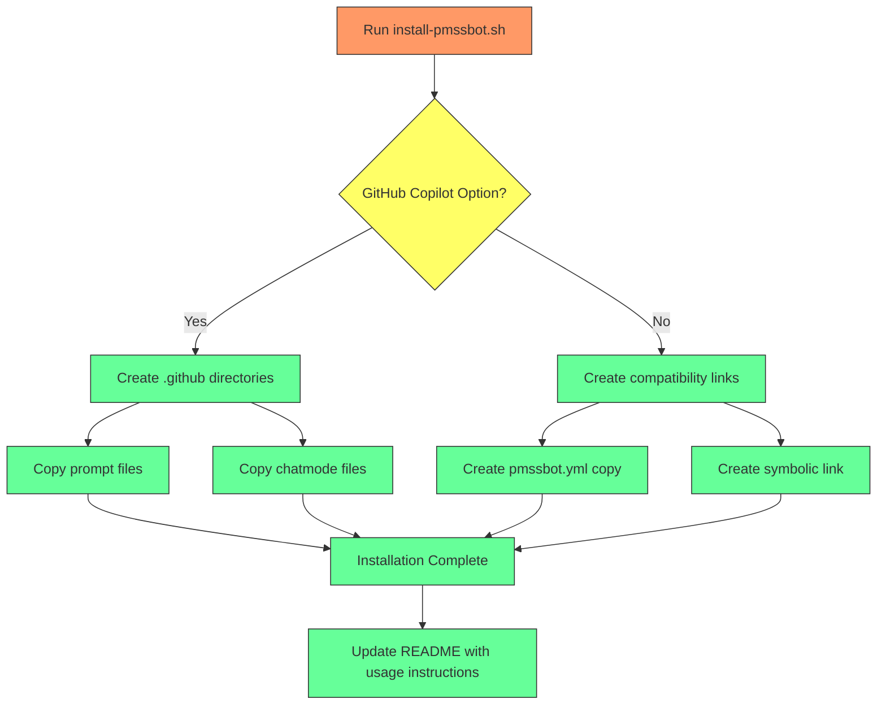
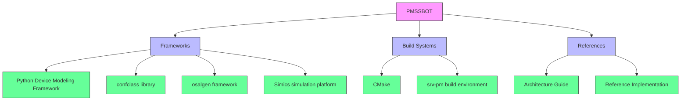

# PMSSBOT Integration

<cite>
**Referenced Files in This Document**   
- [pmssbot.yml](file://pmssbot/pmssbot.yml)
- [install-pmssbot.sh](file://pmssbot/install-pmssbot.sh)
- [create-py-tb-device.md](file://pmssbot/commands/create-py-tb-device.md)
- [create-py-tb-device.md](file://pmssbot/instructions/core/create-py-tb-device.md)
- [pmssbot.chatmode.md](file://pmssbot/github-copilot/chatmodes/pmssbot.chatmode.md)
- [create-py-tb-dev.prompt.md](file://pmssbot/github-copilot/prompts/create-py-tb-dev.prompt.md)
- [README.md](file://pmssbot/README.md)
</cite>

## Table of Contents
1. [Introduction](#introduction)
2. [Project Structure](#project-structure)
3. [Core Components](#core-components)
4. [Architecture Overview](#architecture-overview)
5. [Detailed Component Analysis](#detailed-component-analysis)
6. [Dependency Analysis](#dependency-analysis)
7. [Performance Considerations](#performance-considerations)
8. [Troubleshooting Guide](#troubleshooting-guide)
9. [Conclusion](#conclusion)

## Introduction
PMSSBOT is a specialized AI agent designed for power management subsystem (PMSS) development within the Agent OS ecosystem. This document details PMSSBOT's integration as a domain-specific agent focused on Python testbench device creation and power management validation for the SRV-PM project. The agent, personified as Powell, provides expert-level assistance in creating Python testbench devices using the confclass framework, integrating with Simics simulation, and leveraging CMake build systems. This comprehensive guide covers the end-to-end workflow from command invocation through implementation to integration, including configuration, deployment, and best practices for maintaining domain-specific agents.

## Project Structure
The PMSSBOT agent follows a self-contained directory structure that organizes all components necessary for its operation and integration with Agent OS. The structure is designed to be portable across different projects and environments while maintaining clear separation between configuration, commands, instructions, and GitHub Copilot integration components.

**Diagram sources**
- [README.md](file://pmssbot/README.md#L0-L38)

**Section sources**
- [README.md](file://pmssbot/README.md#L0-L38)

## Core Components
PMSSBOT's functionality is built around several core components that work together to provide a seamless development experience for power management subsystem engineers. The agent combines configuration files, installation scripts, command definitions, detailed implementation workflows, and GitHub Copilot integration to create a comprehensive toolset for Python testbench device creation.

**Section sources**
- [README.md](file://pmssbot/README.md#L0-L199)
- [pmssbot.yml](file://pmssbot/pmssbot.yml#L0-L53)

## Architecture Overview
PMSSBOT operates as a self-contained AI agent that integrates with the Agent OS ecosystem through a well-defined architecture. The agent's design follows a modular approach with clear separation between configuration, execution, and integration components. At its core, PMSSBOT leverages a configuration file (pmssbot.yml) that defines the agent's metadata, command mappings, and capabilities. The installation script (install-pmssbot.sh) deploys the agent to target projects, creating the necessary directory structure and file links. The agent's intelligence is distributed across command definitions, detailed implementation workflows, and GitHub Copilot integration files that enable natural language interaction.

The architecture supports two primary integration modes: GitHub Copilot integration for interactive development assistance and standalone operation for programmatic access. When integrated with GitHub Copilot, PMSSBOT activates the Powell persona, providing expert guidance through complex workflows with systematic development approaches, comprehensive validation, and performance awareness.

**Diagram sources**
- [pmssbot.yml](file://pmssbot/pmssbot.yml#L0-L53)
- [pmssbot.chatmode.md](file://pmssbot/github-copilot/chatmodes/pmssbot.chatmode.md#L0-L89)
- [create-py-tb-dev.prompt.md](file://pmssbot/github-copilot/prompts/create-py-tb-dev.prompt.md#L0-L18)

## Detailed Component Analysis

### Command Invocation and Workflow
The PMSSBOT integration begins with command invocation through the create-py-tb-device.md command file, which serves as the entry point for Python testbench device creation. This command requires three mandatory parameters: OSAL source, IP name, and module name, ensuring that all necessary context is provided before initiating the implementation workflow.

**Diagram sources**
- [create-py-tb-device.md](file://pmssbot/commands/create-py-tb-device.md#L0-L16)

**Section sources**
- [create-py-tb-device.md](file://pmssbot/commands/create-py-tb-device.md#L0-L16)

### Configuration and Agent Behavior
The pmssbot.yml configuration file defines the agent's behavior, capabilities, and integration points within the Agent OS ecosystem. This YAML file specifies the agent's metadata, command mappings, GitHub Copilot integration paths, core instruction workflows, capabilities, focus domains, and dependencies. The configuration enables the agent to be self-contained while providing clear mappings to external resources and integration points.

**Diagram sources**
- [pmssbot.yml](file://pmssbot/pmssbot.yml#L0-L53)

**Section sources**
- [pmssbot.yml](file://pmssbot/pmssbot.yml#L0-L53)

### Implementation Workflow
The create-py-tb-device.md implementation workflow in the instructions/core directory provides a comprehensive, step-by-step guide for creating Python testbench devices. This workflow begins with mandatory parameter validation, ensuring that all three required parameters (OSAL source, IP name, and module name) are provided and valid. The workflow then proceeds through project preparation, OSAL analysis, CMake configuration, Python register generation, device class implementation, build system integration, die component integration, testing and validation, and version control integration.

**Diagram sources**
- [create-py-tb-device.md](file://pmssbot/instructions/core/create-py-tb-device.md#L0-L315)

**Section sources**
- [create-py-tb-device.md](file://pmssbot/instructions/core/create-py-tb-device.md#L0-L315)

### GitHub Copilot Integration
The pmssbot.chatmode.md file enables GitHub Copilot chatmode integration, activating the full Powell persona with complete PMSS development capabilities. This integration uses a YAML configuration that defines the agent's persona, commands, dependencies, and activation instructions. The chatmode provides a natural language interface for users to interact with PMSSBOT, allowing them to create testbench devices, analyze OSAL registers, and validate device implementations through conversational commands.

**Diagram sources**
- [pmssbot.chatmode.md](file://pmssbot/github-copilot/chatmodes/pmssbot.chatmode.md#L0-L89)

**Section sources**
- [pmssbot.chatmode.md](file://pmssbot/github-copilot/chatmodes/pmssbot.chatmode.md#L0-L89)

### Prompt Guidance for AI-Generated Code
The create-py-tb-dev.prompt.md file provides guidance for AI-generated code when creating Python testbench devices. This prompt file references the complete implementation workflow and emphasizes mandatory parameter validation before proceeding with any implementation steps. The prompt serves as a template for GitHub Copilot to generate appropriate code and guidance based on the detailed workflow defined in the instructions.

**Diagram sources**
- [create-py-tb-dev.prompt.md](file://pmssbot/github-copilot/prompts/create-py-tb-dev.prompt.md#L0-L18)

**Section sources**
- [create-py-tb-dev.prompt.md](file://pmssbot/github-copilot/prompts/create-py-tb-dev.prompt.md#L0-L18)

### Installation and Deployment
The install-pmssbot.sh script integrates PMSSBOT with the core installer to deploy agent-specific templates and configuration files. The installation process creates a .pmssbot directory structure, copies all necessary files, and optionally sets up GitHub Copilot integration by creating .github/prompts and .github/chatmodes directories. The script supports multiple installation modes, including GitHub Copilot integration and basic installation, with options for overwriting existing files.

**Diagram sources**
- [install-pmssbot.sh](file://pmssbot/install-pmssbot.sh#L0-L295)

**Section sources**
- [install-pmssbot.sh](file://pmssbot/install-pmssbot.sh#L0-L295)

## Dependency Analysis
PMSSBOT has several key dependencies that enable its functionality within the power management subsystem development environment. These dependencies are clearly defined in the pmssbot.yml configuration file and include frameworks such as the Python Device Modeling Framework, confclass library, osalgen framework, and Simics simulation platform. The agent also depends on build systems like CMake and the srv-pm build environment, as well as reference materials including the architecture guide and reference implementation.

The installation script manages these dependencies by copying the necessary files and creating the appropriate directory structure. When GitHub Copilot integration is enabled, the script creates symbolic links to the prompt and chatmode files, ensuring that the agent's capabilities are accessible through the GitHub Copilot interface.

**Diagram sources**
- [pmssbot.yml](file://pmssbot/pmssbot.yml#L0-L53)

**Section sources**
- [pmssbot.yml](file://pmssbot/pmssbot.yml#L0-L53)

## Performance Considerations
PM