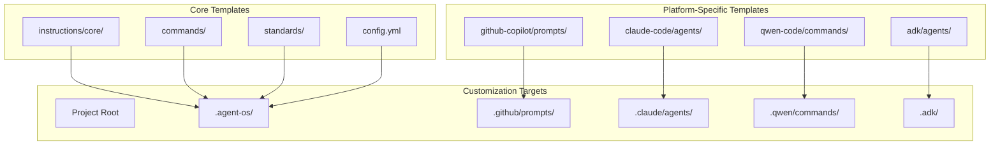
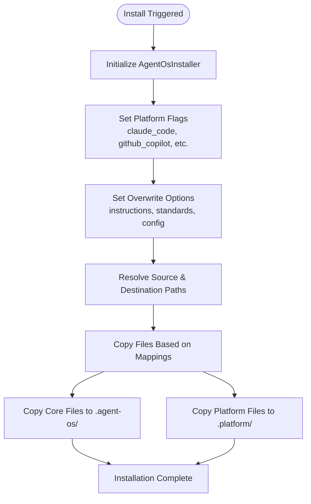
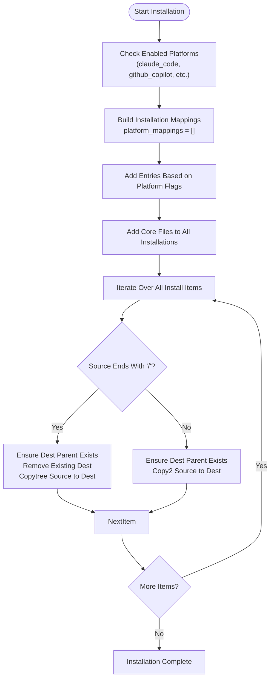
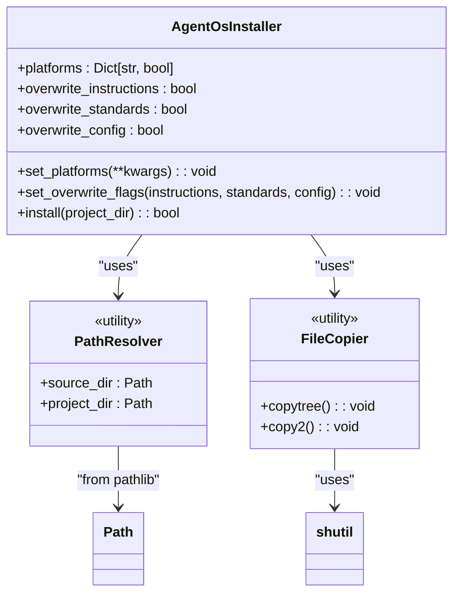

# Template Customization

<cite>
**Referenced Files in This Document**   
- [src/installer.py](file://src/installer.py)
- [commands/execute-tasks.md](file://commands/execute-tasks.md)
- [github-copilot/prompts/execute-tasks.prompt.md](file://github-copilot/prompts/execute-tasks.prompt.md)
- [instructions/core/execute-tasks.md](file://instructions/core/execute-tasks.md)
- [config.yml](file://config.yml)
- [claude-code/commands/execute-tasks.toml](file://qwen-code/commands/execute-tasks.toml)
</cite>

## Table of Contents
1. [Introduction](#introduction)
2. [Project Structure](#project-structure)
3. [Core Components](#core-components)
4. [Architecture Overview](#architecture-overview)
5. [Detailed Component Analysis](#detailed-component-analysis)
6. [Dependency Analysis](#dependency-analysis)
7. [Performance Considerations](#performance-considerations)
8. [Troubleshooting Guide](#troubleshooting-guide)
9. [Conclusion](#conclusion)

## Introduction
This document provides comprehensive guidance on customizing templates within Agent OS to override default behaviors across commands, instructions, and agent prompts. It details the hierarchical template resolution process during installation, explains how to extend or replace workflows using project-level templates, and offers practical examples for integrations with GitHub Copilot and Claude Code. Implementation insights into `src/installer.py` are included, along with best practices for managing customizations and avoiding common pitfalls.

## Project Structure
Agent OS organizes templates in a hierarchical structure that supports both core functionality and platform-specific extensions. The layout enables modular customization while maintaining consistency across environments.

**Diagram sources**
- [src/installer.py](file://src/installer.py#L75-L150)

**Section sources**
- [src/installer.py](file://src/installer.py#L75-L150)

## Core Components
The core components of Agent OS's template system include instruction files, command definitions, and configuration settings located in standardized directories. These form the base layer of the template hierarchy and are installed into the `.agent-os/` directory within each project. Key files such as `execute-tasks.md` define default workflows that can be overridden by higher-priority templates during installation.

**Section sources**
- [commands/execute-tasks.md](file://commands/execute-tasks.md)
- [instructions/core/execute-tasks.md](file://instructions/core/execute-tasks.md)
- [config.yml](file://config.yml)

## Architecture Overview
The installation architecture follows a precedence-based model where platform-specific templates take priority over core templates. During installation, the `AgentOsInstaller` class processes template mappings and copies files according to enabled platform flags and overwrite settings.

**Diagram sources**
- [src/installer.py](file://src/installer.py#L75-L150)

## Detailed Component Analysis

### Template Resolution Process
The template resolution process is governed by the `install` method in `AgentOsInstaller`, which determines which files are copied based on platform activation and overwrite policies.

#### Template Resolution Flowchart

**Diagram sources**
- [src/installer.py](file://src/installer.py#L95-L150)

**Section sources**
- [src/installer.py](file://src/installer.py#L95-L150)

### Custom Template Creation
Users can create custom templates in their project directories to extend or replace existing workflows. For example, modifying `execute-tasks.md` allows altering task execution logic, while updating `execute-tasks.prompt.md` changes prompt behavior for AI integrations.

#### Example: GitHub Copilot Integration
To customize the `execute-tasks` workflow for GitHub Copilot:
1. Create `.github/prompts/execute-tasks.prompt.md` in the project root
2. Define the new prompt structure
3. Ensure `github_copilot` platform flag is enabled during installation

This overrides the default prompt from `github-copilot/prompts/execute-tasks.prompt.md`.

#### Example: Claude Code Integration
For Claude Code integration:
1. Place custom `.toml` command files in `.qwen/commands/`
2. Match filenames to core command templates
3. Enable `qwen_code` platform flag

These templates will supersede defaults from `qwen-code/commands/`.

**Section sources**
- [commands/execute-tasks.md](file://commands/execute-tasks.md)
- [github-copilot/prompts/execute-tasks.prompt.md](file://github-copilot/prompts/execute-tasks.prompt.md)
- [qwen-code/commands/execute-tasks.toml](file://qwen-code/commands/execute-tasks.toml)

## Dependency Analysis
The template customization system relies on proper configuration of the `AgentOsInstaller` class and correct file placement within the project structure.

**Diagram sources**
- [src/installer.py](file://src/installer.py#L75-L150)

**Section sources**
- [src/installer.py](file://src/installer.py#L75-L150)

## Performance Considerations
Template installation performance is generally fast due to direct file copying operations. However, large template sets or deeply nested directories may impact installation time. The use of `shutil.copytree` and `shutil.copy2` ensures reliable file transfers but does not support incremental updates—entire directories are replaced when present.

No significant memory overhead is introduced during installation, as files are processed sequentially without loading content into memory.

## Troubleshooting Guide
Common issues in template customization often stem from incorrect file placement, naming mismatches, or version drift between core and custom templates.

**Section sources**
- [src/installer.py](file://src/installer.py#L120-L145)

### Common Issues and Solutions
| Issue | Cause | Solution |
|------|------|----------|
| Custom template not applied | Incorrect file path or name | Verify file is in correct `.platform/` directory with exact matching name |
| Installation warnings about missing sources | Source directory not found | Confirm platform-specific source exists in repository |
| Version drift between core and custom | Outdated custom template | Regularly review core template changes and update custom versions |
| Overwrite settings ignored | Flags not properly set | Use `set_overwrite_flags()` with correct parameters before calling `install()` |

## Conclusion
Template customization in Agent OS provides a powerful mechanism for tailoring agent behavior to specific project needs and platform integrations. By understanding the hierarchical resolution process and leveraging the `AgentOsInstaller` class effectively, users can create sophisticated custom workflows. Proper management of custom templates through version control and regular synchronization with core templates ensures long-term maintainability and compatibility.