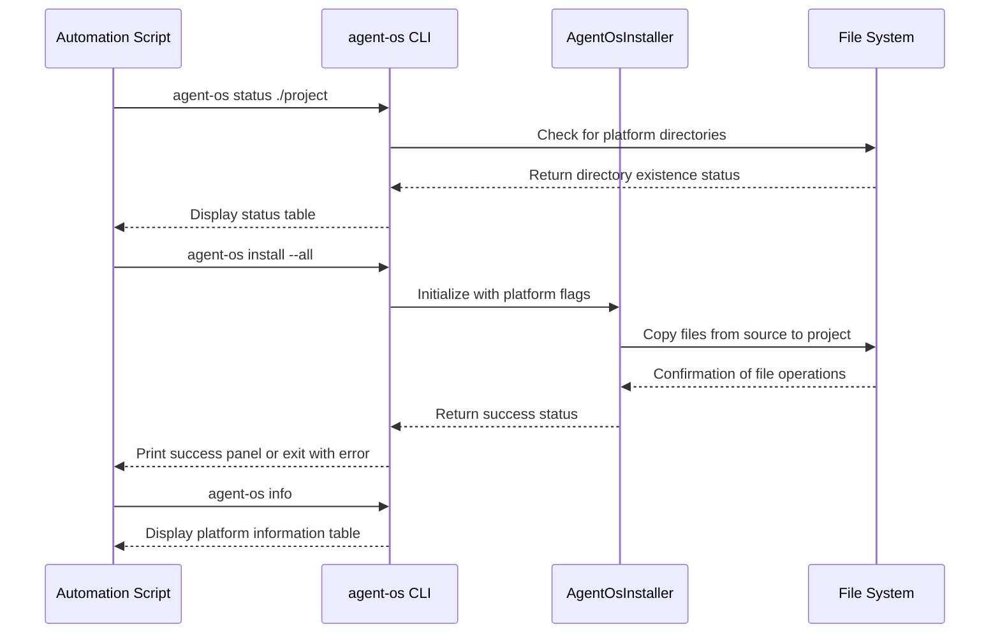
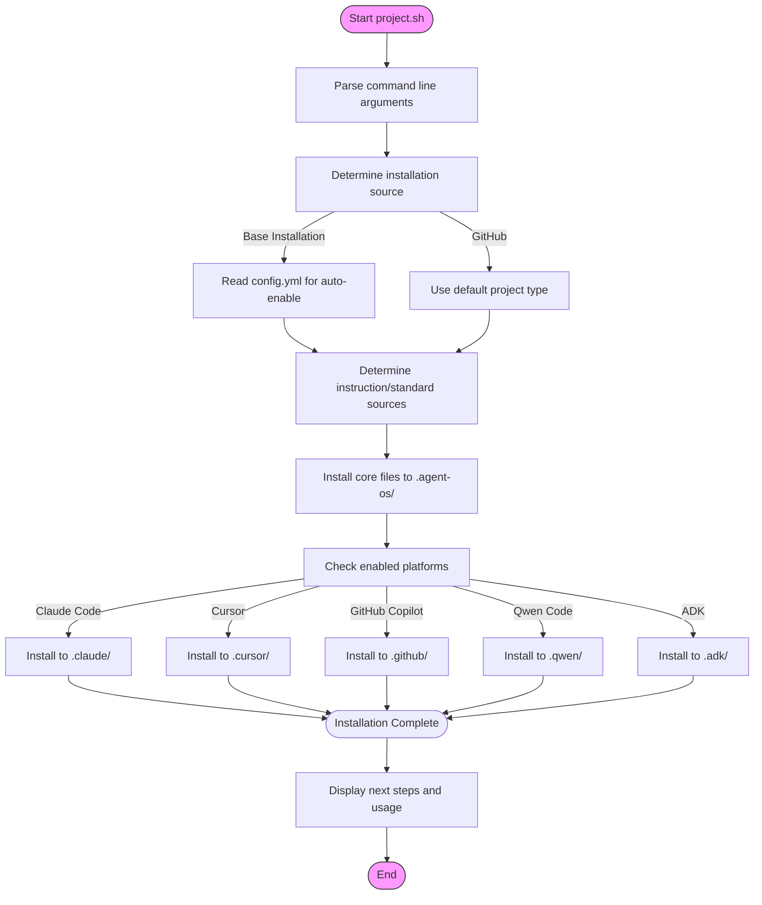
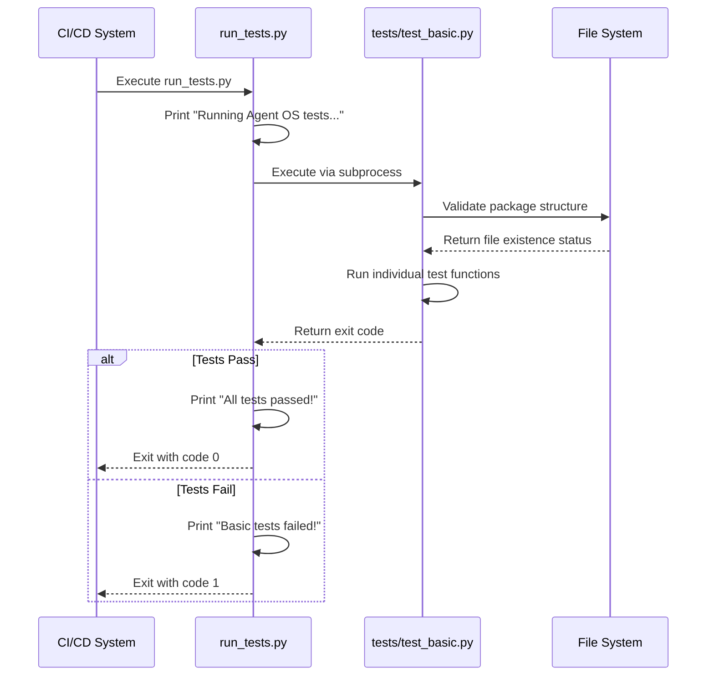
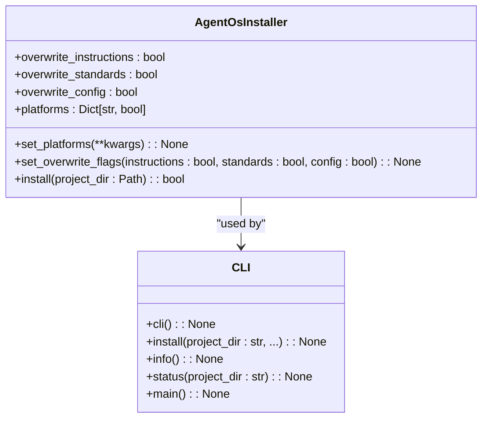

# Workflow Automation

<cite>
**Referenced Files in This Document**   
- [src/cli.py](file://src/cli.py)
- [setup/project.sh](file://setup/project.sh)
- [run_tests.py](file://run_tests.py)
- [src/installer.py](file://src/installer.py)
</cite>

## Table of Contents
1. [Introduction](#introduction)
2. [Core CLI Commands for Automation](#core-cli-commands-for-automation)
3. [Scripting with setup/project.sh](#scripting-with-setupprojectsh)
4. [Automated Testing with run_tests.py](#automated-testing-with-run_testspy)
5. [Implementation Details for Reliable Automation](#implementation-details-for-reliable-automation)
6. [Common Issues in Automated Workflows](#common-issues-in-automated-workflows)
7. [Performance Optimization Strategies](#performance-optimization-strategies)
8. [Conclusion](#conclusion)

## Introduction
Agent OS provides robust workflow automation capabilities through its command-line interface and shell scripting infrastructure. This document details how developers can leverage these tools to automate project setup, configuration, and validation in CI/CD pipelines and build systems. The system supports programmatic execution of core commands such as `agent-os install`, `status`, and `info`, enabling end-to-end automation of development environment bootstrapping. By combining the Python-based CLI with Bash scripts and automated testing, Agent OS offers a comprehensive solution for reproducible and reliable workflow automation.

## Core CLI Commands for Automation

The Agent OS CLI, built using the Click framework, exposes several commands that are specifically designed for programmatic use in automation scenarios. These commands provide structured output and predictable exit codes, making them suitable for integration into build pipelines and CI/CD systems.

The primary automation commands include:

- `agent-os install`: Bootstraps Agent OS in a project directory with configurable platform support
- `agent-os status`: Checks the installation status of Agent OS components in a project
- `agent-os info`: Displays information about available platforms and usage examples

These commands can be chained together in scripts to create comprehensive automation workflows. For example, a typical pipeline might first check the status of an existing installation, then install missing components, and finally validate the setup using automated tests.



**Diagram sources**
- [src/cli.py](file://src/cli.py#L25-L187)
- [src/installer.py](file://src/installer.py#L63-L151)

**Section sources**
- [src/cli.py](file://src/cli.py#L25-L187)

## Scripting with setup/project.sh

The `setup/project.sh` script provides a Bash-based alternative to the Python CLI for automating Agent OS installations. This script is particularly useful in environments where Python may not be available or when integrating with shell-based build systems.

The script supports several key automation features:

- **Flag-based configuration**: Command-line flags control which platforms to install and whether to overwrite existing files
- **Base installation detection**: Automatically detects if running from a base Agent OS installation or directly from GitHub
- **Project type support**: Allows specification of project types that determine which instruction and standard files to install
- **Error handling**: Uses `set -e` to exit on any command failure, ensuring reliable automation

The script can be used in various automation scenarios, such as:

```bash
# Install with all platforms in current directory
./setup/project.sh --all

# Install specific platforms with overwrite flags
./setup/project.sh --claude-code --cursor --overwrite-instructions --overwrite-standards

# Install from GitHub without base installation
./setup/project.sh --no-base --claude-code --cursor
```

The script's modular design allows it to either copy files from a local base installation or download them directly from GitHub, providing flexibility for different deployment scenarios. It also handles the conversion of command formats between different AI coding platforms, ensuring consistent functionality across environments.



**Diagram sources**
- [setup/project.sh](file://setup/project.sh#L0-L525)

**Section sources**
- [setup/project.sh](file://setup/project.sh#L0-L525)

## Automated Testing with run_tests.py

The `run_tests.py` script demonstrates how Agent OS implements automated validation workflows that can be extended for custom quality gates in CI/CD pipelines. This script serves as a model for creating automated testing frameworks that validate the integrity of Agent OS installations.

Key features of the automated testing system include:

- **Modular test structure**: Tests are organized in the `tests/` directory and can be extended with additional test files
- **Subprocess execution**: Uses `subprocess.run()` to execute test files, capturing their exit codes for reliable pass/fail determination
- **Clear output formatting**: Provides formatted output with success and failure indicators
- **Standard exit codes**: Returns appropriate exit codes (0 for success, non-zero for failure) that integrate well with CI/CD systems

The script can be easily extended to include additional test suites or custom quality gates. For example, organizations could add tests that verify specific configuration requirements, security policies, or compliance standards.

```python
# Example of extending run_tests.py with custom quality gates
def run_custom_quality_gates():
    """Run organization-specific quality gates."""
    print("\n" + "=" * 50)
    print("Running custom quality gates...")
    print("=" * 50)
    
    # Example: Security policy check
    if not check_security_policy():
        print("❌ Security policy check failed!")
        return 1
        
    # Example: Compliance check
    if not check_compliance_standards():
        print("❌ Compliance check failed!")
        return 1
    
    print("✅ All quality gates passed!")
    return 0
```

The testing framework can be integrated into CI/CD pipelines to ensure that every Agent OS installation meets organizational standards before deployment.



**Diagram sources**
- [run_tests.py](file://run_tests.py#L0-L36)
- [tests/test_basic.py](file://tests/test_basic.py#L0-L159)

**Section sources**
- [run_tests.py](file://run_tests.py#L0-L36)

## Implementation Details for Reliable Automation

The reliability of Agent OS automation workflows is ensured through careful implementation of argument parsing, exit codes, and error handling in the core CLI module (`src/cli.py`). These implementation details are critical for creating robust automation scripts that can handle various scenarios and edge cases.

### Argument Parsing

The CLI uses Click's argument and option decorators to define a clear and consistent interface:

- **Positional arguments**: `project_dir` for specifying the target directory
- **Boolean flags**: `--claude-code`, `--cursor`, etc., for enabling specific platforms
- **Multi-option flags**: `--all` to enable all platforms at once
- **Overwrite controls**: Flags to control whether existing files should be overwritten

This approach provides a user-friendly interface while also being highly scriptable, as each option has a clear purpose and behavior.

### Exit Codes and Error Handling

The CLI implements a comprehensive error handling strategy that ensures reliable automation:

- **Successful execution**: Exits with code 0 when operations complete successfully
- **Expected errors**: Exits with code 1 for installation failures or other expected error conditions
- **Unexpected errors**: Catches exceptions and exits with code 1, providing error messages
- **Keyboard interrupts**: Handles Ctrl+C gracefully with a user-friendly message and exit code 1

The use of `sys.exit()` with appropriate codes allows automation scripts to reliably determine the outcome of CLI operations and respond accordingly.

### Installer Class Design

The `AgentOsInstaller` class in `src/installer.py` is designed with automation in mind:

- **State management**: Uses instance variables to store configuration (platforms, overwrite flags)
- **Modular methods**: Separate methods for setting platforms and overwrite flags
- **Progress reporting**: Uses Rich library to provide visual feedback during long operations
- **Return values**: Methods return boolean success indicators for programmatic use

This design enables both direct CLI use and programmatic integration in Python scripts.



**Diagram sources**
- [src/cli.py](file://src/cli.py#L25-L187)
- [src/installer.py](file://src/installer.py#L15-L151)

**Section sources**
- [src/cli.py](file://src/cli.py#L25-L187)
- [src/installer.py](file://src/installer.py#L15-L151)

## Common Issues in Automated Workflows

Despite the robust design of Agent OS automation features, certain issues commonly arise in automated workflows. Understanding these issues and their solutions is critical for maintaining reliable CI/CD pipelines.

### Environment Variable Dependencies

Some automation scripts may depend on environment variables that are not consistently available across different systems. The `setup/project.sh` script mitigates this by:

- Using absolute paths where possible
- Setting `set -e` to fail fast on errors
- Providing clear error messages for missing dependencies
- Downloading required files directly from GitHub when needed

Best practice is to minimize environment variable dependencies and provide sensible defaults when they are necessary.

### Race Conditions in Parallel Setups

When multiple processes attempt to install or modify Agent OS simultaneously, race conditions can occur. The primary risks include:

- File corruption during concurrent writes
- Inconsistent state when installations overlap
- Resource contention on limited systems

To avoid these issues, automation scripts should:

- Use file locking mechanisms when available
- Serialize installations in CI/CD pipelines
- Ensure adequate system resources for parallel operations
- Implement retry logic with exponential backoff

### Debugging Failed Automated Sequences

When automated sequences fail, effective debugging requires:

- **Comprehensive logging**: The CLI uses Rich for formatted output that clearly indicates success or failure
- **Exit code inspection**: Checking return codes from each command in a sequence
- **Incremental testing**: Running individual commands to isolate failures
- **Verbose output**: Adding debug flags to increase output detail when needed

The combination of clear error messages, consistent exit codes, and structured output makes it easier to diagnose and resolve issues in automated workflows.

## Performance Optimization Strategies

To ensure efficient automation, especially in CI/CD environments where time is critical, several performance optimization strategies can be applied.

### Caching

Implement caching strategies to avoid redundant downloads and installations:

- Cache the base Agent OS installation to avoid repeated GitHub downloads
- Use local file copies instead of network retrieval when possible
- Implement checksum verification to avoid unnecessary file operations

The `setup/project.sh` script already supports this by detecting base installations and using them when available.

### Parallel Execution

Where possible, execute independent operations in parallel:

- Install different platform components concurrently
- Run validation tests in parallel
- Download multiple files simultaneously

This can significantly reduce overall execution time in automation workflows.

### Minimal Configuration Loading

Optimize for minimal configuration loading by:

- Only reading configuration files when necessary
- Caching configuration in memory during multi-step operations
- Using lightweight configuration formats
- Avoiding unnecessary file system scans

The current implementation already follows this principle by only loading configuration when needed and keeping the configuration structure simple.

These optimization strategies can be particularly valuable in CI/CD environments where build times directly impact developer productivity and deployment frequency.

## Conclusion
Agent OS provides comprehensive workflow automation capabilities through its well-designed CLI, shell scripts, and testing infrastructure. By leveraging the `agent-os` commands, `setup/project.sh` script, and `run_tests.py` framework, teams can create reliable, reproducible automation workflows for project setup and validation. The system's attention to detail in argument parsing, exit codes, and error handling ensures that these automation scripts can be trusted in critical CI/CD pipelines. With proper implementation of performance optimization strategies and awareness of common issues, organizations can fully leverage Agent OS to streamline their development workflows and improve software delivery velocity.