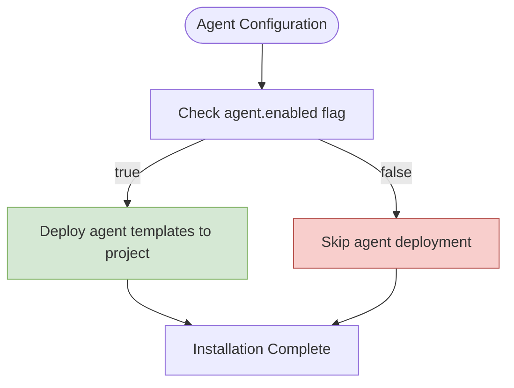
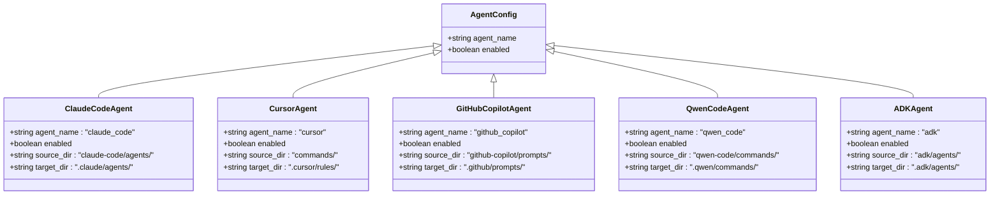
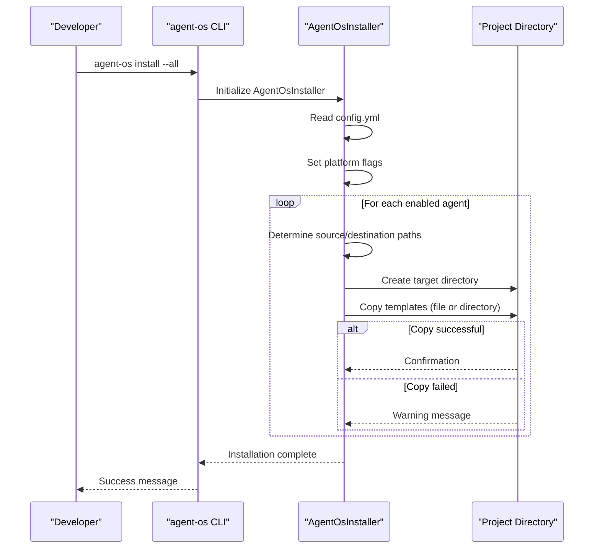
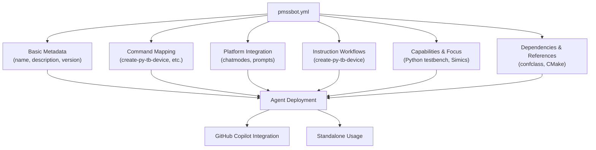
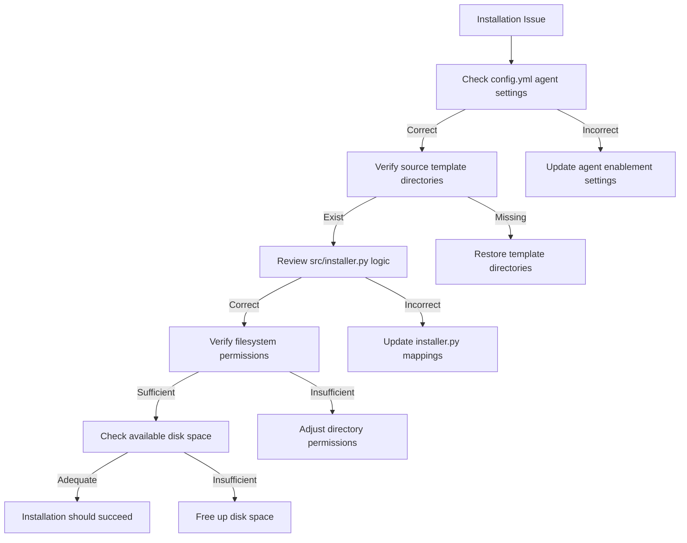

# Agents Configuration

<cite>
**Referenced Files in This Document**   
- [config.yml](file://config.yml)
- [src/installer.py](file://src/installer.py)
- [pmssbot/pmssbot.yml](file://pmssbot/pmssbot.yml)
- [src/cli.py](file://src/cli.py)
</cite>

## Table of Contents
1. [Agents Configuration Overview](#agents-configuration-overview)
2. [Agent Enablement and Template Deployment](#agent-enablement-and-template-deployment)
3. [Agent Configuration Structure](#agent-configuration-structure)
4. [Agent Installation Process](#agent-installation-process)
5. [Specialized Agent Configurations](#specialized-agent-configurations)
6. [Practical Configuration Examples](#practical-configuration-examples)
7. [Common Configuration Issues](#common-configuration-issues)
8. [Troubleshooting Agent Installation](#troubleshooting-agent-installation)
9. [Security Considerations](#security-considerations)

## Agents Configuration Overview

The `agents` key in config.yml serves as the central control mechanism for managing which agent templates are deployed during the installation process. This configuration section determines which AI coding assistants and specialized agents are enabled for integration with your development environment. The agents configuration follows a consistent pattern across all supported platforms, allowing for flexible customization based on project requirements and development workflows.

**Section sources**
- [config.yml](file://config.yml#L6-L14)

## Agent Enablement and Template Deployment

Agent enablement is controlled through the `enabled: true/false` boolean flag within each agent's configuration block. When an agent is enabled (set to `true`), its corresponding template files are deployed to the project directory during installation. Conversely, when an agent is disabled (set to `false`), its templates are excluded from the installation process, conserving disk space and reducing potential configuration conflicts.

The enablement mechanism operates as a gatekeeper for template deployment, ensuring that only actively used agents consume project resources. This selective deployment approach allows developers to maintain a clean project structure while retaining the flexibility to enable additional agents as needed. The current configuration shows all standard agents (Claude Code, Cursor, GitHub Copilot, and Qwen Code) disabled by default, reflecting a conservative approach to resource management.



**Diagram sources**
- [config.yml](file://config.yml#L6-L14)
- [src/installer.py](file://src/installer.py#L38-L46)

**Section sources**
- [config.yml](file://config.yml#L6-L14)

## Agent Configuration Structure

Each agent entry in the configuration follows a standardized structure that includes the agent name as the key and a nested object containing configuration properties. The primary property is `enabled`, which controls the deployment status of the agent. The agent names in the configuration correspond directly to specific directory structures and template collections within the Agent OS framework.

The configuration supports multiple agent types, each serving different development platforms:
- **claude_code**: Templates for Anthropic's Claude Code assistant
- **cursor**: Integration files for the Cursor IDE
- **github_copilot**: Prompt templates for GitHub Copilot
- **qwen_code**: Configuration for Alibaba's Qwen Code assistant
- **adk**: Agent Development Kit platform components

Each agent entry maps to specific source directories that contain the templates and configuration files to be deployed. For example, enabling the `claude_code` agent triggers the deployment of templates from the `claude-code/agents/` directory to the project's `.claude/agents/` location. This mapping ensures consistent deployment patterns across different agent types.



**Diagram sources**
- [config.yml](file://config.yml#L6-L14)
- [src/installer.py](file://src/installer.py#L63-L151)

**Section sources**
- [config.yml](file://config.yml#L6-L14)

## Agent Installation Process

The agent installation process is orchestrated by the `src/installer.py` script, which reads the agent configuration from `config.yml` and deploys the appropriate templates based on the enabled status of each agent. The installation process follows a systematic workflow that ensures reliable deployment of agent templates to the target project directory.

The `AgentOsInstaller` class in `src/installer.py` contains the core logic for agent deployment. During initialization, it sets up platform flags for each supported agent, including `claude_code`, `cursor`, `github_copilot`, `qwen_code`, and `adk`. The `set_platforms` method updates these flags based on the configuration, while the `install` method executes the deployment process.

When the installation process begins, the script creates the necessary directory structure in the target project and then copies the enabled agent templates from their source locations to the appropriate project subdirectories. The deployment process handles both individual files and entire directory trees, ensuring that all required templates are properly installed. For directory deployments, the script uses `shutil.copytree` to recursively copy all contents, while individual files are copied using `shutil.copy2` to preserve metadata.



**Diagram sources**
- [src/installer.py](file://src/installer.py#L63-L151)
- [src/cli.py](file://src/cli.py#L50-L150)

**Section sources**
- [src/installer.py](file://src/installer.py#L25-L151)

## Specialized Agent Configurations

While the main `config.yml` file controls the deployment of standard agents, specialized agents like PMSSBOT have their own dedicated configuration files that provide additional functionality and customization options. The `pmssbot/pmssbot.yml` file serves as a comprehensive configuration for the PMSS Development Agent, extending beyond simple enablement to include detailed metadata, command mappings, and capability definitions.

The PMSSBOT configuration includes several key sections:
- **Basic metadata**: Name, description, author, version, and platform
- **Command mapping**: Links between command names and their corresponding Markdown files
- **Platform integration**: Specific mappings for GitHub Copilot features like chatmodes and prompts
- **Instruction workflows**: References to core instruction files
- **Capabilities and focus areas**: Detailed descriptions of the agent's expertise
- **Dependencies and references**: External frameworks, build systems, and documentation

This specialized configuration approach allows PMSSBOT to function as a self-contained agent with its own installation script (`install-pmssbot.sh`) and comprehensive documentation. Unlike the standard agents controlled by the global `config.yml`, PMSSBOT maintains independence from the main Agent OS configuration, enabling it to be deployed and managed separately.



**Diagram sources**
- [pmssbot/pmssbot.yml](file://pmssbot/pmssbot.yml#L1-L54)
- [pmssbot/install-pmssbot.sh](file://pmssbot/install-pmssbot.sh#L1-L295)

**Section sources**
- [pmssbot/pmssbot.yml](file://pmssbot/pmssbot.yml#L1-L54)

## Practical Configuration Examples

### Enabling Specific Agents
To enable the Claude Code agent for a project, modify the `config.yml` file as follows:
```yaml
agents:
  claude_code:
    enabled: true
  cursor:
    enabled: false
  github_copilot:
    enabled: false
  qwen_code:
    enabled: false
```

### Disabling Unused Agents
To conserve resources and reduce clutter, disable agents that are not in use:
```yaml
agents:
  claude_code:
    enabled: false
  cursor:
    enabled: false
  github_copilot:
    enabled: true
  qwen_code:
    enabled: false
```

### Adding Custom Agent Entries
While the current configuration supports predefined agents, custom agents can be integrated by creating corresponding directory structures and updating the installer logic. For example, to add a hypothetical "custom-agent":
1. Create a directory structure: `custom-agent/agents/`
2. Add agent template files to the directory
3. Update `src/installer.py` to include the new agent in the platforms dictionary
4. Add deployment logic in the `install` method
5. Update `src/cli.py` to include the new command-line option

The installation command would then support the custom agent:
```bash
agent-os install --custom-agent
```

**Section sources**
- [config.yml](file://config.yml#L6-L14)
- [src/installer.py](file://src/installer.py#L25-L151)
- [src/cli.py](file://src/cli.py#L50-L150)

## Common Configuration Issues

### Incorrect Template Paths
One common issue is misconfigured template paths in the installer script. This occurs when the source directory specified in `src/installer.py` does not match the actual directory structure. For example, if the `claude-code/agents/` directory is misspelled as `claude_code/agents/`, the installation process will fail to find and deploy the templates.

### Naming Conflicts
Naming conflicts can arise when multiple agents use similar command names or when agent directories conflict with existing project directories. For instance, if a project already has a `.github/` directory with custom configurations, deploying the GitHub Copilot agent might overwrite important files.

### Platform Flag Mismatches
A critical issue occurs when there is a mismatch between the agent names in `config.yml` and the platform flags in `src/installer.py`. The installer uses exact string matching to determine which agents to deploy, so any discrepancy (such as using `claude-code` instead of `claude_code`) will prevent proper agent deployment.

### Missing Directory Creation
The installation process assumes that parent directories exist or can be created. If there are permission issues or filesystem limitations preventing directory creation, the agent deployment will fail even if the configuration is correct.

**Section sources**
- [config.yml](file://config.yml#L6-L14)
- [src/installer.py](file://src/installer.py#L63-L151)

## Troubleshooting Agent Installation

### Verification Steps
1. **Check Configuration**: Verify that the desired agents are set to `enabled: true` in `config.yml`
2. **Validate Directory Structure**: Ensure that the source template directories exist and contain the expected files
3. **Review Installation Output**: Check the console output for any warning or error messages during installation
4. **Confirm Target Locations**: Verify that the agent templates have been deployed to the correct project subdirectories

### Common Error Scenarios
- **Source Directory Not Found**: This error indicates that the installer cannot locate the template directory specified in the configuration. Verify the directory name and path in `src/installer.py`
- **Permission Denied**: This error occurs when the installer lacks write permissions to the target project directory. Ensure proper filesystem permissions
- **Disk Space Issues**: Insufficient disk space can cause partial installations. Check available storage before running the installer
- **Network Issues**: For installations that download templates, network connectivity problems can interrupt the process

### Diagnostic Commands
The Agent OS CLI provides several commands to help diagnose installation issues:
- `agent-os info`: Displays available platforms and their target directories
- `agent-os status <project_dir>`: Checks which agents are currently installed in a project
- `agent-os install --all`: Attempts to install all available agents, useful for testing the complete installation process



**Diagram sources**
- [config.yml](file://config.yml#L6-L14)
- [src/installer.py](file://src/installer.py#L63-L151)
- [src/cli.py](file://src/cli.py#L155-L180)

**Section sources**
- [config.yml](file://config.yml#L6-L14)
- [src/installer.py](file://src/installer.py#L63-L151)
- [src/cli.py](file://src/cli.py#L155-L180)

## Security Considerations

Enabling external agent integrations introduces several security implications that must be carefully managed. The deployment of agent templates, particularly those that integrate with AI coding assistants, can potentially expose project code and sensitive information to external services.

When enabling agents like GitHub Copilot or Claude Code, organizations should consider:
- **Data Privacy**: Understand what code and context information is transmitted to the external service
- **Intellectual Property**: Assess the risk of proprietary algorithms or business logic being exposed
- **Compliance Requirements**: Ensure that agent usage complies with industry regulations and company policies
- **Access Controls**: Implement appropriate access controls for agent configuration and usage

The modular nature of the agent configuration allows organizations to maintain strict control over which integrations are permitted. By defaulting to disabled agents, the configuration follows the principle of least privilege, requiring explicit enablement of each integration. This approach minimizes the attack surface and ensures that only approved agents are deployed in development environments.

Additionally, specialized agents like PMSSBOT that operate within the local development environment (as opposed to cloud-based AI assistants) offer enhanced security by keeping code analysis and generation within the organization's infrastructure. The self-contained design of PMSSBOT, with all configuration and templates stored locally, eliminates the risk of data exfiltration to external services.

**Section sources**
- [config.yml](file://config.yml#L6-L14)
- [pmssbot/pmssbot.yml](file://pmssbot/pmssbot.yml#L1-L54)