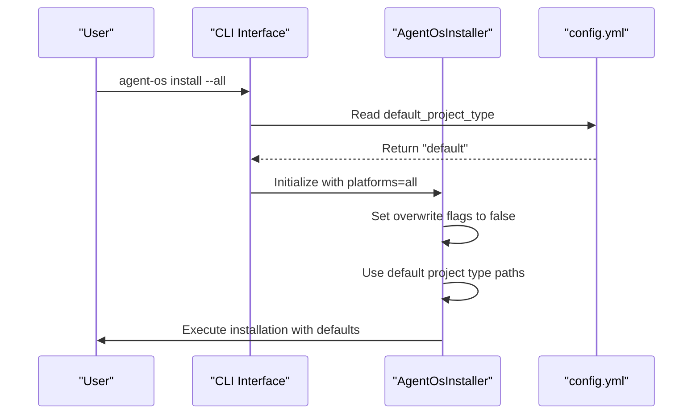
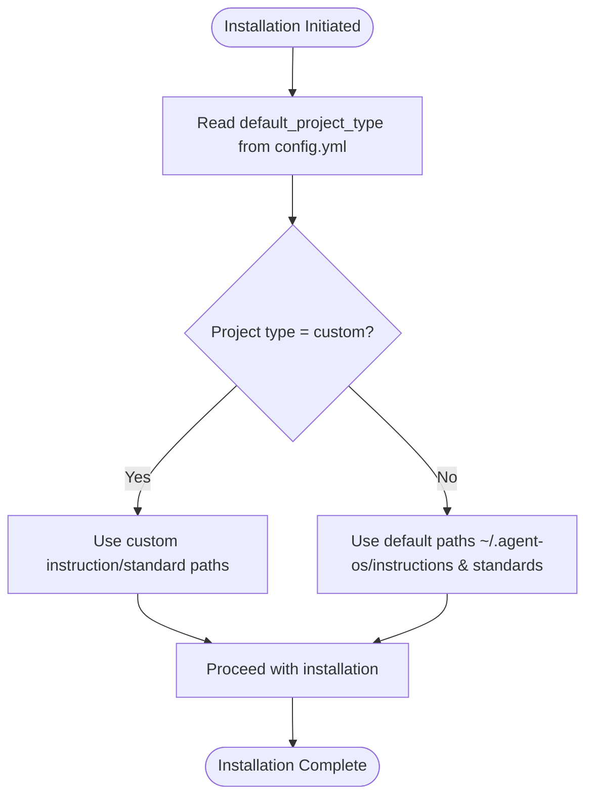

# Default Settings

<cite>
**Referenced Files in This Document**   
- [config.yml](file://config.yml)
- [src/cli.py](file://src/cli.py)
- [src/installer.py](file://src/installer.py)
- [instructions/meta/pre-flight.md](file://instructions/meta/pre-flight.md)
- [instructions/meta/post-flight.md](file://instructions/meta/post-flight.md)
- [setup/project.sh](file://setup/project.sh)
</cite>

## Table of Contents
1. [Introduction](#introduction)
2. [Core Configuration Parameters](#core-configuration-parameters)
3. [Integration with CLI Commands](#integration-with-cli-commands)
4. [Pre-Flight and Post-Flight Validation](#pre-flight-and-post-flight-validation)
5. [Workflow Impact Examples](#workflow-impact-examples)
6. [Environment-Specific Configuration Management](#environment-specific-configuration-management)
7. [Sensitive Data Handling](#sensitive-data-handling)
8. [Common Misconfigurations](#common-misconfigurations)
9. [Troubleshooting Incorrect Defaults](#troubleshooting-incorrect-defaults)
10. [Backward Compatibility Strategies](#backward-compatibility-strategies)

## Introduction
The `config.yml` file serves as the central configuration hub for Agent OS, defining global behavior through top-level settings that streamline user interactions and reduce repetitive input. This document details the default settings that govern installation workflows, project initialization, and system validation. These defaults are designed to enhance usability while maintaining flexibility across diverse development environments and project types. The configuration integrates tightly with the CLI interface and supports validation mechanisms through pre-flight and post-flight checks to ensure system integrity.

**Section sources**
- [config.yml](file://config.yml#L1-L31)

## Core Configuration Parameters

### default_project_type
The `default_project_type` parameter specifies the default template used when initializing new projects. When set to `default`, it references core instruction and standard directories located at `~/.agent-os/instructions` and `~/.agent-os/standards`. This setting eliminates the need for users to specify project types during installation unless deviating from the default. Custom project types can be defined in the configuration by uncommenting and configuring type-specific blocks with custom instruction and standard paths.

**Section sources**
- [config.yml](file://config.yml#L29-L31)
- [setup/project.sh](file://setup/project.sh#L148-L186)

### overwrite_behavior
The overwrite behavior is controlled through three distinct flags in the CLI interface that map to internal installer settings: `overwrite_instructions`, `overwrite_standards`, and `overwrite_config`. These boolean flags determine whether existing files should be replaced during installation. By default, all overwrite flags are disabled, preserving user modifications. The behavior is implemented in the `AgentOsInstaller.set_overwrite_flags()` method and activated via corresponding CLI options.

**Section sources**
- [src/installer.py](file://src/installer.py#L48-L59)
- [src/cli.py](file://src/cli.py#L41-L73)

### verbose_output
While not explicitly defined as a configuration parameter in `config.yml`, verbose output behavior is implicitly controlled through the Rich console integration used throughout the application. The installer and CLI components use Rich's Panel, Progress, and Text components to provide detailed visual feedback during operations. This structured output serves as the default verbosity mechanism, providing clear status updates without requiring explicit verbose flags.

**Section sources**
- [src/cli.py](file://src/cli.py#L10-L11)
- [src/installer.py](file://src/installer.py#L10-L11)

## Integration with CLI Commands

### CLI Parameter Mapping
The default settings in `config.yml` directly influence the behavior of the `agent-os install` command. When users execute installation without specifying certain flags, the system consults the configuration to determine appropriate defaults. For example, the `default_project_type` value is automatically applied when no `--project-type` flag is provided. Similarly, platform enablement states in the configuration can auto-enable corresponding features during installation when no explicit platform flags are given.

**Diagram sources**
- [src/cli.py](file://src/cli.py#L41-L73)
- [src/installer.py](file://src/installer.py#L22-L35)
- [config.yml](file://config.yml#L29-L31)

### Default Value Propagation
Default values from the configuration are propagated through the installation process via the `AgentOsInstaller` class. The installer maintains internal state for platform enablement and overwrite policies, which are initialized based on both configuration defaults and CLI inputs. When no explicit overwrite flags are provided, the installer maintains conservative defaults (false) to prevent accidental data loss.

**Section sources**
- [src/installer.py](file://src/installer.py#L63-L151)
- [src/cli.py](file://src/cli.py#L41-L73)

## Pre-Flight and Post-Flight Validation

### Pre-Flight Checks
Pre-flight validation is governed by rules defined in `instructions/meta/pre-flight.md`, which establish mandatory execution protocols before any installation or modification process begins. Key validation rules include:
- Mandatory use of specified subagents when indicated in XML attributes
- Sequential processing of XML blocks
- Exact adherence to provided templates
- Requirement to seek clarification when instructions are ambiguous

These checks ensure that all operations follow standardized procedures and maintain consistency across different execution environments.

**Section sources**
- [instructions/meta/pre-flight.md](file://instructions/meta/pre-flight.md#L1-L20)

### Post-Flight Verification
Post-flight validation, defined in `instructions/meta/post-flight.md`, occurs after completing all steps in a process flow. The verification process includes:
- Confirmation that every numbered step has been executed according to instructions
- Validation that tasks assigned to specific subagents were properly delegated
- Reporting of any deviations from intended execution

This final verification layer ensures accountability and provides audit trails for complex operations, helping identify and correct execution errors.

**Section sources**
- [instructions/meta/post-flight.md](file://instructions/meta/post-flight.md#L1-L18)

## Workflow Impact Examples

### Example 1: Changing Default Project Type
When modifying `default_project_type` from `default` to a custom type like `ruby-on-rails`, all subsequent installations automatically use the instruction and standard paths associated with that project type. This change eliminates the need to specify `--project-type=ruby-on-rails` for each installation, streamlining workflow for teams specializing in specific technology stacks.

**Diagram sources**
- [config.yml](file://config.yml#L29-L31)
- [setup/project.sh](file://setup/project.sh#L182-L208)

### Example 2: Overwrite Policy Effects
Configuring overwrite behavior significantly impacts installation safety and flexibility. With all overwrite flags disabled (default), the system preserves existing customizations. Enabling `overwrite_instructions` allows template updates to propagate to projects, useful for organization-wide standard updates. However, this must be balanced against the risk of losing project-specific modifications.

**Section sources**
- [src/installer.py](file://src/installer.py#L48-L59)
- [src/cli.py](file://src/cli.py#L41-L73)

## Environment-Specific Configuration Management
Agent OS supports environment-specific configurations through the project type mechanism. Organizations can define multiple project types in `config.yml`, each with tailored instruction and standard paths. For example, development, staging, and production environments can have distinct configurations by defining separate project types. The system automatically falls back to the `default` project type when a specified type is not found, ensuring robustness against configuration errors.

**Section sources**
- [config.yml](file://config.yml#L15-L28)
- [setup/project.sh](file://setup/project.sh#L182-L208)

## Sensitive Data Handling
The current configuration system does not include built-in encryption or sensitive data protection mechanisms. Configuration values are stored in plain text YAML format. For environments requiring sensitive data management, it is recommended to:
- Store `config.yml` outside version control
- Use symbolic links to reference environment-specific configurations
- Implement external configuration management tools
- Avoid storing credentials or secrets in configuration files

The system's design philosophy emphasizes configuration as code, treating `config.yml` as infrastructure definition rather than a secrets store.

**Section sources**
- [config.yml](file://config.yml#L1-L31)

## Common Misconfigurations

### Invalid Default Project Types
Specifying a `default_project_type` that does not exist in the configuration or has invalid path references leads to fallback behavior using the `default` type. This occurs when:
- The project type name contains typos
- Path specifications use incorrect syntax
- Referenced directories do not exist on the filesystem

### Conflicting Overwrite Policies
While the system does not enforce policy conflicts, inconsistent overwrite settings can lead to unexpected behavior. For example, enabling `overwrite_instructions` while disabling `overwrite_standards` may create version mismatches between guidance documents and coding standards.

**Section sources**
- [config.yml](file://config.yml#L15-L28)
- [setup/project.sh](file://setup/project.sh#L182-L208)

## Troubleshooting Incorrect Defaults

### Issue: Installation Ignores Custom Project Type
**Symptoms**: System continues using default instructions despite setting `default_project_type` to a custom value.
**Resolution**:
1. Verify the project type is properly defined in `config.yml` with correct indentation
2. Ensure the referenced instruction and standard paths exist
3. Check for trailing spaces in path specifications
4. Validate file permissions for configuration and referenced directories

### Issue: Unexpected File Overwrites
**Symptoms**: Existing custom files are being overwritten despite default safe behavior.
**Resolution**:
1. Check if CLI commands include explicit overwrite flags
2. Verify no scripts are calling the installer programmatically with overwrite enabled
3. Review automation scripts for unintended flag propagation

**Section sources**
- [config.yml](file://config.yml#L29-L31)
- [src/installer.py](file://src/installer.py#L48-L59)

## Backward Compatibility Strategies
When evolving default settings across versions, maintain backward compatibility through:
- Gradual deprecation of old project types rather than immediate removal
- Maintaining default values for existing parameters when introducing new ones
- Providing clear migration paths in release notes
- Using semantic versioning to signal breaking changes
- Implementing configuration validation that gracefully handles missing or outdated settings

The fallback mechanism to the `default` project type provides inherent resilience against configuration errors, ensuring that invalid or missing custom types do not prevent system operation.

**Section sources**
- [config.yml](file://config.yml#L1-L31)
- [setup/project.sh](file://setup/project.sh#L148-L186)