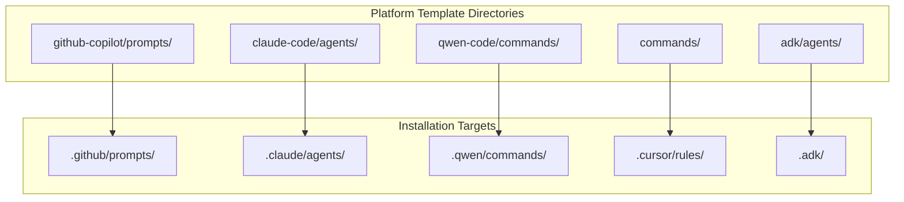
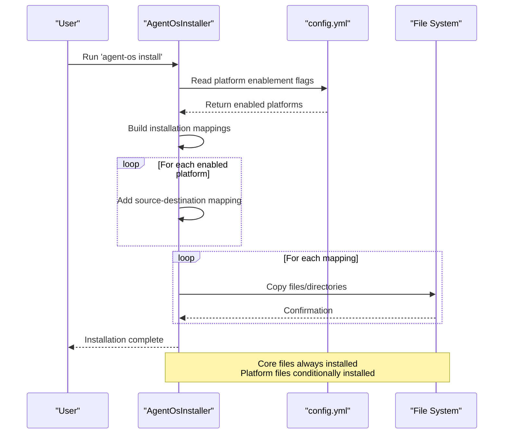

# Platform Settings

<cite>
**Referenced Files in This Document**   
- [config.yml](file://config.yml)
- [src/installer.py](file://src/installer.py)
- [ADK_INTEGRATION_SUMMARY.md](file://ADK_INTEGRATION_SUMMARY.md)
</cite>

## Table of Contents
1. [Introduction](#introduction)
2. [Platform Configuration in config.yml](#platform-configuration-in-configyml)
3. [Supported AI Coding Platforms](#supported-ai-coding-platforms)
4. [Platform Template Directory Structure](#platform-template-directory-structure)
5. [Installation Process and Platform Deployment](#installation-process-and-platform-deployment)
6. [Single vs. Multi-Platform Setup Examples](#single-vs-multi-platform-setup-examples)
7. [Adding New Platform Integrations](#adding-new-platform-integrations)
8. [Common Issues and Troubleshooting](#common-issues-and-troubleshooting)
9. [Performance Best Practices](#performance-best-practices)

## Introduction
The Platform Settings section documents the configuration and behavior of AI coding assistant integrations within Agent OS. This system enables selective deployment of platform-specific assets through the `agents` key in `config.yml`. Each platform entry controls whether templates and configuration files for AI environments like GitHub Copilot, Claude Code, Qwen Code, Cursor, and ADK are installed during setup. The installer uses these settings to determine which assets to deploy, allowing users to customize their development environment based on preferred tools.

**Section sources**
- [config.yml](file://config.yml#L7-L14)
- [src/installer.py](file://src/installer.py#L38-L46)

## Platform Configuration in config.yml
The `agents` section in `config.yml` defines which AI coding platforms are enabled for installation. Each platform is represented as a key with an `enabled` boolean flag that controls whether its associated templates and configurations will be deployed.

```yaml
agents:
  claude_code:
    enabled: false
  cursor:
    enabled: false
  github_copilot:
    enabled: false
  qwen_code:
    enabled: false
```

Each platform entry follows the same pattern:
- **Key name**: Snake-case identifier matching the platform (e.g., `github_copilot`)
- **enabled**: Boolean flag determining if the platform should be installed
- No additional fields (description, template paths) are currently defined in config.yml itself

The configuration serves as a global switch for platform integrations, used by both shell scripts and the Python installer to determine which assets to deploy during installation.

**Section sources**
- [config.yml](file://config.yml#L7-L14)

## Supported AI Coding Platforms
Agent OS supports integration with multiple AI coding assistants, each with specific configuration and deployment behavior:

### GitHub Copilot
- **Configuration key**: `github_copilot`
- **Template location**: `github-copilot/prompts/`
- **Installation target**: `.github/prompts/`
- **Purpose**: Provides prompt templates for GitHub Copilot integration

### Claude Code
- **Configuration key**: `claude_code`
- **Template location**: `claude-code/agents/`
- **Installation target**: `.claude/agents/`
- **Purpose**: Contains agent definitions used by Anthropic's Claude model

### Qwen Code
- **Configuration key**: `qwen_code`
- **Template location**: `qwen-code/commands/`
- **Installation target**: `.qwen/commands/`
- **Purpose**: Stores command templates in TOML format for Alibaba's Qwen model

### Cursor
- **Configuration key**: `cursor`
- **Template location**: `commands/`
- **Installation target**: `.cursor/rules/`
- **Purpose**: Provides rule-based automation for the Cursor IDE

### ADK (Agent Development Kit)
- **Configuration key**: `adk`
- **Template locations**: `adk/agents/` and `commands/`
- **Installation target**: `.adk/` (project-local)
- **Purpose**: Enables development of custom agents with dedicated command and agent templates

All platforms follow a consistent enablement pattern where setting `enabled: true` activates deployment of their respective assets during installation.

**Section sources**
- [config.yml](file://config.yml#L7-L14)
- [src/installer.py](file://src/installer.py#L50-L61)
- [ADK_INTEGRATION_SUMMARY.md](file://ADK_INTEGRATION_SUMMARY.md#L0-L47)

## Platform Template Directory Structure
Each platform has a dedicated directory structure that contains its specific templates and configuration files:



**Diagram sources**
- [src/installer.py](file://src/installer.py#L55-L65)

The relationship between platform settings and template directories is hardcoded in the installer logic:
- `github-copilot/prompts/` → `.github/prompts/` when `github_copilot` enabled
- `claude-code/agents/` → `.claude/agents/` when `claude_code` enabled
- `qwen-code/commands/` → `.qwen/commands/` when `qwen_code` enabled
- `commands/` → `.cursor/rules/` when `cursor` enabled
- `adk/agents/` and `commands/` → `.adk/` when `adk` enabled

This structure ensures that each platform's templates are deployed to the correct location expected by the respective AI coding environment.

**Section sources**
- [src/installer.py](file://src/installer.py#L55-L65)

## Installation Process and Platform Deployment
The `src/installer.py` module uses the platform configuration to selectively deploy assets during the `agent-os install` command execution. The `AgentOsInstaller` class maintains a dictionary of platform flags that are set based on the configuration.



**Diagram sources**
- [src/installer.py](file://src/installer.py#L38-L46)
- [src/installer.py](file://src/installer.py#L55-L65)

The installation process follows these steps:
1. Initialize platform flags with default disabled state
2. Read configuration to determine which platforms are enabled
3. Build a list of source-to-destination mappings based on enabled platforms
4. Copy core files (instructions, standards, config.yml) unconditionally
5. Copy platform-specific files only for enabled platforms
6. Handle directory creation and file copying with overwrite protection

The `set_platforms()` method allows dynamic configuration of which platforms to install, while the `install()` method executes the deployment based on these settings.

**Section sources**
- [src/installer.py](file://src/installer.py#L38-L46)
- [src/installer.py](file://src/installer.py#L55-L65)

## Single vs. Multi-Platform Setup Examples
### Single Platform: GitHub Copilot Only
To enable only GitHub Copilot integration:

```yaml
agents:
  claude_code:
    enabled: false
  cursor:
    enabled: false
  github_copilot:
    enabled: true
  qwen_code:
    enabled: false
```

This configuration will:
- Install core files (.agent-os/instructions/, .agent-os/standards/)
- Deploy github-copilot/prompts/ to .github/prompts/
- Skip all other platform templates
- Minimize installation footprint for Copilot-only usage

### Multi-Platform: Claude + GitHub Copilot + ADK
For a comprehensive setup with multiple AI assistants:

```yaml
agents:
  claude_code:
    enabled: true
  cursor:
    enabled: false
  github_copilot:
    enabled: true
  qwen_code:
    enabled: true
```

This configuration will:
- Install core files
- Deploy claude-code/agents/ to .claude/agents/
- Deploy github-copilot/prompts/ to .github/prompts/
- Deploy qwen-code/commands/ to .qwen/commands/
- Include ADK templates if auto-enabled from base config

The installer combines all enabled platform mappings with core files before executing the copy operations, ensuring all requested platforms are deployed in a single pass.

**Section sources**
- [config.yml](file://config.yml#L7-L14)
- [src/installer.py](file://src/installer.py#L55-L65)

## Adding New Platform Integrations
To add a new platform integration, follow the existing pattern demonstrated by current platforms:

1. **Define the platform key** in `config.yml` under `agents:` using snake_case naming
2. **Create template directories** in the repository root (e.g., `new-platform/templates/`)
3. **Update the installer** (`src/installer.py`) to include the new platform:
   - Add the platform to the `self.platforms` dictionary initialization
   - Add conditional logic in the `install()` method to map source to destination
4. **Update installation scripts** (`setup/base.sh`, `setup/project.sh`) to accept command-line flags
5. **Document the platform** in README-PLATFORMS.md with usage instructions

Example addition for a hypothetical "ai-studio" platform:

```python
# In src/installer.py __init__
self.platforms = {
    # ... existing platforms
    'ai_studio': False,
}

# In install() method
if self.platforms['ai_studio']:
    platform_mappings.append(('ai-studio/templates/', '.ai-studio/templates/'))
```

This approach maintains consistency with the existing architecture and leverages the established installation framework.

**Section sources**
- [src/installer.py](file://src/installer.py#L50-L61)
- [config.yml](file://config.yml#L7-L14)

## Common Issues and Troubleshooting
### Platform Not Installing Despite Being Enabled
**Symptom**: Platform is set to `enabled: true` but templates are not deployed
**Cause**: Source directory does not exist in the repository
**Solution**: Verify the template directory exists (e.g., `github-copilot/prompts/`)

### Missing Template Files
**Symptom**: Installation completes but expected prompt or agent files are missing
**Cause**: Template files were not committed to the repository
**Solution**: Ensure all platform template files are present in their respective directories

### Incorrect Enablement Flags
**Symptom**: Wrong platforms are being installed
**Cause**: Configuration file uses incorrect key names or nesting
**Solution**: Verify exact key names match expected format (e.g., `github_copilot`, not `github-copilot`)

### Platform Conflicts
**Symptom**: Multiple platforms writing to the same directory
**Cause**: Overlapping destination paths in installer logic
**Solution**: Ensure each platform has a unique target directory (e.g., `.github/`, `.claude/`)

### Auto-enabling Issues
**Symptom**: Platform not enabled despite being enabled in base config
**Cause**: Shell scripts fail to parse config.yml correctly
**Solution**: Verify YAML formatting and indentation in config.yml

These issues can typically be diagnosed by checking the installer output and verifying both configuration syntax and file system structure.

**Section sources**
- [config.yml](file://config.yml#L7-L14)
- [src/installer.py](file://src/installer.py#L55-L65)
- [setup/project.sh](file://setup/project.sh#L122-L152)

## Performance Best Practices
To minimize installation overhead when managing multiple platforms:

### Selective Platform Enablement
Only enable platforms that are actively used in the project:
```yaml
agents:
  github_copilot:
    enabled: true
  claude_code:
    enabled: false
  cursor:
    enabled: false
  qwen_code:
    enabled: false
```

### Regular Configuration Audit
Periodically review `config.yml` to disable unused platforms, reducing:
- Disk space usage
- Installation time
- File system complexity
- Potential conflicts

### Use Project-Specific Configurations
Leverage project types to maintain different platform configurations for different projects, avoiding unnecessary template deployment.

### Monitor Installation Time
Track installation duration as an indicator of configuration efficiency. Significant increases may indicate too many platforms are enabled.

### Template Directory Maintenance
Regularly clean up unused template files from platform directories to reduce copy operations during installation.

By following these practices, users can maintain optimal performance while still having access to multiple AI coding assistant integrations when needed.

**Section sources**
- [config.yml](file://config.yml#L7-L14)
- [src/installer.py](file://src/installer.py#L55-L65)