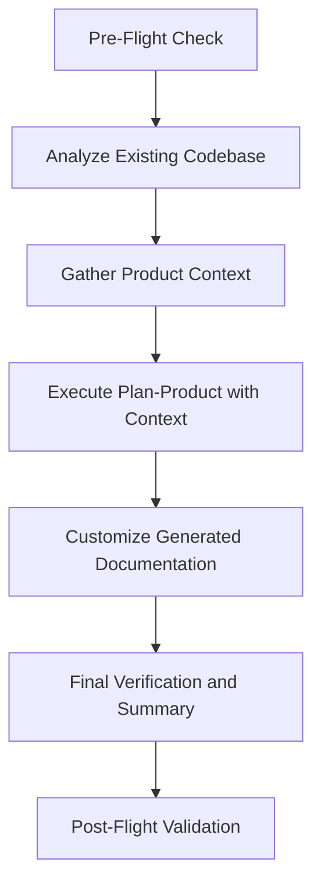
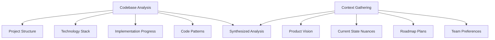
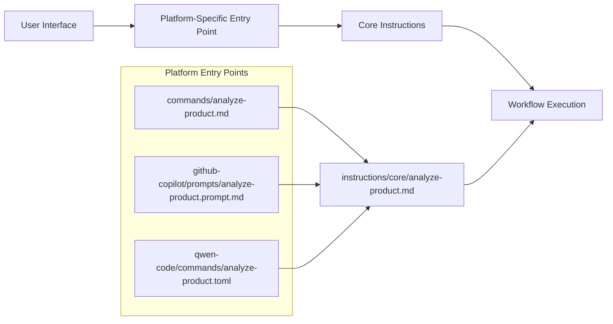
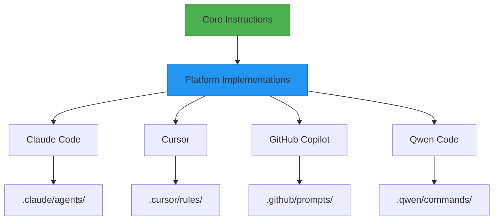

# Analyze Product Workflow

<cite>
**Referenced Files in This Document**   
- [analyze-product.md](file://instructions/core/analyze-product.md)
- [analyze-product.md](file://commands/analyze-product.md)
- [analyze-product.prompt.md](file://github-copilot/prompts/analyze-product.prompt.md)
- [analyze-product.toml](file://qwen-code/commands/analyze-product.toml)
- [pre-flight.md](file://instructions/meta/pre-flight.md)
- [post-flight.md](file://instructions/meta/post-flight.md)
- [README-PLATFORMS.md](file://README-PLATFORMS.md)
- [cli.py](file://src/cli.py)
</cite>

## Table of Contents
1. [Introduction](#introduction)
2. [Workflow Overview](#workflow-overview)
3. [Core Analysis Process](#core-analysis-process)
4. [Invocation Mechanism](#invocation-mechanism)
5. [Cross-Platform Integration](#cross-platform-integration)
6. [Pre-Flight Validation](#pre-flight-validation)
7. [Common Pitfalls and Resolution Strategies](#common-pitfalls-and-resolution-strategies)
8. [Standardization Across AI Platforms](#standardization-across-ai-platforms)
9. [Conclusion](#conclusion)

## Introduction

The analyze-product workflow serves as a critical bridge between high-level product planning and actionable technical implementation. This workflow enables AI agents to systematically evaluate existing codebases, extract meaningful insights, and prepare comprehensive technical assessments that inform subsequent development phases. By transforming abstract product visions into structured technical analyses, this workflow ensures that development efforts are grounded in the actual state of the codebase while aligning with strategic objectives.

The analyze-product workflow is particularly valuable when integrating Agent OS into existing projects, as it establishes a clear understanding of current implementation status, technological dependencies, and architectural patterns before initiating new development work. This foundational analysis prevents redundant efforts, identifies potential integration challenges early, and creates a shared context for all stakeholders involved in the product lifecycle.

**Section sources**
- [analyze-product.md](file://instructions/core/analyze-product.md#L1-L20)

## Workflow Overview

The analyze-product workflow follows a structured five-step process designed to comprehensively assess a product's current state and prepare for Agent OS integration. The workflow begins with pre-flight validation to ensure proper execution context, followed by systematic analysis of the existing codebase, gathering of business context, execution of product planning with synthesized information, and concludes with documentation customization and final verification.

This workflow builds upon the plan-product.md framework but adapts it for existing codebases rather than greenfield projects. It combines automated code analysis with human input to create a holistic understanding of both technical implementation and business requirements. The process culminates in the creation of accurate product documentation that reflects both completed work and future plans, enabling seamless continuation of development activities within the Agent OS framework.

**Diagram sources**
- [analyze-product.md](file://instructions/core/analyze-product.md#L1-L218)

**Section sources**
- [analyze-product.md](file://instructions/core/analyze-product.md#L1-L218)

## Core Analysis Process

The core analysis process within the analyze-product workflow consists of two primary phases: automated codebase analysis and contextual information gathering. The first phase involves a deep examination of the existing codebase across four key dimensions: project structure, technology stack, implementation progress, and code patterns.

The project structure analysis evaluates directory organization, file naming conventions, module architecture, and build configurations to understand the overall code organization. Technology stack assessment identifies frameworks, dependencies, database systems, and infrastructure components currently in use. Implementation progress analysis maps completed features, work-in-progress items, authentication systems, API endpoints, and database schemas. Code pattern evaluation documents coding styles, naming conventions, file organization approaches, and testing methodologies employed in the codebase.

Following automated analysis, the workflow employs the context-fetcher subagent to gather business context through targeted questions about product vision, current state nuances, roadmap plans, and team preferences. This human-in-the-loop approach ensures that the technical analysis is enriched with business context that may not be evident from code alone, creating a more comprehensive understanding of the product landscape.

**Diagram sources**
- [analyze-product.md](file://instructions/core/analyze-product.md#L21-L64)
- [analyze-product.md](file://instructions/core/analyze-product.md#L65-L89)

**Section sources**
- [analyze-product.md](file://instructions/core/analyze-product.md#L21-L109)

## Invocation Mechanism

The analyze-product workflow can be invoked through multiple entry points, with the primary mechanism being the command-line interface (CLI) provided by Agent OS. The CLI exposes the analyze-product functionality through the `agent-os install` command with appropriate platform flags, allowing users to initiate the analysis process directly from their terminal environment.

The workflow is accessible through various platform-specific interfaces, including Claude Code commands, Cursor rule files, GitHub Copilot prompts, and Qwen Code TOML configurations. Each platform-specific implementation references the core analyze-product.md instructions, ensuring consistent behavior across different AI coding environments. This unified approach allows developers to use their preferred AI platform while maintaining workflow consistency.

The invocation mechanism follows a standardized pattern where platform-specific files (such as analyze-product.md in commands/, analyze-product.prompt.md in github-copilot/prompts/, or analyze-product.toml in qwen-code/commands/) contain minimal configuration that references the comprehensive instructions in instructions/core/analyze-product.md. This separation of concerns ensures that the core logic remains centralized while allowing for platform-specific adaptations in invocation syntax and integration methods.

**Diagram sources**
- [analyze-product.md](file://instructions/core/analyze-product.md)
- [analyze-product.prompt.md](file://github-copilot/prompts/analyze-product.prompt.md)
- [analyze-product.toml](file://qwen-code/commands/analyze-product.toml)
- [cli.py](file://src/cli.py)

**Section sources**
- [analyze-product.md](file://instructions/core/analyze-product.md)
- [analyze-product.prompt.md](file://github-copilot/prompts/analyze-product.prompt.md)
- [analyze-product.toml](file://qwen-code/commands/analyze-product.toml)
- [cli.py](file://src/cli.py)

## Cross-Platform Integration

The analyze-product workflow demonstrates Agent OS's commitment to cross-platform compatibility by providing consistent functionality across multiple AI coding platforms including Claude Code, Cursor, GitHub Copilot, and Qwen Code. This multi-platform support is achieved through a unified architecture where platform-specific files serve as lightweight wrappers that reference the same core instructions.

Each platform implements the analyze-product workflow according to its native conventions: Claude Code uses agent templates, Cursor employs rule files with @ references, GitHub Copilot utilizes prompt templates, and Qwen Code leverages TOML configuration files. Despite these implementation differences, all platforms ultimately execute the same analyze-product.md instructions, ensuring consistent analysis outcomes regardless of the AI platform used.

The integration approach follows a principle of minimal platform-specific code, with the majority of logic centralized in the core instructions directory. This design reduces maintenance overhead, ensures feature parity across platforms, and allows improvements to the analyze-product workflow to benefit all supported platforms simultaneously. The setup script (setup/project.sh) automates the installation of platform-specific files, making it easy for users to enable support for multiple AI platforms in their projects.

**Diagram sources**
- [README-PLATFORMS.md](file://README-PLATFORMS.md)
- [analyze-product.md](file://instructions/core/analyze-product.md)
- [cli.py](file://src/cli.py)

**Section sources**
- [README-PLATFORMS.md](file://README-PLATFORMS.md)
- [cli.py](file://src/cli.py)

## Pre-Flight Validation

The analyze-product workflow incorporates robust pre-flight validation through the meta/pre-flight.md instructions, ensuring proper execution context before commencing analysis. This validation occurs at the beginning of the workflow and enforces critical execution rules that maintain the integrity of the analysis process.

The pre-flight check mandates that steps specifying a subagent in the subagent attribute must use the designated subagent for instruction execution. This rule preserves the main agent's context while delegating specialized tasks to appropriate subagents, such as using the context-fetcher for gathering product requirements. The validation also requires sequential processing of XML blocks and exact adherence to step instructions, preventing deviations that could compromise analysis quality.

Additionally, the pre-flight system enforces the use of provided templates and prevents over-reading of instructions into context, which could lead to confusion or redundant processing. This validation layer acts as a quality gate, ensuring that the analyze-product workflow executes consistently and reliably across different environments and AI platforms. The post-flight check at the workflow's conclusion verifies that all steps were executed according to their instructions and that subagents were properly utilized.

**Section sources**
- [pre-flight.md](file://instructions/meta/pre-flight.md)
- [post-flight.md](file://instructions/meta/post-flight.md)
- [analyze-product.md](file://instructions/core/analyze-product.md#L4-L6)

## Common Pitfalls and Resolution Strategies

Despite its structured approach, the analyze-product workflow may encounter several common pitfalls that can compromise analysis quality. One frequent issue is incomplete dependency mapping, where the automated code analysis fails to detect certain technology stack components, particularly those configured through environment variables or external services. This can be resolved by supplementing automated analysis with manual verification and user input during the context gathering phase.

Another potential pitfall is overlooking architectural constraints embedded in the codebase, such as performance requirements, security policies, or compliance regulations that are not immediately apparent from code structure. The resolution strategy involves asking targeted questions during the context gathering step to surface these implicit constraints and incorporating them into the final analysis.

Inconsistent coding patterns across different parts of the codebase can also pose challenges for accurate analysis. When encountering such inconsistencies, the workflow should document variations rather than forcing uniformity, providing a more accurate representation of the actual code quality and maintenance challenges. The final verification step serves as a crucial quality check to identify and address these issues before completing the analysis.

**Section sources**
- [analyze-product.md](file://instructions/core/analyze-product.md)
- [pre-flight.md](file://instructions/meta/pre-flight.md)

## Standardization Across AI Platforms

The analyze-product workflow exemplifies Agent OS's approach to standardization across diverse AI platforms, ensuring consistent output quality regardless of the underlying AI system. This standardization is achieved through a centralized instruction model where the core logic resides in a single source file (instructions/core/analyze-product.md) that is referenced by all platform-specific implementations.

By decoupling workflow logic from platform-specific syntax, Agent OS ensures that Qwen Code, Cursor, GitHub Copilot, and Claude Code produce comparable analysis results when executing the analyze-product workflow. This consistency is critical for teams using multiple AI platforms, as it prevents fragmentation of product documentation and maintains a unified understanding of the codebase across different development environments.

The standardization extends to output formats, with all platforms generating documentation that adheres to the same structure and conventions. This includes consistent roadmap templates, technology stack documentation, and code pattern descriptions. The use of standardized XML blocks for process flow definition further reinforces consistency, ensuring that each step in the analysis process is executed with the same rigor regardless of the AI platform performing the analysis.

**Section sources**
- [analyze-product.md](file://instructions/core/analyze-product.md)
- [README-PLATFORMS.md](file://README-PLATFORMS.md)
- [analyze-product.toml](file://qwen-code/commands/analyze-product.toml)

## Conclusion

The analyze-product workflow represents a sophisticated integration of automated code analysis and human-in-the-loop validation, providing a comprehensive framework for assessing existing products and preparing them for Agent OS integration. By systematically analyzing codebases across multiple dimensions and supplementing technical findings with business context, this workflow transforms high-level product plans into actionable technical insights that guide subsequent development efforts.

The workflow's architecture demonstrates effective design principles, including separation of concerns between platform-specific interfaces and core logic, robust validation through pre-flight and post-flight checks, and standardized output formats that ensure consistency across different AI platforms. These features make the analyze-product workflow a reliable tool for teams seeking to understand their codebase's current state while planning future development.

As AI-assisted development continues to evolve, workflows like analyze-product will play an increasingly important role in bridging the gap between abstract product visions and concrete technical implementations. By providing structured processes for requirements gathering and technical feasibility assessment, Agent OS enables development teams to make informed decisions based on comprehensive system impact assessments rather than incomplete or anecdotal information.