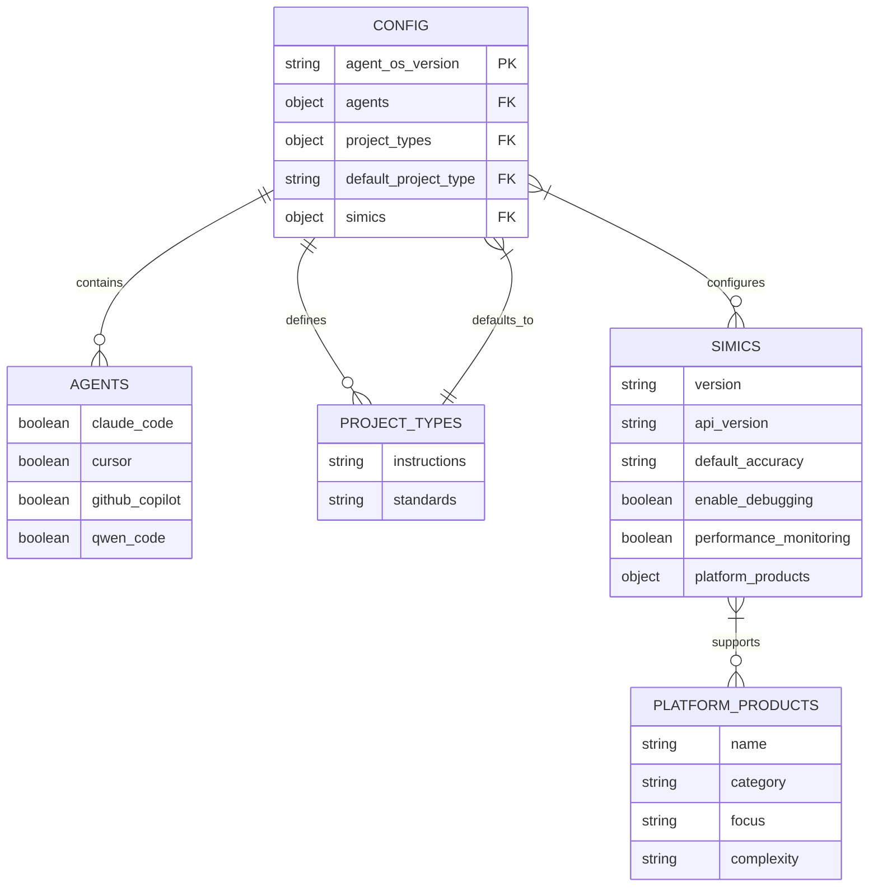
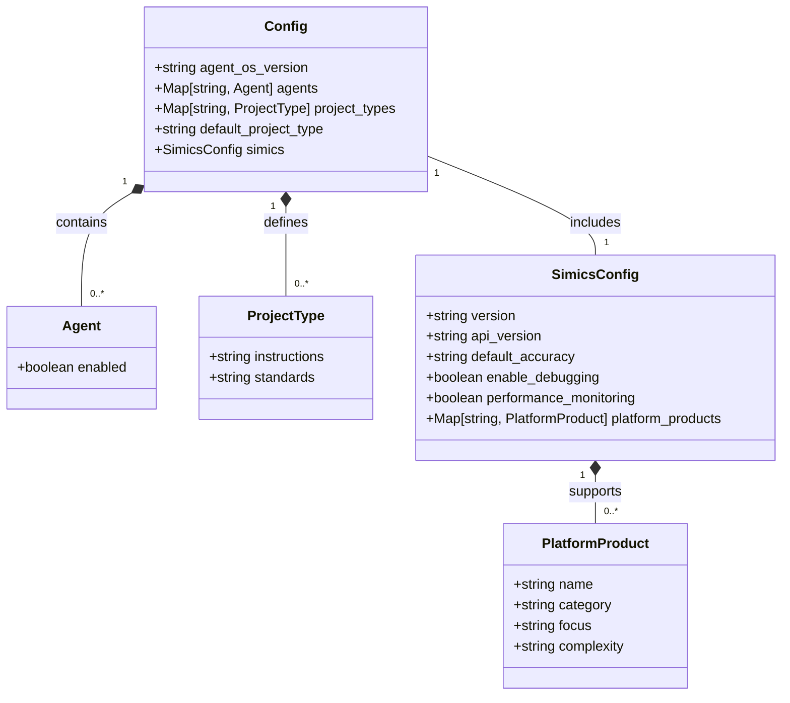
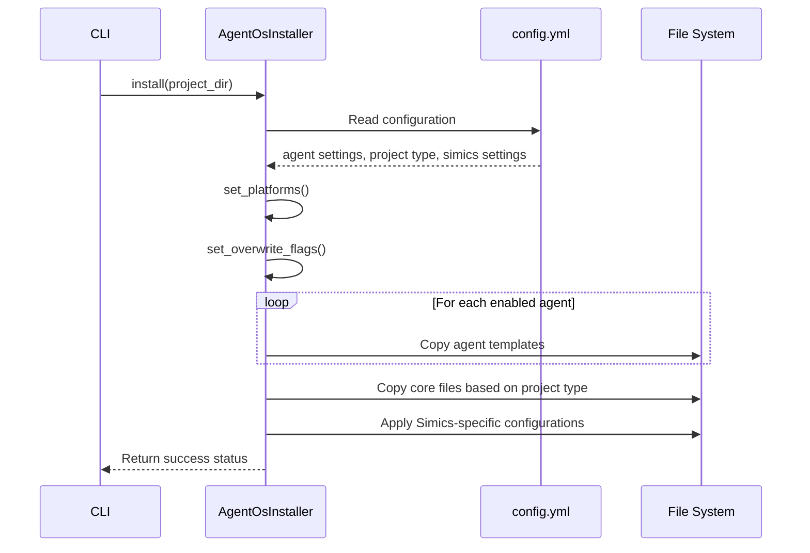
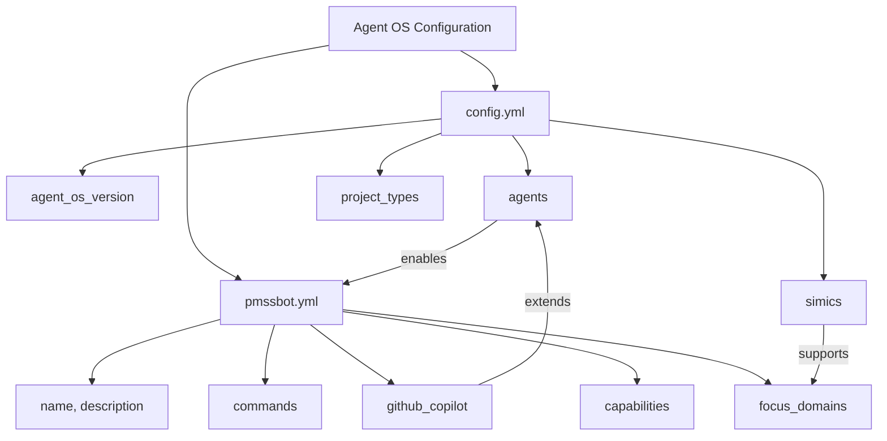
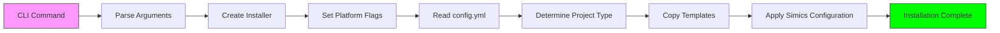

# Core Workflows

<cite>
**Referenced Files in This Document**   
- [config.yml](file://config.yml) - *Updated with Simics integration in commit 7c66d17*
- [installer.py](file://src\installer.py) - *Modified for Simics project types*
- [cli.py](file://src\cli.py) - *Updated for Simics workflows*
- [pmssbot.yml](file://pmssbot\pmssbot.yml) - *Specialized agent configuration*
- [CHANGELOG.md](file://CHANGELOG.md) - *Versioning and backward compatibility*
- [SIMICS_INTEGRATION.md](file://SIMICS_INTEGRATION.md) - *Simics-specific documentation*
</cite>

## Update Summary
**Changes Made**   
- Added Simics-specific project types: simics-device, simics-platform, simics-simulation
- Updated Configuration Entity Relationships to include Simics platform products
- Enhanced Field Definitions with Simics configuration parameters
- Added Simics-specific sample configurations
- Updated Configuration Schema Diagram to reflect new structure
- Added Simics integration details to Template Selection in Installer
- Updated Versioning and Backward Compatibility with Simics release notes

## Table of Contents
1. [Introduction](#introduction)
2. [Configuration Entity Relationships](#configuration-entity-relationships)
3. [Field Definitions and Data Types](#field-definitions-and-data-types)
4. [Configuration Schema Diagram](#configuration-schema-diagram)
5. [Template Selection in Installer](#template-selection-in-installer)
6. [Relationship with pmssbot Configuration](#relationship-with-pmssbot-configuration)
7. [Sample Configurations](#sample-configurations)
8. [Data Access Patterns](#data-access-patterns)
9. [Security Considerations](#security-considerations)
10. [Versioning and Backward Compatibility](#versioning-and-backward-compatibility)

## Introduction
The configuration system in Agent OS is centered around the config.yml file, which serves as the primary control point for system behavior and installation parameters. This document provides comprehensive documentation of the configuration data model, focusing on the relationships between top-level keys, field definitions, validation rules, and how configuration drives system behavior during installation and execution. The configuration system enables users to customize their development environment by selecting specific agents, defining project types, and controlling template installation behavior. With the addition of Simics integration, the system now supports specialized workflows for virtual platform development, device modeling, and simulation.

## Configuration Entity Relationships
The config.yml file defines three primary entities that work together to control the installation and behavior of Agent OS: agents, project_types, and the default_project_type. These entities form a hierarchical relationship where the agents section controls which AI coding platforms are enabled, the project_types section defines different sets of instructions and standards for various project scenarios, and the default_project_type specifies which project type configuration should be used by default during installation.

The agents entity contains boolean flags for each supported platform (claude_code, cursor, github_copilot, qwen_code), determining which agent templates will be installed. The project_types entity allows for multiple configurations with different instruction and standards paths, enabling users to maintain different sets of guidelines for different types of projects. The default_project_type acts as a pointer to the specific project type that should be used when no explicit project type is specified during installation.

With the Simics integration, additional project types have been introduced: simics-device, simics-platform, and simics-simulation. These specialized project types are designed for virtual platform development, device modeling, and simulation workflows respectively. The simics configuration section also introduces platform-specific products (QSP, SPR, GNR) with their own characteristics and complexity levels.



**Diagram sources**
- [config.yml](file://config.yml#L1-L67)
- [SIMICS_INTEGRATION.md](file://SIMICS_INTEGRATION.md#L1-L145)

**Section sources**   
- [config.yml](file://config.yml#L1-L67)
- [SIMICS_INTEGRATION.md](file://SIMICS_INTEGRATION.md#L1-L145)
- [installer.py](file://src\installer.py#L25-L36)

## Field Definitions and Data Types
The config.yml configuration file contains several key fields with specific data types and validation rules. The agent_os_version field is a string that specifies the current version of Agent OS, following semantic versioning principles. This field is used for version tracking and compatibility checks.

The agents section contains a collection of platform-specific objects, each with an enabled boolean field. These boolean values determine whether specific agent templates will be installed during the setup process. The validation rules ensure that only true or false values are accepted, with false being the default state for all agents.

The project_types section defines a mapping of project type names to their respective configuration objects. Each project type contains two string fields: instructions and standards. These fields specify the file system paths to the instruction and standards directories for that project type. The paths support tilde expansion (~) for user home directory references. The default_project_type field is a string that references one of the defined project types by name, with "default" being the fallback value if no explicit default is set.

The simics section introduces new configuration parameters for Simics integration:
- **version**: String specifying the minimum Simics version required
- **api_version**: String indicating the Simics API version to use
- **default_accuracy**: String defining the default simulation accuracy level
- **enable_debugging**: Boolean flag to enable debugging capabilities
- **performance_monitoring**: Boolean flag to enable performance monitoring
- **platform_products**: Object containing configuration for supported platform products (QSP, SPR, GNR), each with name, category, focus, and complexity attributes.



**Diagram sources**
- [config.yml](file://config.yml#L1-L67)
- [SIMICS_INTEGRATION.md](file://SIMICS_INTEGRATION.md#L1-L145)

**Section sources**   
- [config.yml](file://config.yml#L1-L67)
- [SIMICS_INTEGRATION.md](file://SIMICS_INTEGRATION.md#L1-L145)

## Configuration Schema Diagram
The hierarchical structure of config.yml follows a clear organization with top-level keys that contain nested configuration objects. The root level contains the agent_os_version string, followed by the agents object, project_types object, default_project_type string, and the new simics object.

```mermaid
flowchart TD
A[config.yml] --> B[agent_os_version: string]
A --> C[agents: object]
A --> D[project_types: object]
A --> E[default_project_type: string]
A --> F[simics: object]
C --> C1[claude_code: object]
C --> C2[cursor: object]
C --> C3[github_copilot: object]
C --> C4[qwen_code: object]
C1 --> C1a[enabled: boolean]
C2 --> C2a[enabled: boolean]
C3 --> C3a[enabled: boolean]
C4 --> C4a[enabled: boolean]
D --> D1[default: object]
D --> D2[simics-device: object]
D --> D3[simics-platform: object]
D --> D4[simics-simulation: object]
D1 --> D1a[instructions: string]
D1 --> D1b[standards: string]
D2 --> D2a[instructions: string]
D2 --> D2b[standards: string]
D3 --> D3a[instructions: string]
D3 --> D3b[standards: string]
D4 --> D4a[instructions: string]
D4 --> D4b[standards: string]
F --> F1[version: string]
F --> F2[api_version: string]
F --> F3[default_accuracy: string]
F --> F4[enable_debugging: boolean]
F --> F5[performance_monitoring: boolean]
F --> F6[platform_products: object]
F6 --> F6a[qsp: object]
F6 --> F6b[spr: object]
F6 --> F6c[gnr: object]
F6a --> F6a1[name: string]
F6a --> F6a2[category: string]
F6a --> F6a3[focus: string]
F6a --> F6a4[complexity: string]
F6b --> F6b1[name: string]
F6b --> F6b2[category: string]
F6b --> F6b3[focus: string]
F6b --> F6b4[complexity: string]
F6c --> F6c1[name: string]
F6c --> F6c2[category: string]
F6c --> F6c3[focus: string]
F6c --> F6c4[complexity: string]
style A fill:#f9f,stroke:#333
```



**Diagram sources**
- [config.yml](file://config.yml#L1-L67)

**Section sources**   
- [config.yml](file://config.yml#L1-L67)

## Template Selection in Installer
The configuration directly drives template selection behavior in the installer.py module. When the install method is executed, it reads the enabled status of each agent from the config.yml file and uses this information to determine which template directories should be copied to the target project.

The AgentOsInstaller class initializes with platform flags that correspond to the agents defined in config.yml. The set_platforms method updates these flags based on the configuration, and the install method uses them to build the platform_mappings list that determines which source directories are copied to their respective destination paths.

For example, when claude_code is enabled, the installer maps 'claude-code/agents/' to '.claude/agents/' in the project directory. Similarly, when github_copilot is enabled, 'github-copilot/prompts/' is mapped to '.github/prompts/'. The installer also handles the core files that are always installed, including instructions, standards, and the config.yml itself, with their source paths determined by the project type configuration.

With Simics integration, the installer now supports specialized project types that map to Simics-specific instruction and standards directories. When a simics-device project type is selected, the installer copies templates from ~/.agent-os/simics/device-instructions and ~/.agent-os/simics/device-standards. Similarly, simics-platform and simics-simulation project types use their respective Simics directories.



**Diagram sources**
- [installer.py](file://src\installer.py#L63-L151)
- [config.yml](file://config.yml#L1-L67)

**Section sources**   
- [installer.py](file://src\installer.py#L63-L151)
- [config.yml](file://config.yml#L1-L67)
- [SIMICS_INTEGRATION.md](file://SIMICS_INTEGRATION.md#L1-L145)

## Relationship with pmssbot Configuration
The config.yml file in the root directory serves as the general configuration for Agent OS, while pmssbot/pmssbot.yml provides specialized configuration for the PMSS development agent. These two configuration files serve different but complementary purposes within the ecosystem.

The root config.yml focuses on installation parameters and platform selection, controlling which agent templates are installed across the system. In contrast, pmssbot.yml contains domain-specific configuration for the PMSS (Power Management Sub-System) development agent, including command mappings, GitHub Copilot integration settings, and agent capabilities.

The pmssbot configuration extends the general Agent OS framework by defining specific commands like create-py-tb-device and debug-registers, along with their corresponding markdown file paths. It also specifies GitHub Copilot chatmodes and prompts tailored to PMSS development tasks. While config.yml controls what gets installed, pmssbot.yml defines how the specialized agent behaves once installed, creating a layered configuration approach where general settings are overridden by specific ones in specialized contexts.

The Simics integration in config.yml complements the pmssbot configuration, as pmssbot's focus domains include "Simics simulation environment" and "Register modeling and side effects". This creates a cohesive workflow where the general Simics configuration in config.yml enables the platform, while pmssbot.yml provides specialized agent capabilities for PMSS development within that environment.



**Diagram sources**
- [config.yml](file://config.yml#L1-L67)
- [pmssbot.yml](file://pmssbot\pmssbot.yml#L1-L53)

**Section sources**   
- [config.yml](file://config.yml#L1-L67)
- [pmssbot.yml](file://pmssbot\pmssbot.yml#L1-L53)
- [SIMICS_INTEGRATION.md](file://SIMICS_INTEGRATION.md#L1-L145)

## Sample Configurations
The default configuration in config.yml provides a basic setup with all agents disabled and a single default project type. This configuration serves as a starting point for users who want to selectively enable specific agents and customize their development environment.

For a full-featured development setup with all platforms enabled, the configuration would include:

```yaml
agent_os_version: 1.4.1

agents:
  claude_code:
    enabled: true
  cursor:
    enabled: true
  github_copilot:
    enabled: true
  qwen_code:
    enabled: true

project_types:
  default:
    instructions: ~/.agent-os/instructions
    standards: ~/.agent-os/standards
  python-backend:
    instructions: ~/.agent-os/project_types/python-backend/instructions
    standards: ~/.agent-os/project_types/python-backend/standards
  react-frontend:
    instructions: ~/.agent-os/project_types/react-frontend/instructions
    standards: ~/.agent-os/project_types/react-frontend/standards

default_project_type: python-backend
```

For specialized PMSS development work with Simics integration, a configuration might look like:

```yaml
agent_os_version: 1.4.1

agents:
  claude_code:
    enabled: true
  cursor:
    enabled: false
  github_copilot:
    enabled: true
  qwen_code:
    enabled: false

project_types:
  default:
    instructions: ~/.agent-os/instructions
    standards: ~/.agent-os/standards
  simics-device:
    instructions: ~/.agent-os/simics/device-instructions
    standards: ~/.agent-os/simics/device-standards
  simics-platform:
    instructions: ~/.agent-os/simics/platform-instructions
    standards: ~/.agent-os/simics/platform-standards
  simics-simulation:
    instructions: ~/.agent-os/simics/simulation-instructions
    standards: ~/.agent-os/simics/simulation-standards

default_project_type: simics-device

simics:
  version: "6.0+"
  api_version: "latest"
  default_accuracy: "functional"
  enable_debugging: true
  performance_monitoring: true
  platform_products:
    qsp:
      name: "QSP Platform Product"
      category: "embedded"
      focus: "Embedded/IoT development"
      complexity: "Low to Medium"
    spr:
      name: "SPR Server Platform Product"
      category: "server"
      focus: "Server/Data center validation"
      complexity: "High"
    gnr:
      name: "GNR Server Platform Product"
      category: "server"
      focus: "Next-generation server research"
      complexity: "Very High"
```

**Section sources**   
- [config.yml](file://config.yml#L1-L67)
- [SIMICS_INTEGRATION.md](file://SIMICS_INTEGRATION.md#L1-L145)
- [pmssbot.yml](file://pmssbot\pmssbot.yml#L1-L53)

## Data Access Patterns
Configuration data is accessed through multiple pathways during CLI command execution. When the install command is invoked, the CLI parses command-line arguments and translates them into calls to the installer's set_platforms and set_overwrite_flags methods.

The primary data access pattern involves reading the config.yml file during the installation process to determine which agents should be enabled by default. The setup/project.sh script reads the configuration to auto-enable platforms based on the enabled flags in the config file. This allows users to set their preferred platforms once in the configuration and have them automatically applied to all future project installations.

The installer.py module accesses configuration data through its internal state, which is populated either by direct method calls from the CLI or by reading the config file indirectly through the shell scripts. The data flow follows a pattern where configuration is read once at the beginning of the installation process and then used to make decisions about which files to copy and where to copy them.

For Simics workflows, the configuration data is accessed when executing Simics-specific commands like plan-simics-platform, create-simics-device, and assemble-platform. These commands use the simics configuration section to determine platform-specific settings and accuracy requirements.



**Diagram sources**
- [cli.py](file://src\cli.py#L0-L187)
- [installer.py](file://src\installer.py#L63-L151)

**Section sources**   
- [cli.py](file://src\cli.py#L0-L187)
- [installer.py](file://src\installer.py#L63-L151)
- [SIMICS_INTEGRATION.md](file://SIMICS_INTEGRATION.md#L1-L145)

## Security Considerations
The configuration system includes several security considerations for sensitive data and access control. While the current config.yml file does not contain sensitive information like API keys or credentials, the file system paths it contains could potentially expose information about the user's directory structure.

Access control recommendations include setting appropriate file permissions on the config.yml file to prevent unauthorized modification. Since the configuration controls which agent templates are installed, ensuring its integrity is important for maintaining a consistent development environment.

The separation between the general Agent OS configuration and specialized agent configurations like pmssbot.yml follows the principle of least privilege, where each configuration file contains only the settings necessary for its specific purpose. This limits the potential impact of configuration tampering to specific domains rather than affecting the entire system.

For environments requiring stricter security, configuration files can be stored in protected directories with restricted read/write permissions. The use of relative paths and tilde expansion in configuration values also helps prevent hard-coded absolute paths that might expose sensitive directory information.

The Simics configuration section contains settings that could impact system performance and debugging capabilities. The enable_debugging and performance_monitoring flags should be carefully managed in production environments to prevent potential security vulnerabilities or performance degradation.

**Section sources**   
- [config.yml](file://config.yml#L1-L67)
- [pmssbot.yml](file://pmssbot\pmssbot.yml#L1-L53)
- [SIMICS_INTEGRATION.md](file://SIMICS_INTEGRATION.md#L1-L145)

## Versioning and Backward Compatibility
The versioning strategy for the configuration system is documented in CHANGELOG.md, which tracks all notable changes to Agent OS following semantic versioning principles. The agent_os_version field in config.yml indicates the current version of the configuration schema, allowing for backward compatibility checks.

Backward compatibility is maintained through careful evolution of the configuration schema. New features are added in a way that doesn't break existing configurations, such as adding new project types without removing the default type. When changes could potentially break compatibility, they are introduced in major version increments with clear migration paths documented in the changelog.

The changelog details how configuration has evolved, such as the introduction of project types in version 1.4.0 and the addition of GitHub Copilot and Qwen Code platform support in version 1.5.0. The Simics integration was added in version 1.5.0, introducing new project types (simics-device, simics-platform, simics-simulation) and the simics configuration section with platform-specific products.

These entries provide context for configuration changes and help users understand how to update their configurations when upgrading to new versions. The system also includes fallback mechanisms, such as defaulting to the "default" project type when no explicit default is set, and maintaining backward compatibility through the continued support of existing agent configurations even as new ones are added.

**Section sources**   
- [config.yml](file://config.yml#L1-L67)
- [CHANGELOG.md](file://CHANGELOG.md#L1-L299)
- [SIMICS_INTEGRATION.md](file://SIMICS_INTEGRATION.md#L1-L145)