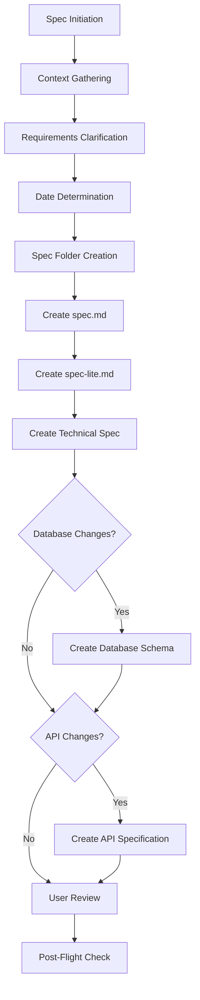
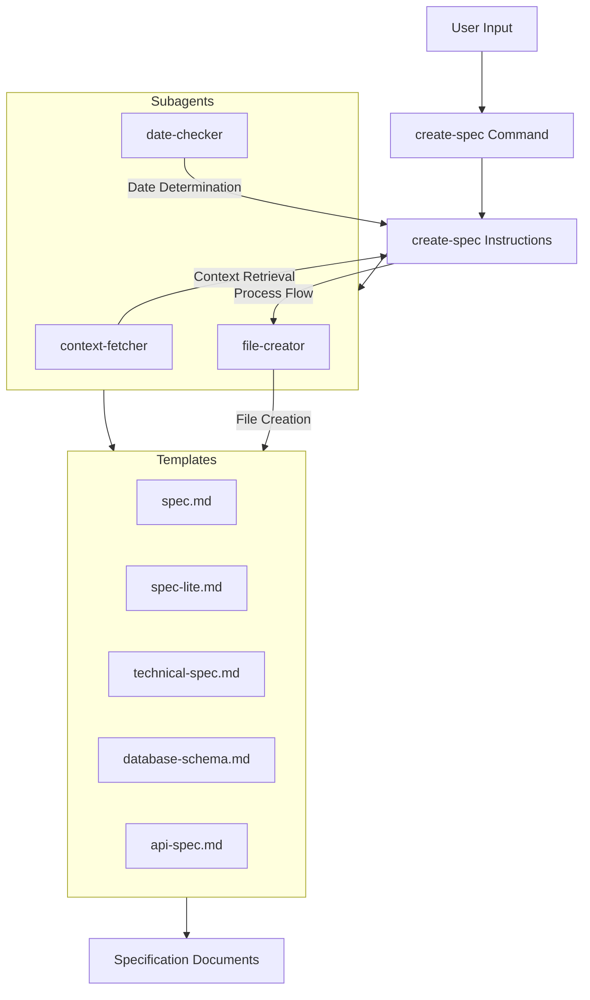
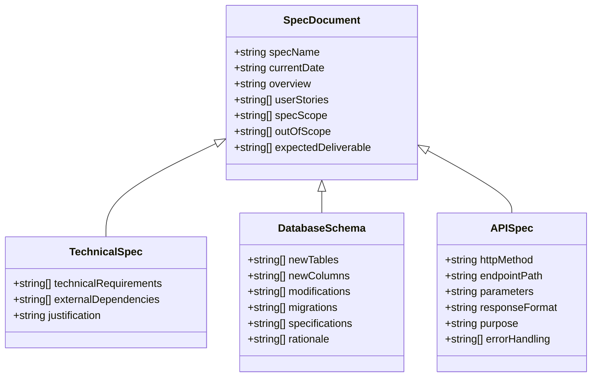
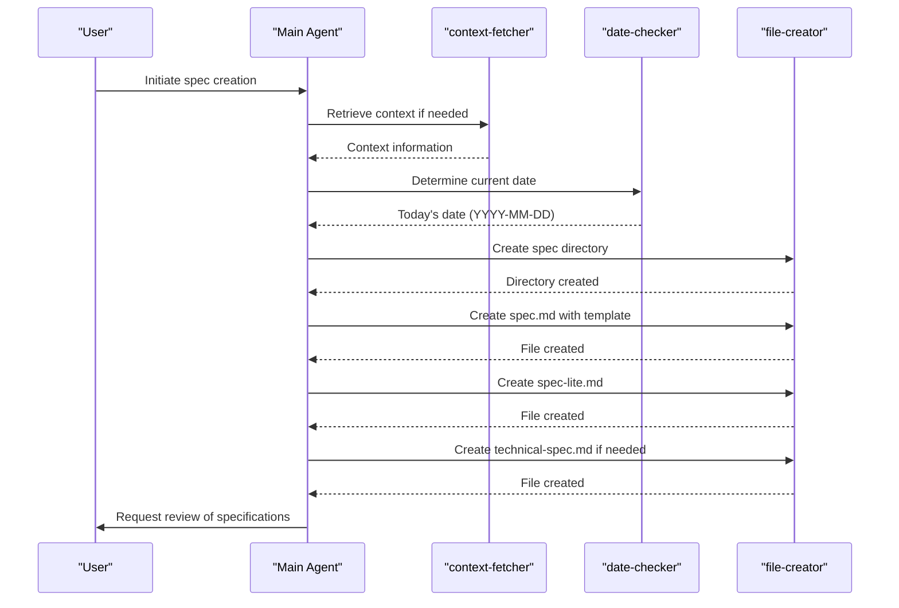

# Create Specification Workflow

<cite>
**Referenced Files in This Document**   
- [create-spec.md](file://commands/create-spec.md)
- [create-spec.md](file://instructions/core/create-spec.md)
- [create-spec.prompt.md](file://github-copilot/prompts/create-spec.prompt.md)
- [pre-flight.md](file://instructions/meta/pre-flight.md)
- [post-flight.md](file://instructions/meta/post-flight.md)
- [context-fetcher.md](file://adk/agents/context-fetcher.md)
- [date-checker.md](file://adk/agents/date-checker.md)
- [file-creator.md](file://adk/agents/file-creator.md)
</cite>

## Table of Contents
1. [Introduction](#introduction)
2. [Workflow Overview](#workflow-overview)
3. [Core Components](#core-components)
4. [Architecture and Data Flow](#architecture-and-data-flow)
5. [Detailed Component Analysis](#detailed-component-analysis)
6. [Integration with Pre-Flight and Post-Flight Checks](#integration-with-pre-flight-and-post-flight-checks)
7. [Common Issues and Best Practices](#common-issues-and-best-practices)
8. [Conclusion](#conclusion)

## Introduction

The Create Specification Workflow is a systematic process for generating comprehensive technical specifications from product requirements within the Agent OS framework. This workflow ensures standardized, reproducible, and platform-agnostic specification creation by leveraging a structured instruction set, specialized subagents, and consistent templates. The system is designed to transform high-level product ideas into detailed technical documentation that includes architecture diagrams, interface definitions, and data models, enabling seamless transition from concept to implementation.

**Section sources**
- [create-spec.md](file://instructions/core/create-spec.md#L1-L430)

## Workflow Overview

The create-spec workflow follows a 11-step process that begins with spec initiation and concludes with user review. The workflow is triggered either by a user request for the next roadmap item ("what's next?") or by a specific feature idea. It systematically gathers context, clarifies requirements, determines the current date for folder naming, creates a structured specification directory, and generates multiple specification documents with varying levels of detail.

The workflow employs three specialized subagents: context-fetcher for information retrieval, date-checker for date determination, and file-creator for document generation. Each step in the process is executed sequentially according to the instructions, with conditional logic determining whether certain steps (such as database schema or API specification creation) should be included based on the nature of the feature being specified.

**Diagram sources**
- [create-spec.md](file://instructions/core/create-spec.md#L1-L430)

**Section sources**
- [create-spec.md](file://instructions/core/create-spec.md#L1-L430)

## Core Components

The create-spec workflow consists of several interconnected components that work together to produce standardized specifications. The primary components include the command interface, instruction template, specialized subagents, and document templates. The workflow begins with the CLI command in commands/create-spec.md, which references the detailed instructions in instructions/core/create-spec.md.

The instruction template defines a comprehensive structure for specifications, including required sections such as Overview, User Stories, Spec Scope, Out of Scope, and Expected Deliverable. For technical specifications, additional sections cover technical requirements and external dependencies (when needed). The workflow also conditionally generates database schema and API specifications based on the requirements of the feature being specified.

The system uses specialized subagents to perform specific tasks: context-fetcher retrieves relevant information from documentation files, date-checker determines the current date using file system timestamps, and file-creator generates files and directories according to standardized templates. These subagents ensure consistency and reduce the potential for human error in the specification creation process.

**Section sources**
- [create-spec.md](file://instructions/core/create-spec.md#L1-L430)
- [create-spec.md](file://commands/create-spec.md#L1-L7)
- [create-spec.prompt.md](file://github-copilot/prompts/create-spec.prompt.md#L1-L7)

## Architecture and Data Flow

The create-spec workflow follows a modular architecture where each component has a specific responsibility. The data flow begins with user input and progresses through a series of processing steps, with each step building upon the output of the previous one. The architecture is designed to be platform-agnostic, allowing the workflow to function consistently across different AI coding environments.

**Diagram sources**
- [create-spec.md](file://instructions/core/create-spec.md#L1-L430)
- [file-creator.md](file://adk/agents/file-creator.md#L1-L360)

**Section sources**
- [create-spec.md](file://instructions/core/create-spec.md#L1-L430)

## Detailed Component Analysis

### Specification Structure and Templates

The create-spec workflow enforces consistency in output format through standardized templates. The primary specification document (spec.md) follows a structured format with specific sections and constraints. The Overview section is limited to 1-2 sentences that capture the goal and objective of the feature. User Stories follow the standard format "As a [USER_TYPE], I want to [ACTION], so that [BENEFIT]" with detailed workflow descriptions. The Spec Scope section uses a numbered list of 1-5 features, each described in one sentence, while the Out of Scope section explicitly lists excluded functionalities.

The workflow also generates a condensed specification (spec-lite.md) for efficient AI context usage. This document contains a 1-3 sentence summary of the core goal and objective, making it suitable for contexts where brevity is essential. The technical specification (technical-spec.md) includes detailed technical requirements covering functionality, UI/UX, integration, and performance criteria. External dependencies are included conditionally, with justification required for each new library or package.

**Diagram sources**
- [create-spec.md](file://instructions/core/create-spec.md#L142-L201)
- [file-creator.md](file://adk/agents/file-creator.md#L68-L157)

**Section sources**
- [create-spec.md](file://instructions/core/create-spec.md#L142-L201)

### Subagent Integration and Functionality

The create-spec workflow leverages three specialized subagents to perform specific tasks with high reliability. The context-fetcher subagent retrieves relevant information from documentation files while avoiding duplication by checking if content is already in context. It supports various file types including specifications, product documentation, and standards. The date-checker subagent determines the current date using file system timestamps, creating a temporary file to extract the creation timestamp and parsing it into YYYY-MM-DD format. This method ensures accuracy without requiring direct user input.

The file-creator subagent is responsible for generating files and directories according to standardized templates. It handles batch operations, creating multiple files with proper structure and boilerplate content. The agent follows strict naming conventions and directory structures, ensuring consistency across specifications. It also manages placeholder replacement, inserting provided content into templates while preserving exact formatting.

**Diagram sources**
- [context-fetcher.md](file://adk/agents/context-fetcher.md#L1-L68)
- [date-checker.md](file://adk/agents/date-checker.md#L1-L96)
- [file-creator.md](file://adk/agents/file-creator.md#L1-L360)

**Section sources**
- [context-fetcher.md](file://adk/agents/context-fetcher.md#L1-L68)
- [date-checker.md](file://adk/agents/date-checker.md#L1-L96)
- [file-creator.md](file://adk/agents/file-creator.md#L1-L360)

## Integration with Pre-Flight and Post-Flight Checks

The create-spec workflow integrates with pre-flight and post-flight checks to ensure input completeness and output quality. The pre-flight check, defined in instructions/meta/pre-flight.md, establishes common rules that apply to all Agent OS instructions. It emphasizes the importance of using specified subagents, processing XML blocks sequentially, executing every numbered step exactly as specified, and using exact templates as provided. This ensures consistency and adherence to the defined process.

The post-flight check, defined in instructions/meta/post-flight.md, verifies that all steps have been executed according to their instructions. After completing the process flow, the system reviews its work to confirm that every numbered step has been read, executed, and delivered according to its instructions. It specifically checks that all steps specifying a subagent have indeed delegated tasks to the specified subagent. If any step was not executed according to its instructions, the system reports the findings, explaining which part of the instructions were misread or skipped and why.

These checks create a quality assurance framework that enhances the reliability of the specification generation process. The pre-flight check ensures proper execution from the start, while the post-flight check provides validation at the end, creating a comprehensive quality control system.

**Section sources**
- [pre-flight.md](file://instructions/meta/pre-flight.md#L1-L20)
- [post-flight.md](file://instructions/meta/post-flight.md#L1-L18)

## Common Issues and Best Practices

### Addressing Underspecified Interfaces

One common issue in specification creation is underspecified interfaces, where the technical requirements lack sufficient detail for implementation. The create-spec workflow addresses this through its structured template approach, which requires specific sections for technical requirements, API endpoints, and database changes. To prevent underspecification, best practices include:

- Providing detailed descriptions in the Spec Scope section, ensuring each feature is clearly defined
- Including comprehensive technical requirements that cover functionality, UI/UX, integration, and performance criteria
- Using the conditional API specification template to define endpoints with HTTP methods, parameters, response formats, and error handling
- Documenting database schema changes with exact SQL or migration syntax, indexes, constraints, and foreign key relationships

### Handling Missing Error Scenarios

Another common issue is missing error handling in specifications. The create-spec workflow mitigates this through its API specification template, which explicitly includes an "Errors" field for each endpoint. Best practices for comprehensive error handling documentation include:

- Identifying all possible error scenarios for each API endpoint
- Documenting error codes, messages, and appropriate client responses
- Specifying error handling in the controllers section of API specifications
- Including error handling requirements in the technical requirements section

### Refinement Best Practices

To ensure high-quality specifications, several refinement best practices should be followed:

- Conduct thorough requirements clarification by asking numbered questions to resolve ambiguities
- Validate that all generated files adhere to the specified templates and constraints
- Ensure consistency between different specification documents (e.g., alignment between spec.md and technical-spec.md)
- Verify that conditional documents (database-schema.md, api-spec.md) are created only when necessary
- Confirm that all file paths use the @ prefix and relative paths from project root
- Ensure date handling is consistent, using the actual current date in YYYY-MM-DD format

These practices, combined with the structured workflow and quality checks, enable the creation of comprehensive, implementation-ready specifications.

**Section sources**
- [create-spec.md](file://instructions/core/create-spec.md#L1-L430)
- [file-creator.md](file://adk/agents/file-creator.md#L1-L360)

## Conclusion

The Create Specification Workflow provides a robust, standardized approach to generating technical specifications from product requirements. By combining a structured instruction set, specialized subagents, and consistent templates, the workflow ensures reproducible, platform-agnostic specification generation across AI coding environments. The integration of pre-flight and post-flight checks enhances quality assurance, while the modular architecture allows for flexible adaptation to different types of features.

The workflow's emphasis on consistency, completeness, and clarity addresses common issues in specification creation, such as underspecified interfaces and missing error handling. Through its systematic approach, the create-spec workflow transforms high-level product ideas into detailed technical documentation that serves as a reliable foundation for implementation. This enables development teams to move efficiently from concept to code with minimal ambiguity and maximum alignment with product goals.