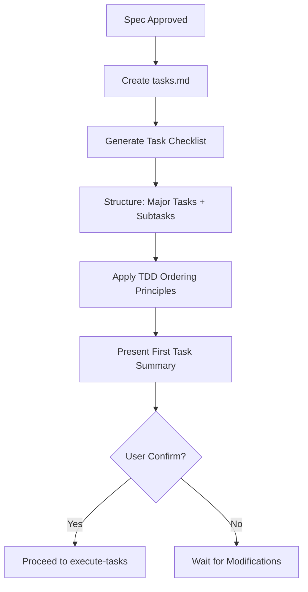
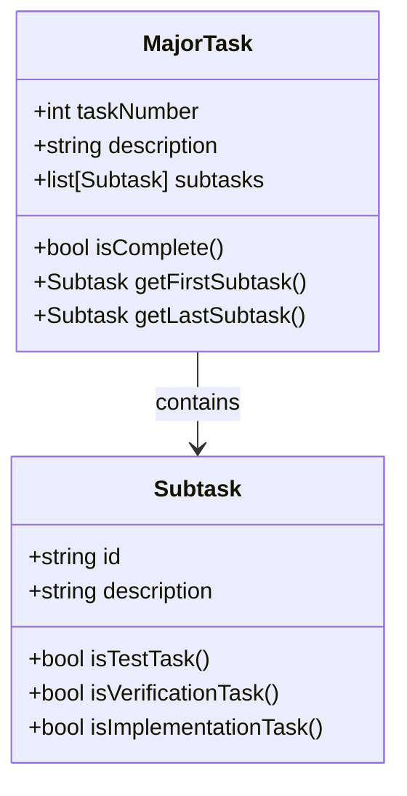
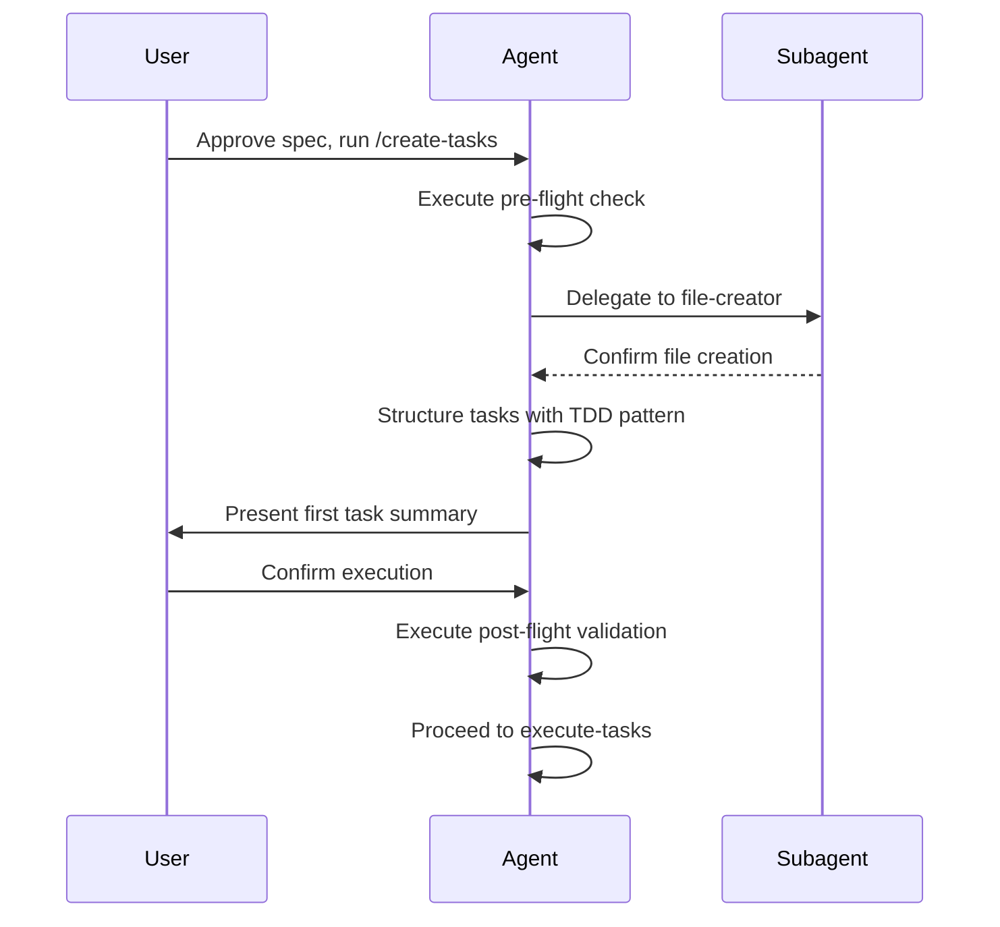
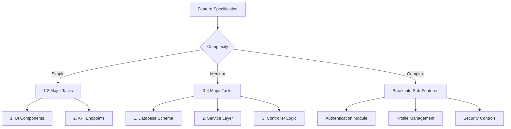
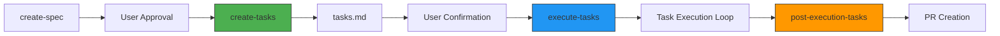

# Create Tasks Workflow

<cite>
**Referenced Files in This Document**   
- [create-tasks.md](file://instructions/core/create-tasks.md)
- [create-spec.md](file://instructions/core/create-spec.md)
- [execute-tasks.md](file://instructions/core/execute-tasks.md)
- [post-flight.md](file://instructions/meta/post-flight.md)
- [pre-flight.md](file://instructions/meta/pre-flight.md)
- [commands/create-tasks.md](file://commands/create-tasks.md)
- [github-copilot/prompts/create-tasks.prompt.md](file://github-copilot/prompts/create-tasks.prompt.md)
</cite>

## Table of Contents
1. [Introduction](#introduction)
2. [Workflow Overview](#workflow-overview)
3. [Task Creation Process](#task-creation-process)
4. [CLI Command Integration](#cli-command-integration)
5. [Task Template Structure](#task-template-structure)
6. [Post-Flight Validation](#post-flight-validation)
7. [Common Challenges and Decomposition Strategies](#common-challenges-and-decomposition-strategies)
8. [Integration with Execution Workflow](#integration-with-execution-workflow)
9. [Conclusion](#conclusion)

## Introduction

The **Create Tasks Workflow** is a core component of the Agent OS framework that transforms approved feature specifications into structured, executable development tasks. This workflow ensures that high-level product requirements are systematically decomposed into granular, test-driven development (TDD) tasks with clear acceptance criteria. The process is designed to enable seamless handoff between planning and implementation phases across various AI coding platforms by standardizing task creation, dependency tracking, and execution readiness checks.

This document details how the `create-tasks` workflow operates, its integration with CLI commands, template enforcement mechanisms, and validation procedures that ensure alignment with technical specifications.

**Section sources**
- [create-tasks.md](file://instructions/core/create-tasks.md#L1-L111)
- [create-spec.md](file://instructions/core/create-spec.md#L1-L430)

## Workflow Overview

The Create Tasks Workflow initiates after a feature specification has been reviewed and approved by the user. It follows a structured process defined in `instructions/core/create-tasks.md` that emphasizes technical dependency ordering, TDD principles, and incremental development. The workflow consists of two primary phases:

1. **Task List Generation**: Creation of a hierarchical task checklist in `tasks.md`
2. **Execution Readiness Check**: Presentation of the first task for user confirmation before implementation begins

The workflow is triggered only after successful completion of the spec creation process (`create-spec.md`) and user approval, ensuring that all requirements are clearly defined before task decomposition begins.



**Diagram sources**
- [create-tasks.md](file://instructions/core/create-tasks.md#L1-L111)
- [create-spec.md](file://instructions/core/create-spec.md#L420-L430)

**Section sources**
- [create-tasks.md](file://instructions/core/create-tasks.md#L1-L50)
- [create-spec.md](file://instructions/core/create-spec.md#L420-L430)

## Task Creation Process

### Step 1: Generate tasks.md File

The workflow begins with the **file-creator** subagent generating a `tasks.md` file within the feature's specification directory. This file serves as the central task management document and is created using a standardized template that enforces consistent formatting across all features.

The file-creator adheres to strict constraints:
- Never overwrites existing files
- Creates parent directories if they don't exist
- Maintains exact template structure
- Only replaces placeholders without modifying template content

**Section sources**
- [create-tasks.md](file://instructions/core/create-tasks.md#L15-L30)
- [file-creator.md](file://adk/agents/file-creator.md#L350-L359)

### Step 2: Task Structure and Hierarchy

Tasks are organized in a hierarchical structure that balances comprehensiveness with manageability:

- **Major Tasks**: 1-5 top-level checklist items, numbered sequentially (1., 2., 3.)
- **Subtasks**: Up to 8 per major task, using decimal notation (1.1, 1.2, etc.)

This structure groups related functionality while maintaining clear boundaries between discrete development units. Each major task typically represents a feature component or technical module, while subtasks represent individual implementation steps.

The workflow enforces specific ordering principles:
- **Technical dependencies**: Tasks are ordered based on prerequisite requirements
- **TDD approach**: First subtask is always "Write tests for [COMPONENT]"
- **Incremental build**: Features are constructed in logical progression
- **Functional grouping**: Related capabilities are clustered together



**Diagram sources**
- [create-tasks.md](file://instructions/core/create-tasks.md#L35-L65)
- [execute-task.md](file://instructions/core/execute-task.md#L130-L178)

**Section sources**
- [create-tasks.md](file://instructions/core/create-tasks.md#L35-L85)

## CLI Command Integration

The Create Tasks Workflow is invoked through the `/create-tasks` command, which serves as the user-facing interface to the underlying instruction set.

### Command Structure

The command is defined in `commands/create-tasks.md` and acts as a reference pointer to the core instructions:

```markdown
# Create Tasks

Create a tasks list with sub-tasks to execute a feature based on its spec.

Refer to the instructions located in this file:
@.agent-os/instructions/core/create-tasks.md
```

This design pattern separates command invocation from implementation logic, allowing multiple AI platforms (ADK, Claude, Copilot) to share the same underlying workflow while maintaining platform-specific command interfaces.

### Prompt Integration

Platform-specific prompts, such as `github-copilot/prompts/create-tasks.prompt.md`, reference the same core instructions, ensuring consistency across different AI coding assistants:

```
# Create Tasks

Create tasks for a new feature.

Refer to the instructions located in this file:
@.agent-os/instructions/core/create-tasks.md
```

This architecture enables standardized task creation regardless of the AI agent executing the workflow, promoting interoperability and reducing platform-specific divergence.

```mermaid
graph TB
User --> CLI[/create-tasks]
CLI --> CommandFile[commands/create-tasks.md]
CommandFile --> CoreInstructions[instructions/core/create-tasks.md]
CoreInstructions --> Subagents
Subagents --> FileCreator[file-creator]
Subagents --> ContextFetcher[context-fetcher]
style CLI fill:#4B9CD3,stroke:#333
style CommandFile fill:#F2DC5D,stroke:#333
style CoreInstructions fill:#95C8D8,stroke:#333
style Subagents fill:#B0E0E6,stroke:#333
```

**Diagram sources**
- [commands/create-tasks.md](file://commands/create-tasks.md#L1-L7)
- [github-copilot/prompts/create-tasks.prompt.md](file://github-copilot/prompts/create-tasks.prompt.md#L1-L7)
- [create-tasks.md](file://instructions/core/create-tasks.md#L1-L111)

**Section sources**
- [commands/create-tasks.md](file://commands/create-tasks.md#L1-L7)
- [github-copilot/prompts/create-tasks.prompt.md](file://github-copilot/prompts/create-tasks.prompt.md#L1-L7)

## Task Template Structure

The workflow enforces a standardized task template that ensures consistency in task formatting, priority indication, and dependency tracking.

### Template Components

The task template includes the following structural elements:

```markdown
## Tasks

- [ ] 1. [MAJOR_TASK_DESCRIPTION]
  - [ ] 1.1 Write tests for [COMPONENT]
  - [ ] 1.2 [IMPLEMENTATION_STEP]
  - [ ] 1.3 [IMPLEMENTATION_STEP]
  - [ ] 1.4 Verify all tests pass

- [ ] 2. [MAJOR_TASK_DESCRIPTION]
  - [ ] 2.1 Write tests for [COMPONENT]
  - [ ] 2.2 [IMPLEMENTATION_STEP]
```

### Key Structural Rules

1. **Test-Driven Development Enforcement**:
   - First subtask must be test creation
   - Final subtask must verify all tests pass
   - Ensures TDD methodology is followed

2. **Hierarchical Numbering**:
   - Major tasks use whole numbers (1., 2., 3.)
   - Subtasks use decimal notation (1.1, 1.2, 2.1, 2.2)
   - Clear visual hierarchy and sequencing

3. **Checklist Format**:
   - All tasks use markdown checklist syntax
   - Enables progress tracking in version control
   - Integrates with GitHub/GitLab task management

4. **Dependency Indication**:
   - Implicit through ordering
   - Later tasks depend on completion of earlier ones
   - No explicit dependency tags, but ordering reflects dependencies

This template structure ensures that all tasks across the codebase follow the same pattern, making it easier for AI agents to parse, execute, and validate task completion.

**Section sources**
- [create-tasks.md](file://instructions/core/create-tasks.md#L67-L85)

## Post-Flight Validation

After task creation is complete, the workflow executes post-flight validation to ensure compliance with process requirements.

### Post-Flight Check Process

The `post_flight_check` directive executes `instructions/meta/post-flight.md`, which performs the following verification steps:

- Confirms every numbered step was executed according to instructions
- Validates that specified subagents were actually used
- Reports any deviations from the intended process
- Identifies skipped or misread instructions

The post-flight check ensures accountability and process integrity by requiring the AI agent to self-audit its execution before proceeding to implementation.

### Pre-Flight Requirements

Before task creation begins, the workflow also executes `instructions/meta/pre-flight.md`, which enforces:

- Strict adherence to subagent specifications
- Sequential processing of XML blocks
- Exact template usage
- Complete execution of all numbered steps

These pre- and post-flight checks create a quality assurance loop that maintains consistency across all task creation operations.



**Diagram sources**
- [create-tasks.md](file://instructions/core/create-tasks.md#L1-L111)
- [post-flight.md](file://instructions/meta/post-flight.md#L1-L17)
- [pre-flight.md](file://instructions/meta/pre-flight.md#L1-L19)

**Section sources**
- [create-tasks.md](file://instructions/core/create-tasks.md#L106-L111)
- [post-flight.md](file://instructions/meta/post-flight.md#L1-L17)
- [pre-flight.md](file://instructions/meta/pre-flight.md#L1-L19)

## Common Challenges and Decomposition Strategies

### Challenge 1: Overly Broad Tasks

**Symptoms**:
- Major tasks with more than 8 subtasks
- Vague implementation steps
- Unclear acceptance criteria

**Resolution Strategy**:
Decompose into multiple major tasks, each with focused subtasks. For example, instead of "Implement user authentication," create:
- 1. Design authentication database schema
- 2. Implement login endpoint
- 3. Implement password reset flow

### Challenge 2: Missing Dependencies

**Symptoms**:
- Tasks that cannot be completed due to unmet prerequisites
- Circular dependencies between tasks
- Implementation blocked by incomplete components

**Resolution Strategy**:
Apply dependency mapping before finalizing task order:
1. Identify all component dependencies
2. Order tasks so prerequisites come first
3. Use conditional documentation for optional dependencies

### Challenge 3: Inconsistent Test Coverage

**Symptoms**:
- Missing test creation subtasks
- Verification steps that don't validate all tests
- Incomplete test scenarios

**Resolution Strategy**:
Enforce TDD template compliance:
- Always include "Write tests" as first subtask
- Always include "Verify all tests pass" as last subtask
- Ensure test scope matches implementation scope

### Recommended Decomposition Pattern



**Section sources**
- [create-tasks.md](file://instructions/core/create-tasks.md#L35-L85)
- [execute-task.md](file://instructions/core/execute-task.md#L130-L178)

## Integration with Execution Workflow

The Create Tasks Workflow serves as the bridge between specification and implementation, feeding directly into the `execute-tasks` workflow.

### Handoff Mechanism

When the user approves the first task, the system transitions to `instructions/core/execute-tasks.md`, which:

1. Identifies tasks to execute (explicit or implicit selection)
2. Gathers context using the context-fetcher subagent
3. Manages git branches via git-workflow subagent
4. Executes tasks in a loop using execute-task instructions
5. Runs post-execution tasks upon completion

### Context Preservation

The task creation process generates several artifacts that preserve context for execution:
- `tasks.md`: Detailed implementation checklist
- `spec-lite.md`: Condensed specification for AI context
- `technical-spec.md`: Implementation requirements
- Git branch: Isolated development environment

This structured handoff ensures that execution agents have all necessary information to implement features correctly while maintaining alignment with the original specification.



**Diagram sources**
- [create-tasks.md](file://instructions/core/create-tasks.md#L87-L104)
- [execute-tasks.md](file://instructions/core/execute-tasks.md#L1-L187)

**Section sources**
- [create-tasks.md](file://instructions/core/create-tasks.md#L87-L104)
- [execute-tasks.md](file://instructions/core/execute-tasks.md#L1-L187)

## Conclusion

The Create Tasks Workflow is a critical component of the Agent OS framework that standardizes the transition from feature specification to implementation. By enforcing structured task decomposition, TDD principles, and consistent formatting, it enables reliable handoff between planning and execution phases across different AI coding platforms.

Key strengths of the workflow include:
- **Standardization**: Uniform task templates ensure consistency
- **Automation**: Subagent delegation handles mechanical aspects
- **Validation**: Pre- and post-flight checks maintain process integrity
- **Interoperability**: Central instruction set works across AI platforms
- **Traceability**: Clear lineage from spec to implementation tasks

This workflow exemplifies how AI-assisted development can be systematized to produce predictable, high-quality outcomes while maintaining flexibility for different implementation approaches and platform capabilities.

**Section sources**
- [create-tasks.md](file://instructions/core/create-tasks.md#L1-L111)
- [execute-tasks.md](file://instructions/core/execute-tasks.md#L1-L187)
- [post-flight.md](file://instructions/meta/post-flight.md#L1-L17)