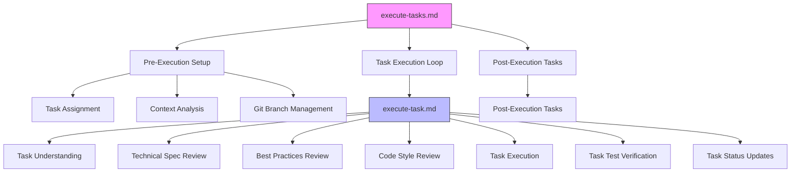
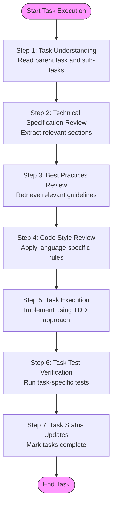
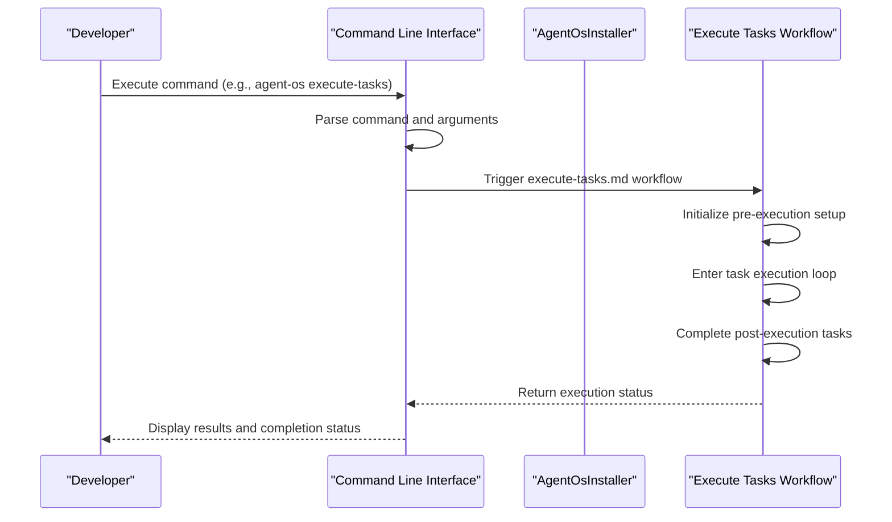
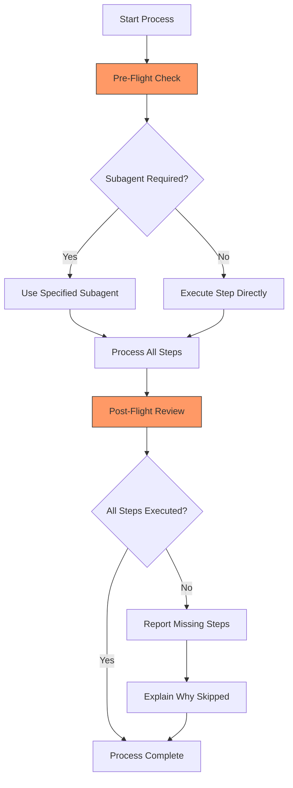
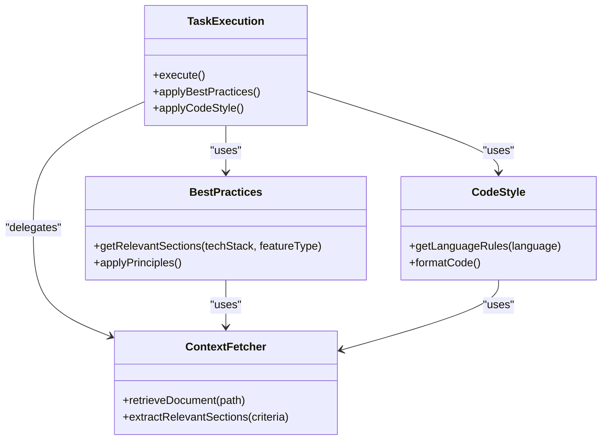

# Execute Tasks Workflow

<cite>
**Referenced Files in This Document**   
- [execute-tasks.md](file://instructions/core/execute-tasks.md)
- [execute-task.md](file://instructions/core/execute-task.md)
- [execute-tasks.toml](file://qwen-code/commands/execute-tasks.toml)
- [execute-task.toml](file://qwen-code/commands/execute-task.toml)
- [execute-tasks.prompt.md](file://github-copilot/prompts/execute-tasks.prompt.md)
- [execute-task.prompt.md](file://github-copilot/prompts/execute-task.prompt.md)
- [execute-tasks.md](file://commands/execute-tasks.md)
- [execute-task.md](file://commands/execute-task.md)
- [cli.py](file://src/cli.py)
- [installer.py](file://src/installer.py)
- [pre-flight.md](file://instructions/meta/pre-flight.md)
- [post-flight.md](file://instructions/meta/post-flight.md)
- [best-practices.md](file://standards/best-practices.md)
- [code-style.md](file://standards/code-style.md)
- [python-style.md](file://standards/code-style/python-style.md)
- [javascript-style.md](file://standards/code-style/javascript-style.md)
</cite>

## Table of Contents
1. [Introduction](#introduction)
2. [Workflow Architecture](#workflow-architecture)
3. [Core Execution Phases](#core-execution-phases)
4. [Task Execution Loop](#task-execution-loop)
5. [CLI Integration](#cli-integration)
6. [Execution Templates](#execution-templates)
7. [Pre-Flight and Post-Flight Validation](#pre-flight-and-post-flight-validation)
8. [Code Style and Best Practices Integration](#code-style-and-best-practices-integration)
9. [Common Issues and Debugging](#common-issues-and-debugging)
10. [Cross-Platform Compatibility](#cross-platform-compatibility)
11. [Conclusion](#conclusion)

## Introduction

The execute-tasks workflow represents the implementation phase of product development within Agent OS, orchestrating the systematic execution of development tasks from specification to completion. This workflow enables reliable, auditable code generation across diverse AI coding assistants by standardizing execution patterns and enforcing quality controls. The system is designed around a three-phase process: pre-execution setup, task execution loop, and post-execution verification, ensuring comprehensive coverage of development activities from branch management to final testing and delivery.

**Section sources**
- [execute-tasks.md](file://instructions/core/execute-tasks.md#L1-L187)

## Workflow Architecture

The execute-tasks workflow is structured as a hierarchical system where high-level orchestration is managed by execute-tasks.md, which coordinates the execution of individual tasks according to the detailed procedures defined in execute-task.md. This architecture enables both broad workflow management and granular task implementation control. The system employs a modular design with specialized subagents for context fetching, git workflow management, and test running, allowing for separation of concerns and focused functionality. Pre-flight and post-flight validation steps ensure process integrity, while the integration of standards and best practices documentation maintains code quality across implementations.

**Diagram sources**
- [execute-tasks.md](file://instructions/core/execute-tasks.md#L1-L187)
- [execute-task.md](file://instructions/core/execute-task.md#L1-L263)

**Section sources**
- [execute-tasks.md](file://instructions/core/execute-tasks.md#L1-L187)
- [execute-task.md](file://instructions/core/execute-task.md#L1-L263)

## Core Execution Phases

The execute-tasks workflow operates through three distinct phases that ensure comprehensive task implementation. The first phase, pre-execution setup, establishes the necessary context and environment for task execution. This includes task assignment based on the current specification, context gathering from relevant documentation, and proper git branch management to isolate changes. The second phase, the task execution loop, systematically processes each assigned task using standardized procedures. The final phase, post-execution tasks, ensures proper delivery and quality verification of implemented features. Each phase is critical to the overall workflow, and completion of all three phases is mandatory according to the workflow rules.

**Section sources**
- [execute-tasks.md](file://instructions/core/execute-tasks.md#L1-L187)

## Task Execution Loop

The task execution loop represents the core implementation phase where individual tasks are processed according to the execute-task.md instructions. This loop iterates through all assigned parent tasks and their subtasks, applying a consistent methodology to each. The process begins with task understanding, where the full scope of implementation is analyzed from tasks.md. This is followed by technical specification review to extract relevant implementation details. The workflow then incorporates best practices and code style guidelines specific to the task's technology stack before executing the task itself using a test-driven development approach. After implementation, task-specific tests are verified, and task status is updated in the tracking document.

**Diagram sources**
- [execute-task.md](file://instructions/core/execute-task.md#L1-L263)

**Section sources**
- [execute-task.md](file://instructions/core/execute-task.md#L1-L263)

## CLI Integration

The execute-tasks workflow is accessible through the Agent OS command line interface, which provides a user-friendly way to trigger automated coding workflows. The CLI, implemented in cli.py, exposes commands that map directly to the execute-tasks functionality. When a user invokes the appropriate command, the system delegates to the underlying instruction files that define the execution process. The installer.py module ensures that the necessary command files are properly installed in project directories, making the workflow available across different development environments. This integration allows developers to initiate complex automated workflows with simple command-line instructions, bridging the gap between user interaction and automated implementation.

**Diagram sources**
- [cli.py](file://src/cli.py#L1-L187)
- [installer.py](file://src/installer.py#L1-L155)

**Section sources**
- [cli.py](file://src/cli.py#L1-L187)
- [installer.py](file://src/installer.py#L1-L155)

## Execution Templates

The execute-tasks workflow supports multiple AI coding assistants through platform-specific execution templates that standardize code generation patterns across different languages and environments. These templates, located in directories like github-copilot/prompts and qwen-code/commands, provide consistent interfaces to the core execution instructions regardless of the underlying AI platform. The templates reference the same core instruction files (execute-tasks.md and execute-task.md), ensuring uniform behavior across platforms while accommodating platform-specific syntax and conventions. This approach enables reliable code generation across Python, JavaScript, and other languages by applying the same procedural framework with appropriate language-specific adaptations.

**Section sources**
- [execute-tasks.prompt.md](file://github-copilot/prompts/execute-tasks.prompt.md#L1-L6)
- [execute-task.prompt.md](file://github-copilot/prompts/execute-task.prompt.md#L1-L6)
- [execute-tasks.toml](file://qwen-code/commands/execute-tasks.toml#L1-L8)
- [execute-task.toml](file://qwen-code/commands/execute-task.toml#L1-L8)

## Pre-Flight and Post-Flight Validation

The execute-tasks workflow incorporates comprehensive validation through pre-flight and post-flight checks that ensure task readiness and code quality. The pre-flight validation, defined in pre-flight.md, establishes critical execution rules such as mandatory use of specified subagents and sequential processing of XML blocks. This ensures that each step is executed according to its instructions and that necessary tools are properly utilized. The post-flight validation, defined in post-flight.md, provides a final review mechanism that verifies all steps have been completed according to their specifications and identifies any deviations from the intended process. These validation steps create a robust quality control framework that enhances the reliability and auditability of the automated development process.

**Diagram sources**
- [pre-flight.md](file://instructions/meta/pre-flight.md#L1-L19)
- [post-flight.md](file://instructions/meta/post-flight.md#L1-L17)

**Section sources**
- [pre-flight.md](file://instructions/meta/pre-flight.md#L1-L19)
- [post-flight.md](file://instructions/meta/post-flight.md#L1-L17)

## Code Style and Best Practices Integration

The execute-tasks workflow integrates code style and best practices guidelines to ensure consistent, high-quality implementations across all generated code. During task execution, the system retrieves relevant sections from best-practices.md and code-style.md based on the task's technology stack and feature type. For Python tasks, the python-style.md guide provides specific formatting rules, type hinting conventions, and function structure recommendations. For JavaScript tasks, the javascript-style.md guide offers language-specific guidance. The context-fetcher subagent dynamically retrieves these guidelines, applying them to the current implementation context. This integration ensures that all generated code adheres to established standards for readability, maintainability, and technical quality.

**Diagram sources**
- [execute-task.md](file://instructions/core/execute-task.md#L1-L263)
- [best-practices.md](file://standards/best-practices.md#L1-L57)
- [code-style.md](file://standards/code-style.md#L1-L95)
- [python-style.md](file://standards/code-style/python-style.md#L1-L117)
- [javascript-style.md](file://standards/code-style/javascript-style.md#L1-L1)

**Section sources**
- [execute-task.md](file://instructions/core/execute-task.md#L1-L263)
- [best-practices.md](file://standards/best-practices.md#L1-L57)
- [code-style.md](file://standards/code-style.md#L1-L95)

## Common Issues and Debugging

The execute-tasks workflow addresses common implementation issues such as partial implementations and test coverage gaps through systematic debugging and validation techniques. When task-specific tests fail during the verification phase, the workflow requires debugging and fixing of specific issues before proceeding. The system limits attempts to resolve blocking issues to three different approaches before requiring documentation of the problem with a warning emoji. Task status updates in tasks.md provide clear visibility into completion status, with completed tasks marked with [x] and blocked tasks documented with specific issue descriptions. This structured approach to issue management ensures that problems are systematically identified, addressed, and documented, maintaining the integrity of the development process.

**Section sources**
- [execute-task.md](file://instructions/core/execute-task.md#L1-L263)

## Cross-Platform Compatibility

The execute-tasks workflow is designed for compatibility across multiple AI coding assistants, including GitHub Copilot and Claude Code, through a unified instruction system with platform-specific interfaces. The core execution logic resides in the instruction files, while platform-specific templates in directories like github-copilot/prompts and qwen-code/commands provide the necessary adaptation layer. This architecture allows the same procedural framework to be accessed through different AI platforms, ensuring consistent behavior regardless of the underlying technology. The installer.py module facilitates this cross-platform compatibility by selectively installing platform-specific files based on user preferences, enabling developers to leverage the execute-tasks workflow with their preferred AI coding assistant.

**Section sources**
- [execute-tasks.prompt.md](file://github-copilot/prompts/execute-tasks.prompt.md#L1-L6)
- [execute-tasks.toml](file://qwen-code/commands/execute-tasks.toml#L1-L8)
- [installer.py](file://src/installer.py#L1-L155)

## Conclusion

The execute-tasks workflow provides a comprehensive framework for automated implementation in product development, combining structured execution phases with robust quality controls and cross-platform compatibility. By orchestrating the execution of multiple tasks through a standardized process, the workflow ensures reliable and auditable code generation across diverse AI coding assistants. The integration of pre-flight validation, context-aware best practices, and post-flight verification creates a robust system that maintains code quality while enabling efficient development. This approach represents a significant advancement in automated software development, providing a systematic methodology that balances automation with quality assurance and adaptability across different technological environments.