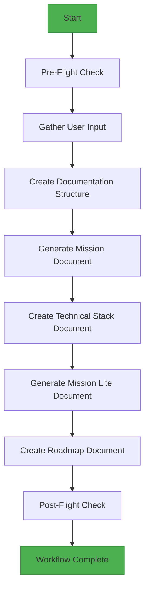
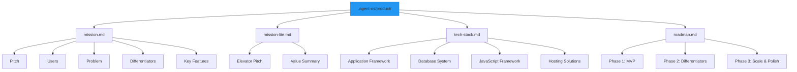

# Plan Product Workflow

<cite>
**Referenced Files in This Document**   
- [plan-product.md](file://instructions/core/plan-product.md)
- [pre-flight.md](file://instructions/meta/pre-flight.md)
- [commands/plan-product.md](file://commands/plan-product.md)
- [github-copilot/prompts/plan-product.prompt.md](file://github-copilot/prompts/plan-product.prompt.md)
- [standards/tech-stack.md](file://standards/tech-stack.md)
- [adk/agents/file-creator.md](file://adk/agents/file-creator.md)
- [adk/agents/context-fetcher.md](file://adk/agents/context-fetcher.md)
</cite>

## Table of Contents
1. [Introduction](#introduction)
2. [Workflow Overview](#workflow-overview)
3. [Instruction File Analysis](#instruction-file-analysis)
4. [Command Template Integration](#command-template-integration)
5. [Prompt Structure and AI Agent Guidance](#prompt-structure-and-ai-agent-guidance)
6. [Pre-Flight Validation Process](#pre-flight-validation-process)
7. [Output Artifacts and Documentation Structure](#output-artifacts-and-documentation-structure)
8. [Common Issues and Mitigation Strategies](#common-issues-and-mitigation-strategies)
9. [Integration with Downstream Workflows](#integration-with-downstream-workflows)
10. [Conclusion](#conclusion)

## Introduction

The Plan Product workflow serves as the foundational entry point for initiating the product development lifecycle within Agent OS. This workflow establishes the strategic foundation by defining the product vision, scope, and high-level objectives before any technical implementation begins. By systematically capturing essential product information through structured interactions with AI agents, this process ensures that all subsequent development activities are aligned with clear business goals and user needs. The workflow is designed to be platform-agnostic, supporting integration with various AI coding assistants including Claude Code, GitHub Copilot, and Cursor, while maintaining consistency in output format and quality.

**Section sources**
- [plan-product.md](file://instructions/core/plan-product.md#L1-L329)

## Workflow Overview

The Plan Product workflow follows a sequential, six-step process that guides AI agents through the systematic creation of comprehensive product documentation. The workflow begins with user input collection and concludes with the generation of structured planning artifacts that serve as the foundation for all future development activities. Each step in the process is designed to build upon the previous one, creating a coherent and comprehensive product plan.

The workflow initiates with the pre-flight check that ensures adherence to execution rules, followed by gathering user inputs for the product's main idea, key features, target users, and tech stack preferences. Subsequently, the workflow creates a standardized documentation structure in the `.agent-os/product/` directory, generating four key files: mission.md, mission-lite.md, tech-stack.md, and roadmap.md. Each file serves a specific purpose in capturing different aspects of the product plan, from vision and user personas to technical architecture and development phases.

**Diagram sources**
- [plan-product.md](file://instructions/core/plan-product.md#L1-L329)

**Section sources**
- [plan-product.md](file://instructions/core/plan-product.md#L1-L329)

## Instruction File Analysis

The instruction file located at `instructions/core/plan-product.md` serves as the authoritative guide for AI agents executing the product planning workflow. This XML-structured document provides detailed, step-by-step instructions that ensure consistent execution across different AI platforms and coding assistants. The instruction file defines a comprehensive process flow with six distinct steps, each assigned to a specific subagent responsible for particular aspects of the planning process.

The instruction file begins with a pre-flight check that references `instructions/meta/pre-flight.md`, establishing execution rules that mandate the use of specified subagents, sequential processing of XML blocks, and strict adherence to provided templates. This ensures that all AI agents follow the same procedural guidelines regardless of their underlying platform. The core of the instruction file consists of six steps that systematically build the product plan, starting with user input collection and progressing through documentation creation.

Each step in the instruction file includes specific templates and constraints that guide the AI agent's output. For example, the mission.md creation step includes templates for pitch, users, problem, differentiators, and key features sections, each with defined constraints on content length, structure, and focus. Similarly, the tech-stack.md creation step specifies 13 required technical items that must be captured, from application framework to deployment solution, ensuring comprehensive technical documentation.

The instruction file also incorporates a sophisticated data resolution mechanism that attempts to automatically populate missing technical stack items by checking predefined sources in a specific order: user input, standards/tech-stack.md, CLAUDE.md, and Cursor User Rules. This hierarchical fallback system minimizes user intervention while ensuring technical consistency across projects.

**Section sources**
- [plan-product.md](file://instructions/core/plan-product.md#L1-L329)
- [pre-flight.md](file://instructions/meta/pre-flight.md#L1-L20)

## Command Template Integration

The Plan Product workflow is triggered through a command template located in `commands/plan-product.md`, which serves as the CLI interface for initiating the product planning process. This command template provides a simple, standardized entry point that abstracts the complexity of the underlying instruction file while maintaining full functionality. When executed, the command template references the core instruction file at `@.agent-os/instructions/core/plan-product.md`, establishing the connection between the user-facing command and the detailed execution instructions.

The command template's simplicity belies its powerful functionality, as it acts as a bridge between the user interface and the comprehensive planning workflow. This design pattern is replicated across multiple platforms, with equivalent command templates available for different AI coding assistants. For instance, the GitHub Copilot version is located at `github-copilot/prompts/plan-product.prompt.md`, while the Qwen Code version exists as `qwen-code/commands/plan-product.toml`. This multi-platform approach ensures that users can initiate the same planning workflow regardless of their preferred AI assistant, promoting consistency and accessibility.

The command template structure follows a standardized format across the Agent OS ecosystem, beginning with a descriptive title followed by a brief purpose statement and concluding with the reference to the core instruction file. This consistent structure enables users to quickly understand and utilize different commands while ensuring that all workflows are grounded in the same foundational instructions.

**Section sources**
- [commands/plan-product.md](file://commands/plan-product.md#L1-L7)
- [github-copilot/prompts/plan-product.prompt.md](file://github-copilot/prompts/plan-product.prompt.md#L1-L7)
- [qwen-code/commands/plan-product.toml](file://qwen-code/commands/plan-product.toml#L1-L8)

## Prompt Structure and AI Agent Guidance

The Plan Product workflow employs a sophisticated prompt structure designed to elicit comprehensive and consistent planning output from AI coding assistants. The prompts are carefully crafted to guide AI agents through the complex process of product planning while maintaining flexibility for different implementation contexts. The core instruction file uses XML-like tags to structure the workflow, with `<process_flow>` containing six numbered steps, each with specific subagents and named operations.

Each step in the prompt structure includes detailed templates and constraints that shape the AI agent's output. For example, the pitch section in mission.md is constrained to 1-2 sentences in an elevator pitch style, while the problem section requires 2-4 problems with quantifiable impact metrics. These constraints ensure that the generated content is focused, actionable, and aligned with product planning best practices.

The prompt structure also incorporates data validation mechanisms, such as the error template that lists five specific pieces of missing information when user input is incomplete. This proactive validation helps prevent incomplete or inconsistent product plans by identifying gaps early in the process. Additionally, the effort scale defined in the roadmap.md creation step provides clear guidance on estimating task duration, with categories ranging from XS (1 day) to XL (3+ weeks), enabling realistic planning and resource allocation.

The use of placeholder syntax (e.g., [PRODUCT_NAME], [TARGET_USERS]) in templates provides a structured framework that AI agents can populate with context-specific information. This approach balances standardization with flexibility, ensuring consistent document structure while allowing for product-specific content. The templates also include schema definitions, such as the user persona schema that specifies fields for name, age range, role, context, pain points, and goals, ensuring comprehensive user research documentation.

**Section sources**
- [plan-product.md](file://instructions/core/plan-product.md#L1-L329)
- [adk/agents/file-creator.md](file://adk/agents/file-creator.md#L158-L273)

## Pre-Flight Validation Process

The Plan Product workflow incorporates a robust pre-flight validation process defined in `instructions/meta/pre-flight.md` that ensures proper execution of the planning workflow. This validation process serves as a quality gate that establishes essential execution rules before any planning activities commence. The pre-flight check is automatically executed at the beginning of the workflow through the `<pre_flight_check>` directive in the main instruction file.

The pre-flight rules mandate several critical execution requirements: the use of specified subagents for each step, sequential processing of XML blocks, strict adherence to templates, and the requirement to stop and ask for clarification when details are unclear. These rules ensure consistency and reliability in workflow execution across different AI platforms and user contexts.

The validation process emphasizes the importance of using the correct subagents for specific tasks, such as context-fetcher for gathering user input and file-creator for generating documentation. This specialization ensures that each aspect of the planning workflow is handled by an agent optimized for that particular function. The requirement to process XML blocks sequentially prevents skipping steps or executing them out of order, maintaining the logical flow of the planning process.

Additionally, the pre-flight check establishes the principle of template fidelity, requiring AI agents to use exact templates as provided without modification. This ensures standardization across all product plans generated through the workflow, facilitating easier comparison and analysis of different products within an organization. The rule about asking specific numbered questions when clarification is needed promotes effective communication between the AI agent and the user, ensuring that all necessary information is captured before proceeding.

**Section sources**
- [pre-flight.md](file://instructions/meta/pre-flight.md#L1-L20)
- [plan-product.md](file://instructions/core/plan-product.md#L5-L8)

## Output Artifacts and Documentation Structure

The Plan Product workflow generates a standardized set of documentation artifacts stored in the `.agent-os/product/` directory, creating a comprehensive foundation for product development. These artifacts include four primary documents: mission.md, mission-lite.md, tech-stack.md, and roadmap.md, each serving a distinct purpose in the product planning ecosystem.

The mission.md document captures the complete product vision, including a concise pitch, detailed user personas, problem statements with quantifiable impact, competitive differentiators, and a comprehensive list of key features. This document serves as the definitive source of truth for the product's purpose and scope. The mission-lite.md document provides a condensed version of the mission, extracting the elevator pitch and a brief value summary for efficient AI context usage in subsequent workflows.

The tech-stack.md document systematically captures 13 critical technical decisions, from application framework and database system to hosting solutions and code repository URLs. This comprehensive technical specification ensures that all development activities are aligned with the chosen technology stack. The roadmap.md document outlines 1-3 development phases with specific goals, success criteria, features, and dependencies, providing a clear path for implementation.

**Diagram sources**
- [plan-product.md](file://instructions/core/plan-product.md#L48-L67)
- [adk/agents/file-creator.md](file://adk/agents/file-creator.md#L158-L273)

**Section sources**
- [plan-product.md](file://instructions/core/plan-product.md#L48-L329)

## Common Issues and Mitigation Strategies

The Plan Product workflow addresses several common challenges in product planning through built-in validation and mitigation strategies. One frequent issue is ambiguous product goals, which the workflow mitigates through structured templates that require specific, measurable outcomes. The pitch template, for example, forces clarity by requiring a concise statement of the product type, target users, problem solved, and value proposition.

Another common issue is missing constraints or incomplete information, which the workflow addresses through comprehensive validation mechanisms. The error template explicitly lists five required pieces of information, including the main idea, key features, target users, tech stack preferences, and project initialization status. This proactive validation prevents the workflow from proceeding with incomplete data.

The workflow also addresses the challenge of inconsistent technical decisions through its hierarchical data resolution process. When technical stack items are missing from user input, the system automatically checks predefined sources in a specific order: standards/tech-stack.md, CLAUDE.md, and Cursor User Rules. This ensures technical consistency across projects while minimizing the burden on users.

For issues related to unrealistic planning, the workflow incorporates an effort scale that categorizes tasks from XS (1 day) to XL (3+ weeks), helping teams make more accurate estimates. The roadmap template also requires measurable success criteria for each phase, preventing vague or unquantifiable goals.

The distinction between mission.md and mission-lite.md addresses the challenge of context management in AI systems, providing a full-featured document for comprehensive planning and a condensed version for efficient context usage in subsequent workflows. This dual-document approach optimizes both completeness and performance.

**Section sources**
- [plan-product.md](file://instructions/core/plan-product.md#L62-L67)
- [plan-product.md](file://instructions/core/plan-product.md#L187-L241)
- [plan-product.md](file://instructions/core/plan-product.md#L284-L301)

## Integration with Downstream Workflows

The Plan Product workflow serves as the critical foundation for all downstream development activities in Agent OS, establishing the context and constraints that guide subsequent workflows. The generated documentation artifacts are explicitly referenced and utilized by other workflows, creating a cohesive and interconnected development process.

The create-spec workflow, for example, uses the mission-lite.md and tech-stack.md documents as input, reading them conditionally only if they are not already in context. This integration ensures that feature specifications are aligned with the product vision and technical constraints established during planning. Similarly, the execute-tasks workflow references the decisions documented in the planning phase, maintaining consistency between planning and implementation.

The use of standardized file paths with the @ prefix (e.g., @.agent-os/product/mission.md) enables reliable cross-document referencing across workflows. This referencing system allows subsequent workflows to access the planning artifacts without requiring users to manually provide context, streamlining the development process.

The hierarchical structure of the planning artifacts supports progressive refinement, where high-level planning decisions inform detailed specification and implementation. For instance, the key features identified in mission.md become the basis for individual specifications, while the technical stack decisions in tech-stack.md constrain the implementation options available to developers.

This integration ensures that all development activities remain aligned with the original product vision, reducing the risk of scope creep and ensuring that technical decisions support business objectives. The workflow's output becomes the single source of truth that guides all subsequent development, testing, and deployment activities.

**Section sources**
- [plan-product.md](file://instructions/core/plan-product.md#L243-L282)
- [create-spec.md](file://instructions/core/create-spec.md#L48-L99)

## Conclusion

The Plan Product workflow in Agent OS represents a comprehensive and systematic approach to initiating the product development lifecycle. By establishing a structured process for defining product vision, scope, and technical direction, this workflow ensures that all subsequent development activities are grounded in clear objectives and well-documented constraints. The integration of AI agent guidance through carefully crafted prompts, combined with robust validation mechanisms and standardized output artifacts, creates a reliable foundation for successful product development.

The workflow's design reflects a deep understanding of both product management principles and AI-assisted development, balancing structure with flexibility to accommodate different product types and development contexts. Its multi-platform support ensures accessibility across different AI coding assistants, while maintaining consistency in output quality and format. By addressing common planning challenges through built-in validation and mitigation strategies, the workflow helps teams avoid pitfalls that often derail product initiatives.

As the entry point to the Agent OS ecosystem, the Plan Product workflow sets the stage for all downstream activities, creating a coherent and interconnected development process where each step builds upon the previous one. The documentation artifacts it generates serve as the single source of truth that guides specification, implementation, testing, and deployment, ensuring alignment between business objectives and technical execution.