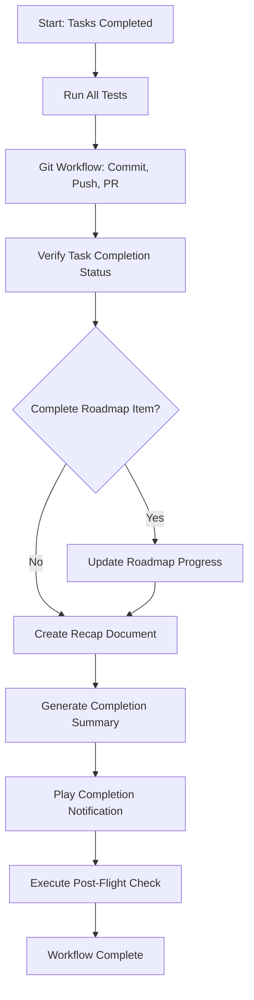
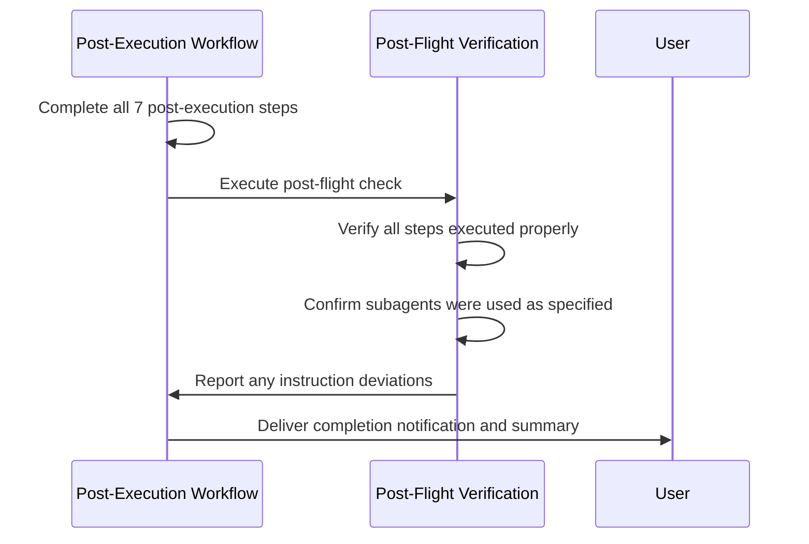

# Post-Execution Tasks Workflow

<cite>
**Referenced Files in This Document**   
- [post-execution-tasks.md](file://instructions/core/post-execution-tasks.md)
- [post-flight.md](file://instructions/meta/post-flight.md)
- [execute-tasks.md](file://instructions/core/execute-tasks.md)
</cite>

## Table of Contents
1. [Introduction](#introduction)
2. [Post-Execution Tasks Overview](#post-execution-tasks-overview)
3. [Core Steps in Post-Execution Workflow](#core-steps-in-post-execution-workflow)
4. [Integration with Post-Flight Verification](#integration-with-post-flight-verification)
5. [Artifact Packaging and Version Control](#artifact-packaging-and-version-control)
6. [Common Issues and Remediation](#common-issues-and-remediation)
7. [Conclusion](#conclusion)

## Introduction
The post-execution-tasks workflow in Agent OS provides a standardized process for finalizing development work, ensuring that all implementation activities are properly concluded, verified, and delivered. This workflow closes the development loop by systematically handling cleanup, review, and handoff activities after feature implementation. The process ensures consistency across AI-assisted development projects by enforcing quality checks, proper documentation, and standardized delivery practices.

**Section sources**
- [post-execution-tasks.md](file://instructions/core/post-execution-tasks.md#L1-L20)

## Post-Execution Tasks Overview
The post-execution-tasks workflow is invoked after all assigned tasks have been completed through the execute-tasks.md process. It serves as the final phase in the development lifecycle, focusing on verification, documentation, and delivery activities. This workflow ensures that implemented features meet acceptance criteria and are properly integrated into the codebase.

The process begins with comprehensive testing verification, followed by Git workflow operations, task completion validation, and optional roadmap updates. The workflow concludes with the creation of recap documentation and completion notifications. Each step is designed to maintain code quality, ensure traceability, and provide clear communication about what has been delivered.

**Diagram sources**
- [post-execution-tasks.md](file://instructions/core/post-execution-tasks.md#L1-L249)

**Section sources**
- [post-execution-tasks.md](file://instructions/core/post-execution-tasks.md#L1-L50)

## Core Steps in Post-Execution Workflow

### Step 1: Comprehensive Test Verification
The workflow initiates with a complete test suite execution to ensure no regressions have been introduced during implementation. The test-runner subagent executes all tests in the application's test suite, requiring a 100% pass rate before proceeding. Any failures must be troubleshooted and fixed before continuing to subsequent steps.

This comprehensive verification differs from task-specific testing performed during implementation, as it validates the entire codebase rather than isolated features. The requirement for all tests to pass ensures that new changes do not negatively impact existing functionality.

**Section sources**
- [post-execution-tasks.md](file://instructions/core/post-execution-tasks.md#L21-L50)

### Step 2: Git Workflow Execution
The git-workflow subagent handles version control operations, including creating a descriptive commit, pushing changes to the remote repository, and creating a pull request. The commit message follows conventional commit format when applicable, providing a clear summary of changes.

The pull request is created against the main branch with a descriptive title and functionality recap in the description. The PR URL is saved for inclusion in the final completion summary, providing a direct link to the code changes for review.

**Section sources**
- [post-execution-tasks.md](file://instructions/core/post-execution-tasks.md#L51-L75)

### Step 3: Task Completion Verification
The project-manager subagent verifies that all tasks in the current specification's tasks.md file have been properly marked as complete with [x] or documented with blockers. This step ensures accountability and provides a clear record of what was accomplished versus what encountered issues.

The verification process reads the tasks.md file and confirms that each task has an appropriate outcome indicator, maintaining transparency about the implementation status and any unresolved blockers.

**Section sources**
- [post-execution-tasks.md](file://instructions/core/post-execution-tasks.md#L76-L90)

### Step 4: Conditional Roadmap Progress Update
When implemented tasks complete roadmap items, the project-manager subagent updates the roadmap.md file by marking relevant items as complete with [x]. This step is conditional and only executes when the current specification fully implements a roadmap feature, all related tasks are completed, and tests are passing.

The conditional execution prevents unnecessary updates when tasks don't correspond to roadmap items, maintaining the accuracy and relevance of the product roadmap.

**Section sources**
- [post-execution-tasks.md](file://instructions/core/post-execution-tasks.md#L91-L130)

### Step 5: Recap Document Creation
A recap document is created in the .agent-os/recaps/ directory using a standardized template. The document includes a summary of completed features, context from the spec-lite.md file, and a reference to the original specification. The filename follows the format [SPEC_FOLDER_NAME].md with a date prefix.

This standardized documentation ensures consistent artifact packaging and provides a historical record of what was built, serving as a valuable resource for future maintenance and onboarding.

**Section sources**
- [post-execution-tasks.md](file://instructions/core/post-execution-tasks.md#L131-L170)

### Step 6: Completion Summary Generation
A structured summary message is created with emoji headers for scannability, including sections for completed features, encountered issues (if any), testing instructions (if applicable), and the pull request link. The summary provides a concise overview of the implementation for stakeholders.

The template ensures consistent communication format across all completed tasks, enhancing readability and information retrieval.

**Section sources**
- [post-execution-tasks.md](file://instructions/core/post-execution-tasks.md#L171-L200)

### Step 7: Completion Notification
A system sound is played to alert the user that tasks are complete. This immediate feedback mechanism provides a clear signal that the implementation and post-execution processes have finished successfully.

The notification serves as a psychological closure point, helping users transition from development mode to review or next-task planning.

**Section sources**
- [post-execution-tasks.md](file://instructions/core/post-execution-tasks.md#L201-L215)

## Integration with Post-Flight Verification
The post-execution workflow concludes with the execution of post-flight.md rules, which provide systematic verification of code quality, test coverage, and compliance with standards. This final check ensures that all steps in the process flow were properly executed according to their instructions.

The post-flight verification confirms that:
- Every numbered step was executed according to its instructions
- All specified subagents were properly delegated tasks
- No steps were skipped or misread

If any discrepancies are found, the system reports the findings, explaining which parts of the instructions were not followed and why. This meta-level verification enhances reliability by validating the integrity of the execution process itself.

**Diagram sources**
- [post-execution-tasks.md](file://instructions/core/post-execution-tasks.md#L244-L249)
- [post-flight.md](file://instructions/meta/post-flight.md#L8-L17)

**Section sources**
- [post-execution-tasks.md](file://instructions/core/post-execution-tasks.md#L244-L249)
- [post-flight.md](file://instructions/meta/post-flight.md#L8-L17)

## Artifact Packaging and Version Control
The post-execution workflow ensures consistent artifact packaging and version control practices through standardized templates and automated processes. Recap documents follow a uniform structure with date prefixes, feature names, summaries, and contextual information, creating a searchable archive of completed work.

Version control practices are enforced through the git-workflow subagent, which ensures proper commit messages, branch management, and pull request creation. The integration with the execute-tasks.md workflow guarantees that post-execution-tasks.md is invoked after all tasks are completed, maintaining the integrity of the development process.

The workflow's design reflects best practices in software development, including comprehensive testing, clear documentation, and systematic verification, all of which contribute to enhanced reliability and maintainability in AI-assisted development projects.

**Section sources**
- [post-execution-tasks.md](file://instructions/core/post-execution-tasks.md#L131-L170)
- [execute-tasks.md](file://instructions/core/execute-tasks.md#L165-L169)

## Common Issues and Remediation
Despite the structured workflow, common issues may arise during post-execution activities. These include orphaned branches, missing documentation, incomplete task markings, and failed tests during final verification.

Remediation procedures are built into the workflow:
- Failed tests trigger troubleshooting and fixing before proceeding
- Incomplete task markings are identified and updated during verification
- Missing roadmap updates are handled through conditional execution logic
- Documentation gaps are prevented by automated recap creation

When the post-flight check identifies that steps were not executed according to instructions, it reports the specific deviations and reasons, enabling corrective action. This systematic approach to issue detection and remediation enhances the overall reliability of the development process.

**Section sources**
- [post-execution-tasks.md](file://instructions/core/post-execution-tasks.md#L21-L249)
- [post-flight.md](file://instructions/meta/post-flight.md#L8-L17)

## Conclusion
The post-execution-tasks workflow provides a comprehensive framework for finalizing development work in Agent OS. By standardizing cleanup, review, and handoff activities, this workflow ensures that all implementation efforts are properly concluded and delivered. The integration with post-flight verification adds an additional layer of quality control, systematically checking compliance with process requirements.

This standardized approach enhances reliability and maintainability across AI-assisted development projects by enforcing consistent practices for testing, documentation, version control, and delivery. The workflow effectively closes the development loop, validating that all tasks are properly resolved and deliverables meet acceptance criteria, thereby maintaining high standards of code quality and project integrity.

**Section sources**
- [post-execution-tasks.md](file://instructions/core/post-execution-tasks.md#L1-L249)
- [post-flight.md](file://instructions/meta/post-flight.md#L8-L17)