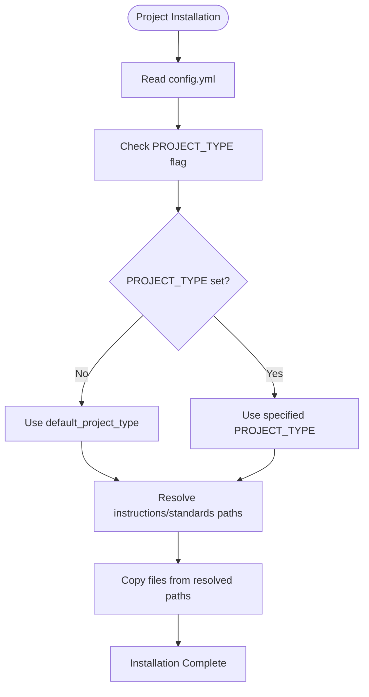
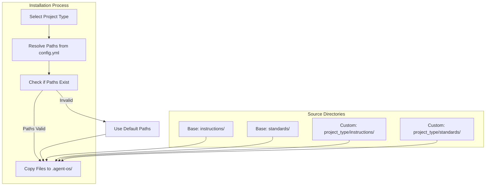
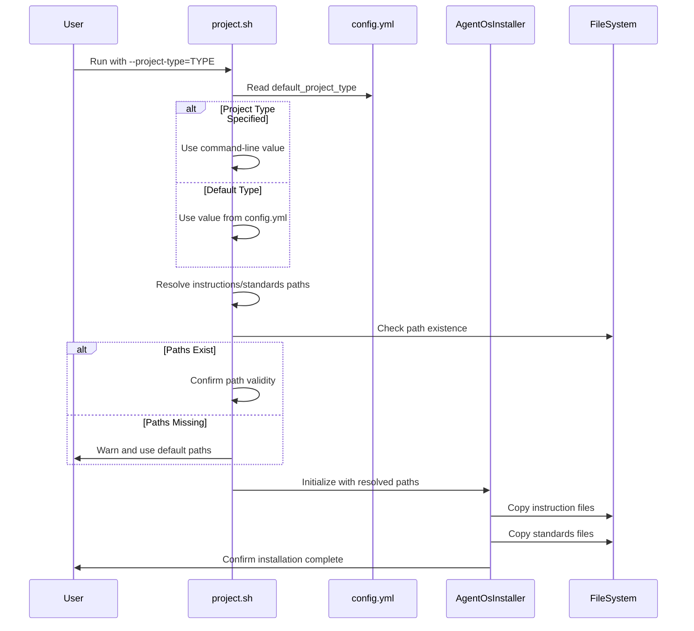
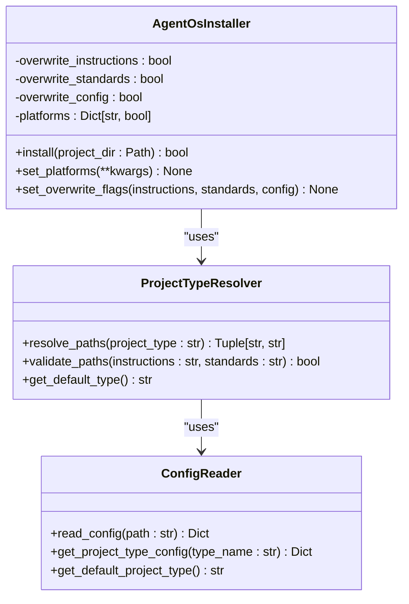

# Project Types

<cite>
**Referenced Files in This Document**   
- [config.yml](file://config.yml) - *Updated in commit 7c66d17f*
- [src/installer.py](file://src\installer.py) - *Integration logic for project types*
- [setup/project.sh](file://setup\project.sh) - *Project type resolution during installation*
- [simics/device-instructions/core/create-simics-device.md](file://simics\device-instructions\core\create-simics-device.md) - *Simics device instruction example*
- [simics/platform-instructions/core/assemble-platform.md](file://simics\platform-instructions\core\assemble-platform.md) - *Platform assembly instruction example*
- [simics/simulation-instructions/core/simulation-testing.md](file://simics\simulation-instructions\core\simulation-testing.md) - *Simulation testing instruction example*
</cite>

## Update Summary
- Added documentation for new Simics-specific project types: `simics-device`, `simics-platform`, and `simics-simulation`
- Updated examples in "Custom Project Type Examples" section to reflect actual configuration
- Enhanced "Field Definitions" with Simics integration context
- Added Simics-related paths to "Instruction and Standards Inheritance" explanation
- Updated "Integration with Installer Logic" to reflect Simics path resolution
- Removed outdated `type_a`/`type_b` references from examples
- Added section sources where specific file analysis occurs

## Table of Contents
1. [Introduction](#introduction)
2. [Project Types Configuration](#project-types-configuration)
3. [Field Definitions](#field-definitions)
4. [Instruction and Standards Inheritance](#instruction-and-standards-inheritance)
5. [Project Type Selection Workflow](#project-type-selection-workflow)
6. [Custom Project Type Examples](#custom-project-type-examples)
7. [Integration with Installer Logic](#integration-with-installer-logic)
8. [Extending and Customizing Project Types](#extending-and-customizing-project-types)
9. [Common Configuration Mistakes](#common-configuration-mistakes)
10. [Optimization Tips](#optimization-tips)

## Introduction
The Project Types system in Agent OS enables users to define and manage different project configurations based on specific development needs. By configuring the `project_types` key in `config.yml`, users can customize instruction sets and standards for various project categories such as 'python-library', 'web-application', or Simics-specific types like 'simics-device'. This system allows for tailored workflows, ensuring that each project type receives appropriate guidance and constraints during setup and execution. The configuration integrates with the installation process to dynamically resolve paths and copy relevant files based on the selected project type.

**Section sources**
- [config.yml](file://config.yml#L1-L67)
- [CHANGELOG.md](file://CHANGELOG.md#L111-L125)

## Project Types Configuration
The `project_types` configuration in `config.yml` defines named project types, each specifying custom instruction and standards directories. The default project type points to the core `instructions` and `standards` directories within the Agent OS installation. Additional project types can be defined by uncommenting and modifying template entries or adding new types. Each project type must specify both `instructions` and `standards` paths, which are resolved during installation. The `default_project_type` field determines which configuration is used when no specific type is requested during installation.



**Diagram sources**
- [config.yml](file://config.yml#L1-L67)
- [setup/project.sh](file://setup\project.sh#L148-L208)

**Section sources**
- [config.yml](file://config.yml#L1-L67)

## Field Definitions
Each project type entry in the `project_types` section includes the following fields:

- **name**: The identifier for the project type (e.g., 'default', 'simics-device'). This name is used with the `--project-type` flag during installation.
- **description**: Optional documentation explaining the purpose and use case of the project type.
- **default status**: Determined by the `default_project_type` field in `config.yml`. The specified type becomes the default when no explicit type is provided.
- **instructions**: Path to the directory containing instruction files for the project type. These files guide the AI agents during product planning and task execution.
- **standards**: Path to the directory containing standards files, including code style guidelines and best practices specific to the project type.
- **associated template sets**: Implicitly defined by the structure of the `instructions` and `standards` directories, these templates are copied during installation and influence agent behavior.

**Section sources**
- [config.yml](file://config.yml#L1-L67)

## Instruction and Standards Inheritance
During installation, the system copies instruction and standards files based on the selected project type. For the 'default' type, files are copied from the base Agent OS directories: `instructions/` and `standards/`. For custom project types, the installer resolves the paths specified in `config.yml` and copies files from those locations. If the specified paths do not exist, the system falls back to the default directories. This mechanism ensures that projects receive appropriate guidance while maintaining backward compatibility. The inheritance model supports domain-specific customization without duplicating common instructions.



**Diagram sources**
- [setup/project.sh](file://setup\project.sh#L182-L208)
- [src/installer.py](file://src\installer.py#L63-L151)

**Section sources**
- [setup/project.sh](file://setup\project.sh#L182-L208)

## Project Type Selection Workflow
The project type selection process begins when the `setup/project.sh` script is executed. If the `--project-type` flag is provided, that value is used; otherwise, the script reads the `default_project_type` from `config.yml`. The selected type is then used to determine source paths for instructions and standards. The installer checks if the specified paths exist and are accessible. If not, it issues a warning and falls back to the default paths. This workflow ensures flexibility while preventing installation failures due to misconfiguration. The resolved paths are then used to copy the appropriate files to the target project's `.agent-os/` directory.



**Diagram sources**
- [setup/project.sh](file://setup\project.sh#L148-L208)
- [src/installer.py](file://src\installer.py#L63-L151)

**Section sources**
- [setup/project.sh](file://setup\project.sh#L148-L208)

## Custom Project Type Examples
Custom project types can be created by defining new entries in the `project_types` section of `config.yml`. For example, the Simics integration introduces three specialized project types:

```yaml
project_types:
  default:
    instructions: ~/.agent-os/instructions
    standards: ~/.agent-os/standards

  simics-device:
    instructions: ~/.agent-os/simics/device-instructions
    standards: ~/.agent-os/simics/device-standards

  simics-platform:
    instructions: ~/.agent-os/simics/platform-instructions
    standards: ~/.agent-os/simics/platform-standards

  simics-simulation:
    instructions: ~/.agent-os/simics/simulation-instructions
    standards: ~/.agent-os/simics/simulation-standards
```

When installing a project, users can specify the type using `--project-type=simics-device`. This would copy device-specific instructions and standards, such as hardware modeling guidelines and device development standards. Similarly, a 'simics-platform' type includes platform assembly templates and validation procedures, while 'simics-simulation' provides testing methodologies and simulation accuracy requirements. These specialized types enable domain-specific workflows for Simics development.

**Section sources**
- [config.yml](file://config.yml#L1-L67)
- [simics/device-instructions/core/create-simics-device.md](file://simics\device-instructions\core\create-simics-device.md)
- [simics/platform-instructions/core/assemble-platform.md](file://simics\platform-instructions\core\assemble-platform.md)

## Integration with Installer Logic
The `src/installer.py` module implements the core installation logic that respects project type configurations. While the Python installer primarily handles file copying, the bash-based `setup/project.sh` script contains the logic for resolving project type-specific paths. The installer reads the `PROJECT_TYPE` environment variable or command-line argument, consults `config.yml` to determine the correct source directories, and copies files accordingly. This integration ensures that both Python and shell-based installation methods produce consistent results. The installer also handles path expansion (e.g., resolving `~` to the home directory) and validates directory existence before copying.



**Diagram sources**
- [src/installer.py](file://src\installer.py#L25-L151)
- [setup/project.sh](file://setup\project.sh#L148-L208)

**Section sources**
- [src/installer.py](file://src\installer.py#L25-L151)

## Extending and Customizing Project Types
Users can extend existing project types or create domain-specific variants by following a structured approach. First, duplicate the `instructions` and `standards` directories to a new location corresponding to the desired project type. Then, customize the instruction files to reflect domain-specific requirements—such as adding API documentation templates for web services or test coverage requirements for libraries. Finally, register the new type in `config.yml` with appropriate paths. This modular design allows organizations to build a library of project templates that can be shared across teams. Domain-specific variants can inherit core practices while adding specialized constraints and workflows.

**Section sources**
- [config.yml](file://config.yml#L1-L67)
- [instructions/core/plan-product.md](file://instructions/core/plan-product.md#L1-L301)

## Common Configuration Mistakes
Several common mistakes can occur when configuring project types:

- **Missing instruction references**: Defining a project type but omitting either `instructions` or `standards` fields results in fallback to default paths with a warning.
- **Invalid type names**: Using names that don't match any defined project type causes the system to use the default configuration.
- **Non-existent paths**: Specifying paths that don't exist on the filesystem triggers a fallback to default directories.
- **Improper indentation**: YAML formatting errors in `config.yml` can prevent proper parsing of project type definitions.
- **Unresolved tildes**: Failing to properly format paths with `~` may lead to incorrect path resolution during installation.

These issues typically result in warnings rather than failures, allowing installations to proceed with default configurations while alerting users to potential problems.

**Section sources**
- [config.yml](file://config.yml#L1-L67)
- [setup/project.sh](file://setup\project.sh#L182-L208)

## Optimization Tips
To effectively manage a large number of project types while maintaining readability:

- **Organize by domain**: Group project types in a dedicated directory (e.g., `~/.agent-os/project_types/`) with subdirectories for each type.
- **Use consistent naming**: Adopt a clear naming convention (e.g., `language-framework`, `domain-type`) to make types easily discoverable.
- **Document types**: Add comments in `config.yml` explaining the purpose of each project type.
- **Leverage inheritance**: Base new types on existing ones and only override necessary files to reduce duplication.
- **Regular audits**: Periodically review and consolidate project types to eliminate redundancy.
- **Version control**: Store custom project type configurations in version control for team sharing and backup.
- **Path simplification**: Use symbolic links or environment variables to simplify complex path references in configuration.

These practices help maintain a scalable and manageable configuration system as the number of project types grows.

**Section sources**
- [config.yml](file://config.yml#L1-L67)
- [setup/project.sh](file://setup\project.sh#L148-L208)