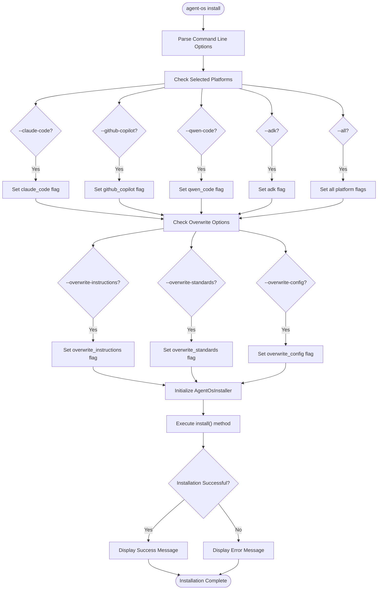
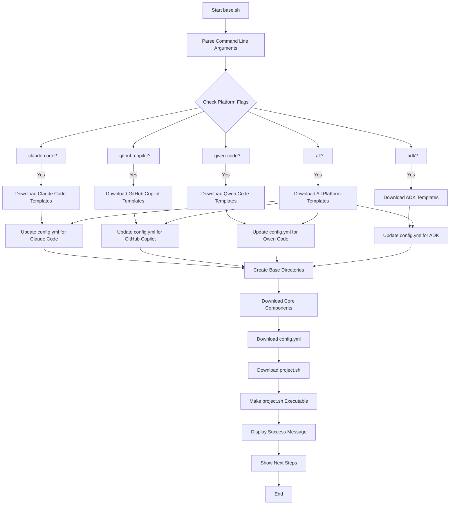
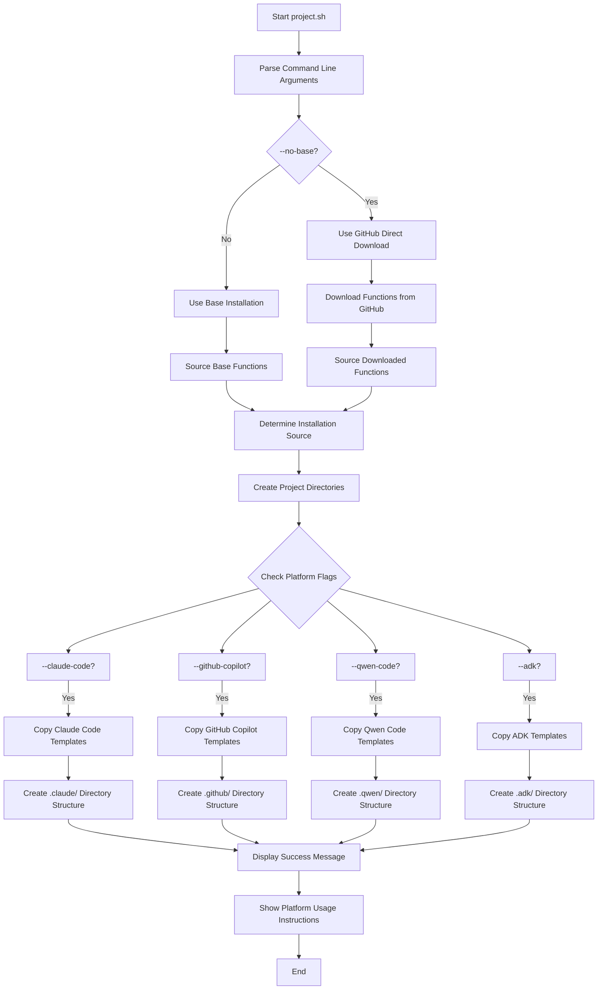
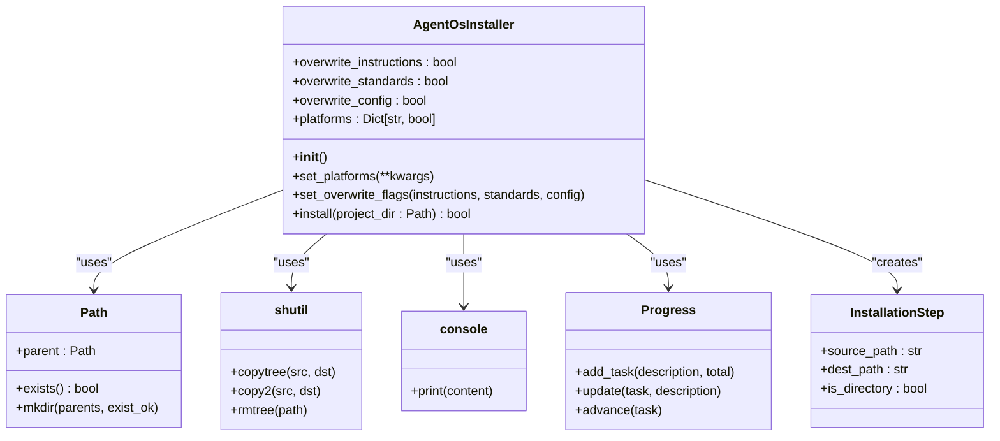
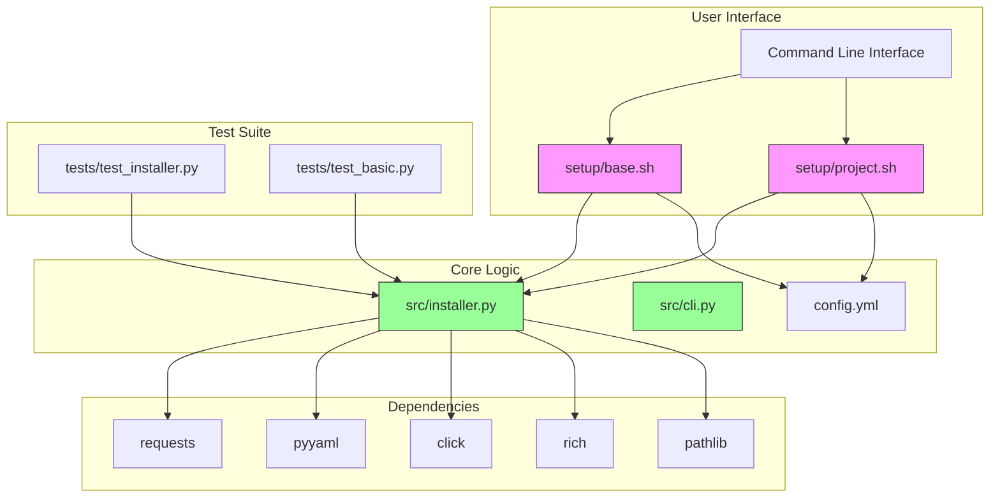

# Installation Guide

<cite>
**Referenced Files in This Document**   
- [src/installer.py](file://src/installer.py)
- [setup/base.sh](file://setup/base.sh)
- [setup/project.sh](file://setup/project.sh)
- [config.yml](file://config.yml)
- [pyproject.toml](file://pyproject.toml)
- [tests/test_installer.py](file://tests/test_installer.py)
- [src/cli.py](file://src/cli.py)
</cite>

## Table of Contents
1. [Two-Phase Installation Process](#two-phase-installation-process)
2. [CLI Command Reference](#cli-command-reference)
3. [Global Base Installation](#global-base-installation)
4. [Local Project Initialization](#local-project-initialization)
5. [Template Copying Mechanism](#template-copying-mechanism)
6. [Installer Architecture](#installer-architecture)
7. [Common Installation Issues](#common-installation-issues)
8. [Troubleshooting Guide](#troubleshooting-guide)

## Two-Phase Installation Process

The Agent OS installation follows a two-phase approach designed to separate global configuration from project-specific setup. This architecture enables consistent development standards across multiple projects while allowing for platform-specific customization at the project level.

The first phase, base system installation, establishes the global Agent OS environment on your machine. This phase installs core components, configuration files, and platform templates to a central location. The second phase, project-specific setup, deploys selected components from the base installation into individual project directories, creating tailored environments based on project requirements.

This separation provides several advantages: centralized management of updates and standards, reduced duplication of large template files, and the ability to maintain different configurations for different project types. The base installation acts as a repository of templates and configurations, while each project installation selectively deploys only the components needed for that specific development environment.

**Section sources**
- [setup/base.sh](file://setup/base.sh#L1-L311)
- [setup/project.sh](file://setup/project.sh#L1-L525)

## CLI Command Reference

The `agent-os install` command provides a comprehensive interface for installing Agent OS in project directories. This CLI tool offers several options to customize the installation process according to specific development platform requirements.

The primary options include:
- `--claude-code`: Enables Claude Code support by installing agent templates to `.claude/agents/`
- `--github-copilot`: Enables GitHub Copilot support by installing prompt templates to `.github/prompts/`
- `--qwen-code`: Enables Qwen Code support by installing command templates to `.qwen/commands/`
- `--overwrite`: Controls file overwriting behavior with three specific flags:
  - `--overwrite-instructions`: Overwrites existing instruction files
  - `--overwrite-standards`: Overwrites existing standards files
  - `--overwrite-config`: Overwrites existing config.yml

The `--all` option enables all available platforms in a single command, providing a comprehensive installation for projects that utilize multiple AI coding assistants. Each flag corresponds directly to platform-specific configuration in the `config.yml` file, ensuring consistency between the CLI interface and configuration management.

The CLI is implemented in `src/cli.py` using the Click framework, providing robust argument parsing and user-friendly help documentation. The command structure follows conventional CLI patterns, accepting both short and long option formats while providing clear error messages for invalid inputs.

**Diagram sources**
- [src/cli.py](file://src/cli.py#L1-L187)
- [src/installer.py](file://src/installer.py#L22-L151)

**Section sources**
- [src/cli.py](file://src/cli.py#L1-L187)
- [src/installer.py](file://src/installer.py#L22-L151)

## Global Base Installation

The global base installation process is initiated through the `setup/base.sh` script, which establishes the foundational Agent OS environment on your system. This script creates a central repository of templates, configurations, and utilities that can be shared across multiple projects, ensuring consistency and reducing redundant downloads.

When executed, `setup/base.sh` performs several key operations: it creates the base directory structure, downloads core components from the GitHub repository, and installs platform-specific templates based on the selected options. The script uses a modular approach, sourcing shared functions from `setup/functions.sh` to handle common operations like file downloads and directory creation.

The installation process begins by creating the base directory (typically `~/.agent-os`) and essential subdirectories for instructions, standards, and setup utilities. It then downloads the latest version of core components including instructions, standards, and commands from the GitHub repository. The script also downloads the `config.yml` file and the `project.sh` script, which will be used for subsequent project-level installations.

Platform-specific templates are installed based on the command-line options provided. For example, when `--claude-code` is specified, the script downloads agent templates to the `claude-code/agents/` directory within the base installation. Similarly, `--github-copilot` triggers the download of prompt templates to `github-copilot/prompts/`, and `--qwen-code` installs command templates to `qwen-code/commands/`.

A key feature of the base installation is its ability to automatically update the `config.yml` file to enable the selected platforms. This is accomplished using `sed` commands that modify the configuration file in-place, setting the `enabled` flag to `true` for each selected platform. This ensures that subsequent project installations can automatically detect and use the available platforms without requiring manual configuration.

**Diagram sources**
- [setup/base.sh](file://setup/base.sh#L1-L311)

**Section sources**
- [setup/base.sh](file://setup/base.sh#L1-L311)
- [config.yml](file://config.yml#L1-L32)

## Local Project Initialization

Local project initialization is handled by the `setup/project.sh` script, which deploys Agent OS components from the base installation into individual project directories. This phase creates a project-specific environment by copying selected templates and configurations based on the project's requirements and the developer's preferences.

The `project.sh` script offers two installation modes: from the base installation or directly from GitHub. By default, it uses the local base installation as the source, which provides faster installation and offline capability. The `--no-base` option allows installation directly from GitHub, which is useful for environments where the base installation is not available.

When initializing a project, the script first creates the necessary directory structure, including `.agent-os/instructions/` and `.agent-os/standards/`. It then determines which platforms to install based on command-line options and the base configuration. If no platform flags are specified, the script automatically enables platforms that are enabled in the base `config.yml` file, providing a convenient default configuration.

The project initialization process supports project type customization through the `--project-type` option. This allows different projects to use different sets of instructions and standards, enabling tailored workflows for various project categories. The script reads project type configurations from the base `config.yml` file, falling back to default paths if the specified project type is not found.

For each enabled platform, the script creates the appropriate directory structure and copies the relevant templates. Claude Code support creates `.claude/commands/` and `.claude/agents/`, GitHub Copilot support creates `.github/prompts/`, and Qwen Code support creates `.qwen/commands/`. The ADK platform creates `.adk/commands/` and `.adk/agents/` directories. The script also provides usage instructions for each installed platform, helping developers understand how to use the newly installed components.

**Diagram sources**
- [setup/project.sh](file://setup/project.sh#L1-L525)

**Section sources**
- [setup/project.sh](file://setup/project.sh#L1-L525)
- [config.yml](file://config.yml#L1-L32)

## Template Copying Mechanism

The template copying mechanism in Agent OS is a sophisticated system that efficiently deploys platform-specific templates from source directories to target project locations. This mechanism is implemented in the `AgentOsInstaller` class within `src/installer.py` and follows a structured approach to ensure reliable and consistent installations.

The core of the template copying mechanism is the `install()` method, which orchestrates the entire installation process. When invoked, this method first creates the necessary directory structure in the target project directory, ensuring that all parent directories exist before attempting to copy files. It then determines which templates to copy based on the platform flags that have been set through the `set_platforms()` method.

The installation process uses a mapping system that defines source and destination paths for each platform. For example, when `claude_code` is enabled, the system maps `claude-code/agents/` in the source directory to `.claude/agents/` in the project directory. Similarly, `github_copilot` maps `github-copilot/prompts/` to `.github/prompts/`, and `qwen_code` maps `qwen-code/commands/` to `.qwen/commands/`.

The mechanism handles both files and directories appropriately. For directories, it uses `shutil.copytree()` to recursively copy all contents, first removing any existing destination directory to ensure a clean installation. For individual files, it uses `shutil.copy2()` to preserve file metadata. The system also creates parent directories as needed using `mkdir(parents=True, exist_ok=True)` to prevent errors during the copying process.

A key feature of the template copying mechanism is its error handling and feedback system. The installer uses the Rich library to provide real-time progress updates, displaying a spinner and descriptive text for each installation step. Warning messages are displayed if source files or directories are not found, allowing users to diagnose issues without interrupting the entire installation process.

**Diagram sources**
- [src/installer.py](file://src/installer.py#L22-L151)

**Section sources**
- [src/installer.py](file://src/installer.py#L22-L151)
- [pyproject.toml](file://pyproject.toml#L1-L122)

## Installer Architecture

The installer architecture in Agent OS is designed as a modular system with clear separation of responsibilities between shell scripts and Python components. This architecture combines the cross-platform compatibility of shell scripting with the robustness and maintainability of Python code, creating a flexible installation system that can be extended and maintained effectively.

At the core of the architecture is the `AgentOsInstaller` class in `src/installer.py`, which encapsulates the installation logic in Python. This class provides a clean API with methods for setting platform flags, configuring overwrite behavior, and executing the installation process. The use of Python allows for sophisticated error handling, progress reporting with the Rich library, and platform-independent file operations through the pathlib module.

The shell scripts `setup/base.sh` and `setup/project.sh` serve as the user-facing interface to the installation system. These scripts handle command-line argument parsing, provide user feedback through console output, and manage the overall installation workflow. They act as wrappers around the Python installer, translating shell-level operations into calls to the Python API.

The architecture follows a two-tier approach where the base installation (`base.sh`) establishes a global repository of templates and configurations, while the project installation (`project.sh`) deploys selected components to individual projects. This separation allows for efficient resource utilization, as large template files are stored only once in the base installation and referenced by multiple projects.

Dependency management is handled through `pyproject.toml`, which specifies the required Python packages including requests for HTTP operations, PyYAML for configuration file parsing, Click for CLI argument parsing, and Rich for enhanced console output. The test suite in `tests/test_installer.py` verifies the core functionality of the installer, ensuring reliability through automated testing.

**Diagram sources**
- [src/installer.py](file://src/installer.py#L22-L151)
- [src/cli.py](file://src/cli.py#L1-L187)
- [pyproject.toml](file://pyproject.toml#L1-L122)

**Section sources**
- [src/installer.py](file://src/installer.py#L22-L151)
- [src/cli.py](file://src/cli.py#L1-L187)
- [pyproject.toml](file://pyproject.toml#L1-L122)
- [tests/test_installer.py](file://tests/test_installer.py#L1-L118)

## Common Installation Issues

Several common issues may arise during the Agent OS installation process, primarily related to environment configuration, file permissions, and dependency requirements. Understanding these issues and their solutions can help ensure a smooth installation experience.

One frequent issue is Python version compatibility. The `pyproject.toml` file specifies that Agent OS requires Python 3.8 or higher, as indicated by the `requires-python = ">=3.8"` directive. Users with older Python versions may encounter installation failures or runtime errors. Verifying the Python version with `python --version` and upgrading if necessary resolves this issue.

Permission errors can occur when the installer lacks write access to the target directories. This is particularly common when attempting to install system-wide components without appropriate privileges. Running the installation with elevated permissions (using `sudo` on Unix-like systems) or installing to user-writable directories typically resolves permission issues.

Platform conflicts may arise when multiple AI coding platforms are installed in the same project, potentially leading to naming conflicts or unexpected behavior. The installation system is designed to handle multiple platforms gracefully, but users should be aware of potential interactions between different platform components.

Network connectivity issues can affect installations that rely on downloading components from GitHub. The `--no-base` option for `project.sh` requires internet access to download components directly from the repository. Users in restricted network environments may need to perform a base installation first, which can then be used for offline project initialization.

Configuration file syntax errors in `config.yml` can prevent the installer from reading platform settings correctly. YAML is sensitive to indentation and formatting, so users should ensure that the configuration file follows proper YAML syntax. Validating the YAML syntax with online tools or YAML linters can help identify and fix syntax issues.

## Troubleshooting Guide

When encountering issues with Agent OS installation, follow this systematic troubleshooting approach to identify and resolve problems efficiently.

First, verify Python version and dependencies by running `python --version` and checking that it meets the minimum requirement of Python 3.8. Then ensure all required packages are installed by reviewing the dependencies listed in `pyproject.toml` and installing any missing packages using pip.

Check PATH configuration to ensure that the `agent-os` command is accessible from the command line. If the command is not found, verify that the Python scripts directory is included in the system PATH and that the package was installed correctly using pip.

Validate YAML syntax in `config.yml` by using a YAML validator or linter. Common issues include incorrect indentation, missing colons, or improper quoting. The file should maintain consistent 2-space indentation and proper key-value formatting.

For permission errors, ensure that the target installation directories are writable. On Unix-like systems, check directory permissions with `ls -la` and modify them with `chmod` if necessary. Consider installing to user directories rather than system directories to avoid permission issues.

When experiencing network-related problems, try accessing the GitHub repository directly in a web browser to confirm connectivity. If behind a corporate firewall, configure git and pip to use appropriate proxy settings.

Review the installation logs for specific error messages. The installer provides detailed output through the Rich library, including progress indicators and warning messages that can help pinpoint the source of issues.

For persistent problems, run the test suite in `tests/test_installer.py` to verify the core functionality of the installer. This can help determine whether the issue is with the installation environment or the installer itself.

**Section sources**
- [config.yml](file://config.yml#L1-L32)
- [pyproject.toml](file://pyproject.toml#L1-L122)
- [tests/test_installer.py](file://tests/test_installer.py#L1-L118)