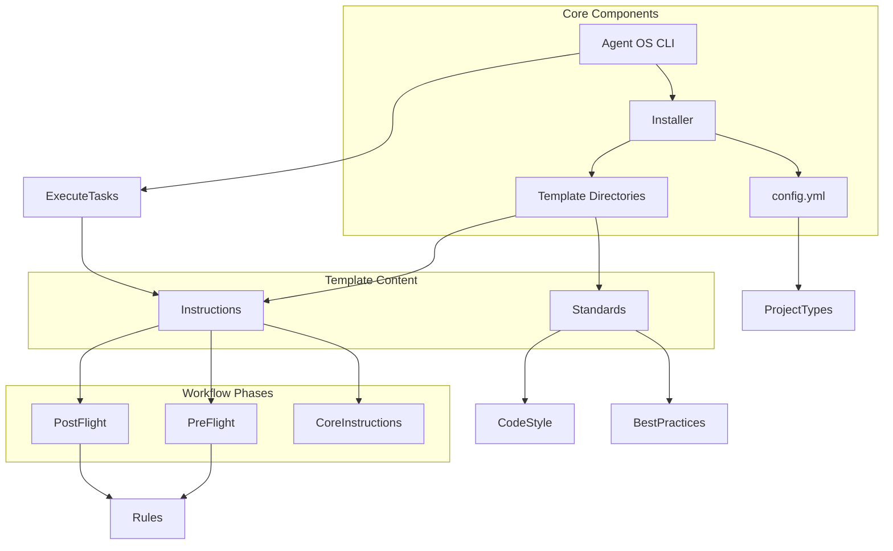

# Introduction

<cite>
**Referenced Files in This Document**   
- [src/cli.py](file://src/cli.py)
- [src/installer.py](file://src/installer.py)
- [config.yml](file://config.yml)
- [instructions/meta/pre-flight.md](file://instructions/meta/pre-flight.md)
- [instructions/meta/post-flight.md](file://instructions/meta/post-flight.md)
- [instructions/core/execute-tasks.md](file://instructions/core/execute-tasks.md)
- [standards/code-style.md](file://standards/code-style.md)
- [commands/execute-tasks.md](file://commands/execute-tasks.md)
- [README.md](file://README.md)
- [INSTALL.md](file://INSTALL.md)
- [ADK_INTEGRATION_SUMMARY.md](file://ADK_INTEGRATION_SUMMARY.md)
- [pmssbot/README.md](file://pmssbot/README.md)
- [pmssbot/pmssbot.yml](file://pmssbot/pmssbot.yml)
- [README-PLATFORMS.md](file://README-PLATFORMS.md)
</cite>

## Table of Contents
1. [Introduction](#introduction)
2. [Core Purpose and Value Proposition](#core-purpose-and-value-proposition)
3. [Architecture Overview](#architecture-overview)
4. [Key Components](#key-components)
5. [Platform Integrations](#platform-integrations)
6. [Workflow Execution Model](#workflow-execution-model)
7. [Target Audiences](#target-audiences)
8. [Real-World Use Cases](#real-world-use-cases)
9. [Getting Started](#getting-started)

## Core Purpose and Value Proposition

Agent OS is a command-line interface (CLI) tool designed to standardize and streamline AI-assisted software development workflows across multiple AI coding platforms, including Claude Code, GitHub Copilot, Qwen Code, and the Agent Development Kit (ADK). It transforms AI coding agents from experimental tools into reliable, productive developers by enforcing consistent processes, best practices, and organizational standards through a configuration-driven architecture.

The core value proposition of Agent OS lies in its ability to eliminate ad-hoc, inconsistent AI interactions by providing structured instructions, reusable templates, and standardized development workflows. By codifying development processes into executable patterns, Agent OS ensures that AI agents follow proven methodologies for tasks such as product planning, specification creation, task execution, and code delivery. This structured approach significantly improves code quality, reduces rework, and accelerates development cycles.

Agent OS achieves this through a modular design that separates concerns between platform-specific integrations, core instructions, development standards, and project configurations. This separation enables teams to maintain a consistent development experience across different AI tools while adapting to the unique requirements of individual projects and technical stacks.

**Section sources**
- [README.md](file://README.md#L1-L33)
- [src/cli.py](file://src/cli.py#L1-L187)
- [INSTALL.md](file://INSTALL.md#L1-L154)

## Architecture Overview



**Diagram sources**
- [src/cli.py](file://src/cli.py#L1-L187)
- [src/installer.py](file://src/installer.py#L1-L155)
- [config.yml](file://config.yml#L1-L31)
- [instructions/meta/pre-flight.md](file://instructions/meta/pre-flight.md#L1-L19)
- [instructions/meta/post-flight.md](file://instructions/meta/post-flight.md#L1-L17)
- [instructions/core/execute-tasks.md](file://instructions/core/execute-tasks.md#L1-L187)

**Section sources**
- [src/cli.py](file://src/cli.py#L1-L187)
- [src/installer.py](file://src/installer.py#L1-L155)
- [config.yml](file://config.yml#L1-L31)

## Key Components

Agent OS is built around several key components that work together to create a cohesive development environment:

- **CLI**: The command-line interface serves as the primary user interaction point, providing commands for installation, status checking, and system information. The `agent-os install` command deploys the system into project directories with support for multiple AI platforms.

- **Installer**: The Python-based installer (`AgentOsInstaller`) copies Agent OS files from the local repository to target project directories, handling platform-specific configurations and file overwrites. It supports both project-local and global installations.

- **Configuration (config.yml)**: The central configuration file defines system settings, enabled platforms, project types, and default configurations. It allows teams to customize Agent OS behavior across different project contexts.

- **Instructions**: A comprehensive set of Markdown files that define structured workflows for various development tasks. These include meta-instructions like `pre-flight.md` and `post-flight.md` that establish common rules, and core instructions like `execute-tasks.md` that orchestrate complex workflows.

- **Standards**: Development standards and best practices documented in Markdown format, covering code style, technical stack recommendations, and implementation guidelines. The system uses conditional blocks to apply relevant standards based on task context.

- **Commands**: Platform-agnostic command definitions that map to specific instruction files, enabling consistent task initiation across different AI coding tools.

**Section sources**
- [src/cli.py](file://src/cli.py#L1-L187)
- [src/installer.py](file://src/installer.py#L1-L155)
- [config.yml](file://config.yml#L1-L31)
- [instructions/meta/pre-flight.md](file://instructions/meta/pre-flight.md#L1-L19)
- [instructions/meta/post-flight.md](file://instructions/meta/post-flight.md#L1-L17)
- [instructions/core/execute-tasks.md](file://instructions/core/execute-tasks.md#L1-L187)
- [standards/code-style.md](file://standards/code-style.md#L1-L95)
- [commands/execute-tasks.md](file://commands/execute-tasks.md#L1-L6)

## Platform Integrations

Agent OS supports integration with multiple AI coding platforms through a unified architecture:

- **Claude Code**: Integrated via `.claude/agents/` directory with agent templates that support subagent functionality.
- **GitHub Copilot**: Integrated through `.github/prompts/` directory with prompt templates that can be attached in Copilot Chat sessions.
- **Qwen Code**: Supported via `.qwen/commands/` directory with TOML configuration files.
- **ADK (Agent Development Kit)**: Fully integrated platform with dedicated agent and command templates in `.adk/` directory.

The system provides consistent installation and management across all platforms through the CLI, with options to enable specific platforms during installation. This multi-platform support allows development teams to leverage their preferred AI tools while maintaining standardized workflows and quality standards.

**Section sources**
- [README-PLATFORMS.md](file://README-PLATFORMS.md#L1-L63)
- [ADK_INTEGRATION_SUMMARY.md](file://ADK_INTEGRATION_SUMMARY.md#L1-L113)
- [src/cli.py](file://src/cli.py#L1-L187)

## Workflow Execution Model

Agent OS implements a structured workflow execution model that ensures comprehensive task completion through three distinct phases:

1. **Pre-flight**: Executed via `pre-flight.md`, this phase establishes common rules such as using specified subagents, processing XML blocks sequentially, and executing steps exactly as specified. It ensures proper setup before task execution begins.

2. **Core Execution**: Orchestrated by instructions like `execute-tasks.md`, this phase follows a three-phase model:
   - Pre-execution setup (task assignment, context analysis, git branch management)
   - Task execution loop (processing all assigned tasks)
   - Post-execution tasks (verification, testing, and delivery)

3. **Post-flight**: Executed via `post-flight.md`, this phase verifies that all steps were completed according to instructions, confirms proper subagent usage, and reports any deviations or issues.

This structured approach ensures that AI agents follow complete workflows rather than stopping after partial completion, significantly improving reliability and output quality.

**Section sources**
- [instructions/meta/pre-flight.md](file://instructions/meta/pre-flight.md#L1-L19)
- [instructions/meta/post-flight.md](file://instructions/meta/post-flight.md#L1-L17)
- [instructions/core/execute-tasks.md](file://instructions/core/execute-tasks.md#L1-L187)

## Target Audiences

Agent OS serves multiple audiences in the AI-assisted development ecosystem:

- **AI-Assisted Developers**: Individual developers who use AI coding tools and benefit from standardized workflows that improve code quality and reduce cognitive load.

- **Engineering Leads**: Technical leaders responsible for maintaining code quality and consistency across teams, who can use Agent OS to enforce best practices and architectural standards.

- **Platform Integrators**: Developers responsible for integrating AI tools into existing development environments, who can leverage Agent OS's modular architecture to connect various AI platforms to organizational workflows.

- **AI Agent Developers**: Creators of specialized AI agents (like PMSSBOT) who can use Agent OS as a foundation for building domain-specific development assistants.

**Section sources**
- [README.md](file://README.md#L1-L33)
- [pmssbot/README.md](file://pmssbot/README.md#L1-L199)

## Real-World Use Cases

Agent OS addresses several practical development challenges:

- **Automated Documentation Setup**: The installer automatically configures project documentation structures and links to relevant standards, ensuring consistent documentation practices.

- **Standardized Code Generation**: By enforcing code style guidelines and best practices through the `standards/` directory, Agent OS ensures generated code adheres to organizational standards.

- **Specialized Agent Support**: The PMSSBOT example demonstrates how Agent OS can support domain-specific agents for tasks like Python testbench device creation, register modeling, and power management validation in the SRV-PM project.

- **Cross-Platform Development**: Teams can use the same workflows across different AI coding tools, allowing developers to choose their preferred platform while maintaining consistency.

- **Onboarding and Training**: New team members can quickly adopt established development patterns through the structured instructions and templates.

**Section sources**
- [pmssbot/README.md](file://pmssbot/README.md#L1-L199)
- [pmssbot/pmssbot.yml](file://pmssbot/pmssbot.yml#L1-L53)
- [standards/code-style.md](file://standards/code-style.md#L1-L95)

## Getting Started

To begin using Agent OS, install it via pip and initialize it in your project directory:

```bash
pip install agent-os
agent-os install --all
```

This installs Agent OS with support for all available platforms. You can then use the `agent-os status` command to verify the installation and begin leveraging the standardized workflows for your development tasks.

For detailed installation instructions and platform-specific guidance, refer to the full documentation.

**Section sources**
- [INSTALL.md](file://INSTALL.md#L1-L154)
- [src/cli.py](file://src/cli.py#L1-L187)