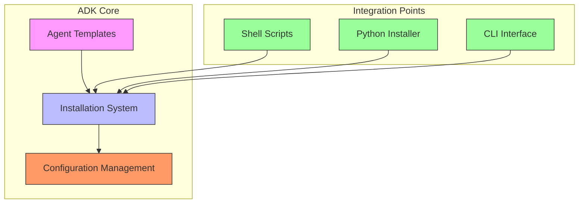
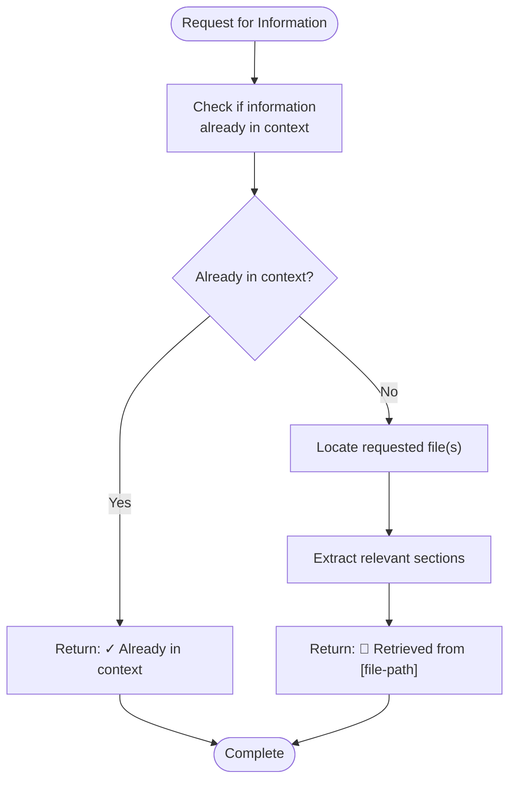
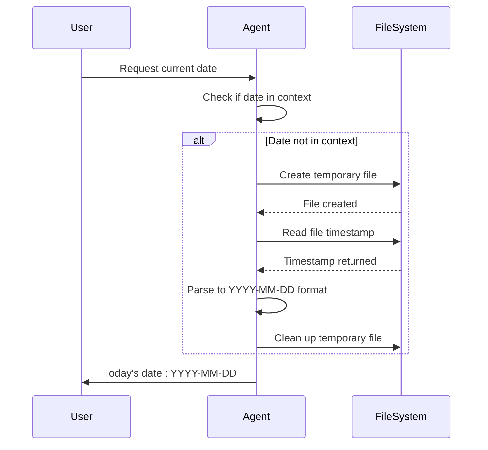
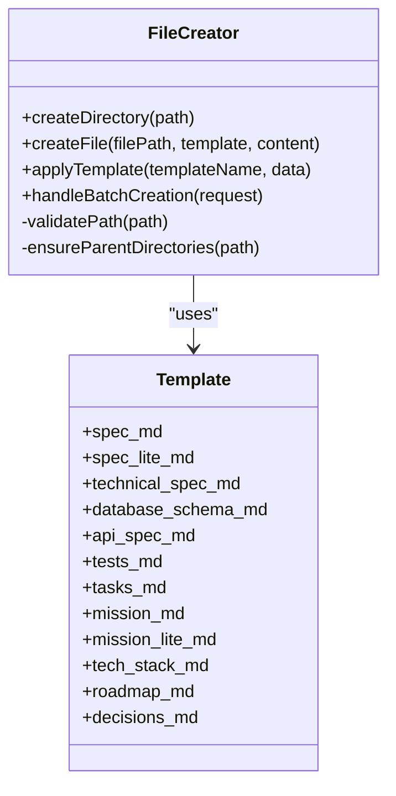
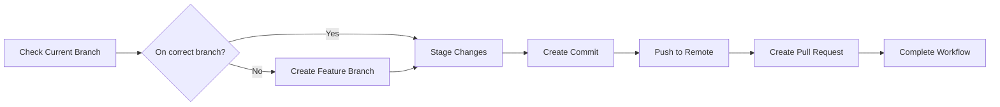
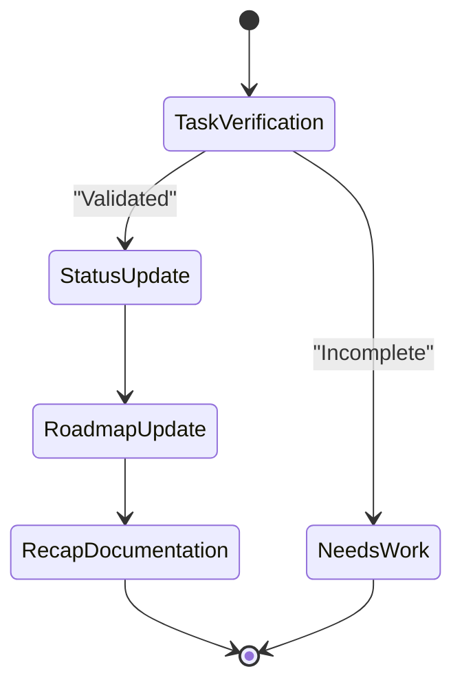
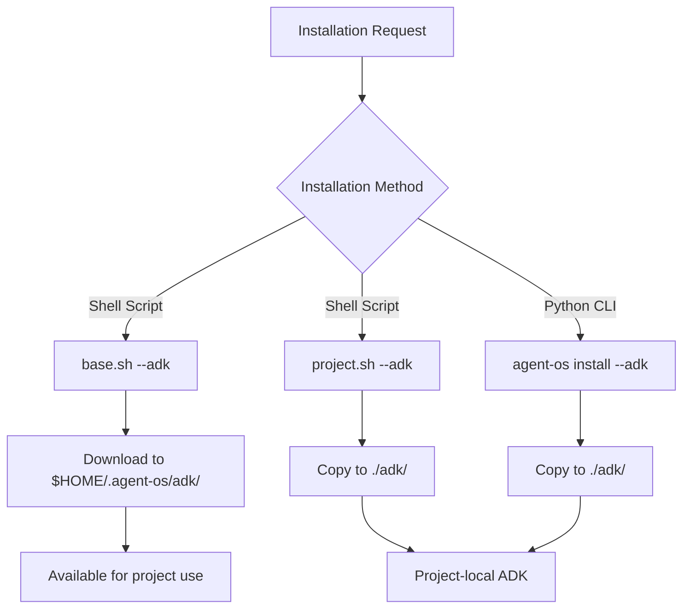
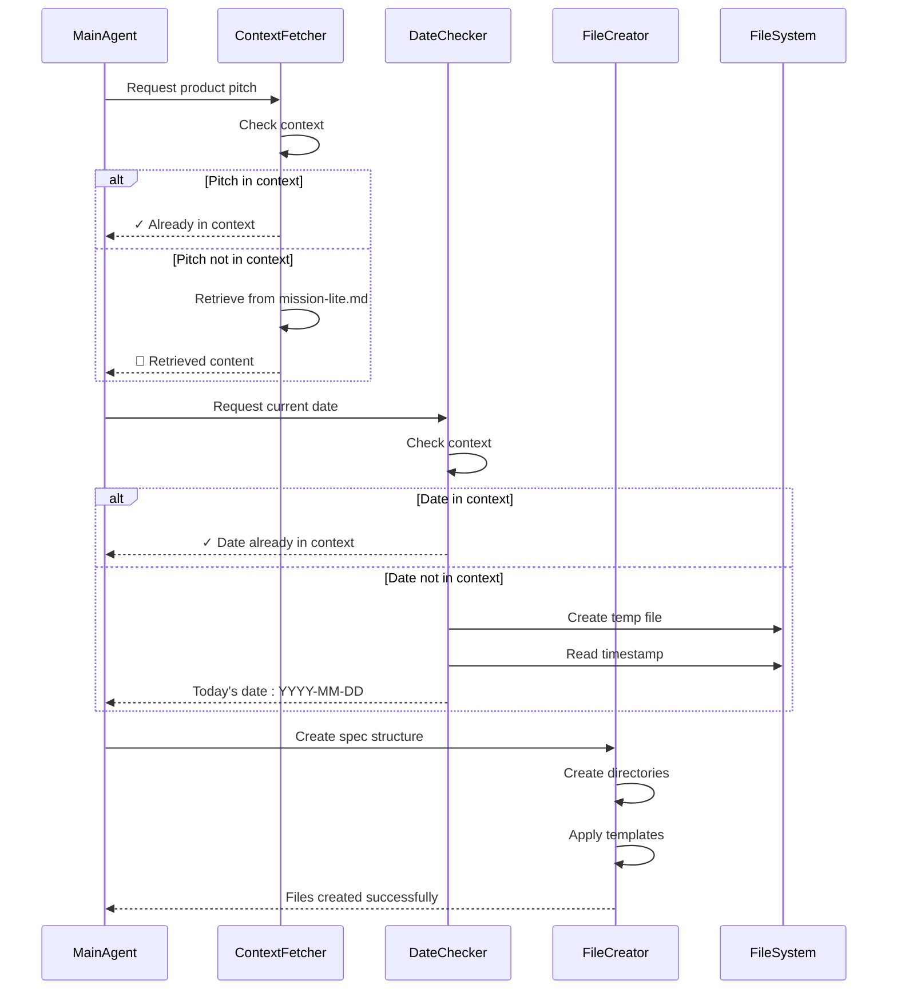
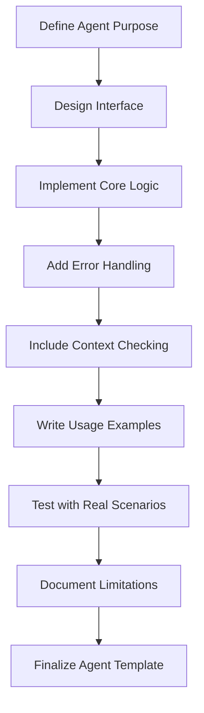
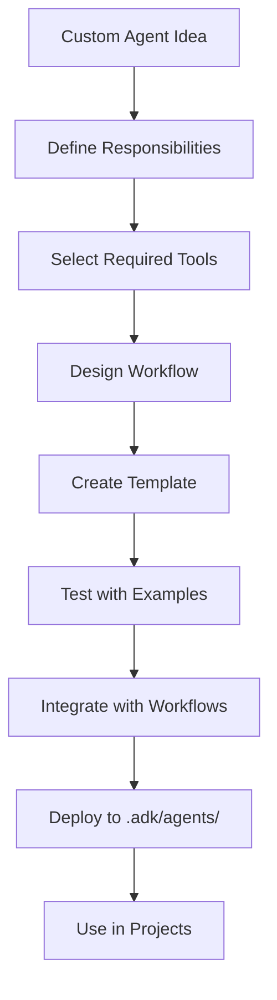

# ADK (Agent Development Kit) Integration

<cite>
**Referenced Files in This Document**   
- [ADK_INTEGRATION_SUMMARY.md](file://ADK_INTEGRATION_SUMMARY.md)
- [installer.py](file://src/installer.py)
- [cli.py](file://src/cli.py)
- [base.sh](file://setup/base.sh)
- [project.sh](file://setup/project.sh)
- [context-fetcher.md](file://adk/agents/context-fetcher.md)
- [date-checker.md](file://adk/agents/date-checker.md)
- [file-creator.md](file://adk/agents/file-creator.md)
- [git-workflow.md](file://adk/agents/git-workflow.md)
- [project-manager.md](file://adk/agents/project-manager.md)
- [test-runner.md](file://adk/agents/test-runner.md)
</cite>

## Table of Contents
1. [Introduction](#introduction)
2. [ADK Architecture and Design](#adk-architecture-and-design)
3. [Agent Templates Overview](#agent-templates-overview)
4. [Installation Process](#installation-process)
5. [Agent Coordination and Conflict Resolution](#agent-coordination-and-conflict-resolution)
6. [Best Practices for Agent Development](#best-practices-for-agent-development)
7. [Extensibility and Customization](#extensibility-and-customization)
8. [Conclusion](#conclusion)

## Introduction

The Agent Development Kit (ADK) serves as a plugin system that extends Agent OS with custom AI agents. These agents are defined using Markdown templates that specify their behavior, responsibilities, tools, and interaction patterns. ADK enables users to create domain-specific agents that can be seamlessly integrated into the Agent OS ecosystem, enhancing its capabilities for various development workflows.

ADK agents operate as specialized components that handle specific tasks within the software development lifecycle. They follow a consistent pattern of context checking, task execution, and result reporting, ensuring efficient and reliable operation. The system is designed to support modular architecture, allowing agents to be developed, deployed, and maintained independently while maintaining compatibility with the core platform.

**Section sources**
- [ADK_INTEGRATION_SUMMARY.md](file://ADK_INTEGRATION_SUMMARY.md#L0-L113)

## ADK Architecture and Design

The ADK architecture follows a modular design pattern where each agent operates as an independent component with well-defined responsibilities. The system is built on a foundation of standardized agent templates that ensure consistency across different agent types while allowing for specialization based on specific use cases.

Agents are designed to work proactively, automatically determining when their capabilities are needed based on the current context. Each agent template includes metadata such as name, description, available tools, and visual color coding for easy identification. The architecture supports agent coordination through shared context and standardized communication patterns.

The ADK system integrates with Agent OS through multiple entry points, including shell scripts, Python-based installation, and CLI commands. This multi-platform support ensures that ADK can be deployed in various environments while maintaining consistent behavior.



**Diagram sources**
- [ADK_INTEGRATION_SUMMARY.md](file://ADK_INTEGRATION_SUMMARY.md#L0-L113)
- [installer.py](file://src/installer.py#L0-L155)
- [cli.py](file://src/cli.py#L0-L187)

**Section sources**
- [ADK_INTEGRATION_SUMMARY.md](file://ADK_INTEGRATION_SUMMARY.md#L0-L113)
- [installer.py](file://src/installer.py#L0-L155)
- [cli.py](file://src/cli.py#L0-L187)

## Agent Templates Overview

The ADK provides several specialized agent templates, each designed for specific tasks within the development workflow. These templates define the agent's behavior, responsibilities, and interaction patterns through standardized Markdown files.

### Context Fetcher Agent

The context-fetcher agent specializes in retrieving and extracting relevant information from Agent OS documentation files. It first checks if the requested content is already in context before performing any retrieval operations, ensuring efficiency and avoiding duplication.



**Diagram sources**
- [context-fetcher.md](file://adk/agents/context-fetcher.md#L0-L67)

**Section sources**
- [context-fetcher.md](file://adk/agents/context-fetcher.md#L0-L67)

### Date Checker Agent

The date-checker agent determines and outputs the current date in YYYY-MM-DD format using file system timestamps. It employs a reliable method of creating temporary files to extract accurate timestamps, ensuring consistent date information across different environments.



**Diagram sources**
- [date-checker.md](file://adk/agents/date-checker.md#L0-L95)

**Section sources**
- [date-checker.md](file://adk/agents/date-checker.md#L0-L95)

### File Creator Agent

The file-creator agent handles the creation of files, directories, and application of templates according to Agent OS conventions. It supports batch operations and maintains consistent naming conventions and file structures across projects.



**Diagram sources**
- [file-creator.md](file://adk/agents/file-creator.md#L0-L359)

**Section sources**
- [file-creator.md](file://adk/agents/file-creator.md#L0-L359)

### Git Workflow Agent

The git-workflow agent manages git operations including branch management, commits, and pull request creation. It follows Agent OS conventions for branch naming and commit messages, ensuring consistent git history across projects.



**Diagram sources**
- [git-workflow.md](file://adk/agents/git-workflow.md#L0-L145)

**Section sources**
- [git-workflow.md](file://adk/agents/git-workflow.md#L0-L145)

### Project Manager Agent

The project-manager agent tracks task completeness and updates task and roadmap tracking documents. It verifies task completion against requirements and maintains accurate project documentation.



**Diagram sources**
- [project-manager.md](file://adk/agents/project-manager.md#L0-L42)

**Section sources**
- [project-manager.md](file://adk/agents/project-manager.md#L0-L42)

### Test Runner Agent

The test-runner agent executes tests and analyzes failures without making fixes. It provides detailed failure analysis to help identify issues while returning control to the main agent for resolution.

```mermaid
flowchart TD
A[Receive Test Request] --> B[Execute Tests]
B --> C{Tests Pass?}
C --> |Yes| D[Report Success]
C --> |No| E[Analyze Failures]
E --> F[Identify Fix Location]
F --> G[Suggest Approach]
G --> H[Return Control]
D --> H
H --> [*]
```

**Diagram sources**
- [test-runner.md](file://adk/agents/test-runner.md#L0-L60)

**Section sources**
- [test-runner.md](file://adk/agents/test-runner.md#L0-L60)

## Installation Process

The ADK installation process is designed to be consistent across different platforms and installation methods. The system supports multiple installation approaches while maintaining the same core behavior and file structure.

### Base Installation

The base installation downloads ADK templates to the base Agent OS directory, making them available for project installations. This approach allows for centralized management of agent templates.

```bash
# Base installation with ADK
curl -sSL https://raw.githubusercontent.com/fenghaitao/agent-os/main/setup/base.sh | bash -s -- --adk
```

### Project Installation

Project installation copies ADK templates to the project directory, creating a project-local `.adk/` folder. This ensures that each project has its own copy of the agent templates.

```bash
# Project installation with ADK
$HOME/.agent-os/setup/project.sh --adk
```

### Python CLI Installation

The Python CLI provides a convenient way to install ADK using the `agent-os` command. This method offers the same functionality as the shell scripts with additional error handling and progress reporting.

```bash
# Install ADK platform
agent-os install --adk
```



**Diagram sources**
- [ADK_INTEGRATION_SUMMARY.md](file://ADK_INTEGRATION_SUMMARY.md#L48-L103)
- [base.sh](file://setup/base.sh#L223-L261)
- [project.sh](file://setup/project.sh#L0-L524)
- [installer.py](file://src/installer.py#L0-L155)

**Section sources**
- [ADK_INTEGRATION_SUMMARY.md](file://ADK_INTEGRATION_SUMMARY.md#L48-L103)
- [base.sh](file://setup/base.sh#L223-L261)
- [project.sh](file://setup/project.sh#L0-L524)
- [installer.py](file://src/installer.py#L0-L155)
- [cli.py](file://src/cli.py#L0-L187)

## Agent Coordination and Conflict Resolution

Effective agent coordination is essential for maintaining smooth workflows and preventing conflicts. The ADK system implements several strategies to ensure agents work together harmoniously while avoiding interference.

### Context Management

Agents follow a consistent pattern of checking the current context before performing actions. This prevents redundant operations and ensures that information is not duplicated unnecessarily. The context-fetcher agent exemplifies this approach by verifying if requested information is already available before retrieving it.

### Task Delegation

The system uses clear task delegation patterns where each agent has well-defined responsibilities. When multiple agents could potentially handle a task, the main agent makes the decision based on the specific requirements and context. This prevents conflicts and ensures that the most appropriate agent handles each task.

### State Management

Agents maintain minimal state and focus on producing clear outputs that can be used by other components. The date-checker agent, for example, produces a standardized date output that can be reliably used by other agents without ambiguity.



**Diagram sources**
- [context-fetcher.md](file://adk/agents/context-fetcher.md#L0-L67)
- [date-checker.md](file://adk/agents/date-checker.md#L0-L95)
- [file-creator.md](file://adk/agents/file-creator.md#L0-L359)

**Section sources**
- [context-fetcher.md](file://adk/agents/context-fetcher.md#L0-L67)
- [date-checker.md](file://adk/agents/date-checker.md#L0-L95)
- [file-creator.md](file://adk/agents/file-creator.md#L0-L359)

## Best Practices for Agent Development

Developing effective ADK agents requires adherence to specific best practices that ensure consistency, reliability, and maintainability.

### Naming Conventions

Agents should follow consistent naming conventions that clearly indicate their purpose and functionality. The existing agents use descriptive names like "context-fetcher" and "date-checker" that immediately convey their primary function.

### Interface Design

Agent interfaces should be designed with clear responsibilities and well-defined inputs and outputs. Each agent should have a specific focus and avoid attempting to handle multiple unrelated tasks.

### Testing Strategies

Agents should be designed with testability in mind. The test-runner agent provides a model for how agents can be tested by executing specific test cases and providing clear feedback on results.



**Diagram sources**
- [test-runner.md](file://adk/agents/test-runner.md#L0-L60)

**Section sources**
- [test-runner.md](file://adk/agents/test-runner.md#L0-L60)

## Extensibility and Customization

The ADK system is designed to support extensibility and customization, allowing users to create domain-specific agents that address unique requirements.

### Custom Agent Creation

Users can create new agents by following the template structure used by existing agents. This includes defining metadata, responsibilities, workflow patterns, and output formats in a standardized Markdown format.

### Integration with Standardized Workflows

Custom agents can be integrated with existing Agent OS workflows while maintaining compatibility with standardized processes. This allows for innovation without sacrificing the benefits of standardized development practices.

### Template Reuse

The file-creator agent demonstrates how templates can be reused across different contexts. Custom agents can leverage existing templates or define new ones to ensure consistency in generated artifacts.



**Section sources**
- [file-creator.md](file://adk/agents/file-creator.md#L0-L359)

## Conclusion

The ADK (Agent Development Kit) provides a powerful framework for extending Agent OS with custom AI agents. Through its modular architecture and standardized templates, ADK enables users to create specialized agents that enhance the platform's capabilities for various development workflows.

The integration of ADK into the Agent OS ecosystem is comprehensive, supporting multiple installation methods while maintaining consistent behavior across environments. The six core agent templates—context-fetcher, date-checker, file-creator, git-workflow, project-manager, and test-runner—demonstrate the versatility of the system in handling different aspects of software development.

By following best practices for agent development, users can create custom agents that integrate seamlessly with existing workflows while addressing domain-specific requirements. The system's focus on context management, task delegation, and state management ensures that agents work together effectively without conflicts.

ADK represents a significant advancement in the Agent OS platform, enabling greater customization and extensibility while maintaining compatibility with standardized development practices. As users continue to develop new agents, the ecosystem will grow richer, providing increasingly sophisticated support for software development workflows.