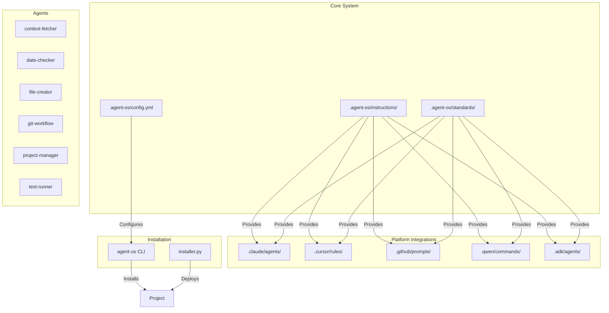
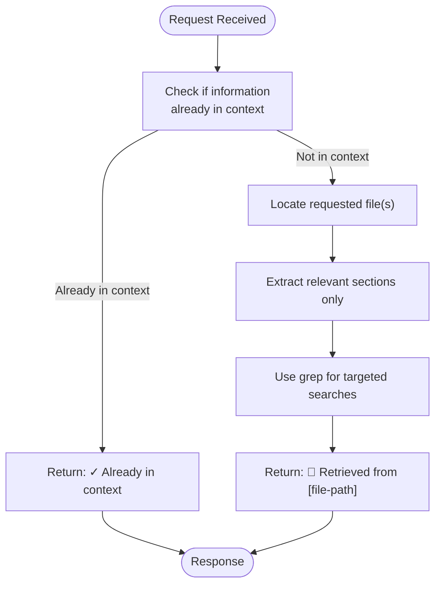
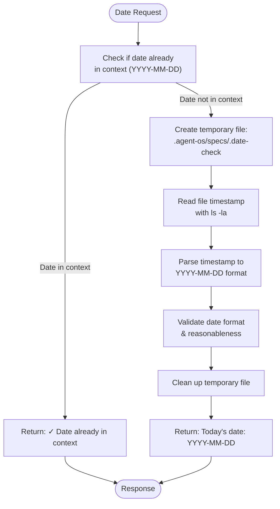
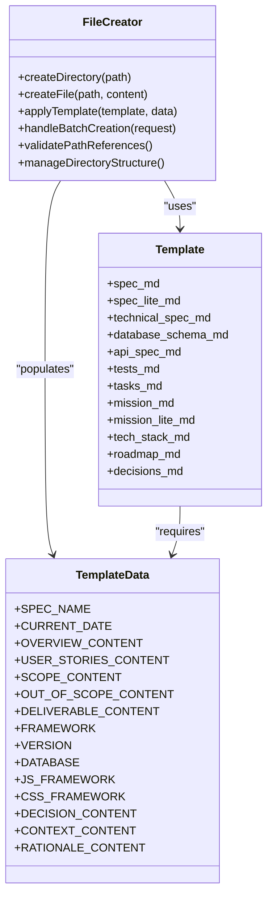
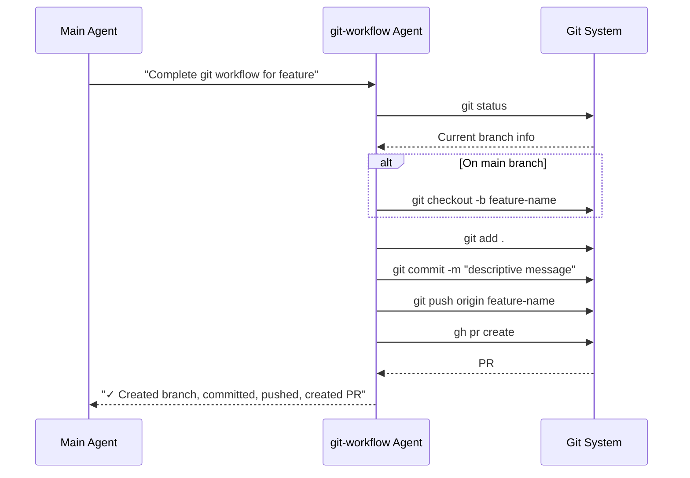
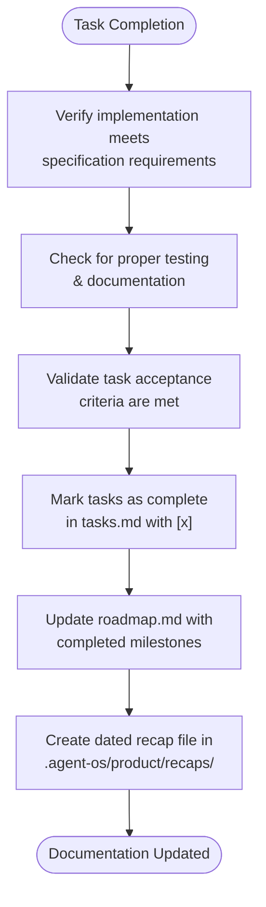
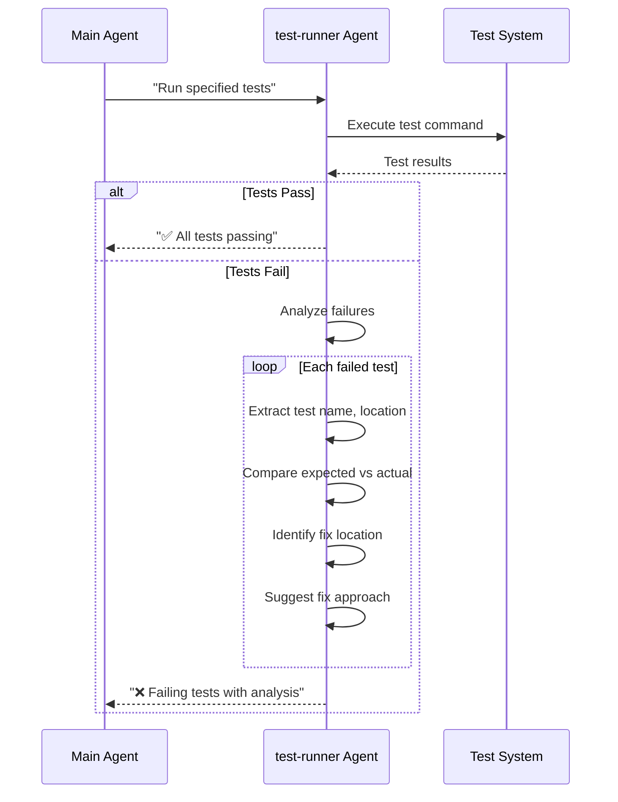
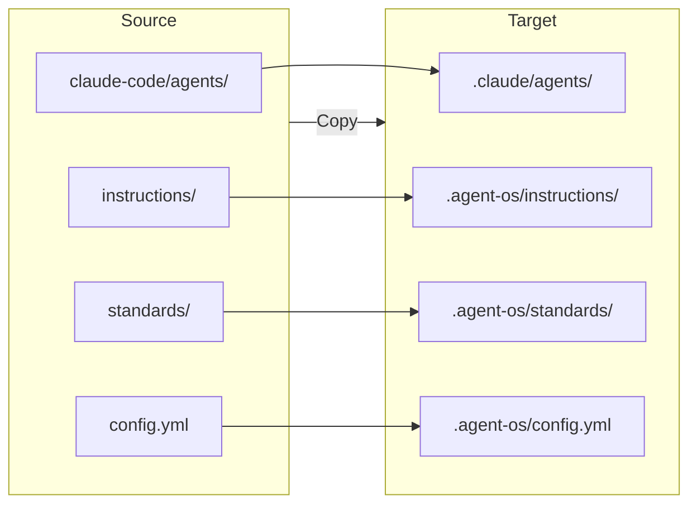
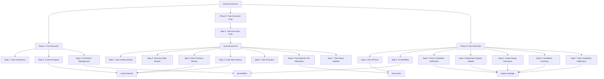
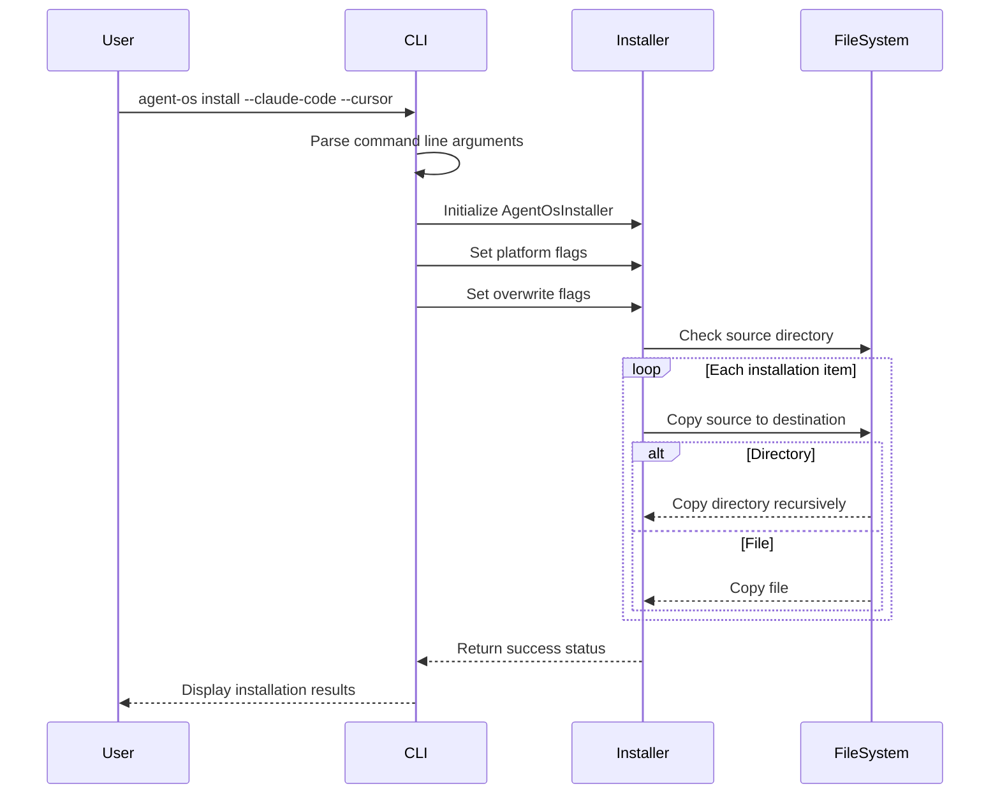

# Claude Code Integration

<cite>
**Referenced Files in This Document**   
- [context-fetcher.md](file://claude-code/agents/context-fetcher.md)
- [date-checker.md](file://claude-code/agents/date-checker.md)
- [file-creator.md](file://claude-code/agents/file-creator.md)
- [git-workflow.md](file://claude-code/agents/git-workflow.md)
- [project-manager.md](file://claude-code/agents/project-manager.md)
- [test-runner.md](file://claude-code/agents/test-runner.md)
- [installer.py](file://src/installer.py)
- [cli.py](file://src/cli.py)
- [execute-tasks.md](file://commands/execute-tasks.md)
- [execute-tasks.md](file://instructions/core/execute-tasks.md)
- [execute-task.md](file://instructions/core/execute-task.md)
- [post-execution-tasks.md](file://instructions/core/post-execution-tasks.md)
</cite>

## Table of Contents
1. [Introduction](#introduction)
2. [Agent OS Architecture Overview](#agent-os-architecture-overview)
3. [Claude Code Agent System](#claude-code-agent-system)
4. [Core Agent Analysis](#core-agent-analysis)
5. [Agent Integration and Installation](#agent-integration-and-installation)
6. [Workflow Orchestration](#workflow-orchestration)
7. [CLI Command Invocation](#cli-command-invocation)
8. [Common Issues and Solutions](#common-issues-and-solutions)
9. [Performance Considerations](#performance-considerations)
10. [Conclusion](#conclusion)

## Introduction

Agent OS provides a structured framework for AI-assisted software development, with Claude Code integration at its core. The system leverages specialized Markdown templates that define agent behavior, responsibilities, and interaction patterns to transform AI coding assistants from general-purpose tools into focused development partners. This document details how Agent OS orchestrates Claude Code agents through a sophisticated system of templates, workflows, and installation processes that enable consistent, high-quality code generation aligned with project standards and requirements.

The integration centers on six specialized agents—context-fetcher, date-checker, file-creator, git-workflow, project-manager, and test-runner—each designed with specific capabilities and constraints to handle distinct aspects of the development workflow. These agents operate within a larger ecosystem of instructions, standards, and CLI tools that coordinate their activities and ensure cohesive operation across the development lifecycle.

**Section sources**
- [README.md](file://README.md#L1-L33)
- [INSTALL.md](file://INSTALL.md#L1-L20)

## Agent OS Architecture Overview

Agent OS implements a modular architecture that separates concerns across different components and platforms. The system is designed to integrate seamlessly with various AI coding platforms while maintaining a consistent interface and workflow pattern. At its core, Agent OS provides standardized development workflows that can be adapted to different AI assistants through platform-specific templates and configurations.

The architecture consists of several key layers:
- **Core System**: Contains instructions, standards, and configuration files that define the development process
- **Platform Integrations**: Platform-specific templates for Claude Code, Cursor, GitHub Copilot, Qwen Code, and ADK
- **Agents**: Specialized Markdown templates that define focused AI behaviors for specific tasks
- **Commands**: High-level workflow definitions that orchestrate agent activities
- **Installation System**: Python-based and shell-based installers that deploy the system to projects

This layered approach allows Agent OS to maintain consistent development practices across different AI coding platforms while providing the flexibility to leverage platform-specific features and interfaces.

**Diagram sources**
- [INSTALL.md](file://INSTALL.md#L50-L100)
- [ADK_INTEGRATION_SUMMARY.md](file://ADK_INTEGRATION_SUMMARY.md#L1-L20)

## Claude Code Agent System

The Claude Code agent system in Agent OS consists of six specialized agents, each defined by a Markdown template that specifies its name, description, tools, color, and detailed behavioral instructions. These agents are designed to work together in a coordinated fashion, with each focusing on a specific aspect of the development workflow while adhering to strict constraints that prevent role overlap and ensure predictable behavior.

The agent templates follow a consistent structure with YAML frontmatter defining metadata and a Markdown body containing detailed instructions. This structure allows for easy configuration and extension while maintaining readability and maintainability. Each agent is assigned specific tools (Read, Grep, Glob, Write, Bash) that define its capabilities and limit its actions to appropriate domains.

The system leverages a "subagent" pattern where higher-level workflows can invoke these specialized agents to handle specific tasks, creating a hierarchical delegation model that optimizes for both efficiency and accuracy. This approach allows the main agent to focus on high-level planning and coordination while delegating mechanical or specialized tasks to agents optimized for those purposes.

**Section sources**
- [context-fetcher.md](file://claude-code/agents/context-fetcher.md#L1-L10)
- [date-checker.md](file://claude-code/agents/date-checker.md#L1-L10)
- [file-creator.md](file://claude-code/agents/file-creator.md#L1-L10)

## Core Agent Analysis

### Context Fetcher Agent

The context-fetcher agent specializes in retrieving and extracting relevant information from Agent OS documentation files while avoiding duplication. It operates with a "context check first" principle, determining if requested information is already available before retrieving new content.

**Diagram sources**
- [context-fetcher.md](file://claude-code/agents/context-fetcher.md#L15-L50)

**Section sources**
- [context-fetcher.md](file://claude-code/agents/context-fetcher.md#L1-L67)

### Date Checker Agent

The date-checker agent determines the current date using file system timestamps, providing a reliable method for AI systems to access temporal information without requiring direct user input.

**Diagram sources**
- [date-checker.md](file://claude-code/agents/date-checker.md#L20-L50)

**Section sources**
- [date-checker.md](file://claude-code/agents/date-checker.md#L1-L95)

### File Creator Agent

The file-creator agent handles the creation of files, directories, and application of templates according to Agent OS conventions, ensuring consistent project structure and documentation.

**Diagram sources**
- [file-creator.md](file://claude-code/agents/file-creator.md#L15-L50)

**Section sources**
- [file-creator.md](file://claude-code/agents/file-creator.md#L1-L359)

### Git Workflow Agent

The git-workflow agent manages git operations including branch creation, commits, and pull request creation, following Agent OS conventions for branch naming and commit messages.

**Diagram sources**
- [git-workflow.md](file://claude-code/agents/git-workflow.md#L15-L30)

**Section sources**
- [git-workflow.md](file://claude-code/agents/git-workflow.md#L1-L145)

### Project Manager Agent

The project-manager agent tracks task completion and updates project documentation, maintaining accurate records of progress across specifications and roadmaps.

**Diagram sources**
- [project-manager.md](file://claude-code/agents/project-manager.md#L15-L30)

**Section sources**
- [project-manager.md](file://claude-code/agents/project-manager.md#L1-L42)

### Test Runner Agent

The test-runner agent executes tests and analyzes failures, providing focused feedback without attempting to fix issues, maintaining a clear separation of concerns.

**Diagram sources**
- [test-runner.md](file://claude-code/agents/test-runner.md#L15-L30)

**Section sources**
- [test-runner.md](file://claude-code/agents/test-runner.md#L1-L60)

## Agent Integration and Installation

The integration of Claude Code agents into projects occurs through the Agent OS installation system, which copies agent templates from the source repository to the target project directory. This process is managed by both Python-based and shell-based installers that handle platform-specific file mappings and directory structures.

The installation system follows a consistent pattern across different platforms, with Claude Code agents being copied from `claude-code/agents/` in the source repository to `.claude/agents/` in the target project. This mapping ensures that agents are available in the expected location for the AI coding assistant to access them during development workflows.

**Diagram sources**
- [installer.py](file://src/installer.py#L50-L100)
- [INSTALL.md](file://INSTALL.md#L50-L80)

**Section sources**
- [installer.py](file://src/installer.py#L1-L155)
- [INSTALL.md](file://INSTALL.md#L1-L154)

## Workflow Orchestration

Agent OS orchestrates complex development workflows through a hierarchical system of instructions that coordinate the activities of multiple agents. The core workflow for executing tasks, defined in `execute-tasks.md`, demonstrates this orchestration by integrating several agents in a structured sequence across three phases: pre-execution setup, task execution loop, and post-execution tasks.

The workflow begins with context analysis using the context-fetcher agent to gather essential information from documentation files, followed by git branch management using the git-workflow agent to ensure proper isolation. During task execution, the system leverages the test-runner agent for focused test verification and concludes with post-execution tasks that involve multiple agents for comprehensive verification and documentation.

**Diagram sources**
- [execute-tasks.md](file://instructions/core/execute-tasks.md#L1-L20)
- [execute-task.md](file://instructions/core/execute-task.md#L1-L20)
- [post-execution-tasks.md](file://instructions/core/post-execution-tasks.md#L1-L20)

**Section sources**
- [execute-tasks.md](file://instructions/core/execute-tasks.md#L1-L187)
- [execute-task.md](file://instructions/core/execute-task.md#L1-L263)
- [post-execution-tasks.md](file://instructions/core/post-execution-tasks.md#L1-L249)

## CLI Command Invocation

The Agent OS CLI provides a user-friendly interface for installing and managing the system in project directories. The `agent-os install` command serves as the primary entry point, accepting flags to enable specific platforms including Claude Code, and handling the installation process through the underlying `installer.py` module.

The CLI implementation uses Click for command-line interface definition and Rich for enhanced terminal output, providing progress indicators and formatted messages that improve user experience. Platform selection flags (`--claude-code`, `--cursor`, etc.) map directly to the platform configuration in the installer, creating a seamless connection between user input and installation behavior.

**Diagram sources**
- [cli.py](file://src/cli.py#L50-L100)
- [installer.py](file://src/installer.py#L100-L150)

**Section sources**
- [cli.py](file://src/cli.py#L1-L187)
- [installer.py](file://src/installer.py#L1-L155)

## Common Issues and Solutions

### Prompt Ambiguity

Prompt ambiguity can occur when agent instructions are not specific enough, leading to inconsistent or incorrect behavior. The Agent OS system addresses this through several mechanisms:

1. **Structured Templates**: Agent templates use clear YAML frontmatter and standardized sections to ensure consistent structure
2. **Explicit Constraints**: Each agent includes "Important Constraints" sections that define boundaries and limitations
3. **Output Format Specifications**: Agents are required to follow specific output formats, reducing variability in responses
4. **Context Checking**: Agents like context-fetcher and date-checker include explicit context checking to avoid redundant operations

### Agent Role Overlap

Role overlap between agents could lead to confusion about which agent should handle specific tasks. Agent OS prevents this through:

1. **Specialized Responsibilities**: Each agent has clearly defined core responsibilities that distinguish it from others
2. **Tool Restrictions**: Agents are limited to specific tool sets that align with their intended functions
3. **Behavioral Constraints**: Explicit "Important Constraints" sections prevent agents from performing actions outside their domain
4. **Hierarchical Orchestration**: Higher-level workflows explicitly specify which agent to use for each task

For example, while both file-creator and git-workflow agents can use Bash commands, file-creator is restricted to file and directory operations, while git-workflow is specialized for git operations, with clear boundaries defined in their respective templates.

**Section sources**
- [context-fetcher.md](file://claude-code/agents/context-fetcher.md#L50-L60)
- [git-workflow.md](file://claude-code/agents/git-workflow.md#L50-L60)
- [file-creator.md](file://claude-code/agents/file-creator.md#L300-L320)

## Performance Considerations

### Response Accuracy

Agent OS enhances response accuracy through several design principles:

1. **Focused Specialization**: Each agent is specialized for a narrow domain, improving expertise and reducing errors
2. **Context Minimization**: Agents retrieve only necessary context, reducing the risk of information overload
3. **Template-Driven Output**: Standardized templates ensure consistent and predictable output formats
4. **Validation Rules**: Agents include validation rules (e.g., date-checker's format validation) to ensure correctness

The system also implements a hierarchical delegation model where complex tasks are broken down into smaller, more manageable operations handled by specialized agents, improving overall accuracy through division of labor.

### Token Usage Optimization

Token usage is optimized through several strategies:

1. **Context Checking**: Agents check if information is already in context before retrieving it, avoiding redundant content
2. **Selective Extraction**: Agents extract only specific sections needed rather than entire files
3. **Concise Output**: Agents are instructed to keep responses focused and minimal
4. **Efficient Workflows**: Orchestration workflows minimize redundant operations and agent invocations

For example, the context-fetcher agent uses grep to find relevant sections rather than reading entire files, significantly reducing token usage for information retrieval tasks. Similarly, the date-checker agent uses a file system timestamp method rather than requesting the date from the user, minimizing interaction overhead.

**Section sources**
- [context-fetcher.md](file://claude-code/agents/context-fetcher.md#L10-L20)
- [date-checker.md](file://claude-code/agents/date-checker.md#L10-L20)
- [execute-tasks.md](file://instructions/core/execute-tasks.md#L50-L60)

## Conclusion

Agent OS provides a comprehensive framework for integrating Claude Code and other AI coding assistants into structured development workflows. Through its system of specialized agents, each defined by detailed Markdown templates, the platform transforms general-purpose AI assistants into focused development partners with clearly defined roles and responsibilities.

The integration is achieved through a sophisticated installation system that deploys agent templates to project directories, where they can be invoked by higher-level workflows to handle specific tasks. This approach enables a division of labor where each agent excels in its specialized domain, from context retrieval and date determination to file creation, git operations, task management, and test execution.

The orchestration of these agents through hierarchical workflows ensures that complex development processes are executed consistently and reliably, with each agent contributing its specialized capabilities to the overall workflow. This structured approach addresses common challenges in AI-assisted development, including prompt ambiguity, role overlap, and token efficiency, resulting in a more predictable and effective development experience.

By providing a standardized framework that can be adapted to different AI coding platforms, Agent OS enables teams to leverage the power of AI assistants while maintaining control over code quality, project structure, and development processes.