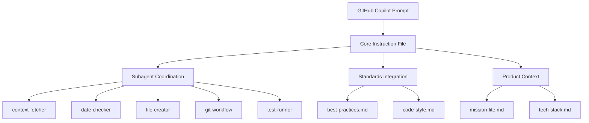
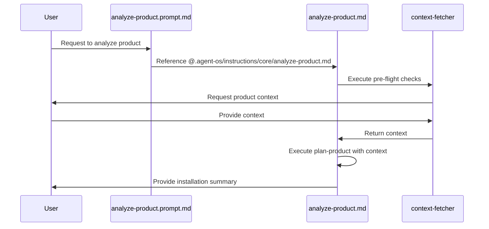
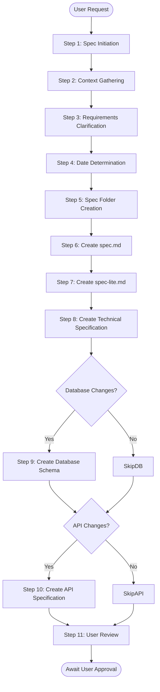
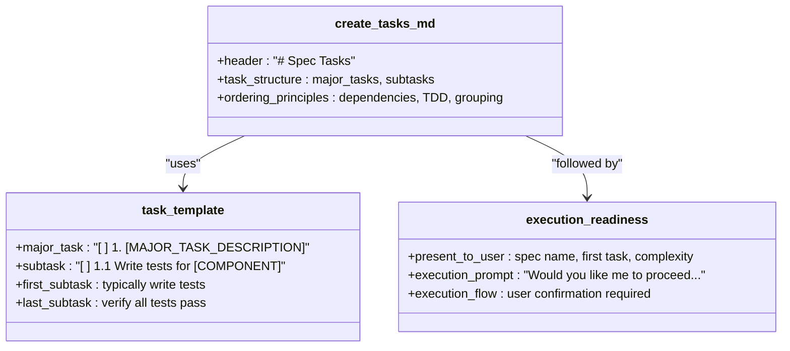
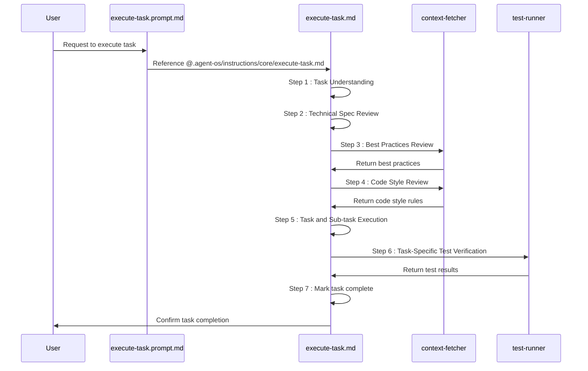
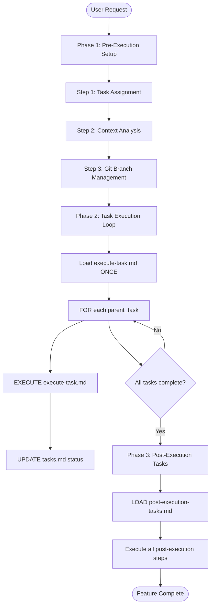
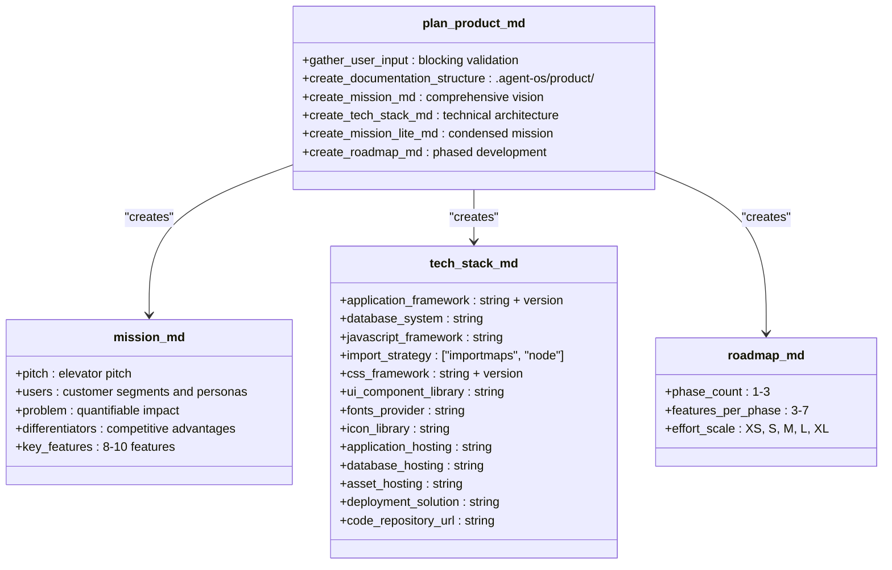
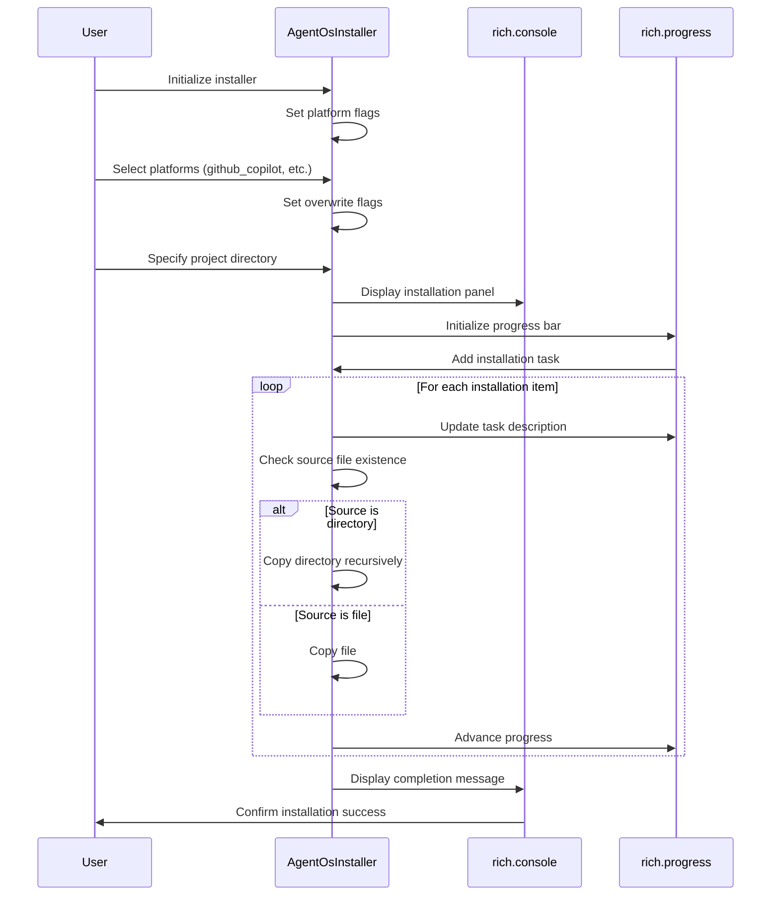
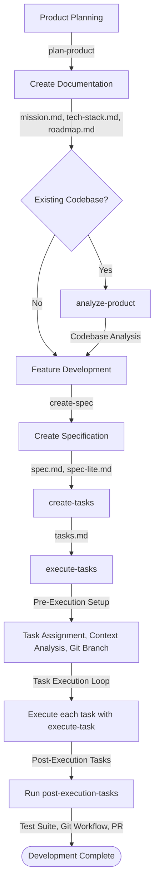

# GitHub Copilot Integration

<cite>
**Referenced Files in This Document**   
- [analyze-product.prompt.md](file://github-copilot/prompts/analyze-product.prompt.md)
- [create-spec.prompt.md](file://github-copilot/prompts/create-spec.prompt.md)
- [create-tasks.prompt.md](file://github-copilot/prompts/create-tasks.prompt.md)
- [execute-task.prompt.md](file://github-copilot/prompts/execute-task.prompt.md)
- [execute-tasks.prompt.md](file://github-copilot/prompts/execute-tasks.prompt.md)
- [plan-product.prompt.md](file://github-copilot/prompts/plan-product.prompt.md)
- [analyze-product.md](file://instructions/core/analyze-product.md)
- [create-spec.md](file://instructions/core/create-spec.md)
- [create-tasks.md](file://instructions/core/create-tasks.md)
- [execute-task.md](file://instructions/core/execute-task.md)
- [execute-tasks.md](file://instructions/core/execute-tasks.md)
- [plan-product.md](file://instructions/core/plan-product.md)
- [pmssbot.chatmode.md](file://pmssbot/github-copilot/chatmodes/pmssbot.chatmode.md)
- [create-py-tb-device.md](file://pmssbot/instructions/core/create-py-tb-device.md)
- [installer.py](file://src/installer.py)
</cite>

## Table of Contents
1. [Introduction](#introduction)
2. [Prompt Template Architecture](#prompt-template-architecture)
3. [Core Prompt Templates](#core-prompt-templates)
4. [Directory Structure and Organization](#directory-structure-and-organization)
5. [Installation and Platform Selection](#installation-and-platform-selection)
6. [Integration with Development Workflows](#integration-with-development-workflows)
7. [Chatmodes and Specialized Functionality](#chatmodes-and-specialized-functionality)
8. [Common Issues and Mitigation Strategies](#common-issues-and-mitigation-strategies)
9. [Best Practices for Prompt Engineering](#best-practices-for-prompt-engineering)
10. [Performance Optimization](#performance-optimization)
11. [Conclusion](#conclusion)

## Introduction

Agent OS leverages GitHub Copilot's code generation capabilities through a structured system of prompt files that guide AI behavior across the product development lifecycle. These prompts serve as the interface between human intent and AI execution, translating high-level development processes into actionable instructions. The system is designed to standardize development workflows while maintaining flexibility for different project requirements and user preferences. By using a combination of prompt templates, instruction files, and configuration parameters, Agent OS creates a consistent development experience that can be adapted to various technical stacks and team practices.

**Section sources**
- [analyze-product.prompt.md](file://github-copilot/prompts/analyze-product.prompt.md)
- [plan-product.prompt.md](file://github-copilot/prompts/plan-product.prompt.md)

## Prompt Template Architecture

Agent OS employs a hierarchical architecture for its prompt system, where prompt files serve as entry points that reference detailed instruction files containing the complete workflow logic. This separation of concerns allows for clean, maintainable prompt templates that remain focused on their primary purpose: initiating specific development processes. Each prompt file in the `github-copilot/prompts/` directory contains a simple directive that references a corresponding instruction file in the `instructions/core/` directory using the `@` syntax. This design pattern enables the prompt to remain concise while delegating complex workflow logic to dedicated instruction files.

The architecture follows a consistent pattern where prompt files contain minimal content focused on the action to be performed, while instruction files contain comprehensive process flows with conditional logic, subagent coordination, and detailed execution steps. This approach ensures that the AI receives clear, focused instructions at the prompt level while having access to rich contextual information and procedural guidance in the referenced instruction files. The system also supports conditional execution through subagents that handle context fetching, date checking, file creation, and other specialized tasks.

**Diagram sources**
- [analyze-product.prompt.md](file://github-copilot/prompts/analyze-product.prompt.md)
- [create-spec.md](file://instructions/core/create-spec.md)
- [execute-tasks.md](file://instructions/core/execute-tasks.md)

**Section sources**
- [analyze-product.prompt.md](file://github-copilot/prompts/analyze-product.prompt.md)
- [create-spec.md](file://instructions/core/create-spec.md)

## Core Prompt Templates

### analyze-product.prompt.md

The `analyze-product.prompt.md` template initiates the analysis of an existing codebase and installation of Agent OS. It serves as the entry point for integrating Agent OS into established projects by first understanding the current state before proceeding with setup. This prompt references the comprehensive `analyze-product.md` instruction file, which contains a detailed five-step process for codebase analysis, context gathering, and installation execution.

**Diagram sources**
- [analyze-product.prompt.md](file://github-copilot/prompts/analyze-product.prompt.md)
- [analyze-product.md](file://instructions/core/analyze-product.md)

**Section sources**
- [analyze-product.prompt.md](file://github-copilot/prompts/analyze-product.prompt.md)
- [analyze-product.md](file://instructions/core/analyze-product.md)

### create-spec.prompt.md

The `create-spec.prompt.md` template initiates the creation of detailed feature specifications aligned with the product roadmap and mission. This prompt serves as the gateway to the feature development process by referencing the comprehensive `create-spec.md` instruction file, which contains an eleven-step workflow for spec creation. The process begins with spec initiation, either by identifying the next uncompleted roadmap item when the user asks "what's next?" or by accepting a specific spec idea from the user.

The instruction file implements conditional logic to optimize context usage, only reading mission-lite.md and tech-stack.md if they are not already in context. It then proceeds through requirements clarification, date determination, folder creation, and the generation of multiple specification documents including spec.md, spec-lite.md, technical-spec.md, database-schema.md (conditional), and api-spec.md (conditional). The workflow follows test-driven development principles by structuring tasks with the first subtask typically being "Write tests for [component]" and the final subtask being "Verify all tests pass."

**Diagram sources**
- [create-spec.prompt.md](file://github-copilot/prompts/create-spec.prompt.md)
- [create-spec.md](file://instructions/core/create-spec.md)

**Section sources**
- [create-spec.prompt.md](file://github-copilot/prompts/create-spec.prompt.md)
- [create-spec.md](file://instructions/core/create-spec.md)

### create-tasks.prompt.md

The `create-tasks.prompt.md` template initiates the creation of a tasks list based on an approved feature specification. This prompt references the `create-tasks.md` instruction file, which contains a two-step process for generating a structured tasks checklist. The workflow begins with the creation of a tasks.md file inside the current feature's specification folder, following a specific template structure with major tasks and subtasks.

The task structure emphasizes technical dependencies, test-driven development (TDD) approach, and incremental feature building. Major tasks are limited to 1-5 items and formatted as a numbered checklist, while subtasks use decimal notation (1.1, 1.2) with up to 8 subtasks per major task. The first subtask is typically "Write tests for [component]" and the last is "Verify all tests pass," reinforcing TDD principles. After task creation, the system performs an execution readiness check by presenting the first task summary to the user and requesting confirmation before proceeding to implementation.

**Diagram sources**
- [create-tasks.prompt.md](file://github-copilot/prompts/create-tasks.prompt.md)
- [create-tasks.md](file://instructions/core/create-tasks.md)

**Section sources**
- [create-tasks.prompt.md](file://github-copilot/prompts/create-tasks.prompt.md)
- [create-tasks.md](file://instructions/core/create-tasks.md)

### execute-task.prompt.md

The `execute-task.prompt.md` template initiates the execution of a specific task along with its sub-tasks, following a systematic test-driven development (TDD) workflow. This prompt references the `execute-task.md` instruction file, which contains a seven-step process for task implementation. The workflow begins with task understanding, where the system reads and analyzes the parent task and all sub-tasks from tasks.md to gain complete understanding of the implementation requirements.

The process continues with technical specification review, best practices review using the context-fetcher subagent to retrieve relevant sections from best-practices.md, and code style review to ensure consistency with project standards. Task execution follows the TDD approach with the first subtask typically being test creation, middle subtasks for implementation, and the final subtask for verification. After implementation, the system uses the test-runner subagent to verify only the tests specific to the current task, ensuring focused validation before marking the task and sub-tasks as complete in the tasks.md file.

**Diagram sources**
- [execute-task.prompt.md](file://github-copilot/prompts/execute-task.prompt.md)
- [execute-task.md](file://instructions/core/execute-task.md)

**Section sources**
- [execute-task.prompt.md](file://github-copilot/prompts/execute-task.prompt.md)
- [execute-task.md](file://instructions/core/execute-task.md)

### execute-tasks.prompt.md

The `execute-tasks.prompt.md` template initiates the execution of a set of tasks following a three-phase process: pre-execution setup, task execution loop, and post-execution tasks. This prompt references the `execute-tasks.md` instruction file, which contains a comprehensive workflow for implementing multiple tasks in sequence. The pre-execution phase includes task assignment, context analysis, and git branch management to ensure proper isolation.

The task execution loop loads the execute-task.md instructions once and reuses them for each parent task, creating an efficient process that maintains consistency across task implementations. After all assigned tasks are completed, the system proceeds to the critical post-execution phase, which runs the post-execution-tasks.md instructions to execute a series of completion steps including running the full test suite, git workflow (commit, push, PR), verifying task completion, updating the roadmap, creating a recap document, generating a completion summary, and playing a notification sound.

**Diagram sources**
- [execute-tasks.prompt.md](file://github-copilot/prompts/execute-tasks.prompt.md)
- [execute-tasks.md](file://instructions/core/execute-tasks.md)

**Section sources**
- [execute-tasks.prompt.md](file://github-copilot/prompts/execute-tasks.prompt.md)
- [execute-tasks.md](file://instructions/core/execute-tasks.md)

### plan-product.prompt.md

The `plan-product.prompt.md` template initiates the planning process for a new product and installation of Agent OS in its codebase. This prompt references the `plan-product.md` instruction file, which contains a six-step workflow for generating comprehensive product documentation. The process begins with gathering user input for the main idea, key features, target users, and tech stack preferences, with blocking validation to ensure all required information is provided.

The workflow continues with creating the documentation structure in the .agent-os/product/ directory, followed by generating three core documents: mission.md (comprehensive product vision), mission-lite.md (condensed mission for AI context), and tech-stack.md (technical architecture). The final step creates the roadmap.md file with a phased development plan that typically includes MVP functionality in Phase 1, key differentiators in Phase 2, and scale/polioh in Phase 3. The system uses an effort scale (XS: 1 day, S: 2-3 days, M: 1 week, L: 2 weeks, XL: 3+ weeks) to estimate feature implementation time.

**Diagram sources**
- [plan-product.prompt.md](file://github-copilot/prompts/plan-product.prompt.md)
- [plan-product.md](file://instructions/core/plan-product.md)

**Section sources**
- [plan-product.prompt.md](file://github-copilot/prompts/plan-product.prompt.md)
- [plan-product.md](file://instructions/core/plan-product.md)

## Directory Structure and Organization

Agent OS organizes its prompt files in a logical directory structure that separates concerns and facilitates easy navigation. The primary prompt files are located in the `github-copilot/prompts/` directory, with each file following a consistent naming convention that reflects its purpose (e.g., analyze-product.prompt.md, create-spec.prompt.md). This structure provides a clear entry point for GitHub Copilot integration while maintaining separation from the more detailed instruction files.

The instruction files that contain the comprehensive workflow logic are organized in the `instructions/core/` directory, mirroring the prompt file names without the ".prompt" prefix. This parallel structure makes it easy to locate the corresponding instruction file for any given prompt. Additionally, specialized chatmodes are organized in the `pmssbot/github-copilot/chatmodes/` directory, allowing for domain-specific configurations that extend the core functionality.

The system also includes platform-specific directories such as `claude-code/`, `qwen-code/`, and `adk/` that contain agents and commands tailored to different AI development environments. This modular organization enables Agent OS to support multiple AI platforms while maintaining a consistent core architecture. The `standards/` directory contains code style guidelines and best practices that are referenced by the prompt system to ensure consistency across implementations.

```mermaid
graph TD
Root[agent-os/] --> GitHubCopilot[github-copilot/]
GitHubCopilot --> Prompts[prompts/]
Prompts --> AnalyzeProduct[analyze-product.prompt.md]
Prompts --> CreateSpec[create-spec.prompt.md]
Prompts --> CreateTasks[create-tasks.prompt.md]
Prompts --> ExecuteTask[execute-task.prompt.md]
Prompts --> ExecuteTasks[execute-tasks.prompt.md]
Prompts --> PlanProduct[plan-product.prompt.md]
GitHubCopilot --> Chatmodes[chatmodes/]
Chatmodes --> Pmssbot[pmssbot.chatmode.md]
Root --> Instructions[instructions/]
Instructions --> Core[core/]
Core --> AnalyzeProductMd[analyze-product.md]
Core --> CreateSpecMd[create-spec.md]
Core --> CreateTasksMd[create-tasks.md]
Core --> ExecuteTaskMd[execute-task.md]
Core --> ExecuteTasksMd[execute-tasks.md]
Core --> PlanProductMd[plan-product.md]
Root --> PmssbotDir[pmssbot/]
PmssbotDir --> GitHubCopilotPmss[github-copilot/]
GitHubCopilotPmss --> PromptsPmss[prompts/]
GitHubCopilotPmss --> ChatmodesPmss[chatmodes/]
PmssbotDir --> InstructionsPmss[instructions/]
InstructionsPmss --> CorePmss[core/]
CorePmss --> CreatePyTbDevice[create-py-tb-device.md]
Root --> Standards[standards/]
Standards --> CodeStyle[code-style.md]
Standards --> BestPractices[best-practices.md]
Standards --> TechStack[tech-stack.md]
```

**Diagram sources**
- [github-copilot/prompts/](file://github-copilot/prompts/)
- [instructions/core/](file://instructions/core/)
- [pmssbot/github-copilot/chatmodes/](file://pmssbot/github-copilot/chatmodes/)

**Section sources**
- [github-copilot/prompts/](file://github-copilot/prompts/)
- [instructions/core/](file://instructions/core/)
- [pmssbot/github-copilot/chatmodes/](file://pmssbot/github-copilot/chatmodes/)

## Installation and Platform Selection

Agent OS provides a flexible installation system through the `src/installer.py` module, which enables users to selectively install components based on their preferred development platform. The installer supports multiple AI platforms including Claude Code, Cursor, GitHub Copilot, Qwen Code, and ADK, allowing users to choose the integration that best fits their workflow. The installation process is managed by the `AgentOsInstaller` class, which handles platform-specific file copying and configuration.

The installer uses a mapping system to determine which files should be copied to the target project directory based on the selected platforms. For GitHub Copilot integration, the installer maps files from `github-copilot/prompts/` to `.github/prompts/` in the project directory. This platform-specific installation ensures that only relevant files are copied, reducing clutter and potential conflicts. Users can also control overwrite behavior for instruction files, standards files, and configuration files through dedicated flags.

The installation process follows a consistent pattern: first creating the necessary directory structure, then copying core files that are always installed, and finally copying platform-specific files based on user selection. The installer provides progress feedback through a rich console interface, showing the status of each installation step. This modular approach allows Agent OS to support multiple AI platforms while maintaining a clean, organized project structure.

**Diagram sources**
- [installer.py](file://src/installer.py)

**Section sources**
- [installer.py](file://src/installer.py)

## Integration with Development Workflows

Agent OS integrates with standardized development processes through a comprehensive system of interconnected prompts and instructions that guide the AI through each stage of the product lifecycle. The workflow begins with product planning using the `plan-product` prompt, which establishes the foundational documentation including mission, tech stack, and roadmap. For existing codebases, the `analyze-product` prompt initiates a deep analysis before installing Agent OS and aligning with the current state.

The feature development process follows a structured sequence: first creating a detailed specification with `create-spec`, then generating a tasks checklist with `create-tasks`, and finally executing the implementation with `execute-task` or `execute-tasks`. This workflow enforces best practices such as test-driven development, code style consistency, and proper git branch management. The system also includes pre-flight and post-flight checks that ensure proper setup and cleanup for each process.

Integration with core workflows is achieved through subagents that handle specialized tasks: context-fetcher for gathering information, date-checker for timestamp generation, file-creator for file operations, git-workflow for version control, and test-runner for test execution. These subagents are coordinated through the instruction files, creating a cohesive system where each component plays a specific role in the development process. The use of conditional logic and selective context loading optimizes performance by minimizing unnecessary information processing.

**Diagram sources**
- [plan-product.md](file://instructions/core/plan-product.md)
- [analyze-product.md](file://instructions/core/analyze-product.md)
- [create-spec.md](file://instructions/core/create-spec.md)
- [execute-tasks.md](file://instructions/core/execute-tasks.md)

**Section sources**
- [plan-product.md](file://instructions/core/plan-product.md)
- [analyze-product.md](file://instructions/core/analyze-product.md)
- [create-spec.md](file://instructions/core/create-spec.md)
- [execute-tasks.md](file://instructions/core/execute-tasks.md)

## Chatmodes and Specialized Functionality

Agent OS extends its functionality through chatmodes, which create specialized agent personas for specific domains or use cases. The `pmssbot.chatmode.md` file demonstrates this capability by defining a PMSS Development Engineer persona with expertise in power management subsystem development. This chatmode activates a complete agent operating guideline that includes specific tools, commands, and behavioral rules tailored to the PMSS domain.

The chatmode system uses a YAML configuration block to define the agent's identity, role, style, and available commands. It implements a critical workflow rule where tasks with `elic=true` require user interaction using the exact specified format, ensuring that important decisions are made with explicit user input. The system also enforces a numbered options protocol, always presenting choices as numbered lists to facilitate easy selection.

For the PMSS domain, the chatmode includes specialized commands such as `create-py-tb-device` for creating Python testbench devices, `debug-registers` for register access debugging, and `generate-test-cases` for comprehensive test generation. These commands reference detailed instruction files like `create-py-tb-device.md`,