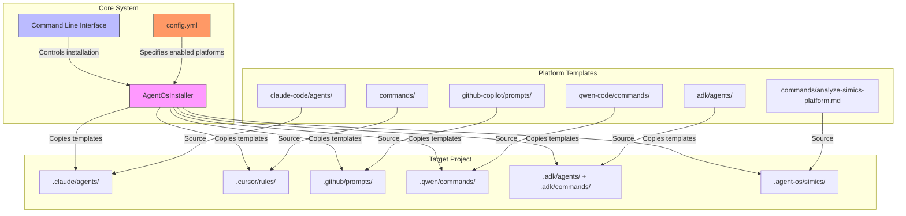
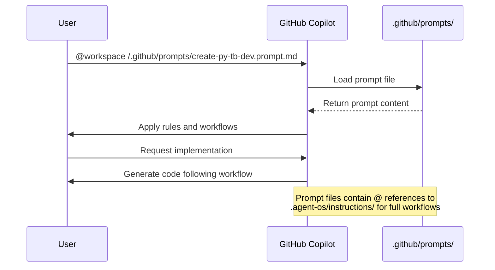
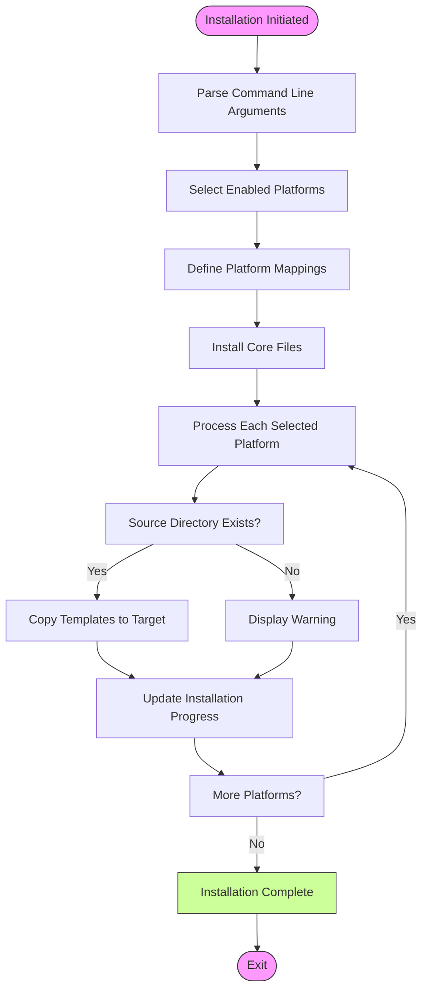

# Platform Integrations

<cite>
**Referenced Files in This Document**   
- [installer.py](file://src/installer.py) - *Updated in recent commit*
- [cli.py](file://src/cli.py) - *Updated in recent commit*
- [README-PLATFORMS.md](file://README-PLATFORMS.md) - *Updated with Simics integration*
- [ADK_INTEGRATION_SUMMARY.md](file://ADK_INTEGRATION_SUMMARY.md)
- [config.yml](file://config.yml) - *Updated with Simics configuration*
- [SIMICS_INTEGRATION.md](file://SIMICS_INTEGRATION.md) - *Added in recent commit*
- [INTEGRATION_STATUS.md](file://simics/INTEGRATION_STATUS.md) - *Added in recent commit*
- [analyze-simics-platform.md](file://commands/analyze-simics-platform.md) - *Added in recent commit*
- [plan-simics-platform.md](file://simics/platform-instructions/core/plan-simics-platform.md) - *Added in recent commit*
</cite>

## Update Summary
**Changes Made**   
- Added new section for Simics platform integration
- Updated Architecture Overview diagram to include Simics
- Added Simics to Platform Integration Patterns
- Updated Configuration Formats section with Simics YAML configuration
- Enhanced Third-Party Dependencies with Simics requirements
- Updated Implementation Guidelines to include Simics project types
- Added Simics to Component Interactions
- Updated document sources with new Simics-related files

## Table of Contents
1. [Introduction](#introduction)
2. [Architecture Overview](#architecture-overview)
3. [Platform Integration Patterns](#platform-integration-patterns)
4. [Component Interactions](#component-interactions)
5. [Configuration Formats](#configuration-formats)
6. [Scalability Considerations](#scalability-considerations)
7. [Third-Party Dependencies](#third-party-dependencies)
8. [Implementation Guidelines](#implementation-guidelines)
9. [Security Considerations](#security-considerations)
10. [Conclusion](#conclusion)

## Introduction

Agent OS implements a plugin-like architecture that enables seamless integration with multiple AI coding platforms through platform-specific templates and configuration files. This documentation details the architectural design that supports Claude Code, GitHub Copilot, Qwen Code, ADK (Agent Development Kit), and now Simics integrations. The system provides a unified workflow while accommodating platform-specific requirements through a flexible installation mechanism that copies appropriate templates during project setup. This approach ensures consistent development experiences across different AI platforms while maintaining compatibility with each platform's unique interface and configuration requirements.

**Section sources**
- [README-PLATFORMS.md](file://README-PLATFORMS.md#L1-L63)
- [ADK_INTEGRATION_SUMMARY.md](file://ADK_INTEGRATION_SUMMARY.md#L1-L113)
- [SIMICS_INTEGRATION.md](file://SIMICS_INTEGRATION.md#L1-L145)

## Architecture Overview

The platform integration architecture in Agent OS follows a modular design pattern where each AI platform is supported through dedicated template directories and configuration mappings. The core system remains platform-agnostic while providing extension points for platform-specific implementations. During installation, the system selectively copies templates from platform-specific directories to designated target locations in the project structure.



**Diagram sources**
- [installer.py](file://src/installer.py#L1-L155)
- [README-PLATFORMS.md](file://README-PLATFORMS.md#L1-L63)
- [SIMICS_INTEGRATION.md](file://SIMICS_INTEGRATION.md#L1-L145)

**Section sources**
- [installer.py](file://src/installer.py#L1-L155)
- [README-PLATFORMS.md](file://README-PLATFORMS.md#L1-L63)
- [SIMICS_INTEGRATION.md](file://SIMICS_INTEGRATION.md#L1-L145)

## Platform Integration Patterns

Agent OS employs distinct integration patterns for each supported platform, leveraging the native capabilities and conventions of each AI coding environment. These patterns ensure optimal compatibility while maintaining a consistent user experience across platforms.

### Claude Code Integration

Claude Code integration utilizes agent templates stored in Markdown files within the `claude-code/agents/` directory. These templates are copied to the `.claude/agents/` directory in the target project during installation. The templates contain structured workflows that reference core instructions in the `.agent-os/instructions/` directory, enabling full subagent support and complex workflow execution.

**Section sources**
- [README-PLATFORMS.md](file://README-PLATFORMS.md#L8-L14)
- [claude-code/agents/](file://claude-code/agents/)

### GitHub Copilot Integration

GitHub Copilot integration uses prompt files with the `.prompt.md` extension stored in the `github-copilot/prompts/` directory. These files are installed to the `.github/prompts/` directory in the target project. The integration leverages Copilot's chat interface, allowing users to reference these prompts directly in conversations. The system also supports chatmodes for full agent persona activation, as demonstrated by the pmssbot implementation.



**Diagram sources**
- [pmssbot.yml](file://pmssbot/pmssbot.yml#L1-L53)
- [create-py-tb-dev.prompt.md](file://pmssbot/github-copilot/prompts/create-py-tb-dev.prompt.md#L1-L18)

**Section sources**
- [README-PLATFORMS.md](file://README-PLATFORMS.md#L27-L33)
- [pmssbot.yml](file://pmssbot/pmssbot.yml#L1-L53)
- [pmssbot/chatmodes/pmssbot.chatmode.md](file://pmssbot/github-copilot/chatmodes/pmssbot.chatmode.md#L1-L89)

### Qwen Code Integration

Qwen Code integration employs TOML configuration files stored in the `qwen-code/commands/` directory. These files are installed to the `.qwen/commands/` directory in the target project. The TOML format provides a structured way to define commands and their parameters, with each file containing references to the core instruction workflows in the `.agent-os/instructions/` directory.

**Section sources**
- [README-PLATFORMS.md](file://README-PLATFORMS.md#L35-L40)
- [qwen-code/commands/](file://qwen-code/commands/)

### ADK Integration

ADK (Agent Development Kit) integration combines elements from multiple platforms, installing both agent templates from `adk/agents/` and command templates from `commands/` to the `.adk/` directory in the target project. This dual-source approach allows ADK to leverage existing command definitions while providing specialized agent capabilities. The integration is fully supported across all installation methods, including shell scripts and the Python CLI.

```mermaid
classDiagram
class ADKInstaller {
+installAgents()
+installCommands()
+handleOverwrites()
}
class PlatformInstaller {
+selectPlatform()
+copyTemplates()
+verifyInstallation()
}
class TemplateManager {
+getSourcePath()
+getTargetPath()
+validateTemplates()
}
ADKInstaller --> PlatformInstaller : "extends"
ADKInstaller --> TemplateManager : "uses"
PlatformInstaller --> TemplateManager : "uses"
note right of ADKInstaller
ADK installation handles both
agents and commands, installing
to .adk/ directory with special
handling for global installations
end note
```

**Diagram sources**
- [installer.py](file://src/installer.py#L1-L155)
- [ADK_INTEGRATION_SUMMARY.md](file://ADK_INTEGRATION_SUMMARY.md#L1-L113)

**Section sources**
- [ADK_INTEGRATION_SUMMARY.md](file://ADK_INTEGRATION_SUMMARY.md#L1-L113)
- [installer.py](file://src/installer.py#L1-L155)

### Simics Integration

Simics integration extends Agent OS with specialized workflows for virtual platform development, device modeling, and simulation. The integration treats Simics platforms as products and individual device modules as specifications, leveraging existing agent-os workflow patterns. It introduces three specialized project types: simics-device, simics-platform, and simics-simulation, each with dedicated instructions and standards directories.

The integration includes commands such as `analyze-simics-platform`, `plan-simics-platform`, `create-simics-device`, `assemble-platform`, and `validate-platform`, which follow the established agent-os command pattern. These commands reference corresponding instruction files in the `.agent-os/simics/` directory structure, maintaining consistency with the core workflow system.

**Section sources**
- [SIMICS_INTEGRATION.md](file://SIMICS_INTEGRATION.md#L1-L145)
- [INTEGRATION_STATUS.md](file://simics/INTEGRATION_STATUS.md#L1-L136)
- [config.yml](file://config.yml#L1-L67)
- [analyze-simics-platform.md](file://commands/analyze-simics-platform.md#L1-L6)

## Component Interactions

The platform integration system relies on well-defined interactions between components, particularly during the installation process where platform-specific templates are selected and copied to the appropriate locations in the target project.

### Installer Component

The `AgentOsInstaller` class in `installer.py` serves as the central component for platform integration, responsible for copying templates from source directories to target project locations based on user-selected platforms. The installer maintains a mapping between platform names and their corresponding source and target directories, processing these mappings during installation.



**Diagram sources**
- [installer.py](file://src/installer.py#L1-L155)
- [cli.py](file://src/cli.py#L1-L187)

**Section sources**
- [installer.py](file://src/installer.py#L1-L155)
- [cli.py](file://src/cli.py#L1-L187)

### CLI Interface

The command-line interface in `cli.py` provides the user-facing control for platform selection during installation. It exposes flags for each supported platform (`--claude-code`, `--github-copilot`, etc.) and handles the delegation of platform selection to the installer component. The CLI also provides status checking functionality to verify which platforms are installed in a given project.

**Section sources**
- [cli.py](file://src/cli.py#L1-L187)
- [installer.py](file://src/installer.py#L1-L155)

## Configuration Formats

Agent OS employs different configuration formats for different platforms, selecting the most appropriate format based on each platform's capabilities and conventions.

### Markdown (MD) for Claude Code and ADK

Markdown files are used for Claude Code agent templates and ADK agents, providing a human-readable format that supports rich text formatting, code blocks, and structured workflows. This format is ideal for complex agent definitions that require detailed documentation and multi-step processes.

**Section sources**
- [claude-code/agents/](file://claude-code/agents/)
- [adk/agents/](file://adk/agents/)

### TOML for Qwen Code

TOML (Tom's Obvious, Minimal Language) is used for Qwen Code command configurations, offering a structured format that is both human-readable and machine-parsable. The hierarchical nature of TOML makes it well-suited for defining commands with parameters, dependencies, and execution rules.

**Section sources**
- [qwen-code/commands/](file://qwen-code/commands/)

### YAML for Configuration and Metadata

YAML is used for system configuration (`config.yml`) and agent metadata (`pmssbot.yml`), providing a flexible format for defining hierarchical data structures. The choice of YAML for configuration files allows for easy extension and modification while maintaining readability.

```mermaid
erDiagram
CONFIG ||--o{ PLATFORM : contains
CONFIG ||--o{ PROJECT_TYPE : defines
CONFIG {
string agent_os_version
string default_project_type
}
PLATFORM {
string platform_name
boolean enabled
}
PROJECT_TYPE {
string type_name
string instructions_path
string standards_path
}
note right of CONFIG
config.yml defines enabled platforms<br/>and project type configurations
end note
```

**Diagram sources**
- [config.yml](file://config.yml#L1-L31)
- [pmssbot.yml](file://pmssbot/pmssbot.yml#L1-L53)

**Section sources**
- [config.yml](file://config.yml#L1-L31)
- [pmssbot.yml](file://pmssbot/pmssbot.yml#L1-L53)

## Scalability Considerations

The platform integration architecture is designed with scalability in mind, allowing for the addition of new platform integrations without significant modifications to the core system.

### Extensible Installer Design

The `AgentOsInstaller` class uses a modular approach to platform mappings, making it straightforward to add support for new platforms by extending the platform mappings dictionary. This design pattern allows new platform integrations to be added with minimal changes to the existing codebase.

**Section sources**
- [installer.py](file://src/installer.py#L1-L155)

### Consistent Interface Patterns

Each platform integration follows consistent interface patterns, with predictable directory structures and file naming conventions. This consistency simplifies the process of adding new integrations, as developers can follow established patterns rather than designing new approaches for each platform.

**Section sources**
- [README-PLATFORMS.md](file://README-PLATFORMS.md#L1-L63)

### Configuration-Driven Platform Management

The use of configuration files to manage platform availability allows for dynamic platform management without requiring code changes. New platforms can be enabled or disabled through configuration updates, providing flexibility in deployment scenarios.

**Section sources**
- [config.yml](file://config.yml#L1-L31)

## Third-Party Dependencies

The platform integration system has specific dependencies and version compatibility requirements for each supported platform.

### GitHub Copilot Dependencies

The GitHub Copilot integration requires access to the GitHub Copilot service and compatibility with the VS Code extension. The integration is designed to work with Copilot's chat interface and prompt system, requiring no additional dependencies beyond the core Copilot functionality.

**Section sources**
- [pmssbot.yml](file://pmssbot/pmssbot.yml#L1-L53)
- [README-PLATFORMS.md](file://README-PLATFORMS.md#L27-L33)

### ADK Dependencies

The ADK integration has no external dependencies beyond the core Agent OS system. It leverages existing command and agent templates, making it self-contained and easy to deploy across different environments.

**Section sources**
- [ADK_INTEGRATION_SUMMARY.md](file://ADK_INTEGRATION_SUMMARY.md#L1-L113)

### Simics Dependencies

The Simics integration requires Simics version 6.0 or higher with the latest API version. The integration is designed to work with Simics's functional accuracy mode by default, with debugging and performance monitoring features enabled. The system maintains compatibility through the `simics` configuration section in `config.yml`.

**Section sources**
- [config.yml](file://config.yml#L1-L67)
- [SIMICS_INTEGRATION.md](file://SIMICS_INTEGRATION.md#L1-L145)

### Version Compatibility

The system maintains version compatibility through the `agent_os_version` field in `config.yml`, allowing for version-specific behavior and backward compatibility. Platform integrations are designed to be forward-compatible, ensuring that newer versions of Agent OS can support existing platform configurations.

**Section sources**
- [config.yml](file://config.yml#L1-L31)

## Implementation Guidelines

When implementing new platform integrations, developers should follow the established patterns and conventions used in the existing integrations.

### Directory Structure

New platform integrations should follow the established directory structure pattern, using a dedicated directory under the root (e.g., `new-platform/`) containing the appropriate template files. The directory structure should mirror the target installation structure to simplify the copying process.

**Section sources**
- [project_structure](file://#L1-L100)

### Template Design

Templates should be designed to reference core instruction workflows in the `.agent-os/instructions/` directory rather than duplicating content. This approach ensures consistency across platforms and simplifies maintenance by centralizing workflow definitions.

**Section sources**
- [README-PLATFORMS.md](file://README-PLATFORMS.md#L55-L63)
- [create-py-tb-dev.prompt.md](file://pmssbot/github-copilot/prompts/create-py-tb-dev.prompt.md#L1-L18)

### Installer Integration

New platforms should be integrated into the `AgentOsInstaller` class by adding entries to the platforms dictionary and corresponding installation mappings. The installer should handle both directory and file copying operations, with appropriate error handling for missing source files.

**Section sources**
- [installer.py](file://src/installer.py#L1-L155)

### Simics-Specific Implementation

For Simics integrations, developers should create project types in `config.yml` with dedicated instructions and standards paths. Commands should follow the established naming convention (e.g., `analyze-simics-platform`) and reference corresponding instruction files in the `.agent-os/simics/` directory structure. The integration should leverage existing subagent implementations while extending them for Simics-specific operations.

**Section sources**
- [config.yml](file://config.yml#L1-L67)
- [SIMICS_INTEGRATION.md](file://SIMICS_INTEGRATION.md#L1-L145)
- [INTEGRATION_STATUS.md](file://simics/INTEGRATION_STATUS.md#L1-L136)

## Security Considerations

The platform integration system includes several security considerations for handling platform-specific credentials and API access.

### Credential Management

The system does not store or manage platform-specific credentials directly. Instead, it relies on the underlying platform's authentication mechanisms (e.g., GitHub authentication for Copilot). This approach minimizes the security surface area and leverages established authentication systems.

**Section sources**
- [README-PLATFORMS.md](file://README-PLATFORMS.md#L1-L63)

### Template Security

Template files are treated as read-only configuration files, with no executable code embedded within them. This design prevents potential code injection attacks and ensures that templates can be safely copied and used across different projects.

**Section sources**
- [claude-code/agents/](file://claude-code/agents/)
- [github-copilot/prompts/](file://github-copilot/prompts/)

### Installation Safety

The installer includes safety features such as overwrite confirmation flags (`--overwrite-instructions`, `--overwrite-standards`, `--overwrite-config`) that allow users to control whether existing files are replaced during installation. This prevents accidental loss of customizations or project-specific configurations.

**Section sources**
- [installer.py](file://src/installer.py#L1-L155)
- [cli.py](file://src/cli.py#L1-L187)

## Conclusion

Agent OS provides a robust and scalable architecture for integrating with multiple AI coding platforms through a plugin-like system of templates and configurations. The design enables support for diverse platforms including Claude Code, GitHub Copilot, Qwen Code, ADK, and now Simics, each with their own integration patterns and configuration formats. The system's modular design, centered around the `AgentOsInstaller` component, allows for selective installation of platform-specific templates while maintaining a consistent core workflow. By leveraging different configuration formats (MD, TOML, YAML) appropriate to each platform's capabilities, Agent OS delivers an optimal user experience across different AI coding environments. The architecture is designed for scalability, making it straightforward to add new platform integrations following the established patterns. Security is maintained through the separation of template content from executable code and reliance on platform-native authentication mechanisms. This comprehensive approach ensures that developers can leverage the strengths of multiple AI coding platforms within a unified and consistent development workflow.