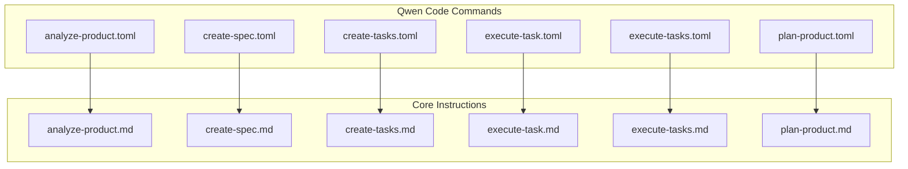
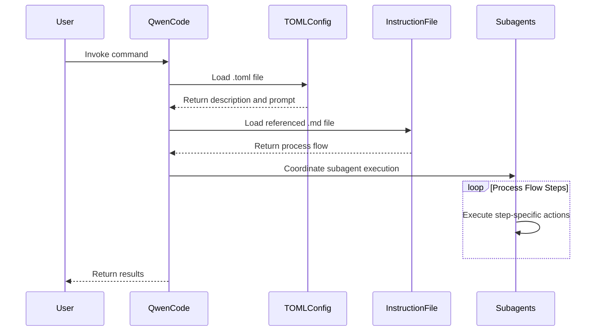
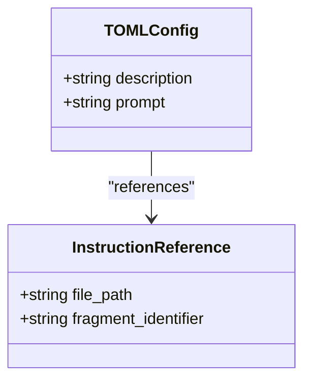
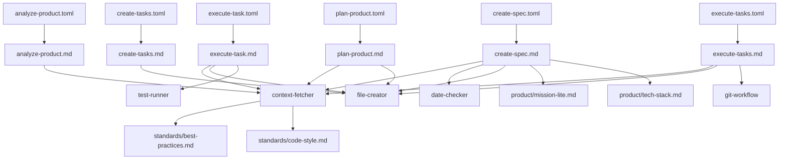

# Qwen Code Integration

<cite>
**Referenced Files in This Document**   
- [analyze-product.toml](file://qwen-code/commands/analyze-product.toml)
- [create-spec.toml](file://qwen-code/commands/create-spec.toml)
- [create-tasks.toml](file://qwen-code/commands/create-tasks.toml)
- [execute-task.toml](file://qwen-code/commands/execute-task.toml)
- [execute-tasks.toml](file://qwen-code/commands/execute-tasks.toml)
- [plan-product.toml](file://qwen-code/commands/plan-product.toml)
- [analyze-product.md](file://instructions/core/analyze-product.md)
- [create-spec.md](file://instructions/core/create-spec.md)
- [create-tasks.md](file://instructions/core/create-tasks.md)
- [execute-task.md](file://instructions/core/execute-task.md)
- [execute-tasks.md](file://instructions/core/execute-tasks.md)
- [plan-product.md](file://instructions/core/plan-product.md)
</cite>

## Table of Contents
1. [Introduction](#introduction)
2. [Project Structure](#project-structure)
3. [Core Components](#core-components)
4. [Architecture Overview](#architecture-overview)
5. [Detailed Component Analysis](#detailed-component-analysis)
6. [Dependency Analysis](#dependency-analysis)
7. [Performance Considerations](#performance-considerations)
8. [Troubleshooting Guide](#troubleshooting-guide)
9. [Conclusion](#conclusion)

## Introduction

Agent OS leverages TOML configuration files to define structured commands for Qwen Code, enabling consistent AI-assisted development workflows. This integration allows developers to standardize interactions between AI agents and codebases through declarative command definitions. The system uses TOML files to specify prompts, descriptions, and execution contexts for various development tasks such as product analysis, specification creation, task planning, and implementation execution. By using TOML as the configuration format, Agent OS achieves a balance between human readability and machine parsing efficiency, supporting reproducible and auditable AI development processes.

## Project Structure

The Qwen Code integration is organized within the `qwen-code/commands` directory, containing six core TOML configuration files that correspond to specific development workflows. These configurations work in conjunction with instruction files located in the `instructions/core` directory, which contain detailed process flows and subagent coordination logic.

**Diagram sources**
- [qwen-code/commands/analyze-product.toml](file://qwen-code/commands/analyze-product.toml)
- [instructions/core/analyze-product.md](file://instructions/core/analyze-product.md)

**Section sources**
- [qwen-code/commands](file://qwen-code/commands)
- [instructions/core](file://instructions/core)

## Core Components

The Qwen Code integration consists of six primary TOML configuration files, each defining a specific development workflow. These files contain a `description` field that summarizes the command's purpose and a `prompt` field that references corresponding instruction files in the `instructions/core` directory. The configuration files serve as entry points that trigger complex workflows involving multiple subagents (context-fetcher, date-checker, file-creator, git-workflow, test-runner) and following structured process flows defined in Markdown instruction files.

**Section sources**
- [qwen-code/commands/analyze-product.toml](file://qwen-code/commands/analyze-product.toml#L1-L8)
- [qwen-code/commands/create-spec.toml](file://qwen-code/commands/create-spec.toml#L1-L8)
- [qwen-code/commands/create-tasks.toml](file://qwen-code/commands/create-tasks.toml#L1-L8)
- [qwen-code/commands/execute-task.toml](file://qwen-code/commands/execute-task.toml#L1-L9)
- [qwen-code/commands/execute-tasks.toml](file://qwen-code/commands/execute-tasks.toml#L1-L9)
- [qwen-code/commands/plan-product.toml](file://qwen-code/commands/plan-product.toml#L1-L8)

## Architecture Overview

The Qwen Code integration architecture follows a command-delegation pattern where TOML configuration files act as command definitions that delegate execution to detailed instruction files. When a Qwen Code command is invoked, the system reads the corresponding TOML file, extracts the prompt reference, and loads the referenced instruction file which contains the complete process flow with multiple steps, subagent interactions, and conditional logic.

**Diagram sources**
- [qwen-code/commands/analyze-product.toml](file://qwen-code/commands/analyze-product.toml)
- [instructions/core/analyze-product.md](file://instructions/core/analyze-product.md)

## Detailed Component Analysis

### Command Configuration Analysis

Each TOML configuration file in the Qwen Code integration follows a consistent schema with two primary fields: `description` and `prompt`. The `description` provides a brief summary of the command's purpose, while the `prompt` contains a multi-line string that references the corresponding instruction file using the `@` symbol notation. This design enables separation of command definition from implementation details, allowing the same instruction file to potentially be referenced by multiple command configurations.

#### Configuration Schema

**Diagram sources**
- [qwen-code/commands/analyze-product.toml](file://qwen-code/commands/analyze-product.toml#L1-L8)
- [qwen-code/commands/create-spec.toml](file://qwen-code/commands/create-spec.toml#L1-L8)

**Section sources**
- [qwen-code/commands/analyze-product.toml](file://qwen-code/commands/analyze-product.toml#L1-L8)
- [qwen-code/commands/create-spec.toml](file://qwen-code/commands/create-spec.toml#L1-L8)

### analyze-product.toml Analysis

The analyze-product.toml configuration enables codebase analysis and Agent OS installation in existing products. It references the analyze-product.md instruction file which implements a five-step process: codebase analysis, product context gathering, plan-product execution, documentation customization, and final verification. This command serves as an entry point for integrating Agent OS into existing projects by first understanding the current codebase state before applying standardized documentation structures.

**Section sources**
- [qwen-code/commands/analyze-product.toml](file://qwen-code/commands/analyze-product.toml#L1-L8)
- [instructions/core/analyze-product.md](file://instructions/core/analyze-product.md#L1-L219)

### create-spec.toml Analysis

The create-spec.toml configuration initiates the creation of detailed feature specifications aligned with the product roadmap. It references create-spec.md which implements an eleven-step process including spec initiation, context gathering, requirements clarification, date determination, folder creation, specification document generation, and user review. This workflow demonstrates sophisticated subagent coordination, using context-fetcher, date-checker, and file-creator subagents to gather information and create structured documentation.

**Section sources**
- [qwen-code/commands/create-spec.toml](file://qwen-code/commands/create-spec.toml#L1-L8)
- [instructions/core/create-spec.md](file://instructions/core/create-spec.md#L1-L431)

### create-tasks.toml Analysis

The create-tasks.toml configuration generates task checklists from approved feature specifications. It references create-tasks.md which implements a two-step process: creating a tasks.md file with a structured checklist and performing an execution readiness check. The task structure follows test-driven development principles with major tasks broken down into subtasks using decimal notation, typically starting with writing tests and ending with verification.

**Section sources**
- [qwen-code/commands/create-tasks.toml](file://qwen-code/commands/create-tasks.toml#L1-L8)
- [instructions/core/create-tasks.md](file://instructions/core/create-tasks.md#L1-L112)

### execute-task.toml Analysis

The execute-task.toml configuration executes individual tasks following a test-driven development workflow. It references execute-task.md which implements a seven-step process: task understanding, technical specification review, best practices review, code style review, task execution, test verification, and status updates. This workflow emphasizes code quality by reviewing relevant standards before implementation and using focused test verification to ensure feature correctness.

**Section sources**
- [qwen-code/commands/execute-task.toml](file://qwen-code/commands/execute-task.toml#L1-L9)
- [instructions/core/execute-task.md](file://instructions/core/execute-task.md#L1-L264)

### execute-tasks.toml Analysis

The execute-tasks.toml configuration manages the execution of multiple tasks through a three-phase process. It references execute-tasks.md which implements a comprehensive workflow: pre-execution setup (task assignment, context analysis, git branch management), task execution loop, and post-execution tasks. The post-execution phase is critical, ensuring completion of all necessary steps including full test suite execution, git workflow management, and roadmap updates.

**Section sources**
- [qwen-code/commands/execute-tasks.toml](file://qwen-code/commands/execute-tasks.toml#L1-L9)
- [instructions/core/execute-tasks.md](file://instructions/core/execute-tasks.md#L1-L188)

### plan-product.toml Analysis

The plan-product.toml configuration initializes new products by creating core documentation files. It references plan-product.md which implements a six-step process: gathering user input, creating documentation structure, and generating mission, tech-stack, mission-lite, and roadmap files. This workflow establishes the foundational documentation for AI agent consumption, creating both detailed and condensed versions of key documents to optimize context usage.

**Section sources**
- [qwen-code/commands/plan-product.toml](file://qwen-code/commands/plan-product.toml#L1-L8)
- [instructions/core/plan-product.md](file://instructions/core/plan-product.md#L1-L330)

## Dependency Analysis

The Qwen Code integration demonstrates a clear dependency hierarchy where TOML configuration files depend on instruction files, which in turn depend on various subagents and standard documentation. The configuration files have no inter-dependencies but share common dependencies on the instruction files and subagent system.

**Diagram sources**
- [qwen-code/commands](file://qwen-code/commands)
- [instructions/core](file://instructions/core)
- [adk/agents](file://adk/agents)

**Section sources**
- [qwen-code/commands](file://qwen-code/commands)
- [instructions/core](file://instructions/core)
- [adk/agents](file://adk/agents)

## Performance Considerations

The use of TOML for Qwen Code configurations offers several performance advantages over alternative formats like YAML or JSON. TOML's minimal syntax results in faster parsing times and lower memory usage during configuration loading. The simplicity of the two-field schema (description and prompt) ensures efficient processing, as the system only needs to extract these values to initiate workflows. Compared to Markdown-based configurations used in other platforms, TOML provides structured data that can be reliably parsed without complex text processing. The separation of command definition (TOML) from implementation details (Markdown instruction files) also enables efficient caching strategies, where frequently used instruction files can be cached independently of command configurations.

**Section sources**
- [qwen-code/commands/analyze-product.toml](file://qwen-code/commands/analyze-product.toml)
- [qwen-code/commands/create-spec.toml](file://qwen-code/commands/create-spec.toml)

## Troubleshooting Guide

Common issues in the Qwen Code integration typically involve malformed configurations or unexpected AI behavior. For TOML files, ensure proper syntax with valid key-value pairs and multi-line string formatting. Missing or incorrect instruction file references (using the `@` symbol) will prevent workflow execution. When experiencing unexpected AI behavior, verify that all required subagents are available and that instruction files are properly formatted with valid XML-like tags. Schema validation issues often arise from missing required sections in generated documentation, so ensure that templates in instruction files are followed precisely. Version compatibility issues can occur when instruction file formats change, so maintain version numbers in the instruction file headers and ensure compatibility with the executing agent system.

**Section sources**
- [qwen-code/commands/analyze-product.toml](file://qwen-code/commands/analyze-product.toml)
- [instructions/core/analyze-product.md](file://instructions/core/analyze-product.md)
- [instructions/core/create-spec.md](file://instructions/core/create-spec.md)

## Conclusion

The Qwen Code integration in Agent OS demonstrates a sophisticated approach to AI-assisted development through structured TOML configurations. By using TOML files to define commands that reference detailed instruction files, the system achieves a balance between simplicity and functionality. This architecture enables reproducible workflows, auditable processes, and consistent AI behavior across different development tasks. The integration effectively leverages subagents to handle specialized tasks while maintaining clear separation of concerns between command definition and execution logic. The choice of TOML over alternative formats provides performance benefits and reliability in parsing, contributing to an efficient and maintainable AI development framework.