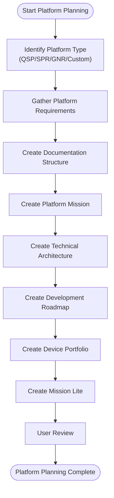
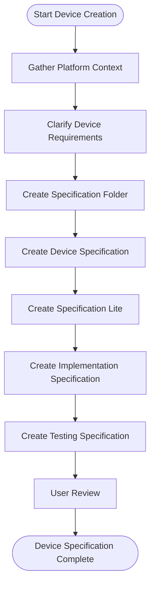
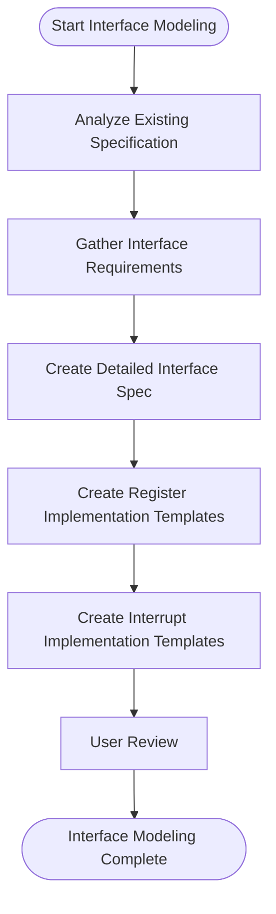
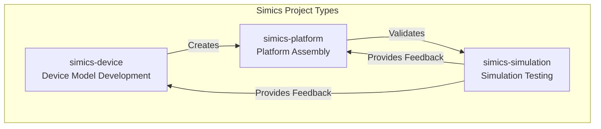
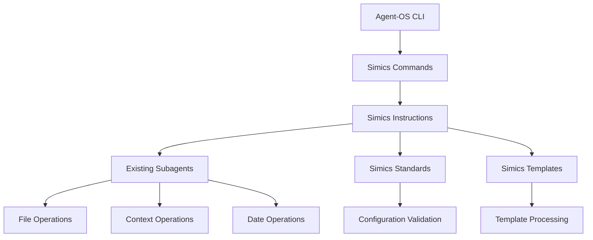
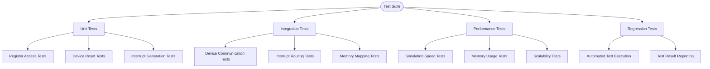

# Simics Integration

<cite>
**Referenced Files in This Document**   
- [SIMICS_INTEGRATION.md](file://SIMICS_INTEGRATION.md)
- [INTEGRATION_STATUS.md](file://simics/INTEGRATION_STATUS.md)
- [plan-simics-platform.md](file://commands/plan-simics-platform.md)
- [create-simics-device.md](file://commands/create-simics-device.md)
- [model-device-interface.md](file://commands/model-device-interface.md)
- [assemble-platform.md](file://commands/assemble-platform.md)
- [validate-platform.md](file://commands/validate-platform.md)
- [plan-simics-platform.md](file://simics/platform-instructions/core/plan-simics-platform.md)
- [create-simics-device.md](file://simics/device-instructions/core/create-simics-device.md)
- [model-device-interface.md](file://simics/device-instructions/core/model-device-interface.md)
- [assemble-platform.md](file://simics/platform-instructions/core/assemble-platform.md)
- [validate-platform.md](file://simics/platform-instructions/core/validate-platform.md)
- [device-development-standards.md](file://simics/device-standards/device-development-standards.md)
- [platform-development-standards.md](file://simics/platform-standards/platform-development-standards.md)
- [simulation-testing-template.md](file://simics/simulation-standards/simulation-testing-template.md)
</cite>

## Table of Contents
1. [Introduction](#introduction)
2. [Platform as Product Model](#platform-as-product-model)
3. [Device Specification and Modeling](#device-specification-and-modeling)
4. [Project Types](#project-types)
5. [Configuration](#configuration)
6. [Workflow Integration](#workflow-integration)
7. [Implementation Standards](#implementation-standards)
8. [Testing and Validation](#testing-and-validation)
9. [Usage Examples](#usage-examples)
10. [Troubleshooting Guide](#troubleshooting-guide)
11. [Conclusion](#conclusion)

## Introduction

The Simics integration extends agent-os with specialized workflows for virtual platform development, device modeling, and simulation within the Simics ecosystem. This integration treats Simics platforms as products and individual device modules as specifications, leveraging agent-os's established workflow patterns to provide a structured approach to virtual platform development.

The integration enables developers to create comprehensive virtual platforms for embedded and server systems, with support for device modeling, platform assembly, and simulation testing. By treating platforms as products and devices as specifications, the integration provides a clear development roadmap and ensures consistency across projects.

**Section sources**
- [SIMICS_INTEGRATION.md](file://SIMICS_INTEGRATION.md#L1-L145)

## Platform as Product Model

The Simics integration treats virtual platforms as products, providing a structured approach to platform development with clear mission, roadmap, and technical architecture.

### Supported Platform Products

The integration supports several predefined platform products:

- **QSP Platform Product**: Quick Start Platform for embedded/IoT development
- **SPR Server Platform Product**: Sapphire Rapids server platform for data center validation
- **GNR Server Platform Product**: Granite Rapids server platform for next-gen server research
- **Custom Platform Products**: User-defined platforms for specialized requirements

Each platform product follows a standardized development lifecycle with defined phases and deliverables.

### Platform Product Workflow

The platform development workflow consists of five key steps:

1. **Plan Platform Product**: Use `plan-simics-platform` to establish platform mission, roadmap, and device portfolio
2. **Analyze Platform**: Use `analyze-simics-platform` to assess existing platforms for integration
3. **Create Device Specifications**: Use `create-simics-device` to specify individual device models
4. **Assemble Platform**: Use `assemble-platform` to integrate devices into complete platform
5. **Validate Platform**: Use `validate-platform` to execute comprehensive platform validation

The `plan-simics-platform` command initiates the platform product planning process, creating comprehensive documentation including mission, technical architecture, roadmap, and device portfolio.



**Diagram sources**
- [plan-simics-platform.md](file://simics/platform-instructions/core/plan-simics-platform.md#L1-L397)

**Section sources**
- [SIMICS_INTEGRATION.md](file://SIMICS_INTEGRATION.md#L15-L50)
- [plan-simics-platform.md](file://commands/plan-simics-platform.md#L1-L6)
- [plan-simics-platform.md](file://simics/platform-instructions/core/plan-simics-platform.md#L1-L397)

## Device Specification and Modeling

Device modules are treated as specifications within agent-os, following an enhanced create-spec pattern that provides detailed requirements for device modeling.

### Device Development Workflow

The device development workflow extends the standard agent-os specification process with Simics-specific requirements:

```bash
# Create a device specification for a specific platform
agent-os create-simics-device --platform=qsp --device-name=uart-controller

# Model detailed device interfaces  
agent-os model-device-interface --spec=uart-controller

# Create implementation tasks
agent-os create-tasks --spec=uart-controller

# Execute device implementation
agent-os execute-tasks --spec=uart-controller
```

The `create-simics-device` command creates a comprehensive device specification with hardware interface, behavioral requirements, platform integration, and validation criteria.



**Diagram sources**
- [create-simics-device.md](file://simics/device-instructions/core/create-simics-device.md#L1-L374)

### Device Interface Modeling

The `model-device-interface` command extends existing device specifications with implementation-ready interface definitions, including detailed register bit field definitions, memory mapping, and interrupt handling logic.

This process creates three key artifacts:
- Detailed interface specification with register bit field definitions
- Register implementation templates with Simics-specific code patterns
- Interrupt implementation templates with signal handling logic



**Diagram sources**
- [model-device-interface.md](file://simics/device-instructions/core/model-device-interface.md#L1-L307)

**Section sources**
- [SIMICS_INTEGRATION.md](file://SIMICS_INTEGRATION.md#L51-L78)
- [create-simics-device.md](file://commands/create-simics-device.md#L1-L6)
- [model-device-interface.md](file://commands/model-device-interface.md#L1-L6)
- [create-simics-device.md](file://simics/device-instructions/core/create-simics-device.md#L1-L374)
- [model-device-interface.md](file://simics/device-instructions/core/model-device-interface.md#L1-L307)

## Project Types

The Simics integration introduces three specialized project types to support different aspects of virtual platform development.

### simics-device

The `simics-device` project type is designed for individual device model development, focusing on register modeling and behavioral simulation. This project type uses device-specific instructions and standards to ensure consistency across device implementations.

### simics-platform

The `simics-platform` project type supports virtual platform assembly, system-level configuration, and multi-device integration. It provides workflows for platform planning, device integration, and system validation.

### simics-simulation

The `simics-simulation` project type is dedicated to simulation environment setup, test scenario development, and automated testing. It includes templates for test configuration, unit testing, integration testing, and performance testing.



**Diagram sources**
- [SIMICS_INTEGRATION.md](file://SIMICS_INTEGRATION.md#L79-L90)

**Section sources**
- [SIMICS_INTEGRATION.md](file://SIMICS_INTEGRATION.md#L79-L90)

## Configuration

The Simics integration extends agent-os configuration through the `config.yml` file, adding project type definitions and Simics-specific settings.

### Project Type Configuration

The integration defines three project types with their corresponding instruction and standards paths:

```yaml
project_types:
  simics-device:
    instructions: ~/.agent-os/simics/device-instructions  
    standards: ~/.agent-os/simics/device-standards
    
  simics-platform:
    instructions: ~/.agent-os/simics/platform-instructions
    standards: ~/.agent-os/simics/platform-standards
    
  simics-simulation:
    instructions: ~/.agent-os/simics/simulation-instructions
    standards: ~/.agent-os/simics/simulation-standards
```

### Simics-Specific Configuration

Additional Simics-specific configuration options include:

```yaml
simics:
  version: "6.0+"
  api_version: "latest"
  default_accuracy: "functional"
  enable_debugging: true
  performance_monitoring: true
```

These settings control the Simics environment, including version requirements, simulation accuracy, and debugging capabilities.

**Section sources**
- [SIMICS_INTEGRATION.md](file://SIMICS_INTEGRATION.md#L91-L119)

## Workflow Integration

The Simics integration is designed to work seamlessly with the existing agent-os CLI framework, maintaining compatibility with established workflows and processes.

### Command Integration

Commands are registered in the `commands/` directory and follow agent-os naming and structure conventions. Each command references its corresponding instruction file, ensuring consistency across the system.

### Project Type Integration

New project types are registered in `config.yml` with custom instruction and standards paths. This maintains compatibility with the existing project type system while supporting Simics-specific requirements.

### Workflow Engine Integration

The integration follows agent-os workflow patterns and reuses existing subagents (context-fetcher, file-creator, date-checker). This ensures compatibility with the existing workflow processing engine and supports workflow chaining and task management.



**Diagram sources**
- [INTEGRATION_STATUS.md](file://simics/INTEGRATION_STATUS.md#L1-L136)

**Section sources**
- [INTEGRATION_STATUS.md](file://simics/INTEGRATION_STATUS.md#L1-L136)

## Implementation Standards

The Simics integration includes comprehensive standards for device development, platform development, and simulation testing.

### Device Development Standards

The device development standards cover code organization, naming conventions, and implementation practices.

#### Code Organization Standards

- Device model source files: `src/devices/[device-name]/`
- Register definitions: `src/devices/[device-name]/registers.h`
- Implementation: `src/devices/[device-name]/[device-name].c`
- Tests: `tests/devices/[device-name]/`

#### Naming Conventions

- Device class names: `[vendor]_[device]_device`
- Register names: `[DEVICE]_[REGISTER]_REG`
- Bit field names: `[REGISTER]_[FIELD]_MASK`
- Function names: `[device]_[operation]`

#### Implementation Standards

- Register modeling with proper access permissions and side effect handling
- State management with checkpointing and restoration support
- Error handling with meaningful error messages and edge case management
- Code documentation with public interface explanations and usage examples

**Section sources**
- [device-development-standards.md](file://simics/device-standards/device-development-standards.md#L1-L48)

### Platform Development Standards

The platform development standards address platform architecture, development phases, integration, and quality assurance.

#### Platform Organization

- Platform products: `.agent-os/platform-products/[platform-name]/`
- Assembly artifacts: `assembly/` subdirectory
- Configuration scripts: `assembly/platform-config.simics`
- Device configurations: `assembly/device-configs/`

#### Development Phase Standards

- Foundation: Core platform and essential devices
- Enhancement: Standard peripherals and features
- Advanced: Platform-specific and high-performance components
- Optimization: Performance tuning and validation

#### Integration Standards

- Consistent memory mapping schemes
- Standardized interrupt allocation
- Unified configuration parameters
- Common debugging interfaces

**Section sources**
- [platform-development-standards.md](file://simics/platform-standards/platform-development-standards.md#L1-L55)

## Testing and Validation

The Simics integration includes comprehensive testing and validation frameworks to ensure platform quality and reliability.

### Simulation Testing Framework

The simulation testing framework provides templates for unit testing, integration testing, performance testing, and automated testing.

#### Unit Testing Templates

Unit tests verify individual device functionality, including:
- Register access operations
- Device reset functionality
- Interrupt generation and handling

#### Integration Testing Templates

Integration tests validate platform-level functionality, including:
- Inter-device communication
- Interrupt routing across the platform
- Platform memory mapping

#### Performance Testing Templates

Performance tests measure simulation metrics, including:
- Simulation speed (virtual time vs. real time)
- Memory usage during simulation
- Scalability limits



**Diagram sources**
- [simulation-testing-template.md](file://simics/simulation-standards/simulation-testing-template.md#L1-L347)

### Platform Validation Process

The platform validation process consists of five key steps:

1. **Validation Planning**: Review platform requirements and define success metrics
2. **Functional Validation**: Test core platform functionality and specification compliance
3. **Performance Validation**: Measure simulation performance and memory usage
4. **Integration Validation**: Test platform with target software and external tools
5. **Validation Reporting**: Generate validation report and provide deployment recommendations

**Section sources**
- [validate-platform.md](file://commands/validate-platform.md#L1-L6)
- [validate-platform.md](file://simics/platform-instructions/core/validate-platform.md#L1-L57)
- [simulation-testing-template.md](file://simics/simulation-standards/simulation-testing-template.md#L1-L347)

## Usage Examples

### Create QSP Platform Product

```bash
# Plan QSP platform as a product
agent-os plan-product --project-type=simics-platform --platform-name=qsp
```

This command creates the following documentation structure:
- `.agent-os/platform-products/qsp/mission.md`
- `.agent-os/platform-products/qsp/roadmap.md`
- `.agent-os/platform-products/qsp/tech-stack.md`
- `.agent-os/platform-products/qsp/device-portfolio.md`

### Create Device for Platform

```bash
# Create UART device specification for QSP platform
agent-os create-spec --project-type=simics-device --platform=qsp --device-name=uart-controller
```

This command creates:
- `.agent-os/specs/YYYY-MM-DD-simics-device-uart-controller/spec.md`
- `.agent-os/specs/YYYY-MM-DD-simics-device-uart-controller/sub-specs/implementation-spec.md`
- `.agent-os/specs/YYYY-MM-DD-simics-device-uart-controller/sub-specs/testing-spec.md`

### Assemble Complete Platform

```bash
# Assemble devices into complete platform
agent-os assemble-platform --product=qsp --phase=foundation

# Validate assembled platform
agent-os validate-platform --product=qsp
```

**Section sources**
- [SIMICS_INTEGRATION.md](file://SIMICS_INTEGRATION.md#L120-L145)

## Troubleshooting Guide

### Common Issues and Solutions

#### Platform Planning Issues
- **Issue**: Platform planning fails to create documentation structure
- **Solution**: Verify that the platform name uses kebab-case and that the project type is correctly specified

#### Device Specification Issues
- **Issue**: Device specification creation fails due to missing platform context
- **Solution**: Ensure the platform product exists or provide complete platform context when creating custom devices

#### Integration Issues
- **Issue**: Device integration fails during platform assembly
- **Solution**: Verify that device specifications are complete and that all dependencies are met

#### Validation Issues
- **Issue**: Platform validation fails performance tests
- **Solution**: Review simulation accuracy settings and optimize device implementations for performance

### Debugging Tips

- Use the `enable_debugging: true` setting in `config.yml` to enable detailed logging
- Check the mission-lite.md and spec-lite.md files for concise overviews of platform and device specifications
- Review the pre-flight and post-flight checks in instruction files for additional validation steps

**Section sources**
- [INTEGRATION_STATUS.md](file://simics/INTEGRATION_STATUS.md#L1-L136)
- [plan-simics-platform.md](file://simics/platform-instructions/core/plan-simics-platform.md#L1-L397)
- [create-simics-device.md](file://simics/device-instructions/core/create-simics-device.md#L1-L374)

## Conclusion

The Simics integration provides a comprehensive framework for virtual platform development, device modeling, and simulation workflows. By treating platforms as products and devices as specifications, the integration offers a structured approach to virtual platform development with clear mission, roadmap, and technical architecture.

Key benefits of the integration include:
- Structured development with platform products providing clear mission and roadmap
- Specification-driven device models following detailed requirements
- Consistent standards across all Simics projects
- Automated workflows for specification, tasks, and execution
- Built-in testing and validation frameworks
- Comprehensive documentation generation and maintenance

The integration is fully compatible with existing agent-os workflows and can be used immediately without changes to the core system. Developers can choose a target platform product (QSP/SPR/GNR/Custom), establish a platform foundation with `plan-simics-platform`, create device specifications with `create-simics-device`, generate implementation tasks with `create-tasks`, execute development with `execute-tasks`, and assemble and validate complete platforms.

**Section sources**
- [SIMICS_INTEGRATION.md](file://SIMICS_INTEGRATION.md#L1-L145)