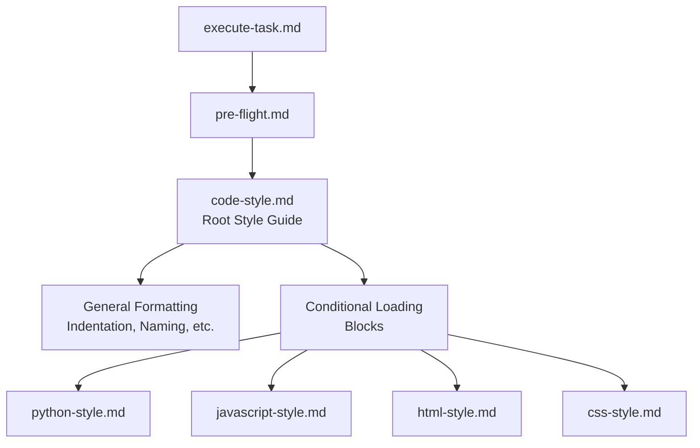
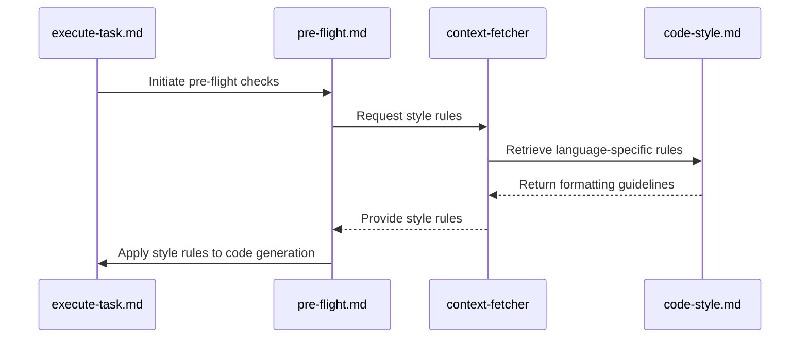

# Code Style Guidelines

<cite>
**Referenced Files in This Document**   
- [code-style.md](file://standards/code-style.md)
- [python-style.md](file://standards/code-style/python-style.md)
- [javascript-style.md](file://standards/code-style/javascript-style.md)
- [css-style.md](file://standards/code-style/css-style.md)
- [html-style.md](file://standards/code-style/html-style.md)
- [pre-flight.md](file://instructions/meta/pre-flight.md)
</cite>

## Table of Contents
1. [Introduction](#introduction)
2. [Style Guide Architecture](#style-guide-architecture)
3. [General Formatting Principles](#general-formatting-principles)
4. [Language-Specific Guidelines](#language-specific-guidelines)
   - [Python Style Guide](#python-style-guide)
   - [JavaScript Style Guide](#javascript-style-guide)
   - [HTML Style Guide](#html-style-guide)
   - [CSS and TailwindCSS Style Guide](#css-and-tailwindcss-style-guide)
5. [Integration with Pre-Flight Checks](#integration-with-pre-flight-checks)
6. [Enforcement and Compliance](#enforcement-and-compliance)
7. [Common Issues and Solutions](#common-issues-and-solutions)
8. [Performance Considerations](#performance-considerations)
9. [Editor Configuration](#editor-configuration)

## Introduction

Consistent code style is essential for maintaining readability, improving maintainability, and enabling seamless collaboration across AI-generated and human-written codebases. The Agent OS project enforces a comprehensive style guide system that ensures uniform formatting standards across all languages and components. This document details the hierarchical structure of the style guides, language-specific rules, integration with pre-flight validation processes, and strategies for maintaining compliance at scale.

**Section sources**
- [code-style.md](file://standards/code-style.md#L1-L10)

## Style Guide Architecture

The Agent OS style guide system follows a hierarchical structure with a root configuration that defines general principles and delegates language-specific rules to dedicated files. The main [code-style.md](file://standards/code-style.md) serves as the entry point, establishing global formatting standards while conditionally loading language-specific guides based on the current task context.

This architecture uses conditional loading blocks to prevent redundant context consumption. When a task involves a specific language, the system dynamically retrieves the appropriate style guide only when needed. The language-specific files—including [python-style.md](file://standards/code-style/python-style.md), [javascript-style.md](file://standards/code-style/javascript-style.md), [html-style.md](file://standards/code-style/html-style.md), and [css-style.md](file://standards/code-style/css-style.md)—implement detailed rules that extend the general principles.

**Diagram sources**
- [code-style.md](file://standards/code-style.md#L1-L95)
- [pre-flight.md](file://instructions/meta/pre-flight.md#L1-L20)

**Section sources**
- [code-style.md](file://standards/code-style.md#L1-L95)
- [best-practices.md](file://standards/best-practices.md#L1-L57)

## General Formatting Principles

The root [code-style.md](file://standards/code-style.md) file establishes universal formatting rules that apply across all languages in the Agent OS ecosystem. These general principles provide a consistent foundation for code appearance and organization.

### Indentation
- Use 2 spaces for indentation (never tabs)
- Maintain consistent indentation throughout files
- Align nested structures for readability

### Naming Conventions
- **Methods and Variables**: Use snake_case (e.g., `user_profile`, `calculate_total`)
- **Classes and Modules**: Use PascalCase (e.g., `UserProfile`, `PaymentProcessor`)
- **Constants**: Use UPPER_SNAKE_CASE (e.g., `MAX_RETRY_COUNT`)

### String Formatting
- Use single quotes for strings: `'Hello World'`
- Use double quotes only when interpolation is needed
- Use template literals for multi-line strings or complex interpolation

### Code Comments
- Add brief comments above non-obvious business logic
- Document complex algorithms or calculations
- Explain the "why" behind implementation choices
- Never remove existing comments unless removing the associated code
- Update comments when modifying code to maintain accuracy
- Keep comments concise and relevant

**Section sources**
- [code-style.md](file://standards/code-style.md#L30-L59)

## Language-Specific Guidelines

### Python Style Guide

The [python-style.md](file://standards/code-style/python-style.md) extends the general formatting principles with Python-specific conventions that align with PEP 8 and modern Python practices.

#### Indentation and Line Length
- Use 4 spaces for indentation (never tabs)
- Maximum line length of 88 characters (Black formatter default)
- Use trailing commas in multi-line structures
- Two blank lines between top-level functions and classes
- One blank line between methods in a class

#### Import Organization
Imports are organized in three distinct groups separated by blank lines:
1. Standard library imports first
2. Third-party imports second
3. Local application imports last

#### Naming Conventions
- Functions and variables: `snake_case`
- Classes: `PascalCase`
- Constants: `UPPER_SNAKE_CASE`
- Private attributes: prefix with single underscore `_private_var`
- "Magic" methods: double underscores `__special__`

#### Type Hints
The style guide mandates comprehensive type annotation:
- Use type hints for function parameters and return values
- Import types from `typing` module when needed
- Use `Optional[Type]` for nullable parameters

#### Function and Method Structure
Functions must include complete docstrings with standardized sections:
- Descriptive function names
- Single responsibility principle
- Docstrings for all public functions and methods
- Args, Returns, and Raises sections in docstrings

#### List and Dictionary Comprehensions
Comprehensions should prioritize readability:
- Use for simple transformations
- Break complex comprehensions into regular loops
- Prefer readability over brevity

**Section sources**
- [python-style.md](file://standards/code-style/python-style.md#L1-L118)

### JavaScript Style Guide

The [javascript-style.md](file://standards/code-style/javascript-style.md) file defines formatting rules for JavaScript code, extending the general principles to accommodate JavaScript's unique syntax and patterns.

While the file currently contains only the title, the system architecture indicates that JavaScript style rules are intended to be loaded conditionally when JavaScript tasks are detected. The integration with the context-fetcher agent suggests that comprehensive JavaScript rules exist or are planned, following the same pattern as other language-specific guides.

The pre-flight process ensures that when JavaScript code is being generated or modified, the appropriate style rules are retrieved and applied, maintaining consistency with the overall style guide system.

**Section sources**
- [javascript-style.md](file://standards/code-style/javascript-style.md#L1-L2)

### HTML Style Guide

The [html-style.md](file://standards/code-style/html-style.md) provides specific formatting rules for HTML markup to ensure consistency in structure and attribute organization.

#### Structure Rules
- Use 2 spaces for indentation
- Place nested elements on new lines with proper indentation
- Content between tags should be on its own line when multi-line

#### Attribute Formatting
- Place each HTML attribute on its own line
- Align attributes vertically
- Keep the closing `>` on the same line as the last attribute

The style guide includes concrete examples demonstrating proper HTML structure with multi-line formatting for attributes and appropriate nesting. This approach enhances readability, particularly for elements with numerous attributes or complex class names.

**Section sources**
- [html-style.md](file://standards/code-style/html-style.md#L1-L35)

### CSS and TailwindCSS Style Guide

The [css-style.md](file://standards/code-style/css-style.md) establishes unique formatting conventions for CSS, with a specific focus on TailwindCSS utility classes.

#### Multi-line CSS Classes in Markup
The guide defines a distinctive multi-line formatting style for TailwindCSS classes:
- Write classes for each responsive size on their own dedicated line
- Start with the smallest size (no responsive prefix) and progress to larger sizes
- Align each line of CSS classes vertically
- Place focus and hover classes on dedicated lines
- Implement an additional 'xs' responsive breakpoint at 400px
- Include custom CSS classes at the start of the first line

This approach creates highly readable markup that clearly shows how styles change across breakpoints. The vertical alignment makes it easy to scan and understand the styling applied at each responsive level.

**Section sources**
- [css-style.md](file://standards/code-style/css-style.md#L1-L25)

## Integration with Pre-Flight Checks

The style guide system is tightly integrated with the pre-flight validation process defined in [pre-flight.md](file://instructions/meta/pre-flight.md). This integration ensures that code style compliance is enforced before any code generation occurs.

The pre-flight process includes several mechanisms for style enforcement:
- Sequential processing of XML blocks to ensure consistent rule application
- Mandatory use of specified subagents for task execution
- Requirement to follow exact templates as provided
- Context-aware loading of relevant style rules based on task requirements

When executing tasks that involve code generation, the system uses the context-fetcher agent to retrieve the appropriate style rules from the code-style directory. This selective loading approach minimizes context consumption while ensuring that only relevant style guidelines are applied.

The execute-task instruction specifically directs the use of the context-fetcher subagent to retrieve style rules for the languages and file types being used in the current task, creating a closed loop of style enforcement.

**Diagram sources**
- [pre-flight.md](file://instructions/meta/pre-flight.md#L1-L20)
- [code-style.md](file://standards/code-style.md#L1-L95)
- [execute-task.md](file://instructions/core/execute-task.md#L101-L129)

**Section sources**
- [pre-flight.md](file://instructions/meta/pre-flight.md#L1-L20)
- [execute-task.md](file://instructions/core/execute-task.md#L101-L129)

## Enforcement and Compliance

The Agent OS style guide system employs multiple strategies to ensure compliance across both AI-generated and human-written code.

### Automated Tooling
The conditional loading blocks in [code-style.md](file://standards/code-style.md) and [best-practices.md](file://standards/best-practices.md) prevent duplicate context loading, optimizing the efficiency of style rule application. The context-fetcher agent plays a crucial role in retrieving and applying the appropriate style rules based on the current task context.

### Consistency Mechanisms
The system uses a one-time agent detection pattern to reduce complexity and ensure consistent application of style rules. All agents follow standardized conventions for branch naming, commit messages, and file templates, creating uniformity across contributions.

### Validation Process
The pre-flight rules mandate exact template usage and sequential processing of instructions, creating a predictable environment for style enforcement. The requirement to use specified subagents ensures that style rules are applied consistently regardless of who or what is generating the code.

**Section sources**
- [code-style.md](file://standards/code-style.md#L1-L95)
- [best-practices.md](file://standards/best-practices.md#L1-L57)
- [pre-flight.md](file://instructions/meta/pre-flight.md#L1-L20)

## Common Issues and Solutions

### AI Model Drift in Formatting
One common issue is AI model drift, where language models may revert to their training data formatting rather than adhering to project-specific style guides. The Agent OS system addresses this through:

- Context-aware loading of style rules immediately before code generation
- Mandatory use of the context-fetcher agent to retrieve current guidelines
- Pre-flight validation that checks for style compliance
- Specific instructions to use exact templates

### Incomplete Style Guide Implementation
The [javascript-style.md](file://standards/code-style/javascript-style.md) file currently contains minimal content, representing a gap in the style guide system. This should be addressed by:

- Developing comprehensive JavaScript style rules following the pattern of other language guides
- Including indentation, naming, and formatting standards
- Adding examples of correct and incorrect usage
- Documenting framework-specific conventions if applicable

### Context Management
The conditional loading blocks help mitigate context management issues by loading style rules only when needed. This prevents context bloat while ensuring that relevant rules are available when required.

**Section sources**
- [javascript-style.md](file://standards/code-style/javascript-style.md#L1-L2)
- [code-style.md](file://standards/code-style.md#L45-L95)

## Performance Considerations

### Large-Scale Refactoring
When performing large-scale refactoring to enforce style guidelines, consider the following performance implications:

- Batch operations to minimize file I/O
- Use parallel processing for independent files
- Implement incremental updates rather than wholesale rewrites
- Cache style rule parsing results when possible

### Editor Integration
Editor configuration can significantly impact performance and developer experience:

- Configure editors to automatically apply style rules on save
- Use lightweight linters that provide real-time feedback
- Implement caching for style rule lookups
- Minimize the number of active extensions to reduce overhead

The system's conditional loading approach already optimizes performance by loading style rules only when needed, reducing memory usage and processing time.

**Section sources**
- [code-style.md](file://standards/code-style.md#L1-L95)
- [pre-flight.md](file://instructions/meta/pre-flight.md#L1-L20)

## Editor Configuration

To ensure seamless adoption of the style guidelines, configure editors with the following settings:

### General Configuration
- Set indentation to 2 spaces for most files
- Disable tab insertion in favor of spaces
- Enable automatic trimming of trailing whitespace
- Configure line length guides at appropriate limits

### Language-Specific Settings
- Python: Set indentation to 4 spaces and line length to 88 characters
- JavaScript: Follow the general 2-space indentation rule
- HTML/CSS: Enable support for the multi-line class formatting pattern

### Integration with Development Workflow
- Connect style rules to pre-commit hooks
- Integrate with IDE linters and formatters
- Set up real-time validation to catch style issues immediately
- Configure the context-fetcher agent for quick access to style guidelines

These configurations ensure that developers and AI agents alike can adhere to the style guidelines with minimal friction, promoting consistent code quality across the project.

**Section sources**
- [code-style.md](file://standards/code-style.md#L1-L95)
- [python-style.md](file://standards/code-style/python-style.md#L1-L118)
- [html-style.md](file://standards/code-style/html-style.md#L1-L35)
- [css-style.md](file://standards/code-style/css-style.md#L1-L25)