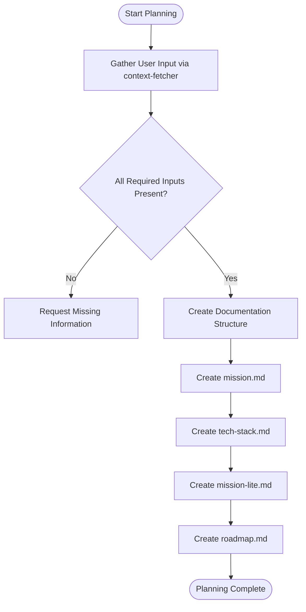
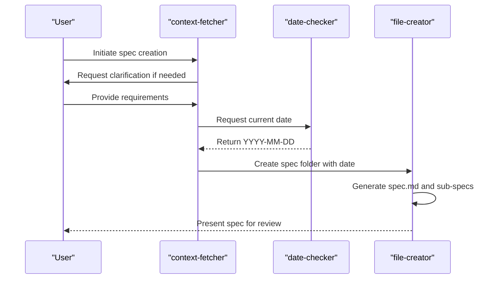
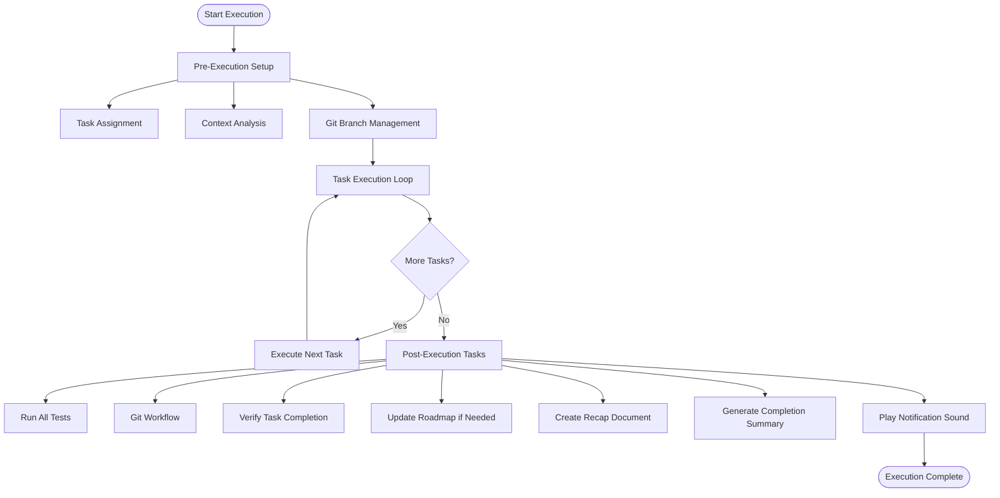
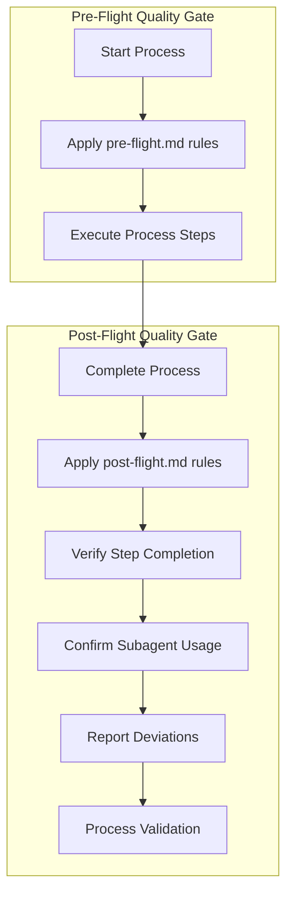
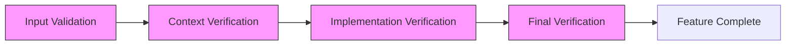
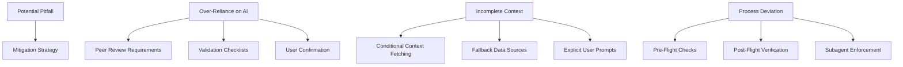
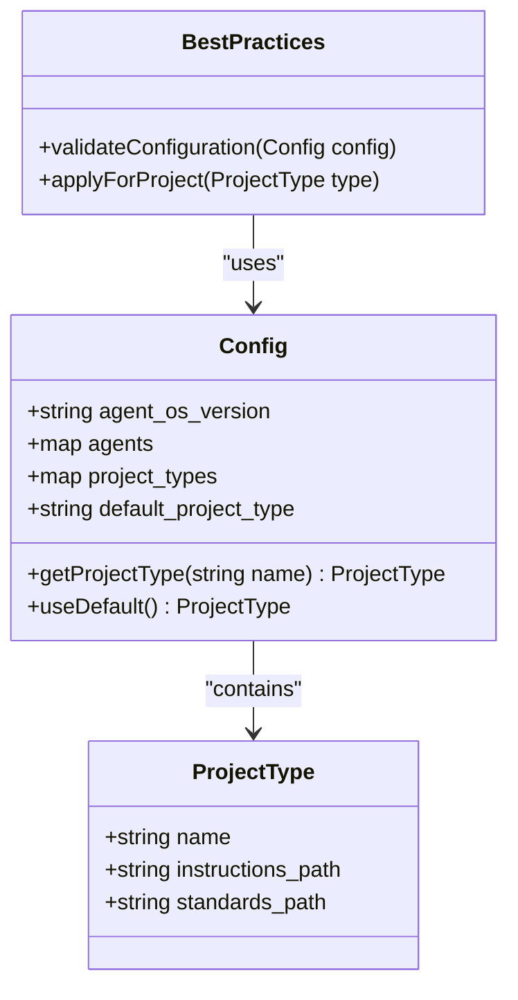

# Development Best Practices

<cite>
**Referenced Files in This Document**   
- [best-practices.md](file://standards/best-practices.md)
- [pre-flight.md](file://instructions/meta/pre-flight.md)
- [post-flight.md](file://instructions/meta/post-flight.md)
- [config.yml](file://config.yml)
- [plan-product.md](file://instructions/core/plan-product.md)
- [create-spec.md](file://instructions/core/create-spec.md)
- [execute-tasks.md](file://instructions/core/execute-tasks.md)
- [post-execution-tasks.md](file://instructions/core/post-execution-tasks.md)
</cite>

## Table of Contents
1. [Introduction](#introduction)
2. [Core Principles of Development](#core-principles-of-development)
3. [Process-Oriented Workflows](#process-oriented-workflows)
4. [Integration with Meta Instructions](#integration-with-meta-instructions)
5. [AI-Assisted Development Ethics](#ai-assisted-development-ethics)
6. [Quality Gates in the Development Lifecycle](#quality-gates-in-the-development-lifecycle)
7. [Common Pitfalls and Mitigation Strategies](#common-pitfalls-and-mitigation-strategies)
8. [Performance Implications in Large Teams](#performance-implications-in-large-teams)
9. [Customization for Project Types](#customization-for-project-types)
10. [Conclusion](#conclusion)

## Introduction

This document outlines the comprehensive development best practices framework within Agent OS, focusing on process-oriented methodologies that complement technical code style rules. The practices are designed to ensure consistency, maintainability, and quality across diverse development workflows. By integrating modular design, rigorous documentation, structured version control, systematic testing, and ethical AI usage, these guidelines form a robust foundation for sustainable software development. These practices are reinforced through meta instructions that act as quality gates throughout the development lifecycle.

**Section sources**
- [best-practices.md](file://standards/best-practices.md)
- [pre-flight.md](file://instructions/meta/pre-flight.md)
- [post-flight.md](file://instructions/meta/post-flight.md)

## Core Principles of Development

The core principles outlined in best-practices.md establish foundational guidelines that shape all development activities. These principles emphasize simplicity, readability, and maintainability as primary objectives.

### Keep It Simple
The "Keep It Simple" principle advocates for minimalistic implementation approaches, avoiding unnecessary complexity. This includes implementing functionality in the fewest lines possible and selecting straightforward solutions over clever but obscure ones. This principle directly influences architectural decisions during product planning and specification creation.

### Optimize for Readability
Code clarity takes precedence over micro-optimizations. This involves using descriptive variable names, writing self-documenting code, and adding comments that explain the rationale ("why") rather than restating what the code does ("what"). This practice enhances long-term maintainability and facilitates onboarding of new team members.

### DRY (Don't Repeat Yourself)
The DRY principle requires extraction of repeated logic into reusable components, whether they are private methods, utility functions, or UI components. This reduces code duplication, minimizes bug surfaces, and simplifies future modifications by centralizing common functionality.

### File Structure
Files should adhere to single responsibility principles, containing focused functionality. Related components are grouped together using consistent naming conventions and directory structures. This organizational discipline supports easier navigation and maintenance.

**Section sources**
- [best-practices.md](file://standards/best-practices.md#L15-L30)

## Process-Oriented Workflows

Agent OS implements structured workflows across key development phases: product planning, specification creation, and task execution. Each phase follows a defined sequence of steps that enforce best practices.

### Product Planning Workflow
The product planning process begins with gathering user input through the context-fetcher subagent, ensuring all necessary information is collected before proceeding. This includes the main idea, key features, target users, and tech stack preferences. The system validates inputs and requests missing information using a standardized error template.

**Diagram sources**
- [plan-product.md](file://instructions/core/plan-product.md#L1-L330)

**Section sources**
- [plan-product.md](file://instructions/core/plan-product.md#L1-L330)

### Specification Creation Workflow
The specification creation process follows a conditional flow based on user input. When users ask "what's next?", the system identifies the next uncompleted roadmap item. Otherwise, it accepts any user-provided spec idea.

The workflow includes context gathering from mission-lite.md and tech-stack.md if not already available, followed by requirements clarification through numbered questions. After determining the current date via the date-checker subagent, the system creates a timestamped spec folder using kebab-case naming conventions.

The spec documentation includes multiple artifacts:
- spec.md: Comprehensive requirements document
- spec-lite.md: Condensed version for AI context
- Technical specifications
- Database schema (if applicable)
- API specifications (if applicable)

This multi-layered approach ensures both detailed and concise documentation coexist, supporting different consumption needs.

**Diagram sources**
- [create-spec.md](file://instructions/core/create-spec.md#L1-L431)

**Section sources**
- [create-spec.md](file://instructions/core/create-spec.md#L1-L431)

### Task Execution Workflow
The task execution process is divided into three distinct phases: pre-execution setup, task execution loop, and post-execution tasks.

#### Pre-Execution Setup
This phase involves task assignment, context analysis, and git branch management. The system identifies tasks to execute, gathers necessary context from spec documents, and ensures proper branch isolation using the git-workflow subagent.

#### Task Execution Loop
The system executes all assigned parent tasks and their subtasks using standardized instructions from execute-task.md. After each task completion, it updates the tasks.md status and checks for remaining tasks before proceeding.

#### Post-Execution Tasks
After task completion, the system runs a comprehensive series of verification steps including test suite execution, git workflow management, task completion verification, roadmap updates, recap document creation, and user notification.

**Diagram sources**
- [execute-tasks.md](file://instructions/core/execute-tasks.md#L1-L188)
- [post-execution-tasks.md](file://instructions/core/post-execution-tasks.md#L1-L250)

**Section sources**
- [execute-tasks.md](file://instructions/core/execute-tasks.md#L1-L188)
- [post-execution-tasks.md](file://instructions/core/post-execution-tasks.md#L1-L250)

## Integration with Meta Instructions

Meta instructions in pre-flight.md and post-flight.md serve as quality gates that ensure consistency and completeness across all development processes.

### Pre-Flight Rules
The pre-flight rules establish fundamental execution principles:
- Use specified subagents for designated tasks
- Process XML blocks sequentially
- Execute every numbered step exactly as specified
- Stop and ask specific questions when clarification is needed
- Use exact templates as provided

These rules ensure that all processes follow a standardized execution pattern, reducing variability and potential errors.

### Post-Flight Rules
The post-flight rules provide verification mechanisms after process completion:
- Verify every numbered step was executed according to instructions
- Confirm all subagent-specified tasks were properly delegated
- Report any deviations from instructions, including misread or skipped steps

This verification layer acts as a final quality check, ensuring process integrity and accountability.

**Diagram sources**
- [pre-flight.md](file://instructions/meta/pre-flight.md#L1-L20)
- [post-flight.md](file://instructions/meta/post-flight.md#L1-L18)

**Section sources**
- [pre-flight.md](file://instructions/meta/pre-flight.md#L1-L20)
- [post-flight.md](file://instructions/meta/post-flight.md#L1-L18)

## AI-Assisted Development Ethics

The development practices incorporate ethical considerations for AI-assisted development, addressing potential risks associated with over-reliance on AI suggestions.

### Responsible AI Usage
The system balances AI assistance with human oversight by:
- Requiring user confirmation for critical decisions
- Providing transparent reasoning for recommendations
- Maintaining clear separation between AI-generated content and human approval
- Using AI as an augmentation tool rather than a replacement for judgment

### Peer Review Requirements
Certain high-impact changes require explicit peer review before implementation. This includes:
- Architecture-altering decisions
- Security-sensitive modifications
- Cross-system integrations
- Performance-critical components

The system enforces these requirements through conditional logic in the process flows, ensuring appropriate scrutiny for sensitive changes.

### Validation Checklists
Automated validation checklists are integrated into the workflow to verify compliance with best practices. These checklists include:
- Code quality metrics
- Security vulnerability scans
- Performance benchmarks
- Documentation completeness
- Test coverage requirements

These automated checks provide objective validation of code quality and adherence to standards.

**Section sources**
- [best-practices.md](file://standards/best-practices.md#L1-L57)
- [pre-flight.md](file://instructions/meta/pre-flight.md#L1-L20)

## Quality Gates in the Development Lifecycle

The development lifecycle incorporates multiple quality gates that enforce best practices at critical junctures.

### Input Validation Gate
At the beginning of product planning, the system validates that all required inputs are present before proceeding. This prevents incomplete specifications and ensures adequate context for decision-making.

### Context Verification Gate
During specification creation, the system verifies that essential context documents (mission-lite.md, tech-stack.md) are available before generating technical specifications. This ensures alignment with overall product goals and technical constraints.

### Implementation Verification Gate
During task execution, the system verifies that each task is properly implemented before proceeding to the next. This includes checking code quality, test coverage, and documentation completeness.

### Final Verification Gate
The post-execution phase serves as the final quality gate, requiring:
- 100% test pass rate
- Proper git workflow execution
- Task completion verification
- Roadmap updates
- Recap documentation
- User notification

This comprehensive verification ensures that no feature is considered complete without meeting all quality criteria.

**Diagram sources**
- [plan-product.md](file://instructions/core/plan-product.md#L1-L330)
- [create-spec.md](file://instructions/core/create-spec.md#L1-L431)
- [execute-tasks.md](file://instructions/core/execute-tasks.md#L1-L188)

## Common Pitfalls and Mitigation Strategies

Despite robust processes, certain pitfalls can occur during development. The system includes specific mitigation strategies to address these challenges.

### Over-Reliance on AI Suggestions
A common risk is accepting AI-generated code or design suggestions without proper review. The mitigation strategy includes:
- Mandatory peer review for significant changes
- Validation checklists that verify design decisions
- Contextual awareness requirements that force consideration of alternatives
- Explicit user confirmation for AI-generated content

### Incomplete Context Gathering
Sometimes essential context may be missing from the current session. The system mitigates this through:
- Conditional context fetching that loads missing documents
- Clear error messages that identify missing information
- Fallback data sources for critical parameters
- User prompts that request specific missing inputs

### Process Deviation
Team members might attempt to bypass standardized processes. The system prevents this by:
- Enforcing pre-flight and post-flight checks
- Requiring subagent usage for specific tasks
- Verifying step-by-step execution compliance
- Reporting any deviations from the specified process

**Diagram sources**
- [pre-flight.md](file://instructions/meta/pre-flight.md#L1-L20)
- [post-flight.md](file://instructions/meta/post-flight.md#L1-L18)
- [best-practices.md](file://standards/best-practices.md#L1-L57)

**Section sources**
- [pre-flight.md](file://instructions/meta/pre-flight.md#L1-L20)
- [post-flight.md](file://instructions/meta/post-flight.md#L1-L18)

## Performance Implications in Large Teams

The best practices framework has specific performance implications when scaled to large development teams.

### Consistency Benefits
Standardized processes ensure consistent output quality across team members, reducing variability in code quality, documentation, and implementation approaches. This consistency reduces integration challenges and improves maintainability.

### Onboarding Efficiency
New team members can quickly understand expected workflows through the standardized process documentation. The clear separation of concerns and consistent patterns accelerate the learning curve.

### Coordination Overhead
While standardization improves quality, it introduces coordination overhead. The system mitigates this by:
- Automating repetitive verification tasks
- Providing clear ownership boundaries
- Using asynchronous review processes
- Implementing efficient notification systems

### Parallel Development Support
The git branch management strategy enables parallel development by isolating feature work. The system automatically creates and manages feature branches, reducing merge conflicts and supporting concurrent development.

**Section sources**
- [execute-tasks.md](file://instructions/core/execute-tasks.md#L1-L188)
- [git-workflow.md](file://adk/agents/git-workflow.md)

## Customization for Project Types

The framework supports customization for different project types through configuration in config.yml.

### Default Configuration
The default project type uses standard instructions and standards located in ~/.agent-os/instructions and ~/.agent-os/standards. This provides a consistent baseline for most projects.

### Custom Project Types
Although currently commented out in config.yml, the system supports custom project types (type_a, type_b) with dedicated instructions and standards directories. This allows tailoring best practices to specific project requirements.

### Configuration Structure
The configuration file defines:
- Agent enablement (currently all disabled)
- Project type mappings
- Instruction and standards paths
- Default project type

This flexible structure enables adaptation of best practices to different development contexts while maintaining a consistent overall framework.

**Diagram sources**
- [config.yml](file://config.yml#L1-L32)

**Section sources**
- [config.yml](file://config.yml#L1-L32)

## Conclusion

The development best practices framework in Agent OS provides a comprehensive, process-oriented approach that complements technical code style rules. By integrating modular design, documentation discipline, structured version control, systematic testing, and ethical AI usage, these practices ensure high-quality, maintainable software development. The integration with meta instructions creates effective quality gates throughout the development lifecycle, while mitigation strategies address common pitfalls like over-reliance on AI suggestions. The framework scales effectively to large teams and supports customization for different project types, making it adaptable to diverse development contexts. This holistic approach balances automation with human oversight, ensuring both efficiency and quality in software delivery.