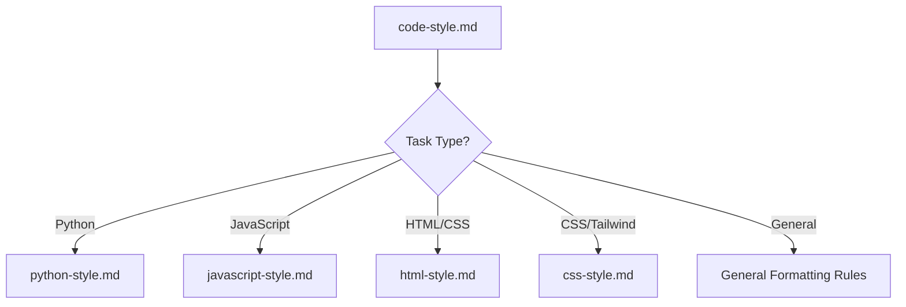
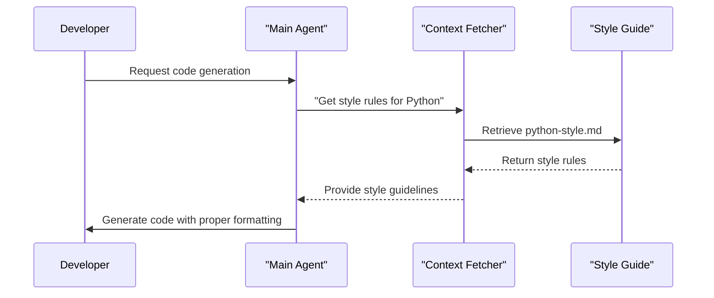
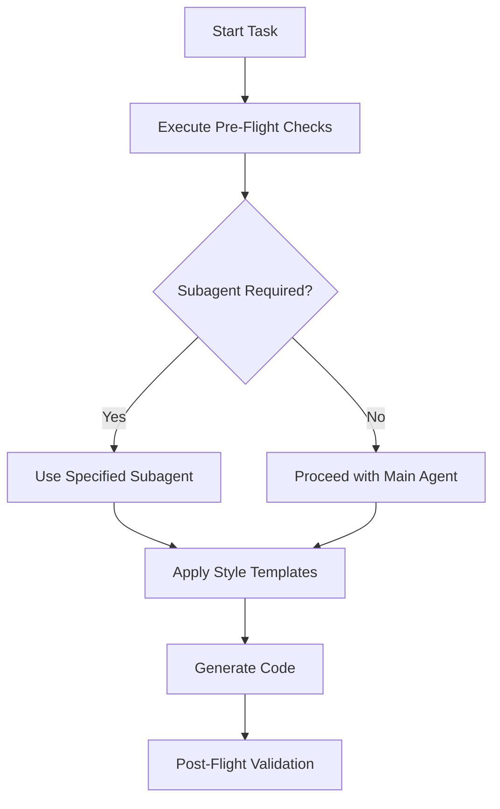

# Standards and Best Practices

<cite>
**Referenced Files in This Document**   
- [code-style.md](file://standards/code-style.md)
- [python-style.md](file://standards/code-style/python-style.md)
- [javascript-style.md](file://standards/code-style/javascript-style.md)
- [html-style.md](file://standards/code-style/html-style.md)
- [css-style.md](file://standards/code-style/css-style.md)
- [best-practices.md](file://standards/best-practices.md)
- [tech-stack.md](file://standards/tech-stack.md)
- [pre-flight.md](file://instructions/meta/pre-flight.md)
- [pyproject.toml](file://pyproject.toml)
</cite>

## Table of Contents
1. [Introduction](#introduction)
2. [Purpose of Consistent Code Quality](#purpose-of-consistent-code-quality)
3. [Code Style Guidelines](#code-style-guidelines)
4. [Best Practices](#best-practices)
5. [Technology Stack Recommendations](#technology-stack-recommendations)
6. [Customization for Teams](#customization-for-teams)
7. [Common Issues and Mitigation](#common-issues-and-mitigation)
8. [Performance Considerations](#performance-considerations)
9. [Integration with Pre-Flight Checks](#integration-with-pre-flight-checks)
10. [Conclusion](#conclusion)

## Introduction
This document outlines the comprehensive standards and best practices framework for Agent OS projects. It covers code style guidelines, development principles, technology stack recommendations, and quality enforcement mechanisms. The standards are designed to ensure consistency, maintainability, and high code quality across all projects, particularly in the context of AI-generated code.

## Purpose of Consistent Code Quality
Enforcing consistent code quality across AI-generated code serves several critical purposes:

- **Maintainability**: Uniform code style enables developers to quickly understand and modify code regardless of its origin
- **Collaboration**: Standardized formatting reduces friction in team environments and code reviews
- **Error Reduction**: Consistent patterns help identify anomalies and potential bugs more easily
- **Knowledge Transfer**: New team members can ramp up faster when code follows predictable patterns
- **Tooling Compatibility**: Automated tools for formatting, linting, and analysis work more effectively with consistent code

The standards framework prevents the fragmentation that often occurs when multiple AI agents generate code with varying styles, ensuring that all output adheres to a unified quality bar.

**Section sources**
- [code-style.md](file://standards/code-style.md#L1-L10)
- [best-practices.md](file://standards/best-practices.md#L1-L10)

## Code Style Guidelines
The code style guidelines are organized hierarchically, with a high-level code-style.md serving as the entry point and language-specific files providing detailed rules.

### Relationship Between High-Level and Language-Specific Style Guides
The [code-style.md](file://standards/code-style.md) file acts as a central dispatcher that conditionally loads language-specific style guides based on the current task context. This architecture prevents unnecessary context loading and ensures that only relevant style rules are applied.



**Diagram sources**
- [code-style.md](file://standards/code-style.md#L30-L95)

### Python Style Guidelines
Python code must adhere to the following standards:

#### General Formatting
- Use 4 spaces for indentation (never tabs)
- Maximum line length of 88 characters
- Two blank lines between top-level functions and classes
- One blank line between methods in a class

#### Import Organization
Imports must be organized in three groups separated by blank lines:
1. Standard library imports
2. Third-party imports
3. Local application imports

```python
import os
import sys
from pathlib import Path

import requests
from django.conf import settings

from myapp.models import User
from myapp.utils import helper_function
```

#### Naming Conventions
- Functions and variables: `snake_case`
- Classes: `PascalCase`
- Constants: `UPPER_SNAKE_CASE`
- Private attributes: prefix with single underscore `_private_var`

#### Type Hints
All functions should use type hints for parameters and return values:

```python
from typing import Dict, List, Optional, Union

def process_users(
    users: List[Dict[str, Union[str, int]]],
    active_only: bool = True
) -> Optional[List[str]]:
    """Process a list of user dictionaries."""
    if not users:
        return None

    return [user['name'] for user in users if user.get('active', False)]
```

**Section sources**
- [python-style.md](file://standards/code-style/python-style.md#L1-L118)
- [pyproject.toml](file://pyproject.toml#L35-L120)

### JavaScript Style Guidelines
JavaScript code follows these standards:

#### General Rules
- Use 2 spaces for indentation
- Follow the naming conventions specified in the general formatting rules
- Use single quotes for strings unless interpolation is needed

The JavaScript style guide is designed to integrate with modern tooling and frameworks, particularly React, which is the preferred JavaScript framework in the Agent OS ecosystem.

**Section sources**
- [javascript-style.md](file://standards/code-style/javascript-style.md#L1-L2)

### HTML Style Guidelines
HTML markup must adhere to strict formatting rules for consistency and readability:

#### Structure Rules
- Use 2 spaces for indentation
- Place nested elements on new lines with proper indentation
- Content between tags should be on its own line when multi-line

#### Attribute Formatting
- Place each HTML attribute on its own line
- Align attributes vertically
- Keep the closing `>` on the same line as the last attribute

```html
<div class="container">
  <header class="flex flex-col space-y-2
                 md:flex-row md:space-y-0 md:space-x-4">
    <h1 class="text-primary dark:text-primary-300">
      Page Title
    </h1>
    <nav class="flex flex-col space-y-2
                md:flex-row md:space-y-0 md:space-x-4">
      <a href="/"
         class="btn-ghost">
        Home
      </a>
      <a href="/about"
         class="btn-ghost">
        About
      </a>
    </nav>
  </header>
</div>
```

**Section sources**
- [html-style.md](file://standards/code-style/html-style.md#L1-L36)

### CSS Style Guidelines
CSS styling follows a specialized approach centered on TailwindCSS:

#### Multi-line CSS Classes
A unique multi-line formatting style is used for Tailwind CSS classes in HTML markup:
- Each responsive size gets its own dedicated line
- The smallest size (no prefix) appears first
- Lines are aligned vertically
- Focus and hover classes get dedicated lines
- An additional 'xs' breakpoint at 400px is implemented

```html
<div class="custom-cta bg-gray-50 dark:bg-gray-900 p-4 rounded cursor-pointer w-full
            hover:bg-gray-100 dark:hover:bg-gray-800
            xs:p-6
            sm:p-8 sm:font-medium
            md:p-10 md:text-lg
            lg:p-12 lg:text-xl lg:font-semibold lg:2-3/5
            xl:p-14 xl:text-2xl
            2xl:p-16 2xl:text-3xl 2xl:font-bold 2xl:w-3/4">
  I'm a call-to-action!
</div>
```

**Section sources**
- [css-style.md](file://standards/code-style/css-style.md#L1-L26)

## Best Practices
The best practices document complements technical style guidelines with process recommendations that enhance code quality and development efficiency.

### Core Principles
#### Keep It Simple
- Implement code in the fewest lines possible
- Avoid over-engineering solutions
- Choose straightforward approaches over clever ones

#### Optimize for Readability
- Prioritize code clarity over micro-optimizations
- Write self-documenting code with clear variable names
- Add comments for "why" not "what"

#### DRY (Don't Repeat Yourself)
- Extract repeated business logic to private methods
- Extract repeated UI markup to reusable components
- Create utility functions for common operations

#### File Structure
- Keep files focused on a single responsibility
- Group related functionality together
- Use consistent naming conventions

### Dependencies Management
When choosing external libraries:
- Select the most popular and actively maintained option
- Check the library's GitHub repository for:
  - Recent commits (within last 6 months)
  - Active issue resolution
  - Number of stars/downloads
  - Clear documentation

These principles work in conjunction with the technical style guidelines to create a holistic approach to code quality that addresses both the form and substance of the code.

**Section sources**
- [best-practices.md](file://standards/best-practices.md#L1-L57)

## Technology Stack Recommendations
The tech-stack.md file provides standardized technology recommendations that serve as defaults for Agent OS projects.

### Recommended Stack
- **Language**: Python 3.11+
- **Web Framework**: FastAPI 0.104+
- **ASGI Server**: Uvicorn (FastAPI)
- **Package Manager**: Poetry / pip
- **Virtual Environment**: Poetry / venv
- **Dependency File**: pyproject.toml / requirements.txt
- **Code Formatter**: Black
- **Import Sorter**: isort
- **Linter**: Ruff / Flake8
- **Type Checker**: mypy
- **Primary Database**: PostgreSQL 17+
- **ORM**: SQLAlchemy
- **Database Migrations**: Alembic
- **JavaScript Framework**: React latest stable
- **Build Tool**: Vite
- **Package Manager**: npm
- **Node Version**: 22 LTS
- **CSS Framework**: TailwindCSS 4.0+
- **UI Components**: Instrumental Components latest
- **Font Provider**: Google Fonts
- **Icons**: Lucide React components
- **Application Hosting**: Digital Ocean App Platform/Droplets
- **Database Hosting**: Digital Ocean Managed PostgreSQL
- **Asset Storage**: Amazon S3
- **CDN**: CloudFront
- **CI/CD Platform**: GitHub Actions

These recommendations are designed to create a cohesive, modern development environment that maximizes productivity and maintainability. Project-specific overrides can be defined in `.agent-os/product/tech-stack.md`.

**Section sources**
- [tech-stack.md](file://standards/tech-stack.md#L1-L43)

## Customization for Teams
While the standards provide a strong foundation, teams have mechanisms to customize them for their specific needs:

### Overriding Defaults
Project-specific standards can be defined in `.agent-os/product/` directories, which take precedence over global standards. This allows teams to:
- Define project-specific technology stacks
- Customize code style rules for unique requirements
- Establish team-specific best practices

### Conditional Loading
The conditional block system in style guides prevents unnecessary context loading:

```markdown
<conditional-block task-condition="python" context-check="python-style">
IF current task involves writing or updating Python:
  IF python-style.md already in context:
    SKIP: Re-reading this file
    NOTE: "Using Python style guide already in context"
  ELSE:
    READ: @.agent-os/standards/code-style/python-style.md
</conditional-block>
```

This architecture allows teams to extend the standards system without modifying the core files, maintaining compatibility while enabling customization.

**Section sources**
- [code-style.md](file://standards/code-style.md#L60-L95)
- [tech-stack.md](file://standards/tech-stack.md#L3-L5)

## Common Issues and Mitigation
AI-generated code presents specific challenges that the standards framework addresses.

### Style Violations in AI-Generated Code
Common issues include:
- Inconsistent indentation
- Incorrect naming conventions
- Poorly formatted multi-line structures
- Missing type hints in Python
- Improperly organized imports

### Mitigation Strategies
#### Context-Aware Style Retrieval
The context-fetcher agent retrieves relevant style rules before code generation:



**Diagram sources**
- [execute-task.md](file://instructions/core/execute-task.md#L101-L129)
- [context-fetcher.md](file://adk/agents/context-fetcher.md)

#### Automated Enforcement
The pre-flight checks ensure compliance:

- Code style rules are applied before any code generation
- Existing comments are preserved and updated
- Formatting templates are used consistently
- Language-specific rules are loaded conditionally

These strategies prevent style violations at the source rather than requiring post-hoc corrections.

**Section sources**
- [code-style.md](file://standards/code-style.md#L30-L59)
- [pre-flight.md](file://instructions/meta/pre-flight.md#L1-L20)

## Performance Considerations
Maintaining consistent styling in large codebases requires careful performance optimization.

### Context Efficiency
The conditional loading system minimizes context usage:
- Style guides are only loaded when relevant to the current task
- Once loaded, guides are cached to prevent re-reading
- Specialized agents handle specific tasks with minimal toolset

### Tooling Integration
The standards are designed to work efficiently with automated tools:
- Black formatter enforces consistent Python style with minimal configuration
- isort automatically organizes imports
- Ruff provides fast linting
- mypy enables type checking without excessive overhead

### Scalability
The architecture supports large projects through:
- Modular style guide organization
- Efficient context retrieval
- Parallel processing capabilities
- Caching of frequently accessed rules

These performance considerations ensure that the standards framework scales effectively with project size and complexity.

**Section sources**
- [CHANGELOG.md](file://CHANGELOG.md#L218-L243)
- [pyproject.toml](file://pyproject.toml#L35-L120)

## Integration with Pre-Flight Checks
The standards are enforced through integration with the pre-flight check system defined in instructions/meta/pre-flight.md.

### Pre-Flight Enforcement
The pre-flight rules establish quality gates:

- Subagents must be used when specified
- XML blocks are processed sequentially
- Steps are executed exactly as specified
- Exact templates are used



**Diagram sources**
- [pre-flight.md](file://instructions/meta/pre-flight.md#L1-L20)

### Quality Gate Implementation
The pre-flight system enforces standards by:
- Requiring the use of specialized subagents for specific tasks
- Ensuring sequential processing of instructions
- Mandating the use of exact templates
- Validating that all steps are followed precisely

This creates a robust quality assurance pipeline that prevents style violations before code is generated, rather than attempting to fix them afterward.

**Section sources**
- [pre-flight.md](file://instructions/meta/pre-flight.md#L1-L20)
- [execute-task.md](file://instructions/core/execute-task.md#L101-L129)

## Conclusion
The standards and best practices framework for Agent OS provides a comprehensive system for maintaining high code quality across AI-generated projects. By combining technical style guidelines, development principles, technology recommendations, and automated enforcement mechanisms, the framework ensures consistency, maintainability, and efficiency. The hierarchical structure of style guides, conditional loading system, and integration with pre-flight checks create a robust quality assurance pipeline that scales effectively from small to large projects. Teams can customize the standards while maintaining compatibility with the core system, enabling both consistency and flexibility in development practices.