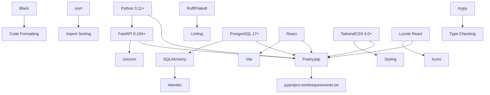
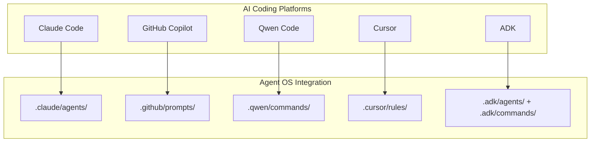
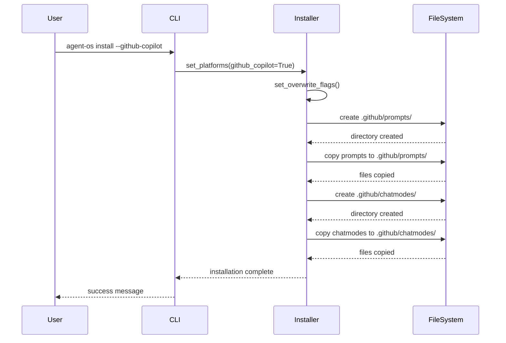
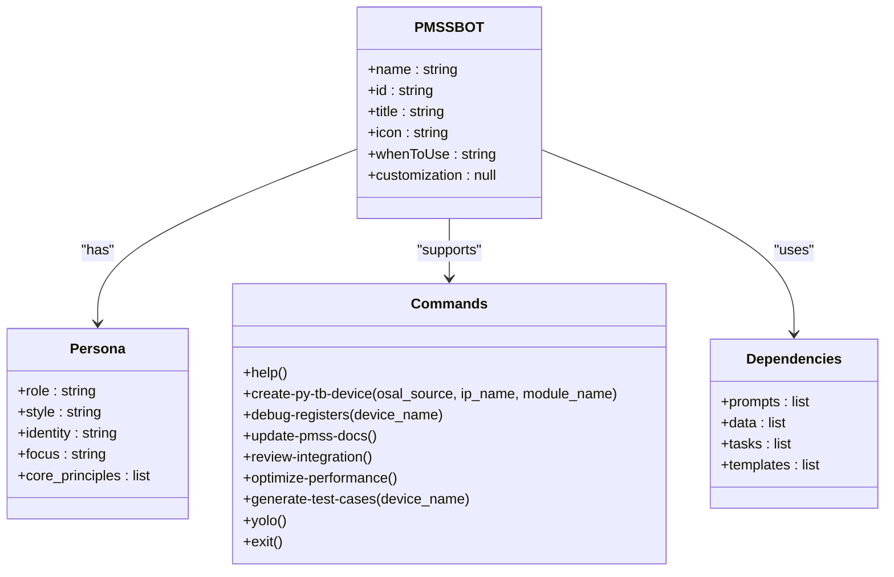

# Technology Stack Recommendations

<cite>
**Referenced Files in This Document**   
- [tech-stack.md](file://standards/tech-stack.md)
- [cli.py](file://src/cli.py)
- [installer.py](file://src/installer.py)
- [pyproject.toml](file://pyproject.toml)
- [pmssbot.yml](file://pmssbot/pmssbot.yml)
- [install-pmssbot.sh](file://pmssbot/install-pmssbot.sh)
- [pmssbot.chatmode.md](file://pmssbot/github-copilot/chatmodes/pmssbot.chatmode.md)
- [create-py-tb-dev.prompt.md](file://pmssbot/github-copilot/prompts/create-py-tb-dev.prompt.md)
- [create-py-tb-device.md](file://pmssbot/commands/create-py-tb-device.md)
</cite>

## Table of Contents
1. [Introduction](#introduction)
2. [Core Technology Stack](#core-technology-stack)
3. [Platform-Specific Integrations](#platform-specific-integrations)
4. [Implementation in Workflows](#implementation-in-workflows)
5. [Integration with AI Coding Assistants](#integration-with-ai-coding-assistants)
6. [Dependency Management and Conflicts](#dependency-management-and-conflicts)
7. [Performance Considerations](#performance-considerations)
8. [Extending the Stack for Specialized Use Cases](#extending-the-stack-for-specialized-use-cases)
9. [Conclusion](#conclusion)

## Introduction
The Agent OS technology stack is designed to support a wide range of AI-assisted development workflows across multiple platforms including Claude Code, GitHub Copilot, Qwen Code, and Cursor. The stack emphasizes consistency, maintainability, and seamless integration with AI coding assistants. This document details the recommended frameworks, libraries, and tools specified in the tech-stack.md file, explaining the rationale behind each choice and demonstrating how they are implemented in actual development workflows. The stack is designed to be extensible for specialized use cases such as PMSSBOT development while maintaining compatibility across different project types and development contexts.

**Section sources**
- [tech-stack.md](file://standards/tech-stack.md#L1-L42)

## Core Technology Stack

The core technology stack for Agent OS projects is defined in tech-stack.md and includes Python 3.11+ as the primary language, FastAPI 0.104+ as the web framework, and Uvicorn as the ASGI server. The stack uses Poetry or pip as the package manager with pyproject.toml or requirements.txt for dependency management. Code quality is maintained through Black for formatting, isort for import sorting, Ruff/Flake8 for linting, and mypy for type checking. For data persistence, PostgreSQL 17+ is the primary database with SQLAlchemy as the ORM and Alembic for database migrations. The frontend stack includes React with Vite as the build tool, TailwindCSS 4.0+ for styling, and Lucide React components for icons. The stack is designed to be modern, well-supported, and compatible with AI coding assistants.

**Diagram sources**
- [tech-stack.md](file://standards/tech-stack.md#L1-L42)

**Section sources**
- [tech-stack.md](file://standards/tech-stack.md#L1-L42)

## Platform-Specific Integrations

Agent OS supports multiple AI coding platforms through platform-specific templates and configurations. The stack integrates with Claude Code through agent templates in claude-code/agents/, GitHub Copilot through prompt templates in github-copilot/prompts/, and Qwen Code through command templates in qwen-code/commands/. Each platform has its own directory structure and configuration files that are installed when the corresponding platform flag is enabled in the CLI. The ADK (Agent Development Kit) platform is supported through commands and agents in adk/commands/ and adk/agents/. These platform-specific integrations allow developers to leverage the strengths of each AI coding assistant while maintaining a consistent development workflow across projects.

**Diagram sources**
- [cli.py](file://src/cli.py#L45-L75)
- [installer.py](file://src/installer.py#L85-L115)

**Section sources**
- [cli.py](file://src/cli.py#L45-L75)
- [installer.py](file://src/installer.py#L85-L115)

## Implementation in Workflows

The technology stack is implemented in workflows through the AgentOsInstaller class in src/installer.py, which copies files from the local repository to the target project directory based on the selected platforms. The CLI in src/cli.py provides commands to install Agent OS with specific platform support, check installation status, and display available platforms. The installation process creates platform-specific directories and copies the necessary files, ensuring that each project has the appropriate configuration for the selected AI coding assistants. The stack is also used in the PMSSBOT development workflow, where the install-pmssbot.sh script sets up GitHub Copilot integration files in .github/prompts/ and .github/chatmodes/ for PMSS development tasks.

**Diagram sources**
- [cli.py](file://src/cli.py#L45-L75)
- [installer.py](file://src/installer.py#L117-L150)
- [install-pmssbot.sh](file://pmssbot/install-pmssbot.sh#L150-L200)

**Section sources**
- [cli.py](file://src/cli.py#L45-L75)
- [installer.py](file://src/installer.py#L117-L150)
- [install-pmssbot.sh](file://pmssbot/install-pmssbot.sh#L150-L200)

## Integration with AI Coding Assistants

The technology stack integrates with AI coding assistants through platform-specific templates and configurations that provide context and guidance for development tasks. For GitHub Copilot, the integration includes prompt templates in .github/prompts/ and chatmode files in .github/chatmodes/ that define the agent's persona and capabilities. The pmssbot.chatmode.md file defines the PMSS Development Engineer persona with specific commands and workflows for creating Python testbench devices and analyzing register structures. The create-py-tb-dev.prompt.md file provides rules for Python testbench device creation, referencing the complete implementation workflow in the instructions directory. These integrations allow AI coding assistants to provide targeted assistance for specific development tasks while maintaining consistency with the overall technology stack.

**Diagram sources**
- [pmssbot.chatmode.md](file://pmssbot/github-copilot/chatmodes/pmssbot.chatmode.md#L1-L90)
- [create-py-tb-dev.prompt.md](file://pmssbot/github-copilot/prompts/create-py-tb-dev.prompt.md#L1-L19)
- [create-py-tb-device.md](file://pmssbot/commands/create-py-tb-device.md#L1-L17)

**Section sources**
- [pmssbot.chatmode.md](file://pmssbot/github-copilot/chatmodes/pmssbot.chatmode.md#L1-L90)
- [create-py-tb-dev.prompt.md](file://pmssbot/github-copilot/prompts/create-py-tb-dev.prompt.md#L1-L19)
- [create-py-tb-device.md](file://pmssbot/commands/create-py-tb-device.md#L1-L17)

## Dependency Management and Conflicts

The technology stack uses Poetry or pip for dependency management, with pyproject.toml or requirements.txt specifying the project dependencies. The pyproject.toml file includes dependencies for the core functionality, development tools, and testing frameworks. The stack is designed to minimize dependency conflicts by using well-maintained, widely-supported libraries with clear version requirements. When conflicts do occur, they can be resolved by updating to compatible versions, using virtual environments to isolate dependencies, or modifying the dependency tree to remove conflicting packages. The installation process in src/installer.py handles platform-specific dependencies by only installing the necessary files for the selected platforms, reducing the risk of conflicts.

**Section sources**
- [pyproject.toml](file://pyproject.toml#L1-L122)
- [installer.py](file://src/installer.py#L85-L115)

## Performance Considerations

The technology stack is designed with performance considerations in mind, particularly for resource-constrained environments. The use of FastAPI and Uvicorn provides high-performance ASGI server capabilities, while PostgreSQL 17+ offers improved query performance and resource utilization. The frontend stack with React and Vite enables fast build times and efficient rendering, while TailwindCSS 4.0+ reduces CSS bloat through its utility-first approach. For AI coding assistant integrations, the stack minimizes overhead by using lightweight prompt and command templates that provide context without excessive file size. The installation process is optimized to only copy necessary files, reducing disk usage and improving installation speed.

**Section sources**
- [tech-stack.md](file://standards/tech-stack.md#L1-L42)
- [installer.py](file://src/installer.py#L117-L150)

## Extending the Stack for Specialized Use Cases

The technology stack can be extended for specialized use cases like PMSSBOT development by adding platform-specific configurations and templates. The PMSSBOT implementation demonstrates this extensibility through its self-contained directory structure that includes commands, instructions, and AI coding assistant integrations tailored to PMSS development tasks. The install-pmssbot.sh script allows for flexible installation options, including GitHub Copilot integration and file overwrite capabilities. The stack can be further extended by adding new platform templates, modifying existing configurations, or incorporating additional tools and libraries as needed for specific project requirements. This extensibility ensures that the technology stack can adapt to evolving development needs while maintaining consistency across projects.

**Section sources**
- [install-pmssbot.sh](file://pmssbot/install-pmssbot.sh#L1-L296)
- [pmssbot.yml](file://pmssbot/pmssbot.yml#L1-L10)
- [pmssbot/README.md](file://pmssbot/README.md#L1-L200)

## Conclusion
The Agent OS technology stack provides a comprehensive, well-structured foundation for AI-assisted development workflows across multiple platforms. By standardizing on modern, well-supported tools and frameworks, the stack ensures consistency, maintainability, and compatibility with AI coding assistants. The platform-specific integrations for Claude Code, GitHub Copilot, Qwen Code, and Cursor enable developers to leverage the strengths of each assistant while maintaining a unified development experience. The stack's extensibility is demonstrated by the PMSSBOT implementation, which adds specialized configurations for PMSS development tasks. With careful attention to dependency management, performance, and usability, the technology stack provides a robust foundation for efficient, high-quality software development in AI-assisted environments.