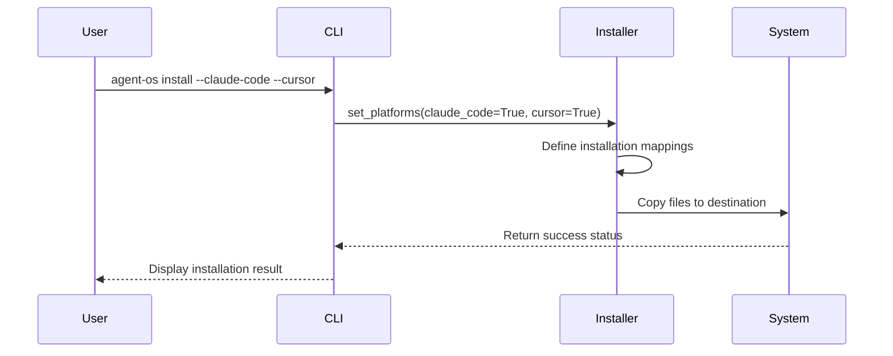
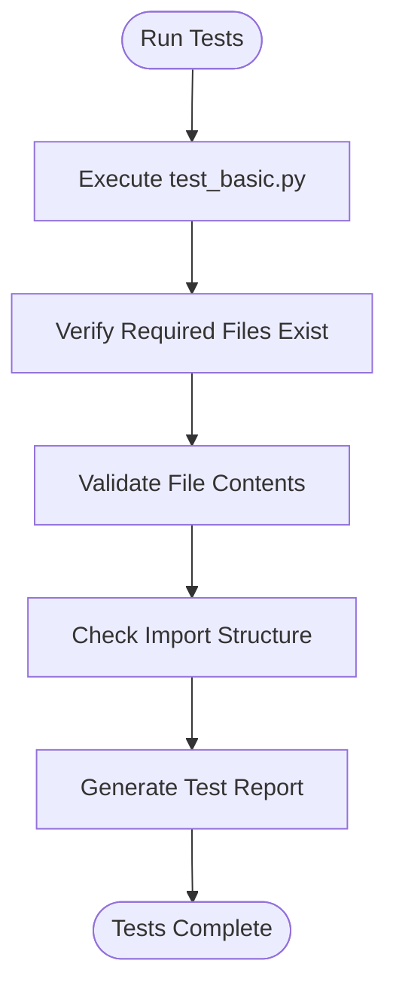

# Troubleshooting

<cite>
**Referenced Files in This Document**   
- [src/cli.py](file://src/cli.py)
- [src/installer.py](file://src/installer.py)
- [run_tests.py](file://run_tests.py)
- [tests/test_basic.py](file://tests/test_basic.py)
- [tests/test_installer.py](file://tests/test_installer.py)
- [config.yml](file://config.yml)
- [INSTALL.md](file://INSTALL.md)
</cite>

## Table of Contents
1. [Common Installation Issues](#common-installation-issues)
2. [Configuration and YAML Errors](#configuration-and-yaml-errors)
3. [Platform Integration Problems](#platform-integration-problems)
4. [Permission and Path Issues](#permission-and-path-issues)
5. [Using Diagnostic Tools](#using-diagnostic-tools)
6. [Performance Troubleshooting](#performance-troubleshooting)
7. [Platform-Specific Troubleshooting](#platform-specific-troubleshooting)
8. [Support Resources](#support-resources)

## Common Installation Issues

### Failed Template Copying
When Agent OS fails to copy templates during installation, it typically results in warnings like "Warning: Source directory not found" or "Warning: Source file not found" in the output. This occurs when the installer cannot locate required source files in the package directory.

The `AgentOsInstaller.install()` method in `src/installer.py` performs file copying operations and checks for source file existence before copying. If source files are missing, verify your installation source integrity.

**Section sources**
- [src/installer.py](file://src/installer.py#L63-L151)

### Installation Fails with No Error Message
If the installation process terminates without clear error messages, check:
1. Python version compatibility (requires Python 3.8+)
2. Package installation method (pip vs. manual)
3. Network connectivity if installing from remote sources

The CLI entry point in `src/cli.py` handles exceptions and should display error messages. If no errors appear, the issue may occur before the CLI initializes.

**Section sources**
- [src/cli.py](file://src/cli.py#L0-L187)

## Configuration and YAML Errors

### YAML Syntax Issues in config.yml
The `config.yml` file must maintain proper YAML syntax. Common issues include:
- Incorrect indentation (YAML is indentation-sensitive)
- Missing colons after keys
- Improper quoting of string values
- Invalid boolean values (use `true`/`false`, not `True`/`False`)

The current configuration in `config.yml` shows proper syntax with correct indentation and boolean formatting. If configuration loading fails, validate the YAML structure using online YAML validators or YAML linters.

**Section sources**
- [config.yml](file://config.yml#L0-L31)

### Configuration Parsing Failures
While the current implementation doesn't show explicit configuration parsing code, ensure that:
1. The `config.yml` file is located in the expected directory (`.agent-os/`)
2. File permissions allow reading
3. The file encoding is UTF-8
4. No BOM (Byte Order Mark) is present at the beginning of the file

## Platform Integration Problems

### Missing Platform Integrations
When specific platforms fail to install, verify:
1. Correct flag usage in the install command
2. Proper platform name syntax (use `--claude-code`, not `--claude`)
3. Sufficient permissions to create hidden directories (`.claude`, `.cursor`, etc.)

The `AgentOsInstaller.set_platforms()` method in `src/installer.py` processes platform flags and enables corresponding installation paths. If a platform isn't installing, ensure the correct flag is being passed to the CLI.



**Diagram sources**
- [src/cli.py](file://src/cli.py#L0-L187)
- [src/installer.py](file://src/installer.py#L38-L46)

## Permission and Path Issues

### Permission Denied Errors
Permission issues commonly occur when:
1. Installing in system-protected directories
2. User lacks write permissions to the target project directory
3. Antivirus software blocks file operations

Solutions:
- Run the command in a user-writable directory
- Use virtual environments when possible
- Temporarily disable antivirus real-time scanning during installation
- On Unix-like systems, avoid using `sudo` with pip unless necessary

### Path Resolution Problems
Path issues may manifest as "File not found" errors even when files exist. This can happen due to:
- Relative path vs. absolute path confusion
- Case sensitivity in file paths (especially on Linux/macOS)
- Spaces or special characters in directory names

The installer uses `Path(project_dir).resolve()` in `src/cli.py` to handle path resolution, which should mitigate most path-related issues.

**Section sources**
- [src/cli.py](file://src/cli.py#L0-L187)

## Using Diagnostic Tools

### Running Integrity Tests with run_tests.py
The `run_tests.py` script provides a quick way to verify installation integrity:

```bash
python run_tests.py
```

This script runs all tests in the `tests/` directory and reports results. A successful test run indicates that the core package structure is intact.

The test runner executes `test_basic.py` and other test files, checking for:
- Required file presence
- Expected file contents
- Import structure validity



**Diagram sources**
- [run_tests.py](file://run_tests.py#L0-L36)
- [tests/test_basic.py](file://tests/test_basic.py#L0-L160)

### Interpreting test_basic.py Results
The `test_basic.py` script performs fundamental checks:

1. **Package Structure Test**: Verifies existence of `__init__.py`, `installer.py`, and `cli.py`
2. **Setup Files Test**: Checks for `pyproject.toml` and `MANIFEST.in`
3. **File Contents Test**: Validates `pyproject.toml` contains expected package metadata
4. **Import Structure Test**: Confirms key components are properly defined

Failed tests indicate potential installation corruption or incomplete package installation.

**Section sources**
- [tests/test_basic.py](file://tests/test_basic.py#L0-L160)

### Analyzing test_installer.py Output
The `test_installer.py` script focuses on installer functionality:

1. **Installer Initialization**: Tests that `AgentOsInstaller` initializes with correct default values
2. **Flag Setting**: Verifies `set_platforms()` and `set_overwrite_flags()` work correctly
3. **Package Structure**: Confirms required files exist in the installed package

These tests help identify issues with the installer's internal state and configuration.

**Section sources**
- [tests/test_installer.py](file://tests/test_installer.py#L0-L118)

### Interpreting Error Messages
#### From src/installer.py
- "Source directory not found": The installer cannot locate template directories
- "Source file not found": Required configuration files are missing
- These typically indicate incomplete package installation

#### From src/cli.py
- "Error: [message]": Unhandled exceptions during CLI execution
- "Unexpected error: [message]": Critical failures in the main execution loop
- These suggest issues with environment setup or runtime dependencies

Enable verbose output by modifying the console configuration in the source files to get more detailed error information.

**Section sources**
- [src/cli.py](file://src/cli.py#L0-L187)
- [src/installer.py](file://src/installer.py#L63-L151)

## Performance Troubleshooting

### Slow Installation Performance
If installations are taking longer than expected:

1. **Check Network Speed**: If installing from remote sources, network latency affects performance
2. **Antivirus Scanning**: Real-time antivirus scanning can significantly slow file operations
3. **Disk Performance**: Slow storage devices impact file copying speed
4. **Large Project Directories**: Installing in directories with many files may slow path resolution

The installer uses `rich.progress` to display progress, which can help identify bottlenecks in the installation process.

### Command Execution Delays
Slow CLI response times may be caused by:
- Python startup overhead
- Module import delays
- Path resolution in large directory trees

Consider using the installed package rather than development mode for better performance.

## Platform-Specific Troubleshooting

### Claude Code Integration Issues
Ensure:
- `.claude/agents/` directory is created
- Agent template files are properly copied
- File permissions allow read access

### Cursor Integration Problems
Verify:
- `.cursor/rules/` directory exists
- Command files are present and readable
- Cursor IDE can access the rules directory

### GitHub Copilot Integration Errors
Check:
- `.github/prompts/` directory is created
- Prompt template files have `.prompt.md` extension
- GitHub Copilot can access the prompts directory

### Qwen Code Integration Failures
Confirm:
- `.qwen/commands/` directory exists
- Command template files are properly formatted
- Qwen Code can reference the command files

Each platform integration follows the same pattern in `AgentOsInstaller.install()`, where specific source paths are mapped to destination paths in the project directory.

**Section sources**
- [src/installer.py](file://src/installer.py#L63-L151)

## Support Resources

For additional help:
1. Review the comprehensive installation guide in [INSTALL.md](file://INSTALL.md)
2. Check the [GitHub Issues](https://github.com/fenghaitao/agent-os/issues) for known problems
3. Verify requirements: Python 3.8+, pip, and Git
4. Ensure you're installing in a valid project directory (not a bare repository)

The documentation provides usage examples and troubleshooting tips for common scenarios.

**Section sources**
- [INSTALL.md](file://INSTALL.md#L0-L154)