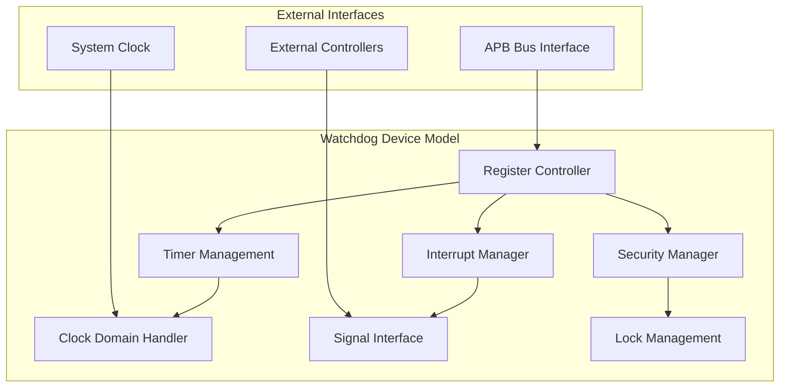

# Simics Watchdog Device Model - Implementation Guide

## Overview

This document provides comprehensive guidance for implementing, integrating, and using the Simics Watchdog Device Model. The watchdog device provides system monitoring and failsafe operations for virtual platforms with progressive escalation from interrupt notification to system reset.

## Table of Contents

1. [Architecture Overview](#architecture-overview)
2. [Implementation Details](#implementation-details)
3. [Platform Integration](#platform-integration)
4. [Usage Examples](#usage-examples)
5. [API Reference](#api-reference)
6. [Testing Guide](#testing-guide)
7. [Troubleshooting](#troubleshooting)
8. [Performance Considerations](#performance-considerations)

## Architecture Overview

### Component Architecture

The watchdog device consists of four main components:



### Key Features

- **32-bit Down Counter**: Configurable countdown timer with reload capability
- **Clock Frequency Division**: Support for frequencies from 1 GHz to 62.5 MHz
- **Progressive Escalation**: Interrupt → Reset escalation on timeout
- **Security Lock**: Hardware write protection mechanism
- **Integration Testing**: Direct signal control for validation
- **Multi-platform Support**: QSP, SPR, GNR platform configurations

## Implementation Details

### DML 1.4 Structure

The device is implemented using Simics Device Modeling Language (DML) 1.4 with the following structure:

```
watchdog.dml
├── Device Parameters
├── Configuration Attributes
├── Session Variables
├── Signal Interfaces
├── Register Bank (regs)
│   ├── Core Timer Registers
│   ├── Status Registers
│   ├── Security Registers
│   ├── Test Registers
│   └── Identification Registers
├── Event Handlers
└── Register Access Methods
```

### Register Bank Implementation

The device implements a comprehensive register bank organized into functional groups:

| Address Range | Register Group | Purpose |
|---------------|----------------|---------|
| 0x000-0x014 | Core Registers | Timer control and status |
| 0xC00 | Security Register | Write access protection |
| 0xF00-0xF04 | Test Registers | Integration testing |
| 0xFD0-0xFEC | Peripheral ID | Device identification |
| 0xFF0-0xFFC | PrimeCell ID | Component identification |

### Timer Management Logic

The timer implements a sophisticated countdown mechanism:

1. **Load Phase**: Counter loads from WDOGLOAD when timer starts
2. **Countdown Phase**: Counter decrements by step_divisor each cycle
3. **Timeout Detection**: Counter reaches zero triggers first timeout
4. **Interrupt Phase**: Raw interrupt asserted, counter reloads
5. **Escalation Phase**: Second timeout triggers reset if RESEN enabled

### Clock Domain Translation

The device supports different operating frequencies through step_value configuration:

```c
switch (step_value) {
    case 0: step_divisor = 1;    // 1 GHz
    case 1: step_divisor = 2;    // 500 MHz  
    case 2: step_divisor = 4;    // 250 MHz
    case 3: step_divisor = 8;    // 125 MHz
    case 4: step_divisor = 16;   // 62.5 MHz
}
```

## Platform Integration

### QSP (Quick Start Platform) Integration

For embedded systems requiring moderate timing precision:

```simics
# Load QSP integration
run-command-file "platforms/qsp-integration.simics"

# Basic configuration
system.watchdog.regs.WDOGLOCK = 0x1ACCE551  # Unlock
system.watchdog.regs.WDOGLOAD = 0x2FAF080   # 30 seconds
system.watchdog.regs.WDOGCONTROL = 0x0B     # 250MHz, interrupt+reset
```

### SPR (Sapphire Rapids) Integration

For server platforms requiring high reliability:

```simics
# Load SPR integration
run-command-file "platforms/spr-integration.simics"

# Server configuration
system.watchdog.regs.WDOGLOCK = 0x1ACCE551  # Unlock
system.watchdog.regs.WDOGLOAD = 0x5F5E100   # 5 minutes
system.watchdog.regs.WDOGCONTROL = 0x03     # 1GHz, interrupt+reset
```

### GNR (Granite Rapids) Integration

For next-generation platforms with redundancy:

```simics
# Load GNR integration with redundancy
run-command-file "platforms/gnr-integration.simics"

# Configure primary watchdog
system.watchdog.regs.WDOGLOCK = 0x1ACCE551
system.watchdog.regs.WDOGLOAD = 0x1C9C380    # 2 minutes
system.watchdog.regs.WDOGCONTROL = 0x03

# Configure backup watchdog
system.watchdog_backup.regs.WDOGLOCK = 0x1ACCE551
system.watchdog_backup.regs.WDOGLOAD = 0x2FAF080  # 5 minutes
system.watchdog_backup.regs.WDOGCONTROL = 0x07    # Slower frequency
```

## Usage Examples

### Basic Watchdog Configuration

```simics
# 1. Unlock the device
system.watchdog.regs.WDOGLOCK = 0x1ACCE551

# 2. Set timeout value (1 second at 1 MHz)
system.watchdog.regs.WDOGLOAD = 0x186A0

# 3. Enable interrupt only (no reset for testing)
system.watchdog.regs.WDOGCONTROL = 0x1

# 4. Monitor status
echo "Counter: " + system.watchdog.regs.WDOGVALUE
echo "Raw Interrupt: " + system.watchdog.regs.WDOGRIS
echo "Masked Interrupt: " + system.watchdog.regs.WDOGMIS
```

### Production Watchdog Configuration

```simics
# Production setup with full escalation
system.watchdog.regs.WDOGLOCK = 0x1ACCE551   # Unlock
system.watchdog.regs.WDOGLOAD = 0x5F5E100    # 5 minutes at 1 MHz
system.watchdog.regs.WDOGCONTROL = 0x3       # Enable interrupt and reset

# Set up interrupt handling
script %{
def watchdog_interrupt_handler():
    print("Watchdog interrupt! System requires attention.")
    # Clear interrupt to prevent reset
    system.watchdog.regs.WDOGINTCLR = 0x1
    print("Watchdog interrupt cleared, timer reloaded.")

# Connect to interrupt signal (platform-specific)
# system.watchdog.wdogint.connect(watchdog_interrupt_handler)
%}
```

### Integration Testing

```simics
# Enable integration test mode
system.watchdog.regs.WDOGLOCK = 0x1ACCE551
system.watchdog.regs.WDOGITCR = 0x1

# Test interrupt signal
system.watchdog.regs.WDOGITOP = 0x2  # Assert interrupt
echo "Interrupt signal state: " + system.watchdog.wdogint

# Test reset signal
system.watchdog.regs.WDOGITOP = 0x1  # Assert reset
echo "Reset signal state: " + system.watchdog.wdogreset

# Disable test mode
system.watchdog.regs.WDOGITCR = 0x0
```

### Frequency Configuration Examples

```simics
# High-performance server (1 GHz)
system.watchdog.regs.WDOGCONTROL = 0x03  # step_value=0, INTEN=1, RESEN=1

# Standard server (500 MHz)
system.watchdog.regs.WDOGCONTROL = 0x07  # step_value=1, INTEN=1, RESEN=1

# Embedded system (250 MHz)
system.watchdog.regs.WDOGCONTROL = 0x0B  # step_value=2, INTEN=1, RESEN=1

# Low-power mode (125 MHz)
system.watchdog.regs.WDOGCONTROL = 0x0F  # step_value=3, INTEN=1, RESEN=1
```

## API Reference

### Register Interface

#### WDOGLOAD (0x000) - Timer Load Register
- **Access**: Read/Write
- **Reset**: 0xFFFFFFFF
- **Purpose**: Set timer reload value in watchdog cycles

```simics
# Set 30-second timeout at 1 MHz
system.watchdog.regs.WDOGLOAD = 0x1C9C380
```

#### WDOGVALUE (0x004) - Current Counter Value
- **Access**: Read-only
- **Purpose**: Read current counter value

```simics
current_value = system.watchdog.regs.WDOGVALUE
echo "Time remaining: " + current_value + " cycles"
```

#### WDOGCONTROL (0x008) - Control Register
- **Access**: Read/Write
- **Fields**:
  - Bits [4:2]: step_value (clock division)
  - Bit [1]: RESEN (reset enable)
  - Bit [0]: INTEN (interrupt enable and timer start)

```simics
# Enable with 250MHz frequency and full escalation
system.watchdog.regs.WDOGCONTROL = 0x0B
```

#### WDOGINTCLR (0x00C) - Interrupt Clear
- **Access**: Write-only
- **Purpose**: Clear interrupt and reload counter

```simics
# Clear any pending interrupt
system.watchdog.regs.WDOGINTCLR = 0x1
```

### Signal Interface

#### wdogint Signal
- **Type**: Output signal
- **Purpose**: Interrupt notification
- **Behavior**: Level-triggered, active high

#### wdogreset Signal
- **Type**: Output signal  
- **Purpose**: Reset escalation
- **Behavior**: Level-triggered, active high

### Configuration Attributes

#### sys_mhz
- **Type**: Integer
- **Default**: 1000
- **Purpose**: System frequency in MHz for clock translation

#### debug_enabled
- **Type**: Boolean
- **Default**: false
- **Purpose**: Enable debug output and logging

## Testing Guide

### Unit Testing

Run the comprehensive unit test suite:

```bash
cd simics/devices/watchdog/tests
python test_watchdog_unit.py
```

Test categories included:
- Register access validation
- Security mechanism testing
- Timer functionality testing
- Interrupt system testing
- Error condition testing

### Integration Testing

Run integration tests for platform compatibility:

```bash
python test_watchdog_integration.py
```

Integration test categories:
- Platform integration tests
- Signal interface tests
- Multi-device interaction tests
- Performance tests
- Stress tests

### Manual Testing

Basic functionality test:

```simics
# 1. Load device module
load-module watchdog-device

# 2. Create device instance
new-watchdog-device name = test_watchdog

# 3. Configure basic test
test_watchdog.regs.WDOGLOCK = 0x1ACCE551
test_watchdog.regs.WDOGLOAD = 0x186A0     # 1 second
test_watchdog.regs.WDOGCONTROL = 0x1      # Interrupt only

# 4. Monitor for timeout
echo "Monitoring watchdog for 2 seconds..."
```

## Troubleshooting

### Common Issues

#### Device Not Responding
**Symptoms**: Writes to registers appear to have no effect
**Cause**: Device is locked
**Solution**: Unlock with magic value
```simics
system.watchdog.regs.WDOGLOCK = 0x1ACCE551
```

#### Timer Not Starting
**Symptoms**: WDOGVALUE doesn't decrement
**Cause**: INTEN bit not set or device locked
**Solution**: 
```simics
# Ensure device is unlocked and INTEN is set
system.watchdog.regs.WDOGLOCK = 0x1ACCE551
system.watchdog.regs.WDOGCONTROL = 0x1
```

#### Interrupt Not Generated
**Symptoms**: No interrupt signal on timeout
**Cause**: Interrupt not enabled or signal not connected
**Solution**:
```simics
# Check INTEN bit and signal connection
control = system.watchdog.regs.WDOGCONTROL
echo "INTEN bit: " + (control & 0x1)
echo "Interrupt status: " + system.watchdog.regs.WDOGMIS
```

#### Unexpected Reset
**Symptoms**: System resets unexpectedly
**Cause**: RESEN enabled and double timeout occurred
**Solution**:
```simics
# Disable reset or handle interrupts promptly
system.watchdog.regs.WDOGCONTROL = 0x1  # Interrupt only
```

### Debug Techniques

#### Enable Debug Logging
```simics
system.watchdog.debug_enabled = true
```

#### Monitor Register State
```simics
script %{
def watchdog_status():
    wdt = system.watchdog
    print(f"WDOGLOAD: 0x{wdt.regs.WDOGLOAD:08x}")
    print(f"WDOGVALUE: 0x{wdt.regs.WDOGVALUE:08x}")
    print(f"WDOGCONTROL: 0x{wdt.regs.WDOGCONTROL:08x}")
    print(f"WDOGRIS: 0x{wdt.regs.WDOGRIS:08x}")
    print(f"WDOGMIS: 0x{wdt.regs.WDOGMIS:08x}")
    print(f"Device locked: {wdt.regs.WDOGLOCK & 1}")

# Call watchdog_status() to check state
%}
```

#### Signal Monitoring
```simics
script %{
def monitor_signals():
    print(f"Interrupt signal: {system.watchdog.wdogint}")
    print(f"Reset signal: {system.watchdog.wdogreset}")
%}
```

### Performance Optimization

#### Recommended Configurations

**For Development/Testing**:
- Enable debug logging
- Use interrupt-only mode (RESEN=0)
- Shorter timeouts for faster testing

**For Production**:
- Disable debug logging
- Enable full escalation (RESEN=1)  
- Appropriate timeouts for use case

#### Platform-Specific Optimization

**QSP Platform**:
- Use step_value=2 (250 MHz) for balance of precision and performance
- Timeout range: 10 seconds to 5 minutes

**SPR Platform**:
- Use step_value=0 (1 GHz) for maximum precision
- Timeout range: 2 minutes to 10 minutes

**GNR Platform**:
- Use redundant watchdogs for critical applications
- Stagger timeout values for layered protection

## Conclusion

The Simics Watchdog Device Model provides a comprehensive and flexible solution for system monitoring in virtual platforms. By following this implementation guide, developers can successfully integrate and utilize the watchdog device across different platform configurations while maintaining reliability and performance standards.

For additional support or questions, refer to the comprehensive test suites provided or consult the device specification document.